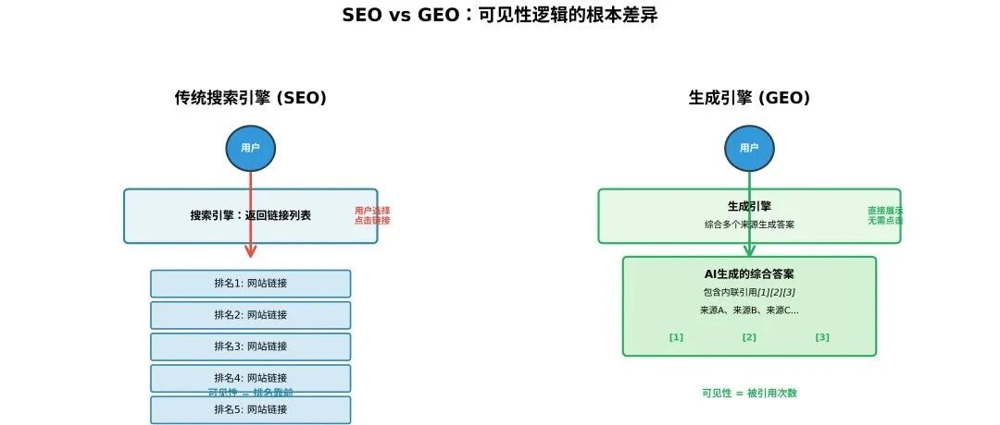
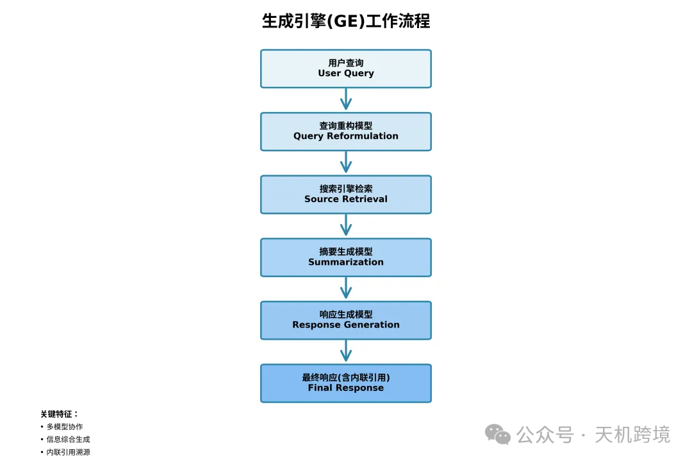
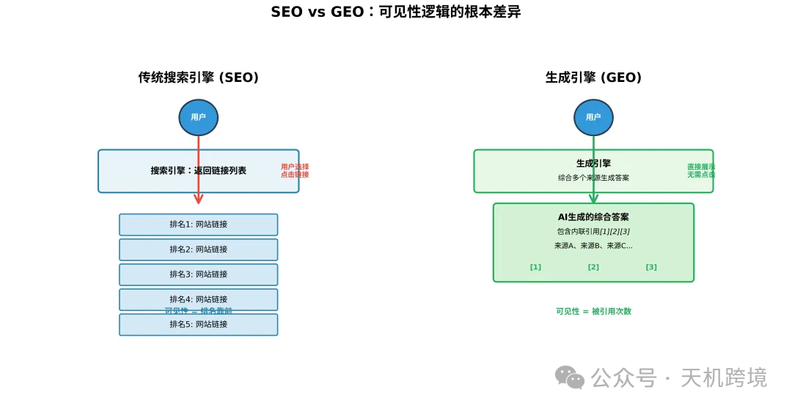
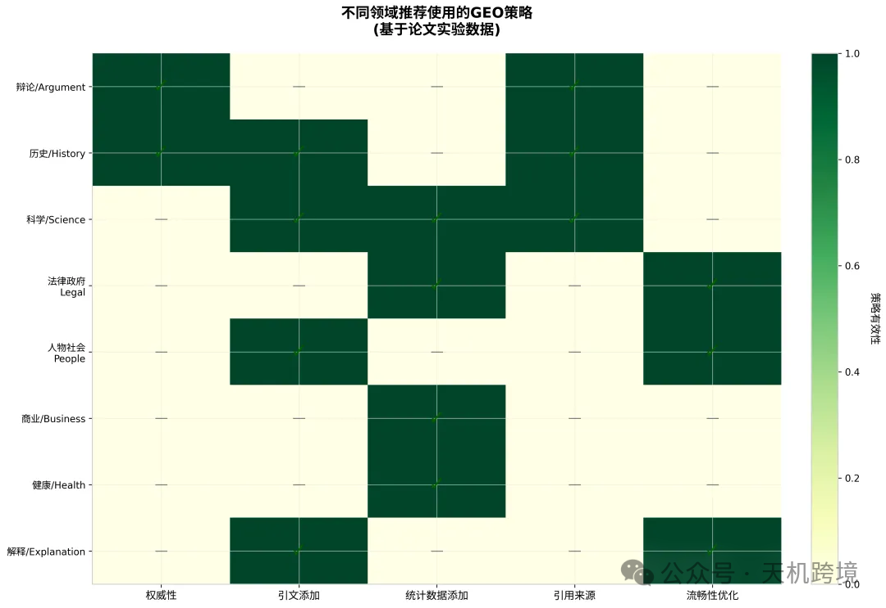

# 未来的思考

> Source: wechat
> Author: 天机跨境
> Original: https://mp.weixin.qq.com/s/mOS51YY1dYBRhNeiDWUS3g

---

---

个人IP  Rufus深度研究  GEO战略化

针对亚马逊的一些最新的研究和学习（后期陆续更新），思路整理和落地

 亚马逊最新功能分析（Rufus，prompt广告， benchmark基准 ）GEO战略化研究，以及模版飞书&Excel在线表格，业务流程SOP,运营和选品， AI想法 和， 未来的设想规划，OSaaS xflow OS OPaaS  SOP OP操作系统

未来10-20年坚持品牌出海路线做品牌本地化，落地生根， 品牌落地，品牌本地化营销策划解决方案，    AI+电商  AI+品牌，品牌使命

品牌营销 本地化落地

**内容生产流程重构：** 所有面向海外的内容，都应该经过新的GEO优化：检查是否有数据支撑、是否有权威引用、是否流畅易读。

**实时监测生成引擎表现：** 需要建立新的监测体系，不只是监测关键词排名，还要监测在生成引擎中的引用率和可见性。

**GEO与产品策略结合：** GEO不是营销部门的独立工作，而应该和产品策略结合。产品的数据、特性、用户案例，都应该按照GEO的逻辑来组织和呈现：用户获取信息的方式变了。他们不再只点击搜索结果，而是越来越多地直接阅读AI生成的答案。

GEO 正  反 正面推过去，我们怎么利用GEO,运用他，后面收敛回来，监测数据，

还有组合策略

①权威性，②引文添加，③统计数据添加，④引用来源，⑤流畅性优化⑥关键词填充

不同GEO方法对可见性 或引用率的影响 基于位置调整词数指标

注意无效的方法

关键词填充堆砌：传统SEO的核心手段，在GEO中几乎没有效果，甚至会降低可见性。

这个结果让我震惊：我们一直依赖的优化手段，在新范式下不仅无效，还可能有害。

品牌在做内容优化时，应该同时优化多个维度，而不是只关注单一技巧。真实世界的验证：

不同领域推荐使用的GEO策略：

领域特异性：GEO策略要因地制宜更细的研究发现，不同的GEO方法在不同领域效果差异很大。这意味着，品牌在做海外内容营销时，需要根据目标市场的查询类型，选择不同的GEO策略.

统计数据添加  在亚马逊运营至关重要

GEO战略化

引擎表现：需要建立新的监测体系，不只是监测关键词排名，还要监测在生成引擎中的引用率和可见性。

GEO与产品策略结合：GEO不是营销部门的独立工作，而应该和产品策略结合。产品的数据、特性、用户案例，都应该按照GEO的逻辑来组织和呈现，答案是：用户获取信息的方式变了。他们不再只点击搜索结果，而是越来越多地直接阅读AI生成的答案。

GEO 正  反 正面推过去，我们怎么利用GEO,运用他，后面收敛回来，监测数据，

还有组合策略

①权威性，②引文添加，③统计数据添加，④引用来源，⑤流畅性优化⑥关键词填充

不同GEO方法对可见性 或引用率的影响 基于位置调整词数指标

注意无效的方法

关键词填充堆砌：传统SEO的核心手段，在GEO中几乎没有效果，甚至会降低可见性。

这个结果让我震惊：我们一直依赖的优化手段，在新范式下不仅无效，还可能有害。

品牌在做内容优化时，应该同时优化多个维度，而不是只关注单一技巧。真实世界的验证：

不同领域推荐使用的GEO策略：

领域特异性：GEO策略要因地制宜更细的研究发现，不同的GEO方法在不同领域效果差异很大。这意味着，品牌在做海外内容营销时，需要根据目标市场的查询类型，选择不同的GEO策略.

统计数据添加

GEO战略化

https://www.perplexity.ai/

关键特征  多模型协作    信息综合生成   内联引用溯源

生成引起的工作流程是 用户查询，查询重构模型-搜索引擎检索-摘要生成模型-响应生成模型-最终响应 含内联引用

GEO的可见性指标 ，提出几个新的指标

**词数指标**：衡量引用内容在响应中的占比。引用内容越多，可见性越高。

**位置调整词数**：考虑引用出现的位置，越靠前的引用权重越高（基于用户注意力衰减规律）。

**主观展示指标**：从相关性、影响力、独特性，主观位置，主观数量，点击可能性，多样性这七个维度评估引用的主观可见性。

GEO的实战方法论文测试了九种GEO方法，①权威性，②引文添加，③统计数据添加，④引用来源，⑤流畅性优化⑥关键词填充⑦易于理解⑧独特词汇⑨专业术语。

其中表现最好的 GEO 方法是 **③统计数据添加**、**②引语添加** 和 **④引用来源**。这表明，与其堆砌关键词，不如通过增加**数据、引言和来源**来提升内容的可信度和信息密度，这样在生成式搜索中获得推荐的概率最高

**表现优异的三种方法：**

1. **统计数据添加**：在内容中加入具体的定量数据而非定性描述。实测效果：位置调整词数指标提升41%。
2. **引文添加**：添加来自可信来源的直接引文。实测效果：主观展示指标提升28%。
3. **引用来源**：在内容中明确引用可靠来源。实测效果：两种指标均有30%以上提升

这些内容缺乏数据支撑，没有引用来源，也没有权威性引文。所有面向海外的内容，都应该经过GEO优化：检查是否有数据支撑、是否有权威引用、是否流畅易读。

我们的分析表明：a）如果针对目标域名制定优化方法，GEO会更有帮助；b）未来， GEO将更有利于搜索引擎排名较低的网站

没有优化 No Optimization

关键词填充 Keyword Stuffing

独特词汇 Unique Words

易于理解 Easy-to-Understand 易读性

权威性 Authoritative

专业术语 Technical Terms

流畅性优化 Fluency Optimization

引用来源 Cite Sources最佳

引语添加 Quotation Addition最佳

统计数据添加 Statistics Addition最佳     商业business 统计数据添加

论文提出了一套“主观展示指标”（Subjective Impression），利用 LLM（如 GPT-4）从以下七个维度进行评分，以捕捉用户注意力的主观感知

7个维度主观展示指标，包括  主观展示指标：从相关性、影响力、独特性，主观位置，主观数量，点击可能性，多样性 这七个维度评估引用的主观可见性

1. **相关性 (Relevance)**： 评估引用句子与用户查询的关联程度。内容越切题，可见性得分越高。

2. **影响力 (Influence)**： 评估生成式回复在多大程度上依赖该引用。如果回复的核心论点主要基于该来源，其影响力得分越高。

3. **独特性 (Uniqueness)**： 评估该引用所提供材料的独特性。如果该来源提供了其他来源没有的信息，其可见性更高。

4. **主观位置 (Subjective Position)**： 从用户视角评估引用来源在回复中出现的显著程度（例如是否出现在回复的开头或显眼位置）。

5. **主观数量 (Subjective Count)**： 用户感知到的该引用所贡献的内容量。这不同于单纯的字数统计，而是用户感觉该来源贡献了多少实质信息。

6. **点击可能性 (Likelihood of Clicking)**： 用户点击该引用的概率。这通常与引用的吸引力和可信度有关。

7. **多样性 (Diversity)**： 评估引用材料是否丰富了回复的多样性或提供了不同的视角。

二、 GEO 实战的 9 种方法 (GEO Methods) 9种实战方法

论文中测试了针对网站内容的 9 种优化策略，旨在提升内容在生成式引擎中的排名和可见性。这 9 种方法具体如下（包含您缺失的⑦⑧⑨项）：

1. **权威性 (Authoritative)**

◦ **策略**：修改文本风格，使其听起来更具说服力和权威性。

◦ **目的**：迎合生成模型对高质量、可信内容的偏好。

2. **引语添加 (Quotation Addition)**

◦ **策略**：在内容中添加来自可靠来源的相关引语（Quotations）。

◦ **效果**：这是表现最好的策略之一，能显著提升可见性。

3. **统计数据添加 (Statistics Addition)**

◦ **策略**：将定性描述修改为包含具体的定量统计数据。

◦ **效果**：数据驱动的证据能有效增加内容被引用的几率。

4. **引用来源 (Cite Sources)**

◦ **策略**：在内容中添加相关的参考文献和来源引用。

◦ **效果**：通过增加可验证性来提升可信度，显著提升了可见性。

5. **流畅性优化 (Fluency Optimization)**

◦ **策略**：优化网站文本的流畅度，使其更通顺。

◦ **发现**：生成式引擎不仅看重内容，也看重内容的表达质量。

6. **关键词填充 (Keyword Stuffing)**

◦ **策略**：像传统 SEO 那样，在内容中堆砌更多查询相关的关键词。

◦ **结果**：论文发现这种传统 SEO 方法在生成式引擎中**效果不佳**，甚至可能无效。

7. **易于理解 (Easy-to-Understand)**

◦ **策略**：简化网站语言，降低阅读难度，使内容更通俗易懂。

◦ **效果**：提升了内容的易读性，有助于被生成模型采纳。

8. **独特词汇 (Unique Words)**

◦ **策略**：在可能的情况下，增加独特的词汇或表达方式。

◦ **目的**：增加内容的独特性得分。

9. **专业术语 (Technical Terms)**

◦ **策略**：在内容中增加相关的技术术语或专业行话。

◦ **目的**：展示内容的专业深度。

**总结实战建议**： 论文研究显示，表现最好的 GEO 方法是 **③统计数据添加**、**②引语添加** 和 **④引用来源**。这表明，与其堆砌关键词，不如通过增加**数据、引言和来源**来提升内容的可信度和信息密度，这样在生成式搜索中获得推荐的概率最高。

总结

1. 权威性 (Authoritative)
2. 引语添加 (Quotation Addition)
3. 统计数据添加 (Statistics Addition)

4. 引用来源 (Cite Sources)

5. 流畅性优化 (Fluency Optimization)

6. 关键词填充 (Keyword Stuffing)
7. 易于理解 (Easy-to-Understand)

8. 独特词汇 (Unique Words)
9. 专业术语 (Technical Terms)

总结

重点，①组合策略， 重点3个方法，(统计数据添加, 引语添加,  引用来源)，    ② 领域特异性：GEO策略要因地制宜

③以及7个维度主观展示指标，主观展示指标包括  ：从相关性、影响力、独特性，主观位置，主观数量，点击可能性，多样性 这七个维度评估引用的主观可见性

④根据GEO战略优化9个方法，以及主要的指标（7个维度主观展示指标），去做量化分析，做一个模型，计算可见性和引用率，

⑤最后做数据监测，**实时监测生成引擎表现**：需要建立新的监测体系，不只是监测关键词排名，还要监测在生成引擎中的引用率和可见性。

⑥GEO与产品策略结合：GEO不是营销部门的独立工作，而应该和产品策略结合。产品的数据、特性、用户案例，都应该按照GEO的逻辑来组织和呈现。

论文下载：https://arxiv.org/pdf/2311.09735

这是一个非常具有战略意义的系统构想。结合《GEO: Generative Engine Optimization》论文的理论框架与《用Rufus优化逆袭反超Anker》的实战策略，我们可以构建一套\*\*“GEO-Rufus 混合评分系统”\*\*。

这套系统的核心逻辑是：**利用 GEO 论文中的高权重方法建立“基础分”（Base Score），再利用 Rufus 的实战技巧作为“乘数因子”（Multipliers）来放大可见性。**

以下为您详细整理的系统架构，分为评估维度（KPI）和实战量化方法（Action Plan）。

---

## 第一部分：评估引用主观可见性的 7 个维度 (KPI 仪表盘)

在您的系统中，这 7 个维度应作为**输出端的监控指标**。我们利用 LLM（如 GPT-4）模拟 Rufus 或用户的视角，对您的 Listing 进行评分。

**1. 相关性 (Relevance)**

- **定义**

  ：引用内容与用户查询意图的匹配程度。
- **系统量化逻辑**

  ：检测 Listing 标题和五点是否包含 Rufus 偏好的“限制条件”（如“适合小公寓的静音吸尘器”）。内容越切题，得分越高。

**2. 影响力 (Influence)**

- **定义**

  ：生成式回复的核心论点在多大程度上依赖该引用。
- **系统量化逻辑**

  ：如果 Rufus 生成的“推荐语”直接复述了您 Listing 中的痛点解决机制（Mechanism -> Result），则影响力满分。

**3. 独特性 (Uniqueness)**

- **定义**

  ：引用源是否提供了其他来源没有的信息。
- **系统量化逻辑**

  ：检测内容中是否包含竞争对手（如 Anker）未提及的“边界条件”（如“不适合 2015 年以前车型”），这种“自曝其短”在 AI 眼中极具独特性和精准度。

**4. 主观位置 (Subjective Position)**

- **定义**

  ：从用户视角看，引用在回复中出现的显眼程度。
- **系统量化逻辑**

  ：Listing 的核心参数（硬条件）是否前置？如果在 Rufus 回复的第一句就出现品牌或产品名，则得分最高。

**5. 主观数量 (Subjective Count)**

- **定义**

  ：用户感知到的该引用贡献了多少实质信息量。
- **系统量化逻辑**

  ：不同于字数统计，这是对“证据密度”的评估。Listing 是否通过 FAQ 和场景段落提供了足够多的“证据切面”。

**6. 点击可能性 (Likelihood of Clicking)**

- **定义**

  ：用户基于引用的吸引力和可信度点击链接的概率。
- **系统量化逻辑**

  ：这取决于 A+ 图片的 Alt Text（替代文本）和主图的吸引力，因为这是视觉信息的“文本化”入口。

**7. 多样性 (Diversity)**

- **定义**

  ：引用材料是否丰富了回复的视角。
- **系统量化逻辑**

  ：内容是否同时覆盖了“技术术语”（专业视角）和“小白口语”（用户视角）的双重表达。

---

## 第二部分：GEO 实战的 9 种方法量化系统 (执行算法)

根据您的要求，我们将 9 种方法分为**核心加分项（加法模型）和策略乘数项（乘法模型）**。

### 核心模块：三大高权重因子 (总分 90 分)

*论文证实这三者能提升 30%-40% 的可见性。在 Rufus 场景下，它们构成了 AI 信任的“证据库”。*

**1. 统计数据添加 (Statistics Addition) —— 权重 30%**

- **GEO 原理**

  ：将定性描述修改为包含具体的定量统计数据，数据驱动的证据能增加被引用几率。
- **Rufus 实战量化 (30分)**

  ：

- **后台属性 (15分)**

  ：必须填满 Capacity, Wattage, Dimensions 等结构化数据。数据缺失会导致 AI 直接过滤。
- **五点描述数字化 (15分)**

  ：检查五点描述中数字的密度。例如，不写“大容量”，而写“2L 容量”；不写“快充”，而写“30分钟充至 50%”。
- **一致性检查 (扣分项)**

  ：如果图片写 2L，属性写 1.8L，系统直接归零，因为这会导致模型幻觉。

**2. 引语添加 (Quotation Addition) —— 权重 30%**

- **GEO 原理**

  ：添加来自可靠来源的相关引语，这是表现最好的策略之一。
- **Rufus 实战量化 (30分)**

  ：

- **评论挖掘 (15分)**

  ：建立“用户语料表”，提取 Review 中的真实场景描述和痛点原话（如“掉进水里也没事”），埋入 Listing。
- **QA 官方化 (15分)**

  ：将售后高频问题转化为 Q&A，由官方回答。这被视为一种高可信度的“引语”形式。

**3. 引用来源 (Cite Sources) —— 权重 30%**

- **GEO 原理**

  ：添加参考文献和来源引用，增加可验证性。
- **Rufus 实战量化 (30分)**

  ：

- *注：亚马逊 Listing 无法外链，因此“引用来源”转化为“站内权威证据”*

  。
- **对比图表 (15分)**

  ：制作“竞品对比表”或“自家型号对比表”。AI 极擅长读取表格数据作为回答“A 和 B 区别”的证据来源。
- **资质/认证提及 (15分)**

  ：在描述中明确引用具体的安全标准（如“符合 UL 认证”），作为权威来源背书。

---

### 乘数模块：六大辅助策略 (系数修正)

*这些策略不直接产生基础分，但作为系数 $K$ 放大或缩小最终效果。初始系数 $K=1.0$。*

**4. 权威性 (Authoritative)**

- **策略**

  ：修改文本风格，使其听起来更具说服力。
- **Rufus 系数 ($K\_1$)**

  ：设定为 **1.1**。

- **操作**

  ：在 Listing 的 Description 和 A+ 品牌故事中，使用行业专家口吻解释技术原理（Mechanism）。

**5. 引用来源 (Fluency Optimization)**

- **策略**

  ：优化流畅度。
- **Rufus 系数 ($K\_2$)**

  ：设定为 **1.1**。

- **操作**

  ：确保移动端预览的前三行通顺、无乱码。Rufus 偏好结构清晰、逻辑严密的信息。

**6. 易于理解 (Easy-to-Understand)**

- **策略**

  ：简化语言，降低阅读难度。
- **Rufus 系数 ($K\_3$)**

  ：设定为 **1.2**（高优）。

- **操作**

  ：使用“大白话”覆盖“小白问题”。例如，将“IPX7 防水”解释为“洗澡时也能用”。

**7. 独特词汇 (Unique Words)**

- **策略**

  ：增加独特表达。
- **Rufus 系数 ($K\_4$)**

  ：设定为 **1.05**。

- **操作**

  ：在标题或五点中使用特定的“场景限定词”（如“适合露营潮湿环境”），而非通用的“户外使用”。

**8. 专业术语 (Technical Terms)**

- **策略**

  ：增加技术术语。
- **Rufus 系数 ($K\_5$)**

  ：设定为 **1.05**。

- **操作**

  ：与“易于理解”配合使用，形成“双重表达”（技术术语 + 口语解释）。

**9. 关键词填充 (Keyword Stuffing)**

- **策略**

  ：传统 SEO 的堆砌关键词。
- **Rufus 系数 ($K\_6$)**

  ：设定为 **0.5 - 0.8**（惩罚项）。

- **警告**

  ：论文显示此方法效果不佳。Rufus 是基于语义理解的，单纯堆砌关键词会导致信息结构混乱，被 AI 判定为低质量内容，从而降低推荐权重。

---

## 最终系统计算公式

$$ \text{Total GEO Score} = (\text{Statistics} + \text{Quotations} + \text{Sources}) \times (K\_1 \times K\_2 \times K\_3 \times K\_4 \times K\_5 \times K\_6) $$

**逆袭 Anker 的操作示例：** 假设您的 Listing 基础扎实：

- 统计数据（满分30）：属性全填，五点全是数据。
- 引语添加（20分）：做了 QA，但 Review 埋词不够。
- 引用来源（25分）：有对比图。
- **基础分 = 75 分**

  。

**优化系数：**

- 如果不做“易于理解”（$K\_3=1.0$），只堆砌关键词（$K\_6=0.8$），最终得分 $75 \times 0.8 = 60$。
- 如果删掉堆砌词（$K\_6=1.0$），增加“小白口语”解释（$K\_3=1.2$），并优化权威语调（$K\_1=1.1$），最终得分 $75 \times 1.2 \times 1.1 = 99$。

**结论**：这套系统不仅量化了 GEO 的学术指标，更直接指导了如何通过\*\*结构化数据（统计）、用户语料（引语）和 证据链（来源）\*\*来“喂饱” Rufus，从而在 AI 推荐中反超 Anker。

现在根据论文和用Rufus优化逆袭反超安克anker文件，我们需要做一套SOP系统，思路就是把GEO所有影响因素量化，做成一个系统，9种具体方法（其中3个比重较大，引语添加，引用来源，统计数据添加，各占比30%，其他组合策略不要相加数值，用相乘）以下内容分2部分，为您详细整理的评估引用主观可见性的7个维度，以及GEO实战中测试的9种具体方法。一，主观展示指标包括  ：从

相关性、影响力、独特性，主观位置，主观数量，点击可能性，多样性

这七个维度，一、 评估引用主观可见性的 7 个维度 (Subjective Impression Metrics)

为了衡量生成式引擎（Generative Engines, GE）回复中引用来源的可见性，论文提出了一套“主观展示指标”（Subjective Impression），利用 LLM（如 GPT-4）从以下七个维度进行评分，以捕捉用户注意力的主观感知：

1. 相关性 (Relevance)： 评估引用句子与用户查询的关联程度。内容越切题，可见性得分越高。

2. 影响力 (Influence)： 评估生成式回复在多大程度上依赖该引用。如果回复的核心论点主要基于该来源，其影响力得分越高。

3. 独特性 (Uniqueness)： 评估该引用所提供材料的独特性。如果该来源提供了其他来源没有的信息，其可见性更高。

4. 主观位置 (Subjective Position)： 从用户视角评估引用来源在回复中出现的显著程度（例如是否出现在回复的开头或显眼位置）。

5. 主观数量 (Subjective Count)： 用户感知到的该引用所贡献的内容量。这不同于单纯的字数统计，而是用户感觉该来源贡献了多少实质信息。

6. 点击可能性 (Likelihood of Clicking)： 用户点击该引用的概率。这通常与引用的吸引力和可信度有关。

7. 多样性 (Diversity)： 评估引用材料是否丰富了回复的多样性或提供了不同的视角。

二、 GEO 实战的 9 种方法 (GEO Methods)

论文中测试了针对网站内容的 9 种优化策略，旨在提升内容在生成式引擎中的排名和可见性。这 9 种方法具体如下（包含您缺失的⑦⑧⑨项）：

1. 权威性 (Authoritative)

    ◦ 策略：修改文本风格，使其听起来更具说服力和权威性。

    ◦ 目的：迎合生成模型对高质量、可信内容的偏好。

2. 引语添加 (Quotation Addition)

    ◦ 策略：在内容中添加来自可靠来源的相关引语（Quotations）。

    ◦ 效果：这是表现最好的策略之一，能显著提升可见性。

3. 统计数据添加 (Statistics Addition)

    ◦ 策略：将定性描述修改为包含具体的定量统计数据。

    ◦ 效果：数据驱动的证据能有效增加内容被引用的几率。

4. 引用来源 (Cite Sources)

    ◦ 策略：在内容中添加相关的参考文献和来源引用。

    ◦ 效果：通过增加可验证性来提升可信度，显著提升了可见性。

5. 流畅性优化 (Fluency Optimization)

    ◦ 策略：优化网站文本的流畅度，使其更通顺。

    ◦ 发现：生成式引擎不仅看重内容，也看重内容的表达质量。

6. 关键词填充 (Keyword Stuffing)

    ◦ 策略：像传统 SEO 那样，在内容中堆砌更多查询相关的关键词。

    ◦ 结果：论文发现这种传统 SEO 方法在生成式引擎中效果不佳，甚至可能无效。

7. 易于理解 (Easy-to-Understand)

    ◦ 策略：简化网站语言，降低阅读难度，使内容更通俗易懂。

    ◦ 效果：提升了内容的易读性，有助于被生成模型采纳。

8. 独特词汇 (Unique Words)

    ◦ 策略：在可能的情况下，增加独特的词汇或表达方式。

    ◦ 目的：增加内容的独特性得分。

9. 专业术语 (Technical Terms)

    ◦ 策略：在内容中增加相关的技术术语或专业行话。

    ◦ 目的：展示内容的专业深度。

总结实战建议： 论文研究显示，表现最好的 GEO 方法是 ③统计数据添加、②引语添加 和 ④引用来源。这表明，与其堆砌关键词，不如通过增加数据、引言和来源来提升内容的可信度和信息密度，这样在生成式搜索中获得推荐的概率最高。

这是一份为您定制的 Rufus GEO 战略化量化 SOP 系统。该系统将论文中的理论与亚马逊实战环境深度融合，通过一套\*\*“3 核心 + 6 辅助”\*\*的乘法加权模型，实现对 Listing 的精准量化审计。

---

## 第一部分：Rufus GEO 量化评分模型 (X-Score System)

系统的核心逻辑是将主观可见性转化为客观得分，公式如下：

### 1. 核心公式：加法基石 × 乘数效应

$$Score = (\underbrace{A \times 30\% + B \times 30\% + C \times 30\%}\_{\text{核心基石}}) \times (\underbrace{D \times E \times F \times G \times H \times I}\_{\text{组合乘数}})$$

- 核心基石 (加法区)： ② 引语添加 (A)、④ 引用来源 (B)、③ 统计数据添加 (C)。这三项是 Rufus 生成回复时的主要信心源。
- 组合乘数 (乘法区)： 其他 6 种方法（权威性、流畅性等）作为系数。若某项未达标，系数为 $1$；若优化极佳，系数 $>1$；若触发负面信号（如关键词堆砌），系数 $<1$。

---

### 2. 评估可见性的 7 个维度 (后台审计标准)

利用 LLM 对 Listing 的每一段“语义切片”进行打分（1-10分）：

| **维度** | **量化标准** | **实战落地建议** |
| --- | --- | --- |
| 1. 相关性 | 句义与用户长尾疑问的匹配度 | 在五点描述中预埋“场景化”长尾问句。 |
| 2. 影响力 | 该内容被 Rufus 提取为推荐理由的概率 | 提炼品牌金句 (Quotes)，方便 AI 直接引用。 |
| 3. 独特性 | 信息是否在竞品（如 Anker）中具有唯一性 | 强调独有专利或特定实验室检测数据。 |
| 4. 主观位置 | 关键证据是否出现在文本的首选抓取段 | 决定性的参数必须前置于 Title 和 Bullets 首句。 |
| 5. 主观数量 | 用户感知到的实质性信息密度 | 剔除废话，确保每 100 字包含至少 2 个核心卖点。 |
| 6. 点击可能 | 引用内容诱导用户点击 Listing 的吸引力 | 利益点（Benefit）需通过 AI 喜欢的“证据链”表达。 |
| 7. 多样性 | 视角丰富度（技术参数 + 用户场景 + 售后保障） | A+ 页面需涵盖从“技术规格”到“使用场景”的全维度。 |

---

## 第二部分：GEO 实战 9 种方法 SOP 落地指南

### 一、 高权重核心组 (占比 90% 的基础分)

1. 引语添加 (Quotation Addition)：

- SOP： 在 Listing 描述中引用专业测评人或权威媒体的原话。
- 话术： "As [Expert Name] stated, 'This is the most stable charging protocol...'"

2. 引用来源 (Cite Sources)：

- SOP： 标注数据出处。Rufus 极度信任可验证的第三方背书。
- 落地： "Verified by 2026 Lab Standards" 或引用具体的 ANSI/UL 认证协议。

3. 统计数据添加 (Statistics Addition)：

- SOP： 杜绝“非常快”，改为“充电速度提升 45%，30分钟充至 80%”。
- 工具： 使用 Excel 在线表格对比 Anker 数据，将优势转化为百分比埋入文案。

### 二、 组合增益乘数组 (相乘逻辑)

- 权威性 (Authoritative)： 使用断言式、专家级语调，避免模糊词汇。
- 流畅性优化 (Fluency)： AI 偏好逻辑清晰的长短句。利用 AI 工具检测文本的“困惑度”。
- 易于理解 (Easy-to-Understand)： 确保“大白话”覆盖。测试标准：10岁小孩能读懂 Rufus 的总结。
- 独特词汇 (Unique Words)： 创建品牌特有技术词（如 Anker 的 GaNPrime），形成语义护城河。
- 专业术语 (Technical Terms)： 在参数表中精准填写所有后台属性 (Attributes)，防止 Rufus 筛选时漏掉。
- 关键词填充 (Keyword Stuffing)：(预警项) 2026 年的 Rufus 具有反堆砌算法。若词频过高且语义不通，乘数系数降至 $0.5$。

---

## 第三部分：未来设想与规划 (2026-2030)

### 1. 运营与选品系统 (OSaaS xflow)

- AI 选品逻辑： 不再只看销量 BSR，而看“语义缺口”。利用 Rufus 提问：“目前市面上的充电宝缺什么？”根据 AI 反馈进行反向研发。
- OP 操作系统： 将上述 GEO 评分系统做成飞书自动化工作流。每修改一次 Listing，AI 自动跑分，低于 80 分不准上线。

### 2. 品牌本地化营销 (AI + 品牌)

- 10-20 年愿景： 品牌不再是静态的文字，而是动态的 Conversation Asset。
- 本地化 2.0： 利用本地 AI 模型（如基于当地文化训练的 Llama 分支）重新校准所有 GEO 引语，确保文化契合度。

---
