# VOC学习：如何借鉴到Amazon Rufus洞察

> Source: wechat
> Author: 天机跨境
> Original: https://mp.weixin.qq.com/s/VoosDuBbLHbvywe8Se2TXg

---

---

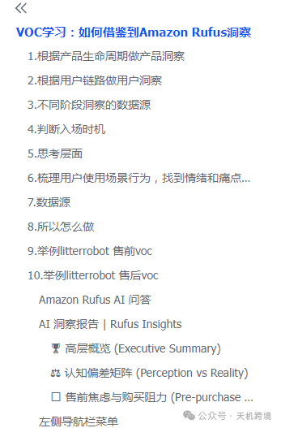

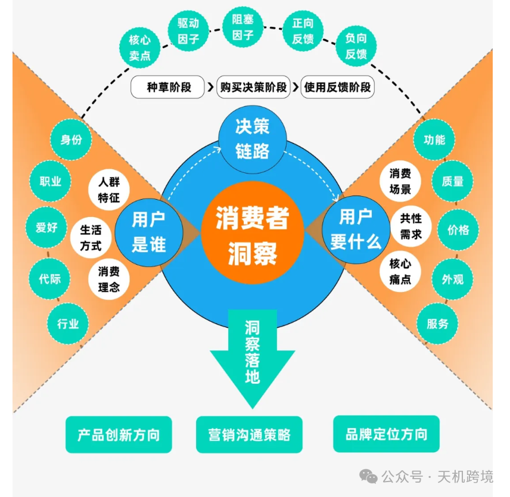

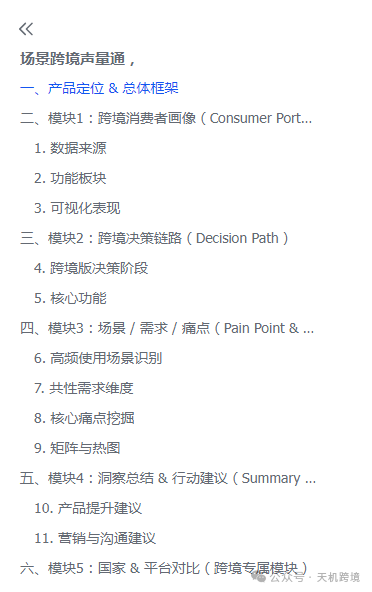

## 跨境声量通 介绍

## https://ai.feishu.cn/wiki/Jj0Qw1fP2iDParkY4Vdc1Ejynkc?from=from\_copylink

## 1.根据产品生命周期做产品洞察

机会 需求 概念 测试 上市后

找到产品功能定义

## 2.根据用户链路做用户洞察

购前 购中 购后

第一次购买 / n次购买 &复购分析

找到产品价值点

## 3.不同阶段洞察的数据源

①产品定义阶段全渠道分析，然后竞品分析主要是定义概念和需求

②已经有样品了洞察内测人群,目标人群画像，特征，行为分析

③有产品了就说围绕差评和用户页面反馈和客诉也就是用户围绕购买的声音 VOC

④稳定之后就是监控舆情判断质量和需求的变化还有品牌资产 LTV

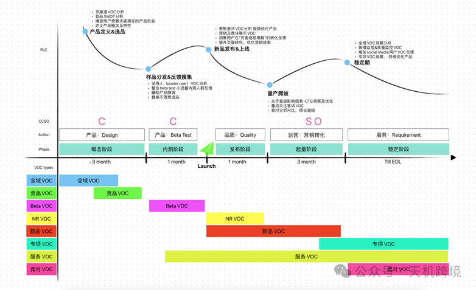

## 4.判断入场时机

先看市场一定是增长上升 —— 大概判断市场需求怎么在变化，有没有持续创新，有没有垄断，是否有季节性淡旺季，品类生命周期判断：导入期-正在增长期-稳定期-衰退期，确定是不是合适 最佳，市场的切入时机.

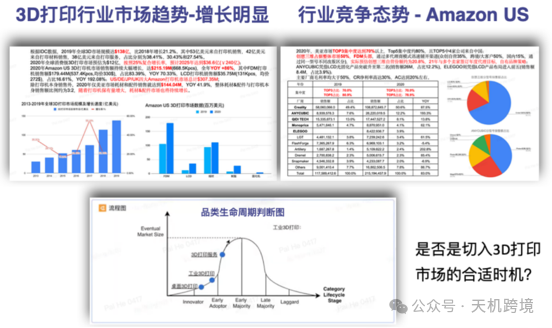

再看用户群体功能定义：背景，目标人群，性别，年龄 段，年收入，婚姻状况，最高学历，DIY能力，兴趣

确定哪类人群，在怎样的场景下，有哪些需求，对于我们具备哪个突出能力的产品有没有兴趣？

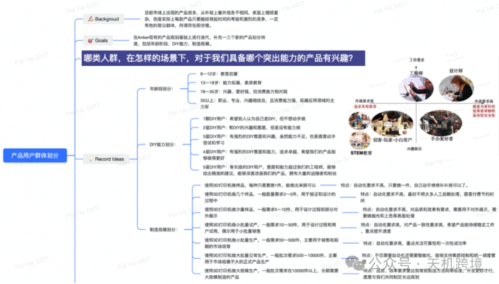

## 5.思考层面

用户分析目前没被满足的，被满足不满意，大多数都能满足的，用户和产品都不在意的，我们的解决方案

打竞品去竞争

创新场景创新需求创新品类 —— 三创法则，CCSO洞察模型

消费者，竞争对手，具有优势的解决方案，我们的机会 （独有的产品价值点）

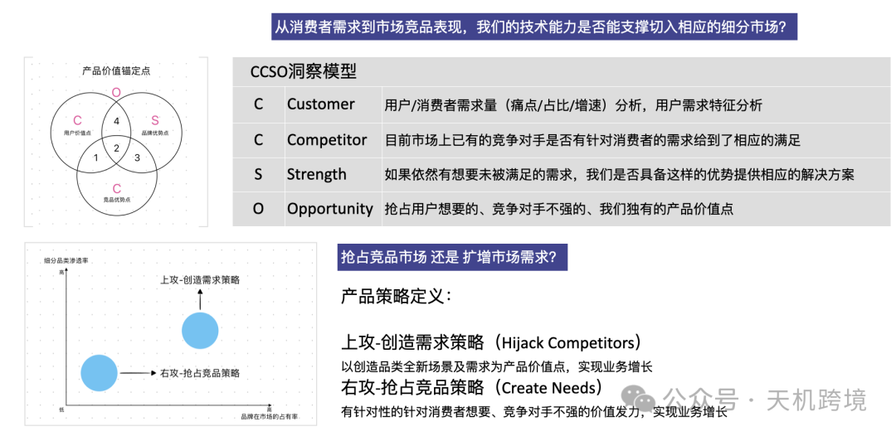

最常用的场景x最核心的受众 —— 找出的问题就是竞对的解决方案需要升级

## 6.梳理用户使用场景行为，找到情绪和痛点——明确需求点

使用我们产品的过程，前中后，使用前，使用中，使用后

情绪点，行为/痛点，需求

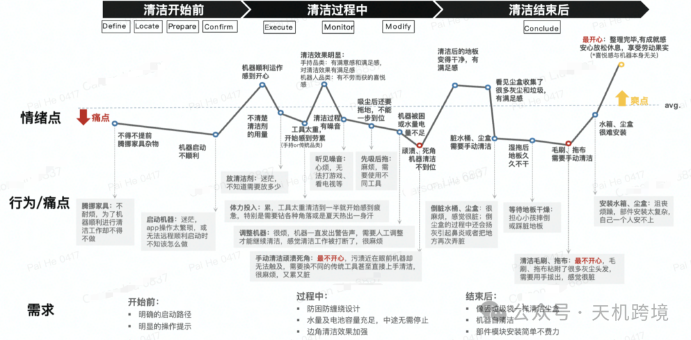

## 7.数据源

文本/音频转文本/图片

邮件/电商评论/社媒/垂直网站

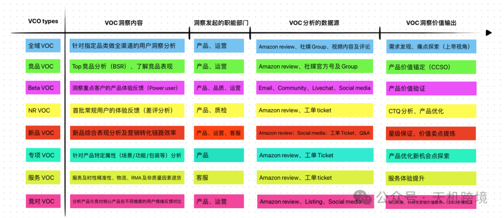

社媒获取用户基本信息还有竞品提及频次和提及情绪还有购买前关注和购买后关键提及和提及情绪

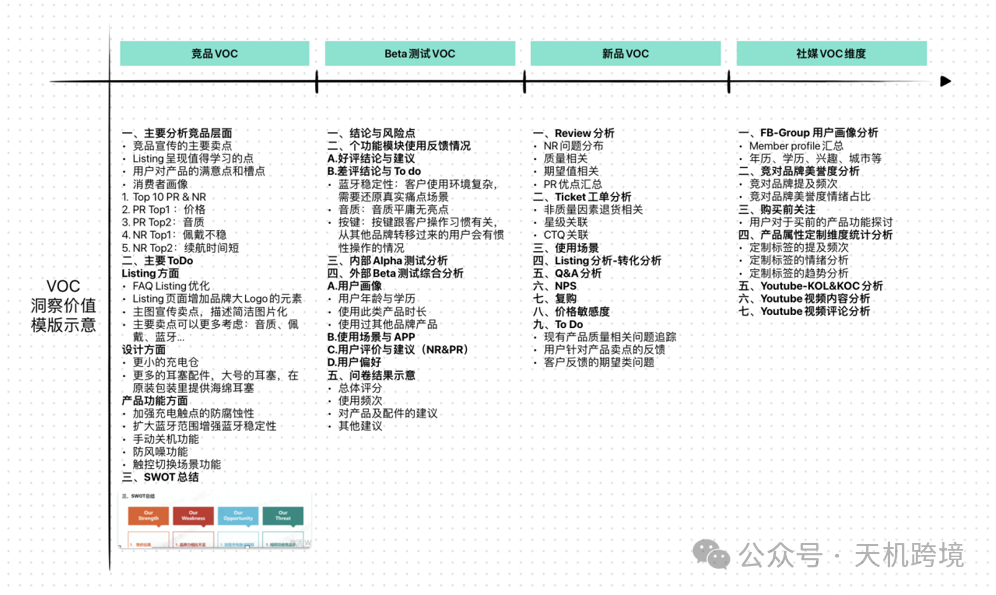

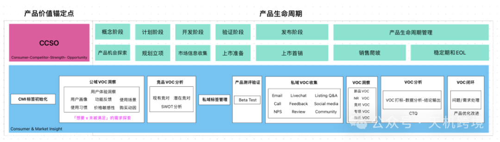

VOC洞察价值盘点

产品价值锚定点

产品生命周期

## 8.所以怎么做

所以做voc，分类voc模板和输出内容

先收集数据

再做重复词提取

在做气泡图

然后做分析

找到提及率高但是不满意的需求（产品市场机会模型输出示意：占比高 x 增速快 x 满意度差）

难点设计标签，一级维度二级标签

1. 明确洞察目的
2. 采集精准数据源
3. 分析维度设计
4. 分析模型校正
5. 数据清洗及标注
6. 数据输出及分析

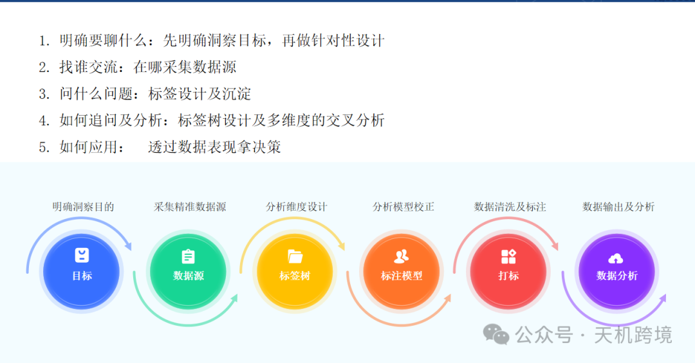

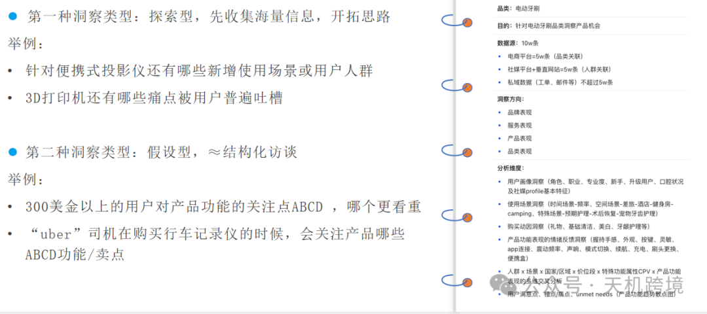

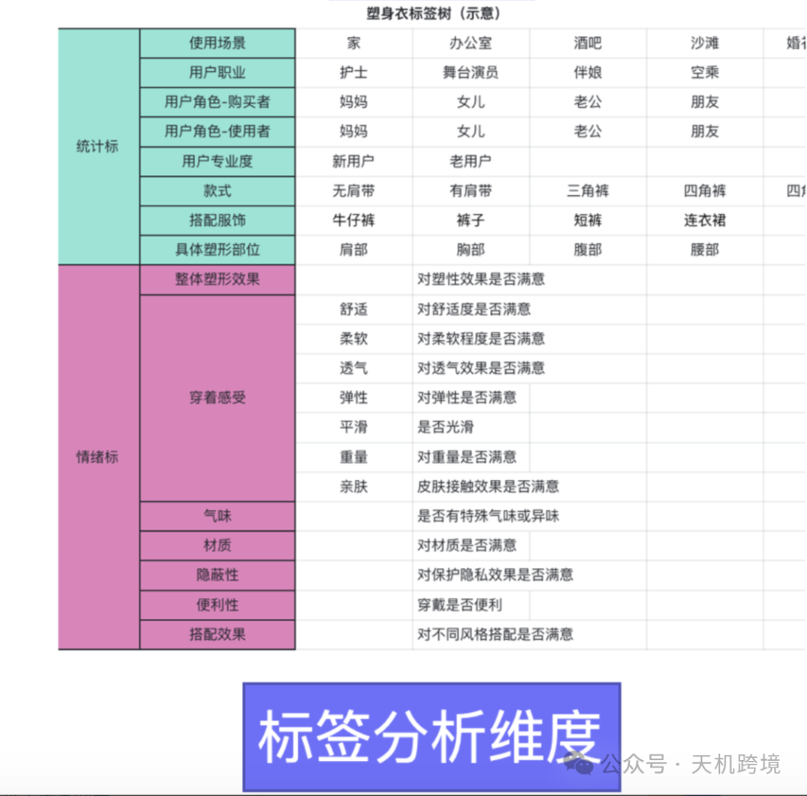

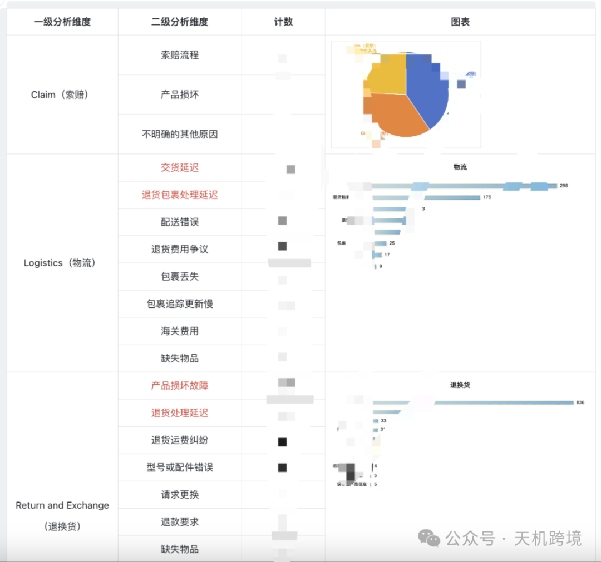

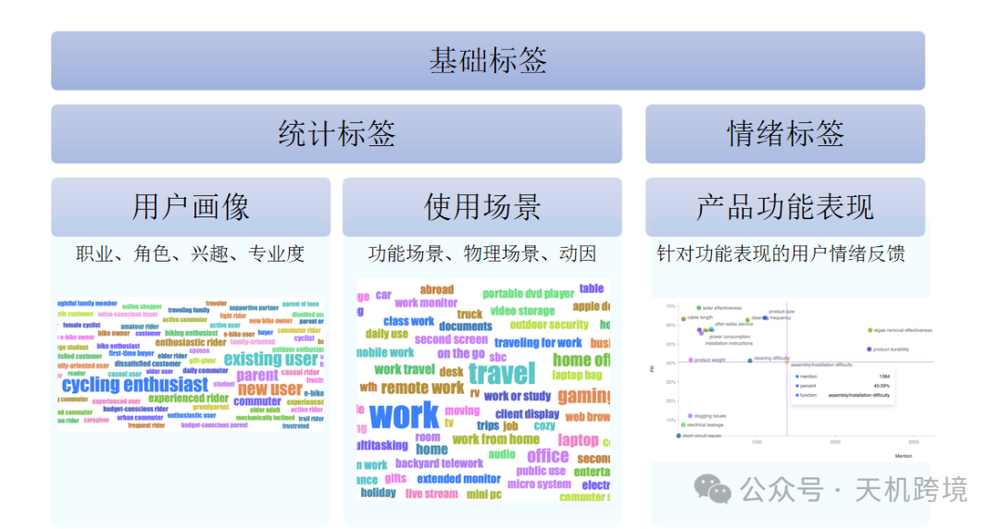

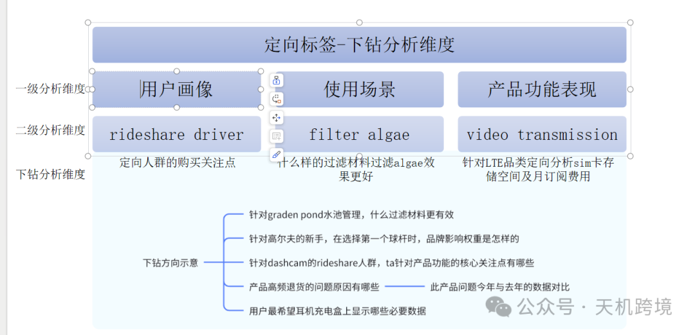

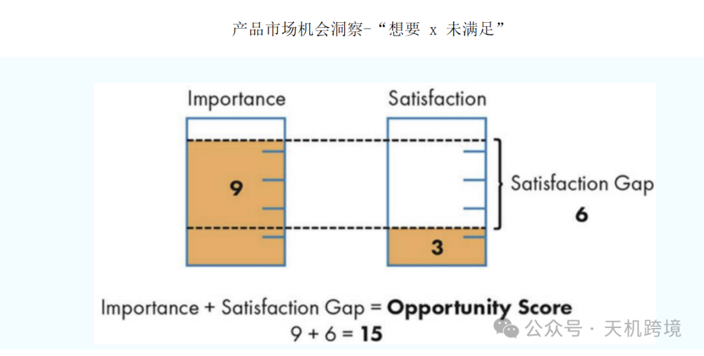

未满足需求洞察，分析，改进

## 9.举例litterrobot 售前voc

voc目的：我需要找到用户在购买智能猫砂盆时，对比Litter-Robot和PetKit的核心决策点，我们想知道用户

**【障碍】** 用户在下单前，犹豫的**最大阻力**是什么？

**【驱动】** 最终让他们下定决心的临门一脚是什么？

**【对手】** 在他们眼中，Litter-Robot的**真正替代品**是谁？

数据收集：使用我们设计的关键词，如`“Litter-Robot worth it?”`,`“Litter-Robot vs PetKit”`，去我们选定的社群（如`r/catcare`,`r/BuyItForLife`）进行搜索，然后把相关贴子全部抓进去飞书表格

数据清洗和打标：

表格至少包含以下字段：`[帖子原文/评论]` |`[链接]` |`[情感]` |`[一级维度]` |`[二级标签]` |`[关键引述]` |`[备注]`

情感是中性/正面/负面（里面包括焦虑，开心，疑惑，求助）

一级标签：购买驱动/决策障碍/竞品对比/人群特征/页面体验

二级标签：多猫家庭/解放双手/竞品对比/价格因素/气味/噪音/外型/售后/朋友推荐

|  |  |  |
| --- | --- | --- |
| 一级维度 | 二级标签 | 备注 |
| 决策障碍 | 价格-太贵了 | 提及$600-$700的价格，觉得难以承受 |
|  | 恐惧-猫咪拒用 | 最大的担忧：“我花了大钱，猫不肯用怎么办？” |
|  | 恐惧-安全/卡猫 | 担心传感器失灵，会卡住或伤害到猫咪 |
|  | 恐惧-清洁维护 | 听说“深度清洁”那个球体内部是噩梦 |
|  | 恐惧-噪音/气味 | 担心机器转动太吵，或者抽屉里的气味问题 |
|  | 产品-尺寸太大 | “这东西太占地方了，我的小公寓放不下” |
|  | 产品-负面评价 | “我看到有人说传感器/App总出问题” |
| 购买驱动 (Purchase Drivers) | 价值-解放双手 | 核心驱动力！“我再也不想铲屎了” |
|  | 价值-气味控制 | “多猫家庭，这是我最后的希望” |
|  | 价值-多猫适用 | “我有3只以上的猫，手动清理不现实” |
|  | 功能-App/智能 | “能监测体重和如厕次数，对我了解猫咪健康很重要” |
|  | 品牌-行业标杆 | “Litter-Robot是这个领域的开创者，我更信赖它” |
| 竞品对比 (Competitor Landscape) | vs\_PetKit (Pura) | “PetKit更便宜，外观也好看，它们俩到底怎么选？” |
|  | vs\_Leo's Loo Too | “Leo's Loo看起来更现代” |
|  | vs\_其他平替 | “亚马逊上那些$200的自动猫砂盆怎么样？” |
|  | vs\_手动铲屎 | “我还是觉得手动最干净，不相信机器” |
| 信息渠道 (Info Channels) | 渠道-YouTube评测 | “看了XX的评测视频，感觉很心动” |
|  | 渠道-Reddit讨论 | “我来Reddit就是想看看真实用户的评价” |
|  | 渠道-官网 | “官网的介绍/保修政策” |

10.统计分析

制作气泡图然后定量和定性分析，定量抓核心痛点，定性分析

**1.提及率气泡图：用户最关心什么？**

**X轴：** 一级维度

**Y轴：** 二级标签

**气泡大小：**`提及次数`

2.负面情感气泡图 —— 什么阻碍用户？

占比高 x 满意度差的机会模型

先**筛选**出所有`情感` 字段为`负面 (Negative)` 的帖子。再使用“图表”功能，按“二级标签”进行分组和计数

气泡最大的就是抱怨最多的

3. 正面情感气泡图 —— 回答用户为什么买？

用户最喜欢的是什么？

4.交叉分析表 —— 和竞品打什么？最能打的点是什么？痛点 槽点

**行：** 设置为`[二级标签 - 竞品]` (例如：`vs_PetKit`,`vs_Leo's Loo`)

**列：** 设置为`[二级标签 - 障碍/驱动]` (例如：`价格-太贵了`,`恐惧-噪音/气味`,`产品-尺寸太大`,`价值-气味控制`)

**值：**`提及次数`

5.用户画像痛点 —— 不同用户人群对于不同的痛点 一对一

**行：**`[二级标签 - 人群]` (例如：`人群-多猫家庭`,`人群-单猫家庭`)

**列：**`[二级标签 - 障碍]` (例如：`价格-太贵了`,`产品-尺寸太大`)

**值 ：**`提及次数`

## 10.举例litterrobot 售后voc

**【产品迭代】** 找出Litter-Robot 4 (LR4) **最核心的产品短板和Bug**（例如：传感器、App连接）。

**【功能创新】** 挖掘用户**提及率最高的新功能建议**（Litter-Robot 5的灵感来源）。

**【口碑监控】** 监控用户是在“主动推荐”还是在“吐槽劝退”，找到“赞美点”和“抱怨点”。

**【服务优化】** 评估用户对“客服”和“保修”的满意度。

监控社区和关键词和数据抓取相同，关键词包含更多问题词

然后打标根据目的在情感产品用户售后品牌

|  |  |  |
| --- | --- | --- |
| 一级维度 (Primary) | 二级标签 (Secondary) | 备注 (Description) |
| 情感 (Sentiment) | 正面-惊喜 (Delight) | "改变了我的人生！" |
|  | 正面-满意 (Satisfied) | "还不错，能用。" |
|  | 中性-求助 (Seeking Help) | "请问这个灯闪烁是什么意思？" |
|  | 负面-烦躁 (Annoyed) | "又卡住了，我得重启一下..." |
|  | 负面-愤怒 (Angry) | "700美金买了个垃圾！客服还不回我！" |
| 产品-硬件 (Product - Hardware) | 硬件-传感器 (Sensor) | "总是误报‘猫在里面’，明明没有猫。" |
|  | 硬件-机械结构 (Mechanical) | "球体转动时卡住/异响。" |
|  | 硬件-气味控制 (Odor Control) | "抽屉的气味还是很大，密封不行。" |
|  | 硬件-噪音 (Noise) | "转动的声音太大，猫很害怕。" |
|  | 硬件-耐用性 (Durability) | "用了两年了还很好" / "3个月就坏了" |
| 产品-软件 (Product - Software) | 软件-App连接 (App Connectivity) | "Wi-Fi总是断线，重置了也没用！" |
|  | 软件-App易用性 (App Usability) | "App界面太乱了，找不到功能。" |
|  | 软件-固件Bug (Firmware Bug) | "更新固件后，传感器反而更敏感了。" |
|  | 软件-数据准确性 (Data Accuracy) | "猫咪体重秤的数据完全不准。" |
| 使用体验 (Usability) | 体验-安装设置 (Setup) | "Wi-Fi配网花了半个小时才搞定。" |
|  | 体验-日常清洁 (Daily Cleaning) | "换垃圾袋很方便。" |
|  | 体验-深度清洁 (Deep Cleaning) | (高频抱怨区) "清洁那个球体内部是地狱级难度。" |
|  | 体验-猫咪适应 (Cat Adoption) | "我的猫就是不敢用" / "我的猫秒用" |
| 客户服务 (Customer Support) | 客服-响应速度 (Response Time) | "秒回！" / "发了邮件3天了" |
|  | 客服-解决能力 (Resolution) | "客服很专业，帮我解决了" / "答非所问" |
|  | 客服-保修/退换 (Warranty/Returns) | "保修期内很爽快地给我寄了新配件。" |
| 功能与品牌 (Feature & Brand) | 功能建议 (Feature Request) | (金矿！) "希望能加个摄像头" / "球体希望能拆洗" |
|  | 品牌-主动推荐 (Recommendation) | "贵是贵，但绝对值。推荐所有养猫的都买。" |
|  | 品牌-吐槽劝退 (Warning Others) | "别买，快跑！" |

未满足需求洞察，分析，改进

有了数据打标后就是建立模型

1.产品bug图 —— 看到目前问题最大的

**筛选：** 情感 =`负面-烦躁` 或`负面-愤怒`。

**制作气泡图 (或树状图)：**

- **维度：**`[二级标签]` (特别是`产品-` 和`软件-` 开头的标签)
- **气泡大小：**`提及次数`
- 未满足需求洞察，分析，改进

2.正面情绪图 —— 找到爽点

**筛选：** 情感 =`正面-惊喜` 或`正面-满意`。

**制作气泡图：**

- **维度：**`[二级标签]`
- **气泡大小：**`提及次数`
- 未满足需求洞察，分析，改进

3.开发新产品

**筛选：** 一级维度 =`功能与品牌`，二级标签 =`功能建议`。

**精读与再分类：** 逐条精读所有“功能建议”的帖子，并为它们打上新的标签，例如：`[建议-摄像头]`,`[建议-易拆洗]`,`[建议-更安静]`,`[建议-尺寸更小]`。

**制作柱状图：** 统计这些新标签的提及次数。

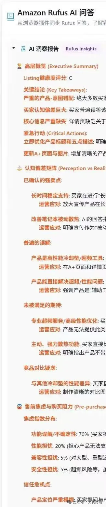

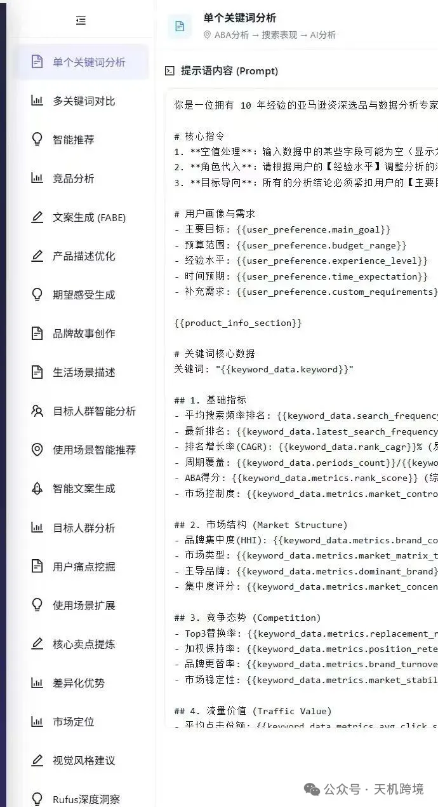

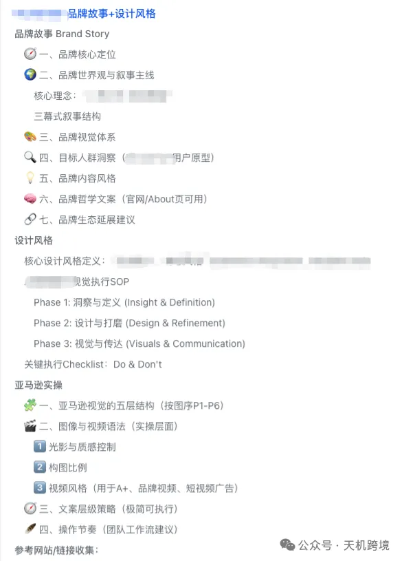

### Amazon Rufus AI 问答

从浏览器插件同步 Rufus 问答，了解客户购买意图

---

### AI 洞察报告 | Rufus Insights

#### 🏆 高层概览 (Executive Summary)

- **Listing健康度评分：** C
- **关键结论 (Key Takeaways)：**

- **严重的产品-意图错配：** 绝大多数买家......
- **买家认知偏差巨大：** 买家普遍误将该.......
- **核心信息严重缺失：** 详情页缺乏关于.......

- **紧急行动 (Critical Actions)：**

- **立即优化产品标题和五点描述：** 明确.....
- **更新A+页面与图片：** 增加清晰的产品.....

#### ⚖️ 认知偏差矩阵 (Perception  vs  Reality)

- **已确认的强卖点：**

- **运营应对：** 明确宣传作为“被动...
- **长时间稳定支持：** 买家在进行“长时间使用
- **改善笔记本被动散热：** AI的回答指...

- **普遍的误解：**

- **运营应对：** 强调产品是“辅助工...
- **运营应对：** 在A+页面和详情页...
- **产品是高性能冷却垫/超频工具：**
- **产品能直接解决超频/性能问题：**

- **未被满足的期待：**

- **运营应对：** 明确指出产品不带...
- **运营应对：** 产品无法提供此类产品...
- **专业超频服务/高级性能优化：** 买家...
- **主动、强力散热功能：** 买家直接...

- **竞品对比疑虑：**

- **运营应对：** 制作清晰的对比图...
- **与其他冷却垫的性能差异：** 买家直...

#### 😧 售前焦虑与购买阻力 (Pre-purchase & buying resistance...)

- **焦虑指数分布：buying resistance**

- **功能误解/不确定性：** 70%（买家将...
- **性能担忧：** 20%（担心产品无法支...
- **兼容性担忧：** 5%（对大型、重型...
- **安全性担忧：** 5%（超频风险等，虽...

- **信任危机点：**

- **产品定位严重模糊：** 买家提问与产品..
- 未满足的需求

---

**您可以根据这份报告调整您的亚马逊 Listing。能够为您针对“性能误解”这点写一段优化 决策**

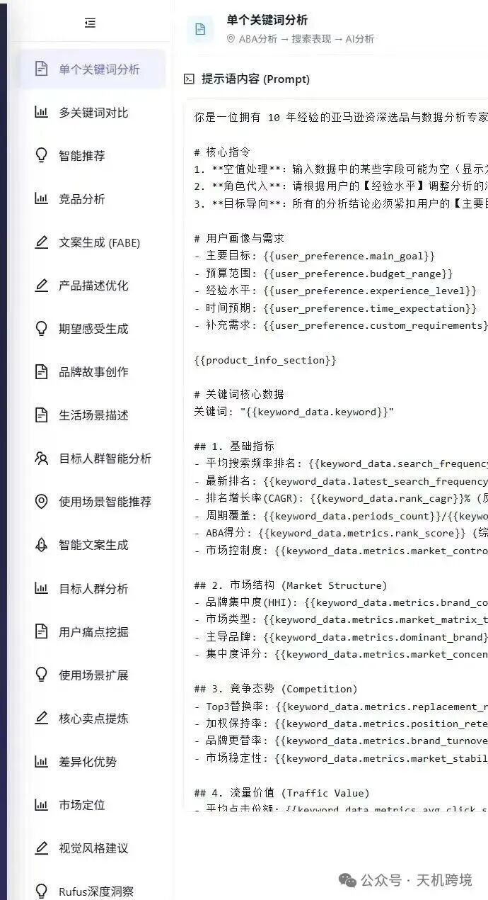

这份图片展示的是一个针对亚马逊（Amazon）卖家的**单个关键词分析**工具界面，特别是

其中的**提示语内容 (Prompt)** 配置页面。

以下是图片中文字内容的详细提取：

### 左侧导航栏菜单

- **单个关键词分析**（当前选中）
- 多关键词对比
- 智能推荐
- 竞品分析
- 文案生成 (FABE)
- 产品描述优化
- 期望感受生成
- 品牌故事创作
- 生活场景描述
- 目标人群智能分析
- 使用场景智能推荐
- 智能文案生成
- 目标人群分析
- 用户痛点挖掘
- 使用场景扩展
- 核心卖点提炼
- 差异化优势
- 市场定位
- 视觉风格建议
- Rufus深度洞察
- 未满足的需求

---

### 右侧主界面内容

#### 标题与路径

- **单个关键词分析**
- 路径：ABA分析 → 搜索表现 → AI分析

#### 提示语内容 (Prompt)

你是一位拥有 10 年经验的亚马逊资深选品与数据分析专家。

## 核心指令

1. **空值处理**：输入数据中的某些字段可能为空（显示...）
2. **角色代入**：请根据用户的【经验水平】调整分析的...
3. **目标导向**：所有的分析结论必须紧扣用户的【主要目的是什么...】

## 用户画像与需求

- 主要目标：`{{user_preference.main_goal}}`
- 预算范围：`{{user_preference.budget_range}}`
- 经验水平：`{{user_preference.experience_level}}`
- 时间预期：`{{user_preference.time_expectation}}`
- 补充需求：`{{user_preference.custom_requirements}}`

`{{product_info_section}}`

## 关键词核心数据

关键词："{{keyword\_data.keyword}}"

1. ### 基础指标

- 平均搜索频率排名：`{{keyword_data.search_frequency_...}}`
- 最新排名：`{{keyword_data.latest_search_frequency_...}}`
- 排名增长率 (CAGR)：`{{keyword_data.rank_cagr}}`%
- 周期覆盖：`{{keyword_data.periods_count}}` /`{{keywords...}}`
- ABA得分：`{{keyword_data.metrics.rank_score}}`（综合...）
- 市场控制度：`{{keyword_data.metrics.market_contro...}}`

2. ### 市场结构 (Market Structure)

- 品牌集中度 (HHI)：`{{keyword_data.metrics.brand_co...}}`
- 市场类型：`{{keyword_data.metrics.market_matrix_t...}}`
- 主导品牌：`{{keyword_data.metrics.dominant_brand}}`
- 集中度评分：`{{keyword_data.metrics.market_concen...}}`

3. ### 竞争态势 (Competition)

- Top3替换率：`{{keyword_data.metrics.replacement_r...}}`
- 加权保持率：`{{keyword_data.metrics.position_rete...}}`
- 品牌更替率：`{{keyword_data.metrics.brand_turnove...}}`
- 市场稳定性：`{{keyword_data.metrics.market_stabil...}}`

4. ### 流量价值 (Traffic Value)

- 平均点击份额：`{{keyword_data.metrics.avg_click_s...}}`

---

**说明：** 该界面展示了如何通过结构化的 Prompt（提示语）和动态变量（如`{{...}}` 占位符）来调用 AI 引擎，从而生成专业的亚马逊市场分析报告。

品牌视觉定位

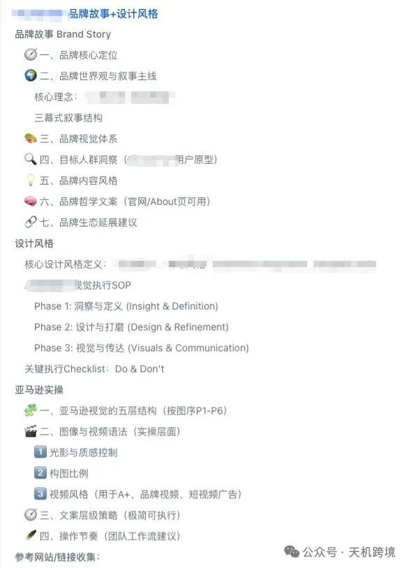

品牌故事+设计风格

品牌故事 Brand Story说明

一、品牌核心定位

二、品牌世界观与叙事主线

核心理念:.....

三幕式叙事结构

三、品牌视觉体系

四、目标人群洞察（用户原型)

五、品牌内容风格

六、品牌哲学文案(官网/About页可用)

七、品牌生态延展建议

设计风格

核心设计风格定义:

视觉执行SOP

Phase 1: 洞察与定义(Insight &Definition)

Phase2: 设计与打磨(Design &Refinement)

Phase 3: 视觉与传达(Visuals &Communication)

关键执行 Checklist:Do &Don't

亚马逊实操

一、 亚马逊视觉的五层结构(按图序P1-P6)

二、 图像与视频语法(实操层面)

1.光影与质感控制

2.构图比例

3.视频风格(用于A+、品牌视频、短视频广告)

三、 文案层级策略(极简可执行)

四、   操作节奏(团队工作流建议)

五， 参考网站/链接收集:www.xxx.com

六，其他补充说明  附件，

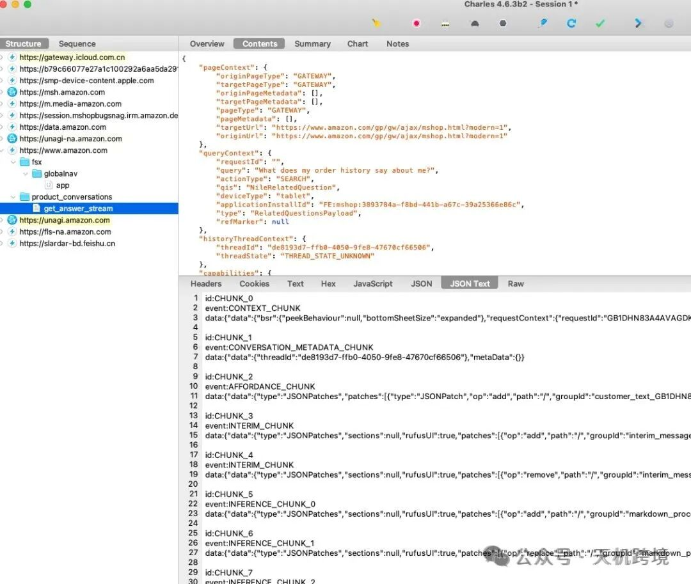

您上传的图片展示了一套专为亚马逊卖家设计的**AI 运营辅助系统**。这些截图涵盖了从后台数据抓取的底层逻辑（接口分析）到前端 AI 分析工具的 Prompt（提示词）配置，以及最终生成的品牌与视觉设计策略大纲。

以下是针对各张图片的详细提取与分析：

#### 图 1：单个关键词分析与 Prompt 配置 (13.jpg)

这张图展示了一个集成在亚马逊后台（ABA 分析 → 搜索表现 → AI 分析）的 **Prompt 编辑器**。它通过预设的结构化指令，引导 AI 扮演“资深选品与数据分析专家”来解读数据。

- **左侧功能菜单（AI 运营全链路）：**

- **分析类：** 单个/多关键词分析、竞品分析。
- **创作类：** 文案生成 (FABE)、产品描述优化、品牌故事创作。
- **洞察类：** 目标人群智能分析、用户痛点挖掘、市场定位、Rufus 深度洞察。

- **核心 Prompt 结构：**

- **核心指令：** 处理空值数据、根据用户经验调整深度、目标导向分析。
- **用户需求变量：** 包括主要目标、预算范围、经验水平、时间预期等占位符（如`{{user_preference.main_goal}}`）。
- 关键分析维度： 1.  基础指标： 搜索频率排名、排名增长率 (CAGR)、ABA 得分。
- 2.  市场结构： 品牌集中度 (HHI)、市场类型、主导品牌。
- 3.  竞争态势： Top 3 替换率、品牌更替率、市场稳定性。
- 4.  流量价值： 平均点击份额。

---

#### 图 2 & 3：品牌故事与设计风格方案 (3.png)

这份文件是大纲形式的**品牌出海全案框架**，旨在通过 AI 辅助卖家建立差异化竞争优势。

- **一、品牌故事 (Brand Story)：**

- 包括品牌核心定位、品牌世界观（三幕式叙事结构）、目标人群洞察（用户原型）以及品牌哲学文案。

- **二、设计风格 (Design Style)：**

- 定义核心设计风格，并制定 **视觉执行 SOP**：从“洞察与定义”到“设计与打磨”，最后进行“视觉与传达”。

- **三、亚马逊实操 (Operations)：**

- **视觉五层结构：** 指导 P1-P6 图片的排序与逻辑。
- **图像与视频语法：** 强调光影质感控制、构图比例，以及适用于 A+ 和品牌视频的风格。
- **文案与节奏：** 极简可执行的文案策略及团队工作流建议。

---

#### 图 4：Charles 数据接口截获 (2.png)

这张图显示了使用 **Charles Proxy** 抓包工具截取的亚马逊后台数据接口信息。

- **数据内容：** 截取了`unagi.amazon.com` 域名下的`get_answer_stream` 接口数据。
- **关键信息：**

- **请求上下文 (queryContext)：** 显示了一个具体的买家咨询问题：“What does my order history say about me?”（我的订单历史说明了关于我的什么信息？）。
- **数据结构：** 展示了以`id:CHUNK_0` 等形式组成的流式数据返回（Stream Data），这是典型的 **AI 模型（如 Rufus）** 生成回答时的传输方式。
- **会话上下文：** 包含了`threadId` 和`deviceType: tablet`（设备类型：平板）等元数据。

**总结：** 这一系列图片反映了一个高度自动化的亚马逊运营工作流：通过 **Charles 抓包 (图 4)** 获取底层的竞争对手或消费者行为原始数据，再通过 **结构化的 AI Prompt (图 1)** 进行深度分析，最终产出 **品牌与视觉执行方案 (图 2/3)**。

如果您需要针对 **图 1** 中的某个特定指标（如 **HHI 品牌集中度**）进行深度的选品逻辑解释，或者需要我为您扩充 **图 2** 中的“三幕式叙事结构”，请随时告诉我。

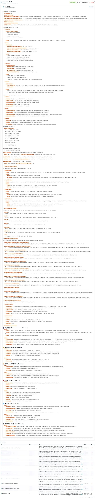

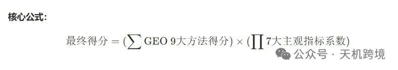

这是一套

VOSEA / VOSEA AI 跨境消费者洞察

场景跨境声量通，

跨境 AI 消费者洞察分析报告模版

AI驱动消费者洞察

跨境版·AI消费者洞察工具

消费者需求洞察

原创 亚马逊 Rufus 最新解释公布！三大变化重新定义流量分发， 123

各位亚马逊卖家注意！近期，亚马逊正式对外公布了关于 Rufus AI 助手的能力更新说明。Rufus已经远远超出了问答的范畴，它正在成为商品搜索、视觉检索、价格匹配、自动下单的入口。作为亚马逊卖家，我们必须读懂背后的信号，提前布局。

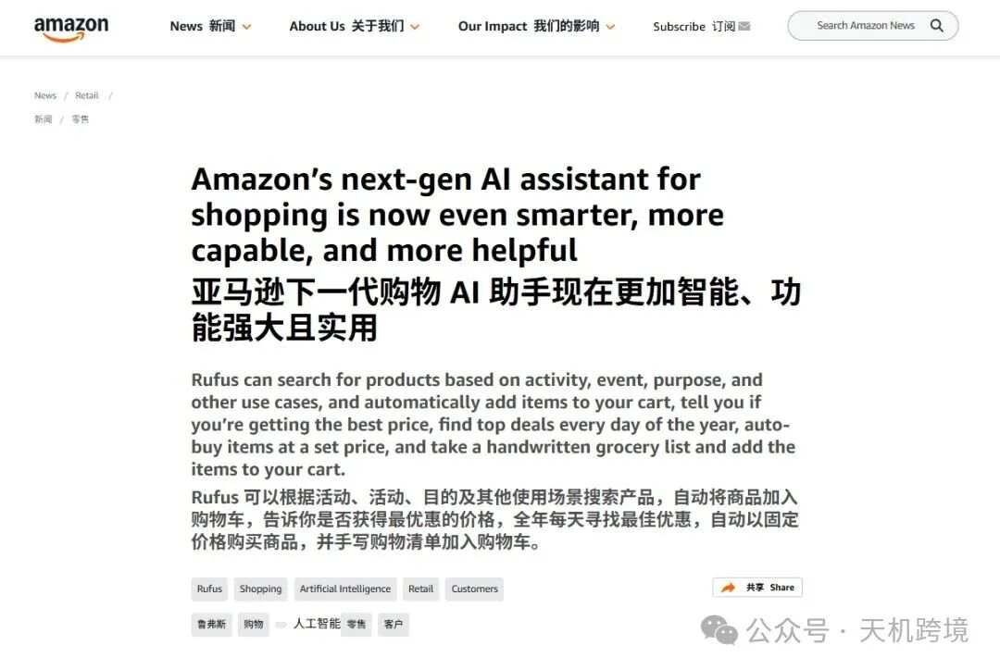

这次更新中，卖家最必须重点关注的三个变化是：

**1、Rufus用户量爆发式增长，已成为重要流量来源；**

**2、视觉搜索与场景识别能力大幅增强；**

**3、价格历史、价格提醒与自动购买的开放。**

**一、Rufus 的用户爆发式增长，AI推荐流量将越来越多**

> “今年已有超过2.5亿用户使用Rufus，月均用户增长149%，互动量增长210%，在购物时使用它的顾客购买可能性高出60%以上。”

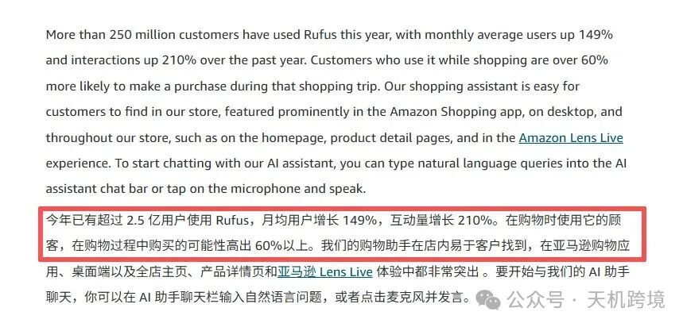

这些数据对卖家有什么意义？Rufus 不再是一个辅助功能，而正在成为“买家进入商品链接的入口”。过去，运营的主战场是搜索排名和广告位。现在，Rufus推荐的流量迅速崛起。近150%的用户增长意味着流量**正在大规模向COSMO和Rufus倾斜**，而高出60%的转化率则证明，被Rufus推荐的商品更能赢得买家信任。

**1、流量入口从“人找货”加速演变为“货找人”**： 传统搜索是“人找货”，买家需要明确知道自己要什么，并通过关键词寻找。而Rufus代表的AI推荐，是更高维度的“货找人”。

买家可以带着一个模糊的需求（如“为公司团建准备礼物”）或一个具体的问题（如“这款咖啡机是否容易清洗？”）去咨询，Rufus 就会完成意图识别并主动推荐更精准的商品。

近150%的用户增长意味着，越来越多的买家开始习惯并依赖这种更简单、更智能的购物方式，AI 推荐流量的入口将越来越大。

**2、“Rufus推荐”成为一个全新的、高权重的流量入口：** 过去，商品的曝光主要依赖于搜索排名、广告、关联推荐等。现在Rufus本身就是一个流量入口：

- 高转化率：Rufus 推荐带来的订单转化率高出 60%，降低了买家的决策成本，信任度高；
- 精准性： Rufus的推荐基于对话上下文、买家画像、历史购买行为，高度精准的意向流量；
- 场景化： 流量不再仅仅来源于关键词，更来源于具体的、多样化的购物场景和实时对话

总结来说，Rufus数据的爆发式增长，意味着AI推荐流量将成为一个趋势。忽视它，就等于主动放弃了一个快速增长且转化率极高的核心流量入口。

**二、视觉搜索强化，“场景化”成为产品展示核心**

> Rufus 拥有强大的新文本和视觉搜索功能，帮助客户寻找灵感并解决问题。买家可以根据活动、目的以及其他具体主题和使用场景搜索和发现产品。

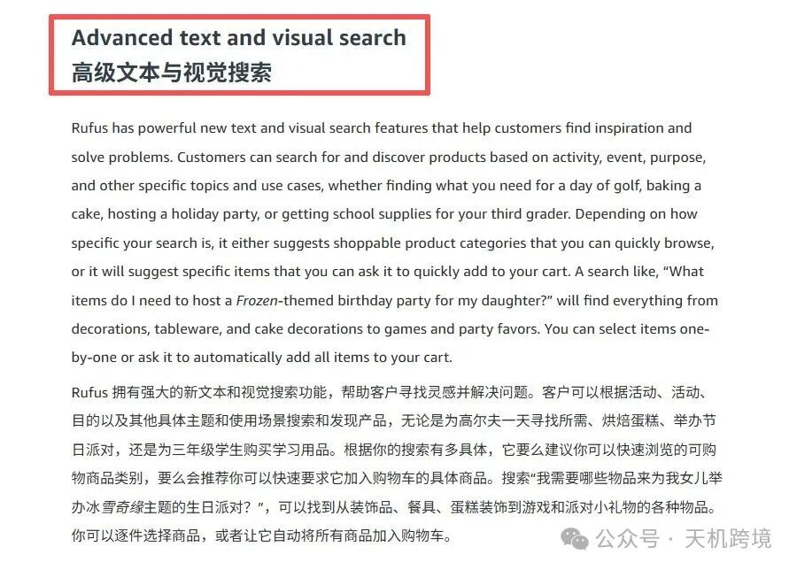

本次更新中，**亚马逊特别强调了 Rufus 的视觉搜索能力与场景识别能力。**

Rufus 的视觉能力被大幅加强，包括：

- **上传手写清单即可自动加购：** 买家拍照上传购物清单 → Rufus 识别内容 → 自动加入购物车。
- **上传图片找类似商品**：例如上传一张地毯污渍图，Rufus 会识别材质并推荐对应清洁剂
- **上传场景图找解决方案**：例如上传一张厨房台面的照片，Rufus 能自动识别器具并给出购买建议。
- **场景搜索、活动搜索、用途搜索全面强化：** 卖家可以问：“给我一个适合11岁男孩的运动主题礼物清单。”Rufus 自动给出一整套产品组合。

简单说，就是Rufus现在不光会识别文案上的文本内容，开始全面理解你 Listing 中的“图片”。Rufus能看懂：

- 产品类别、结构与特性
- 产品的使用场景与用途
- 目标人群（儿童、老人、户外用户、办公人群等）
- 材质、尺寸、颜色、配件
- 功能逻辑（例如“适合露营”“适合初学者”）
- 图片能否与用户的问题匹配（如“适合租房小厨房吗？”）

这对卖家意味着：图片场景越清晰，你被识别的准确度越高；识别越准确，你越可能出现在推荐池；进入推荐池，就意味着有免费自然流量。

**三、价格透明度提高，算法对价格更敏感**

Rufus 的第三项关键更新，就是“价格理解能力与自动提醒系统”。

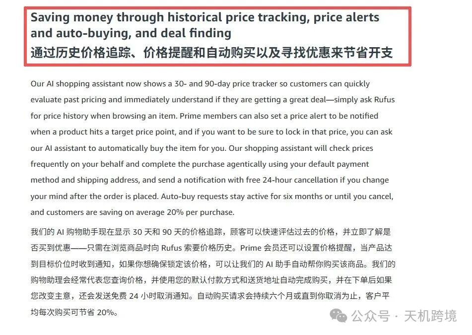

亚马逊展示了几个重要能力：

- Rufus 能读取产品历史价格（Typical Price）
- Rufus 能判断商品是否“值得买”
- Rufus 能在价格下跌时主动提醒用户
- Rufus 能帮助用户设置“降价即自动下单”条件
- Rufus 能作为用户的“价格管家”

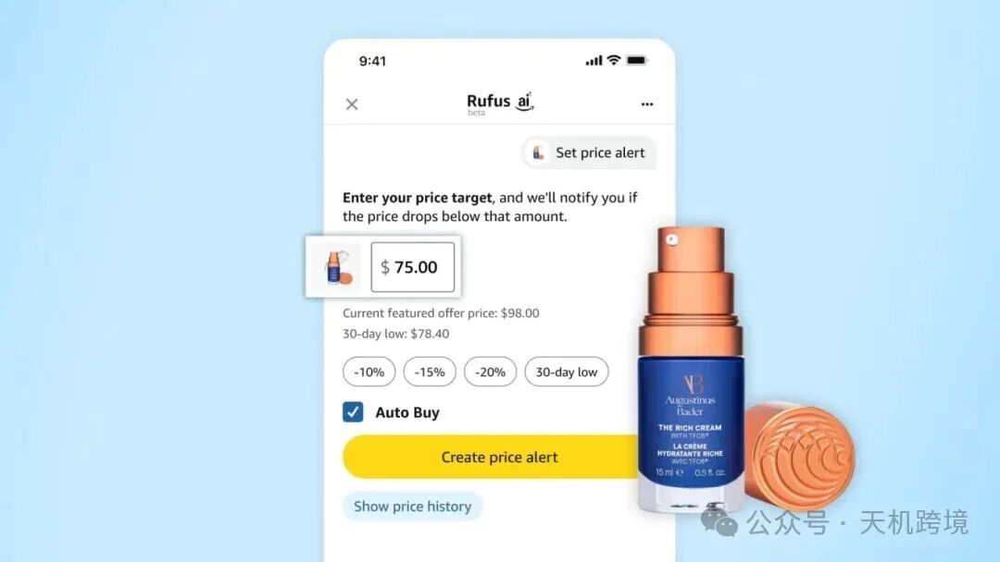

换句话说：Rufus 正在告诉买家：该不该买、什么时候买、买贵了没有。

**直接把商品30天、90天的价格历史都展示给买家了**，还能帮买家设置降价提醒和自动下单。

这对我们卖家意味着什么？价格透明度大幅提升，频繁调价或价格虚高将更容易被买家识别，影响信任感。稳定的、有竞争力的价格，更容易获得系统推荐，甚至锁定用户的“自动购买”订单。

所以卖家定价要谨慎： 不要再用“先标高价再打骨折”的套路了。根据成本和竞争情况，定一个长期有竞争力且稳定的价格。价格平稳，才能积累Rufus权重和买家的信任。

Rufus的这次升级，释放出一个明确信号：亚马逊正全面转向“AI驱动”的流量分发模式。作为卖家，能否被AI识别、理解并推荐，将直接影响产品曝光与自然订单增长。

卖家必须做到：

1、让商品能被COSMO和Rufus 正确理解（文案结构化，文案部署产品场景用途搜索词等）

2、让图片能触发视觉搜索（场景化、人物化、功能化）

3、提前规划价格，以适配价格提醒机制

4、让 Listing 的每一个元素都为 AI 服务

Rufus 不仅改变用户购物方式，也正在改变卖家的运营方式。越早适应的卖家，越能站到流量红利的中心。

**亚马逊操盘手亿级卖家sop'分析**

面对亚马逊新算法的推荐机制，利用**PSPS 线性文案结构化方法**，通过模型化拆解，让卖家的文案能够精准匹配 COSMO 与 Rufus 的抓取偏好，进而获取更多 AI 推荐流量。课程也同步升级了**COSMO 视觉识别算法“三位一体”模型**（“文本描述 × 图片验证 × 评论佐证”），深入拆解亚马逊从图片识别到内容关联的底层逻辑，并通过大量案例，让卖家清晰理解 Listing 如何通过“场景化图片 + 文案一致性”获得更高的排名与推流优先级。
