# Rufus随想

> Source: wechat
> Author: 天机跨境
> Original: https://mp.weixin.qq.com/s/wMBQSw3WPTH3ZxXGbPKEbw

---

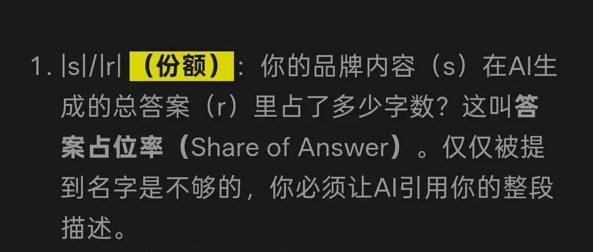

---

listing优化方案，建议下载

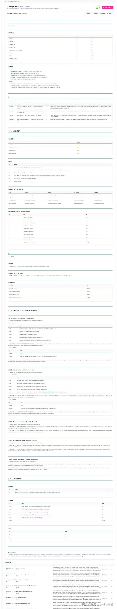

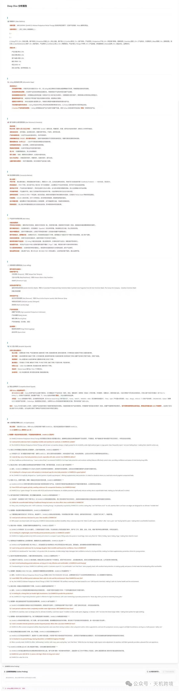

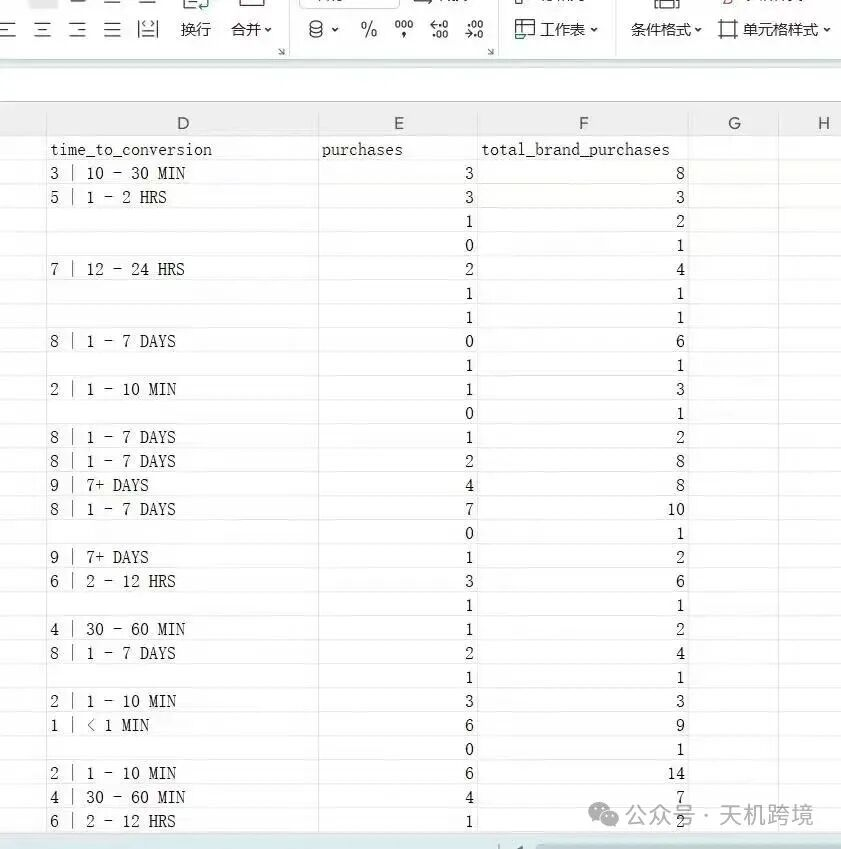

Rufus原理 答案占位率

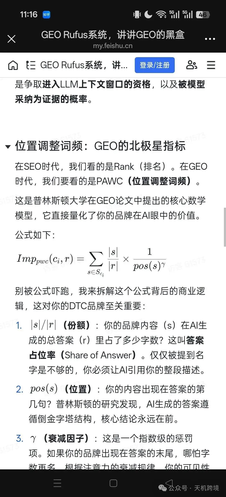

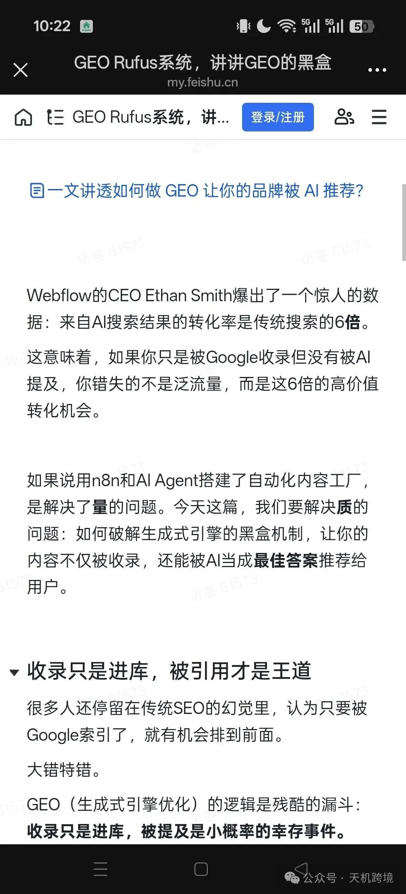

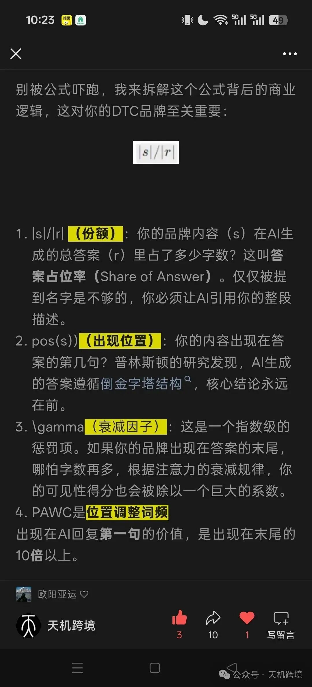

如何进行操作，抓取亚马逊后台广告数据：

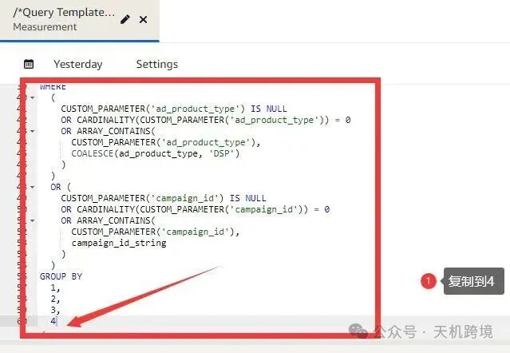

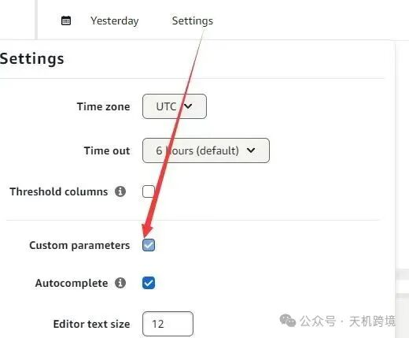

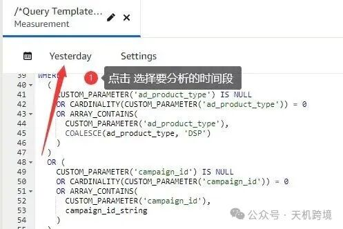

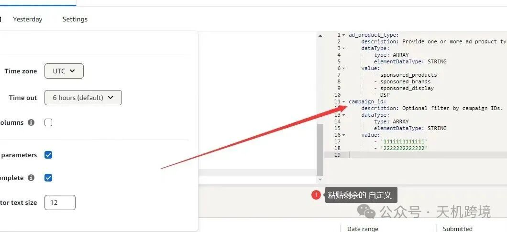

具体指令：

---------------

/\*Query Template : Time to Conversion\*/

SELECT

  advertiser,

  campaign,

  campaign\_id\_string,

  CASE

    WHEN traffic\_event\_subtype = 'AD\_IMP' THEN (

      CASE

        WHEN SECONDS\_BETWEEN (impression\_dt, conversion\_event\_dt) <= 60 THEN '1 | < 1 MIN'

        WHEN SECONDS\_BETWEEN (impression\_dt, conversion\_event\_dt) <= 600 THEN '2 | 1 - 10 MIN'

        WHEN SECONDS\_BETWEEN (impression\_dt, conversion\_event\_dt) <= 1800 THEN '3 | 10 - 30 MIN'

        WHEN SECONDS\_BETWEEN (impression\_dt, conversion\_event\_dt) <= 3600 THEN '4 | 30 - 60 MIN'

        WHEN SECONDS\_BETWEEN (impression\_dt, conversion\_event\_dt) <= 7200 THEN '5 | 1 - 2 HRS'

        WHEN SECONDS\_BETWEEN (impression\_dt, conversion\_event\_dt) <= 43200 THEN '6 | 2 - 12 HRS'

        WHEN SECONDS\_BETWEEN (impression\_dt, conversion\_event\_dt) <= 86400 THEN '7 | 12 - 24 HRS'

        WHEN SECONDS\_BETWEEN (impression\_dt, conversion\_event\_dt) <= 604800 THEN '8 | 1 - 7 DAYS'

        ELSE '9 | 7+ DAYS'

      END

    )

    WHEN traffic\_event\_subtype = 'AD\_CLICK' THEN (

      CASE

        WHEN SECONDS\_BETWEEN (click\_dt, conversion\_event\_dt) <= 60 THEN '1 | < 1 MIN'

        WHEN SECONDS\_BETWEEN (click\_dt, conversion\_event\_dt) <= 600 THEN '2 | 1 - 10 MIN'

        WHEN SECONDS\_BETWEEN (click\_dt, conversion\_event\_dt) <= 1800 THEN '3 | 10 - 30 MIN'

        WHEN SECONDS\_BETWEEN (click\_dt, conversion\_event\_dt) <= 3600 THEN '4 | 30 - 60 MIN'

        WHEN SECONDS\_BETWEEN (click\_dt, conversion\_event\_dt) <= 7200 THEN '5 | 1 - 2 HRS'

        WHEN SECONDS\_BETWEEN (click\_dt, conversion\_event\_dt) <= 43200 THEN '6 | 2 - 12 HRS'

        WHEN SECONDS\_BETWEEN (click\_dt, conversion\_event\_dt) <= 86400 THEN '7 | 12 - 24 HRS'

        WHEN SECONDS\_BETWEEN (click\_dt, conversion\_event\_dt) <= 604800 THEN '8 | 1 - 7 DAYS'

        ELSE '9 | 7+ DAYS'

      END

    )

    ELSE 'Other'

  END AS time\_to\_conversion,

  SUM(purchases) AS purchases,

  SUM(total\_purchases) AS total\_brand\_purchases

FROM

  amazon\_attributed\_events\_by\_conversion\_time

WHERE

  (

    CUSTOM\_PARAMETER('ad\_product\_type') IS NULL

    OR CARDINALITY(CUSTOM\_PARAMETER('ad\_product\_type')) = 0

    OR ARRAY\_CONTAINS(

      CUSTOM\_PARAMETER('ad\_product\_type'),

      COALESCE(ad\_product\_type, 'DSP')

    )

  )

  OR (

    CUSTOM\_PARAMETER('campaign\_id') IS NULL

    OR CARDINALITY(CUSTOM\_PARAMETER('campaign\_id')) = 0

    OR ARRAY\_CONTAINS(

      CUSTOM\_PARAMETER('campaign\_id'),

      campaign\_id\_string

    )

  )

GROUP BY

  1,

  2,

  3,

  4

ad\_product\_type:

    description: Provide one or more ad product types.

    dataType:

        type: ARRAY

        elementDataType: STRING

    value:

        - sponsored\_products

        - sponsored\_brands

        - sponsored\_display

        - DSP

campaign\_id:

    description: Optional filter by campaign IDs.

    dataType:

        type: ARRAY

        elementDataType: STRING

    value:

        - '1111111111111'

        - '2222222222222'

核心理念

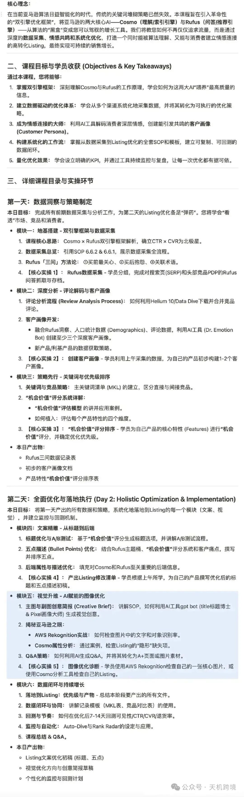
