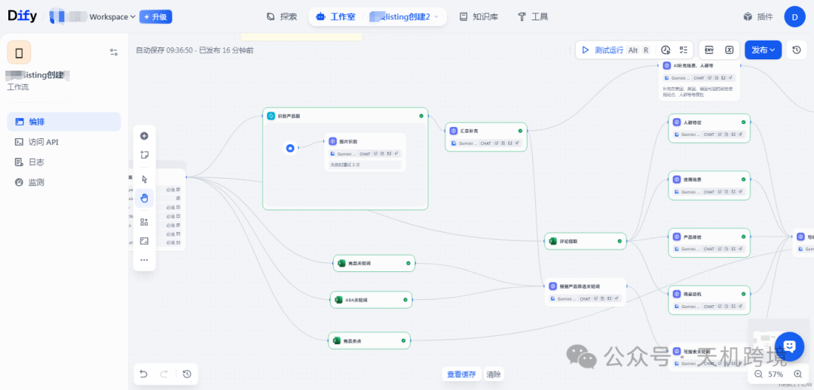
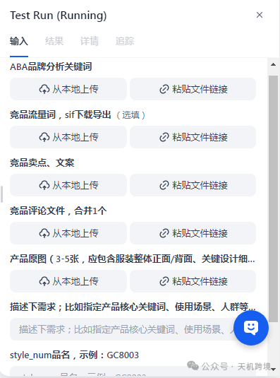
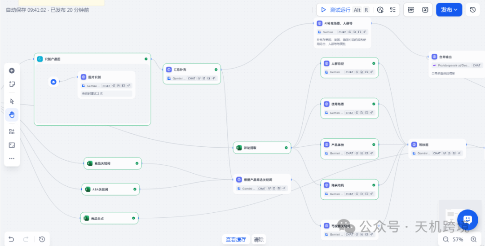
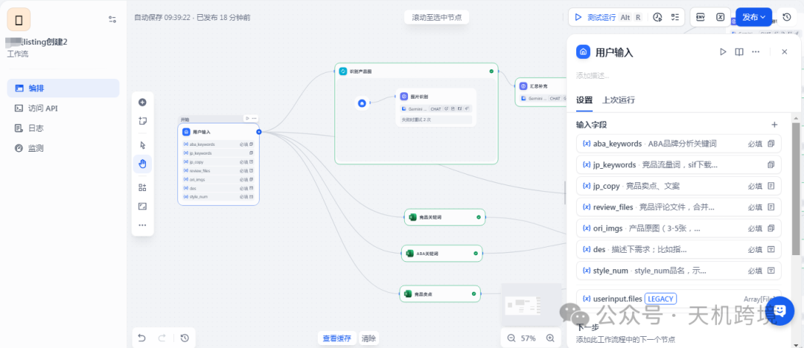
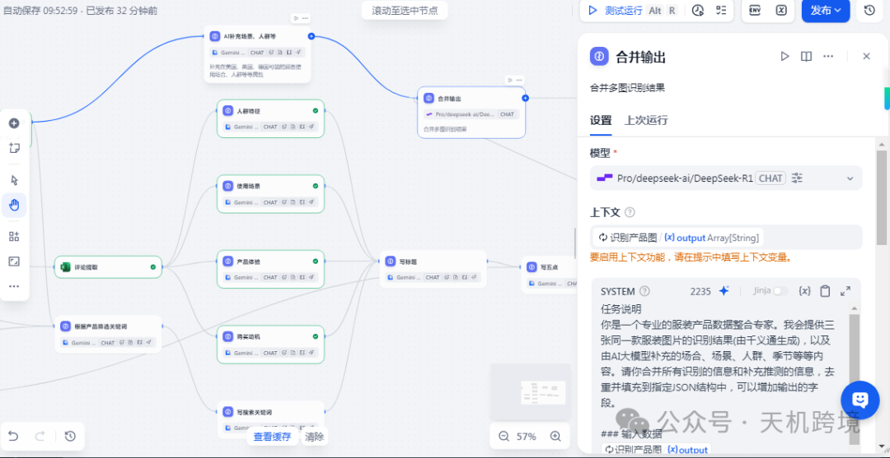
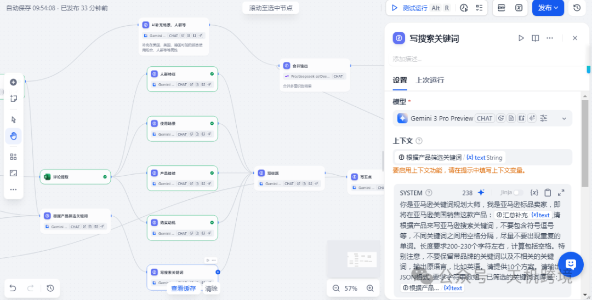
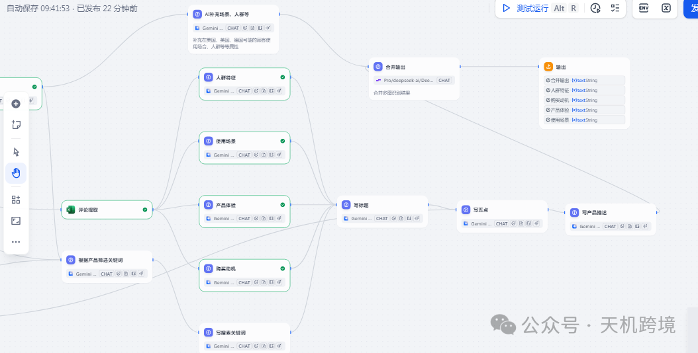
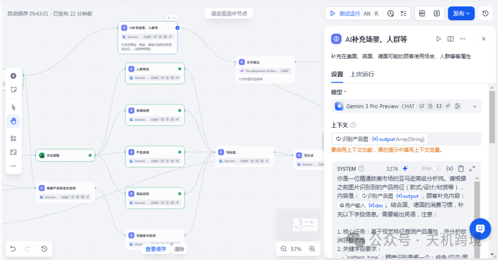
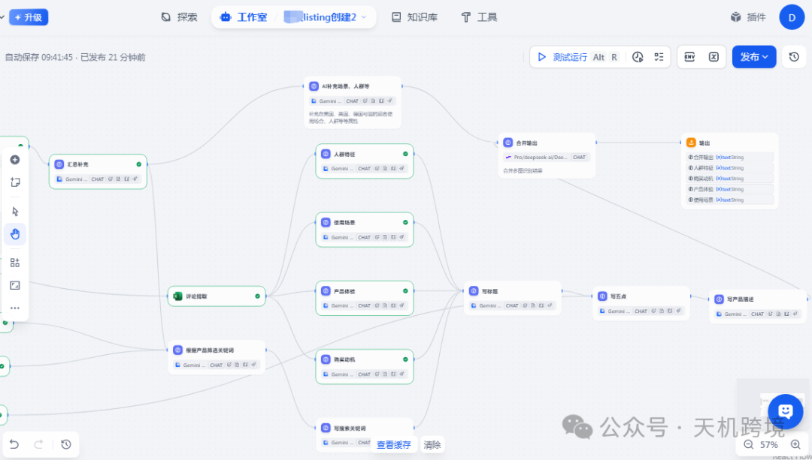

# 亚马逊AI工作流-全自动创建亚马逊listing 工作流（升级版）

> Source: wechat
> Author: 天机跨境
> Original: https://mp.weixin.qq.com/s/lC2YAjL0CfhS5IUkraHzbw

---


---

一个标准的**数据驱动型 SEO Listing 生成工作流拆解**。







这个工作流的核心在于：**先做数据清洗与画像侧写，再进行针对性的文案输出**。直接让 AI 工作流写，它通过您的步骤（ABA、SIF、竞品数据，评论分析），我们可以让 AI 像一个5-8年的资深运营一样思考。

《亚马逊全自动 Listing 生成工作流架构方案（标准版）》。结构清晰，可以直接作为 Dify 或其他 Workflow 工具的蓝图使用。

---

## 亚马逊 Listing 自动化构建架构方案

**——基于多维数据源与深度用户画像的 Dify 工作流设计**

### 一、 系统全景图 (High-Level Overview)

本工作流旨在将原本割裂的“关键词调研”、“竞品分析”与“文案撰写”环节串联。通过输入原始数据（ABA、SIF、评论、原图），利用 LLM 的分析能力提取用户画像与场景痛点，最终输出高转化、高 SEO 权重的 Listing 文案。

- **核心产品**：空气净化器 (Model: KJ-MV205)
- **目标市场**：家居生活（客厅/卧室/婴儿房）
- **关键痛点**：灰尘/山火/烟雾、甲醛/VOCs、过敏源、异味/油烟

---

### 二、 输入层：数据与上下文 (Input Layer)

在 Dify 的“开始节点”中，我们需要定义以下变量，作为整个链路的燃料：







1. **关键词数据源**：

1.`ABA_Keywords`：亚马逊品牌分析关键词表（通过率、转化率数据）。
2.`SIF_Competitor_Keywords`：竞品高流量词、自然搜索词。

2. **竞品情报**：

1.`Competitor_Selling_Points`：竞品主打卖点与文案原稿。
2.`Competitor_Reviews`：竞品 Review 文件（用于挖掘真实槽点）。

3. **自身产品信息**：

1.`Product_Images`：产品原图（需通过 Vision 模型提取视觉特征）。
2.`User_Requirements`：核心需求描述（您的第⑥点：除甲醛、山火模式、过敏人群等）。
3.`Model_Number`：KJ-MV205。

---

### 三、 处理层：深度分析引擎 (The Deep Analysis Core)

这是工作流的“大脑”，不直接产出 Listing，而是产出“策略”。建议在 Dify 中拆分为并行的 LLM 节点。

#### 模块 A：关键词情报中心 (Keyword Intelligence)

- **动作**：融合 ABA 与 SIF 数据。
- **逻辑**：

- **去重与清洗**：剔除无关词。
- **分级打标**：
- **输出**：生成一份\*\*《SEO 埋词策略表》\*\*，按权重排序。

1. *核心大词*：air purifiers, air purifier for home
2. *精准长尾词*：air purifiers for bedroom, air purifier for smoke, air purifier for allergies
3. *场景词*：wildfire smoke, renovation VOCs

#### 模块 B：用户与市场侧写 (Market & User Profiling)


- **动作**：分析竞品评论 (`Competitor_Reviews`) 与卖点 (`Competitor_Selling_Points`)。
- **执行四个维度的深度分析**：

- **人群特征分析 (Audience)**：锁定两类核心人群——“装修新房的家庭（甲醛焦虑）”和“健康敏感人群（过敏、哮喘、受山火影响者）”。
- **使用场景分析 (Scenario)**：强化“刚装修完的客厅”和“需要静音睡眠的卧室”两个画面感。
- **产品体验分析 (UX/Pain Points)**：从差评中提取痛点（如：噪音大、灯光刺眼、滤芯更换贵），转化为我们产品的优势（如：睡眠模式静音、高性价比）。
- **购买动机分析 (Motivation)**：从“为了除味”上升到“为了家人的呼吸健康安全”。

#### 模块 C：视觉特征提取 (Visual Extraction)

- **动作**：利用多模态模型识别`Product_Images`。
- **输出**：提取产品外观特征（如：触摸屏设计、圆润机身、进风口结构），确保文案描述与图片一致。

---

### 四、 生成层：文案构建工厂 (Content Generation Layer)

基于上述分析结果，按顺序生成 Listing 的各个部分。上下文变量需透传进入此阶段。

#### 1. 流量基石：Search Terms 列表

- **依据**：《SEO 埋词策略表》。
- **输出**：整理出一组符合亚马逊字符限制的 Search Terms，优先覆盖 ABA 排名靠前且竞品未充分利用的词。

#### 2. 转化核心：标题 (Title) 生成

- **公式**：[品牌] + [核心大词] + [型号 KJ-MV205] + [核心功能/卖点] + [适用场景/人群] + [核心属性]。
- **指令要求**：必须包含`air purifiers`,`large room`,`H13 True HEPA` (假设),`smoke`,`dust`,`pollen`。
- **示例**：*Brand Air Purifiers for Home Large Room up to [Covered Area], H13 True HEPA Filter for Smoke, Pollen, Pet Dander, Quiet Air Cleaner for Bedroom, Removes VOCs/Dust, KJ-MV205 White.*

#### 3. 痛点击破：五点描述 (Bullet Points)

- **结构规划**：

- **BP1 (核心效能)**：针对甲醛/VOCs/山火烟雾的高效过滤能力。
- **BP2 (健康守护)**：针对过敏人群、宠物家庭、除尘除螨。
- **BP3 (场景体验)**：卧室睡眠模式（静音、关灯）、客厅大循环。
- **BP4 (技术/易用性)**：滤芯技术、定时功能、滤芯更换提醒。
- **BP5 (信任与售后)**：认证（如CARB/ETL）、售后保障。

- **数据注入**：将《用户与市场侧写》中的痛点反向植入，例如：“不像其他净化器那样吵闹，KJ-MV205 采用静音风道设计...”

#### 4. 情感共鸣：产品描述 (Product Description)

- **风格**：Storytelling（讲故事）。
- **内容**：描述一个充满清新空气的家，从具体的“厨房油烟散去”到“装修后的安心入住”，再到“山火季节的室内避难所”。

#### 5. 隐形推手：后台 ST (Backend Search Terms)

- **动作**：填充剩余的高相关度关键词，特别是拼写错误词、西班牙语词（如 purificador de aire）及同义词。





---

### 五、 Dify 工作流编排建议 (Implementation Logic)

如果您在 Dify 中搭建，建议采用以下节点流：


```
graph TD
    Start[开始：输入7项原始数据] --> LLM_Analysis[LLM聚合分析节点]

    subgraph 分析阶段
    LLM_Analysis --> Task1[关键词清洗与分级]
    LLM_Analysis --> Task2[评论挖掘与痛点提取]
    LLM_Analysis --> Task3[用户画像与场景构建]
    end

    Task1 & Task2 & Task3 --> Aggregator[上下文聚合]

    subgraph 写作阶段
    Aggregator --> Writer_ST[写 Search Terms]
    Writer_ST --> Writer_Title[写 Title (埋入核心词)]
    Writer_Title --> Writer_BP[写 5点描述 (结合画像与场景)]
    Writer_BP --> Writer_Desc[写 长描述 (情感升华)]
    Writer_Desc --> Writer_Backend[写 后台ST]
    end

    Writer_Backend --> End[结束：输出完整Listing markdown]
```


### 六、 总结与价值

这套 DSL 架构不仅仅是自动写作，它的价值在于：

1. **逻辑闭环**：文案是基于真实的用户痛点（如装修甲醛、山火）生成的，而不是凭空捏造。
2. **SEO 刚性执行**：强制将 ABA 和 SIF 的高权重词植入标题和五点，保证基础流量。
3. **场景化营销**：针对 KJ-MV205 锁定了具体的“装修”和“山火”场景，大幅提高精准人群的转化率。



---
