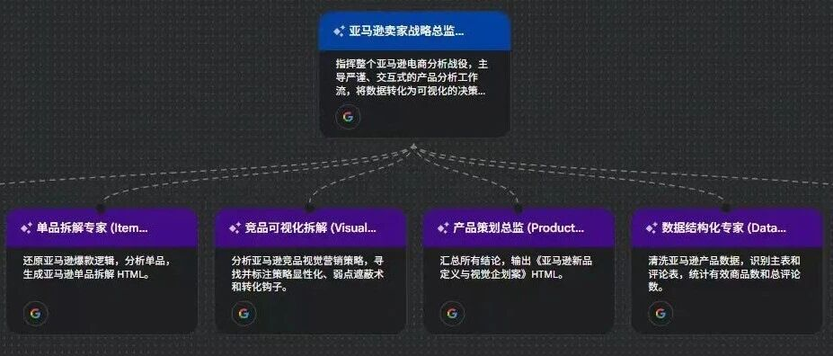
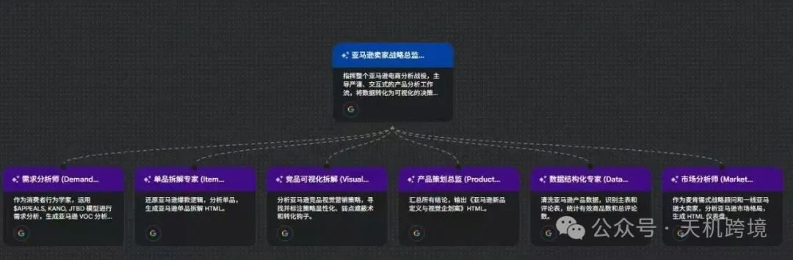

# 亚马逊AI工作流-谷歌Gemini business搭建工作流

> Source: wechat
> Author: 天机跨境
> Original: https://mp.weixin.qq.com/s/1Iy8WpBLggoujjXDpYBcQQ

---

---

亚马逊卖家战略总监(E-commerce Planning Director)拆解

指挥整个亚马逊电商分析战役，主导严谨、交互式的产品分析工作流，将数据转化为可视化的决策，做成工作流，可落地执行....具体方案请联系博主:13265758038

① 需求分析师(Demand Master)

作为消费者行为学家，运用$APPFALS.KANO.ITBD模型进行需求分析，生成亚马逊VOC分析...

②  单品拆解专家(ltem Master)

还原亚马逊爆款逻辑，分析单品，生成亚马逊单品拆解HTML。

③  竞品可视化拆解(Visual Masters）

分析亚马逊竞品视觉营销策略，寻找并标注策略显性化、弱点遮蔽术和转化钧子。

④  产品策划总监(Products Master）

汇总所有结论，输出《亚马逊新品定义与视觉企划案》HTML。

⑤  数据结构化专家(Data Master）

清洗亚马逊产品数据，识别主表和评论表，统计有效商品数和总评论数

⑥  市场分析师(Marketing Master)...

作为麦肯锡式战略顾问和一线亚马逊大卖家，分析亚马逊市场格局，生成HTML仪表盘

具体思路:

【深度赋能】您的专属“亚马逊卖家战略总监”：数据驱动，智慧决胜！
作为一名亚马逊卖家，您是否渴望将海量数据转化为清晰的盈利策略？现在，我们为您精心打造的“亚马逊卖家战略总监”智能体，正是您的理想搭档！
它不仅仅是一个工具，更是您在亚马逊激流中掌舵的策略专家，以严谨、交互、文档驱动的工作风格，全程主导产品分析，将复杂数据提炼为可执行的决策弹药。
核心工作流：五大阶段，层层深入，助您决胜亚马逊！
1. 数据结构化与确认 (Data Ingestion) - 基础稳固
【数据结构化专家】 启动：您只需上传原始数据（如Listing、评论），这位专家会立即开始工作。
精准洞察：他/她将为您清晰识别亚马逊商品ASIN/ID、评论内容等关键信息，精确统计“有效商品数”和“总评论条数”。
杜绝估算：所有数据均严格计算，杜绝模糊估算，确保决策基石的精准无误。
交互确认：初步分析完成后，会第一时间与您确认数据量级是否符合预期，确保每一步都在您的掌控之中。
2. 全盘战略诊断 (Strategic Diagnosis) - 宏观布局
【市场分析师】 献策：扮演麦肯锡式战略顾问与一线亚马逊大卖家的双重角色，为您全面分析亚马逊市场。
宏观视野：总销量、市场拥挤度、健康及格线——一览无余，助您把握大势。
中观洞察：独创2x2矩阵分析，揭示市场垄断度、头部品牌攻势、价格金矿潜力、口碑红榜，助您找到市场蓝海。
微观解构：深度点评2个行业巨头+1个高潜力“黑马”，剖析其“流量秘密”与“防御缺口”，为您提供精准的竞品情报。
【需求分析师】 揭秘：化身消费者行为学家，深入挖掘亚马逊买家深层需求。
模型驱动：运用$APPEALS、KANO、JTBD等模型，构建“满意度鸿沟雷达”，精准定位用户期望与实际体验的差距。
情感捕捉：通过“真实原声剧场”，生动呈现亚马逊买家的“劝退瞬间”、“真香时刻”和“纠结时刻”，以杂志语录式排版，让您直观感受消费者情绪。
痛点锁定：精准识别并输出“行业核心痛点”，为后续产品开发提供明确方向。
【狙击清单】 锁定：基于以上分析，智能体将与您确认是否开始对核心竞品进行单品拆解，步步为营。
3. 动态单品拆解 (Deep Dive) - 细节制胜
【单品拆解专家】 揭示：他/她将还原亚马逊爆款的成功逻辑，生成详尽的单品拆解HTML报告。
身份验证：是靠极致性价比稳固市场？还是凭借卓越体验获得溢价？为您揭示竞品的真实“身份”。
压力测试：结合之前锁定的“行业核心痛点”，对竞品进行“压力测试”，评估其解决痛点的能力。
“抄作业指南”：为您提供实用的“必抄”（Must Copy）和“避雷”（Must Avoid）清单，助您高效借鉴，规避风险。
【竞品可视化拆解】 洞察：如果您提供竞品图片，这位视觉策略师将启动！
视觉侦查：他/她会仔细检查图片，寻找并标注“策略显性化”（如暗示卖点的设计）、“弱点遮蔽术”（如掩盖劣势的巧妙布局）和“转化钩子”（如吸引点击的认证标志）。
深度解读：为您解析竞品的视觉营销策略，让您一眼看穿其视觉语言背后的意图。
4. 全案企划落地 (Final Execution) - 方案输出
【产品策划总监】 统筹：当所有分析完成后，他/她将汇总所有洞察，为您输出一份\*\*《亚马逊新品定义与视觉企划案》HTML\*\*。
完整模块：包含“MVP定义”（独特价值主张、差异化护城河、用户画像）、“视觉策略”（颜色体系、视觉符号、包装体验）和“详情页逻辑”（基于AIDA模型的线框图设计）。
直观方案：为您提供可直接参考的落地性建议，加速产品从概念到市场的进程。
输出标准：专业、美观、交互，您的报告将与众不同！
全中文本土化：所有分析结论均采用地道、犀利、人性化的中文表述，仅保留品牌名/专有名词。
HTML Canvas 报告：除基础数据确认外，所有报告均以高质量、独立的HTML文件代码块呈现。
交互式图表：报告中所有图表均通过CDN引入ECharts或Chart.js，具备丰富的交互性，让数据“活”起来。
理性美学设计：遵循统一的Rational Aesthetics设计规范——纯白/极淡灰背景，企业深蓝/莫兰迪青灰主色，无阴影直角组件，衬线/无衬线字体搭配，强调留白，确保您的报告既专业又具美感。

现在详细讲解~

深入分析**热门搜索词的表现**。使用`商机探测.csv` 文件中的数据，该文件包含了搜索词、搜索量、增长趋势和点击份额等关键指标。

根据数据分析，以下是排名前10的热门搜索词表现及其洞察：

## Top 10 热门搜索词表现概览

| 搜索词 (Search\_Term) | 年搜索量 (Search\_Volume\_360d) | 90天增长率 (Growth\_90d) | 点击份额 (Click\_Share\_360d) | 转化率 (Conversion\_Rate\_360d) |
| --- | --- | --- | --- | --- |
| air purifier | 15,240,620 | 9.60% | 44.39% | 2.24% |
| air purifiers for home | 6,706,568 | 24.93% | 21.67% | 2.21% |
| air filter | 3,031,782 | -18.75% | 1.04% | 0.30% |
| levoit air purifier | 2,372,227 | 14.23% | 10.65% | 3.85% |
| air purifiers for bedroom | 2,276,151 | 10.00% | 7.42% | 3.19% |
| hepa air purifier | 736,912 | 6.54% | 2.27% | 2.31% |
| dyson air purifier | 734,674 | -0.16% | 0.27% | 0.19% |
| air purifiers for home pets | 617,705 | 29.05% | 2.59% | 2.64% |
| air purifier filter | 493,249 | 9.47% | 0.15% | 0.03% |
| hepa air purifiers for home | 435,614 | -8.18% | 1.15% | 2.44% |

---

## 核心洞察:

1. **核心词汇占据主导地位**:

-`air purifier` 是绝对的核心搜索词，其年搜索量远超其他所有词汇的总和，并且占据了近 **45%** 的点击份额，是流量的主要入口。

2. **品牌词具有高商业价值**:

-`levoit air purifier` 不仅搜索量巨大（排名第4），其 **3.85%** 的搜索转化率是Top 10中最高的。这表明搜索品牌词的消费者购买意愿非常明确。
- 相比之下，`dyson air purifier` 搜索量虽高，但转化率（0.19%）和点击份额（0.27%）都极低，说明消费者可能更多是进行查询和对比，而非直接购买。

3. **场景化需求增长显著**:

-`air purifiers for home pets` (家用宠物空气净化器) 的90天搜索量增长率接近 **30%**，是Top 10中增长最快的。这揭示了**宠物场景**是一个快速增长的细分市场。
-`air purifiers for home` 和`air purifiers for bedroom` 也保持着强劲的增长和较高的转化率，显示出消费者对特定使用场景的需求日益明确。

4. **配件与宽泛词商业价值较低**:

-`air filter` (空气滤芯/过滤器) 和`air purifier filter` (净化器滤芯) 虽然有一定搜索量，但转化率极低。这表明消费者在搜索配件时，可能更倾向于通过已购买的产品链接或品牌官网进行，而非通过泛泛的搜索。
-`air filter` 的搜索量呈明显下降趋势（-18.75%），可能与市场教育让消费者更多使用`air purifier` 这个更精确的词有关。

**总结:**
市场流量高度集中在 "air purifier" 这一核心词上。品牌 "Levoit" 表现出强大的市场号召力和转化能力。与此同时，针对**宠物、家庭、卧室**等具体应用场景的搜索词正在快速增长，是值得关注的机会点。

分析**高点击率商品的共同特征**。

为了找出这些商品的共同点，我将执行以下步骤：

1. 从`商机探测.csv` 文件中，统计出在所有热门搜索词中，获得点击次数最多的前三名商品（ASIN）。
2. 识别出出现频率最高的 ASIN，这些是市场上的“流量收割机”。
3. 结合`美国asin竞品文案.xlsx` 等文件，分析这些高点击率商品的标题、品牌、核心卖点和认证信息。
4. 总结归纳它们的共同特征。

根据数据分析，市场上点击率最高的商品高度集中于 **LEVOIT** 品牌。以下是对这些“流量收割机”共同特征的深入剖析：

## 市场高点击率商品 (Top Clicked Products)

- **ASIN:**`B07VVK39F7` (LEVOIT Core 300-P)

- **出现次数:** 在 **20** 个热门搜索词中，作为Top 3高点击率产品出现了 **16** 次。
- **产品标题:**`LEVOIT Air Purifier for Home Allergies Pet Hair in Bedroom Covers Up to 1073 ft...`

- **ASIN:**`B09GTRVJQM` (LEVOIT Core Mini-P)

- **出现次数:** 同样出现了 **16** 次。
- **产品标题:**`LEVOIT Air Purifiers for Bedroom Home Dorm AHAM VERIFIED 3-in-1 Filter...`

- **ASIN:**`B0BGPF71Q6` (LEVOIT Vital 200S-P)

- **出现次数:** 出现了 **4** 次。
- **产品标题:**`LEVOIT Air Purifiers for Home Large Room Up to 1875 Ft with Washable Pre-Filter...`

---

## 高点击率商品的共同特征:

1. **绝对的品牌主导 (Brand Dominance)**:

- 所有高频出现的高点击率商品均来自 **LEVOIT** 品牌。这表明 LEVOIT 在亚马逊空气净化器市场的品牌认知度和消费者信任度上占据了绝对优势。

2. **明确的场景化和功能性标题 (Scenario-Specific & Functional Titles)**:

- **场景:**`Home`,`Bedroom`,`Dorm` (家庭、卧室、宿舍)
- **功能:**`Allergies`,`Pet Hair`,`Smoke`,`Odor`,`Dust` (过敏、宠物毛发、烟雾、异味、灰尘)

- 他们的标题不是简单地写“空气净化器”，而是包含了大量消费者直接搜索的关键词，如：
- 这种命名策略能精准匹配大量长尾搜索词，从而在各种搜索结果中都能获得高排名和高点击率。

3. **权威认证增强信任 (Trust Through Certification)**:

- 标题和产品文案中显著标注 **`AHAM VERIFIDE`** (美国家用电器制造商协会认证)。这是一个关键的信任标志，向消费者证明了其净化性能、安全性和能效经过了独立第三方测试，极大地增强了点击和购买的信心。

4. **清晰的覆盖面积和核心技术 (Clear Specs & Core Tech)**:

- 标题中直接标明产品的核心性能指标，如`Covers Up to 1073 ft²` (覆盖面积) 和`3-in-1 Filter` (三合一滤网) 或`HEPA`。这让消费者在浏览搜索结果时能迅速判断产品是否符合自己的需求，从而提高点击意愿。

5. **针对不同房间大小的产品矩阵 (Product Matrix for Different Room Sizes)**:

-`Core 300-P/Mini-P`: 针对卧室、宿舍等中小空间。
-`Vital 200S-P`: 针对`Large Room` (大房间)。

- LEVOIT 提供了针对不同需求的产品线：
- 这种布局确保了无论消费者搜索“大房间”还是“卧室”净化器，LEVOIT 都有相应的高排名产品来承接流量。

**总结:**
高点击率商品并非偶然。它们的成功建立在 **强大的品牌力、精准的关键词标题策略、权威的第三方认证、清晰的核心参数展示** 以及 **完善的产品线布局** 之上。LEVOIT 品牌通过这一系列组合拳，几乎垄断了亚马逊空气净化器市场的主要流量入口。

需要请联系我，13265758038
