# 亚马逊AI工作流-全自动生成图片

> Source: wechat
> Author: 天机跨境
> Original: https://mp.weixin.qq.com/s/fXTZ6J0EtDviW7Mz2R1UWA

---


---

亚马逊AI工作流-全自动生成图片

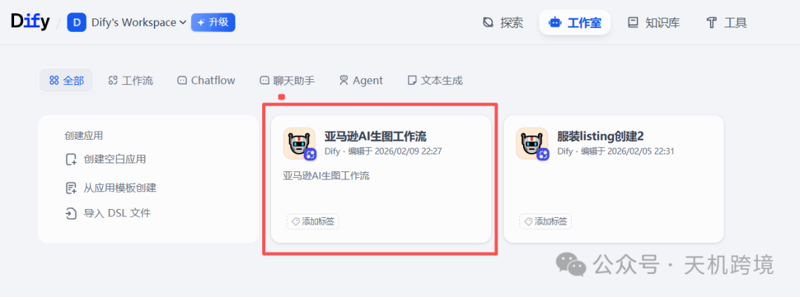

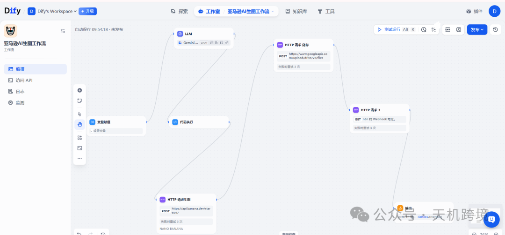


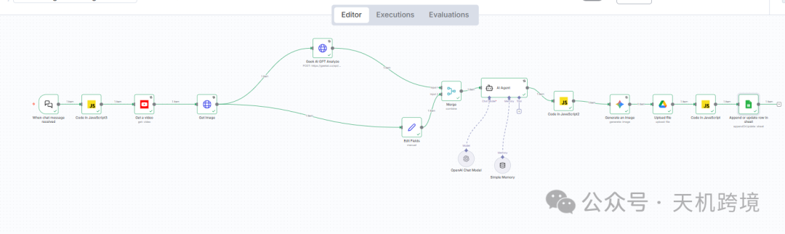

本文介绍如何利用 **n8n** 与 **dify搭建亚马逊自动化生图AI工作流。通过将业务SOP** 植入提示词，AI 能分钟级生成高转化**主图**、**副图**及 **A+ 页面**。该流程涵盖**竞品分析**、参考**素材**生成及 **A/B 测试**，助力卖家低成本提升点击率并实现业务进化。

亚马逊AI视觉营销全链路自动化指南:

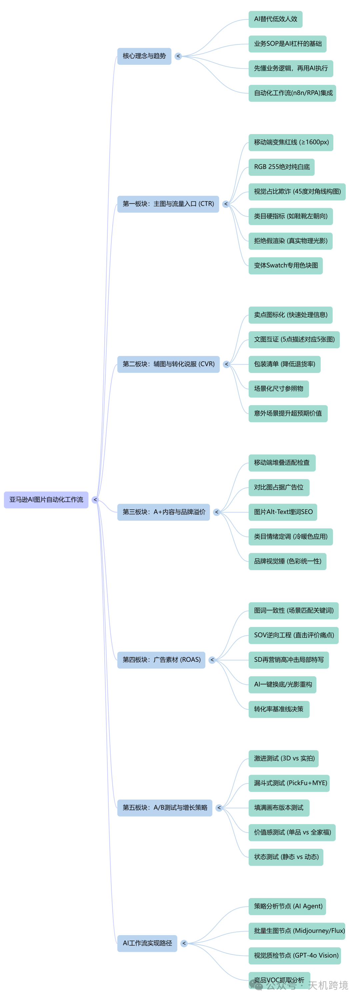

深度思考：

基于卖家自己提供的来源材料，在“亚马逊自动生图AI工作流”实现路径（主要基于n8n和dify自动化工作流平台）下，“批量生图节点”（具体 Nano Banana 和Gemini等模型接口）可以归纳为以下几个核心观点。

总的来说，来源材料并不把生图节点视为单一的创作工具，而是将其定义为“自动化流水线中的执行工厂”。它的价值在于能够严格遵循业务SOP（标准作业程序），以极低的成本和极高的速度进行规模化生产。

以下是具体的深度讨论：

## 1. 定位：是“执行杠杆”而非“策略大脑”

AI的本质是杠杆，如果缺乏扎实的业务理解，AI只会“把错误放大一万倍”。

- **角色分工：**

   在整个工作流中，ChatGPT, Gemini等大语言模型扮演“策略大脑”的角色（负责分析产品、拆解卖点、撰写提示词），而生图节点（如 Nano Banana）则扮演“绘图工厂”的角色。
- **依赖关系：**

   生图节点的产出质量并不完全取决于模型本身的能力，而更多取决于上游输入的“提示词策略”。

## 2 . 运行机制：结构化并发与循环生成

在“批量”这一概念上，工作流通过编程逻辑（如 Loop 和 Parallel 节点）彻底改变了传统美工的单图作业模式。

- **循环生产（Loop）：**

   在辅图（Gallery Images）生成的工作流中，策略节点会一次性输出包含5种不同视角（主图，附图，A+图，全家福、卖点图、场景图等）的JSON数据。生图节点随即进入“循环模式”，针对每一种类型自动请求生成，实现了“让AI逐个去生成”的自动化流程，而非人工一张张调试。
- **并发测试（Parallel）：**

   在A/B测试工作流中，生图节点被用来同时生成“对照组”（如纯白底图）和“实验组”（如带场景图）。这种并发能力使得商家可以低成本地通过“假设生成器”快速产出多组变量素材进行测试。

## 3. 控制与约束：需配合“视觉质检”形成闭环

来源强调，直接生成的图片往往不能直接使用，必须建立反馈机制。

- **闭环修正：**

   在主图工作流中，生图节点的输出会立即被送往一个“视觉质检员”节点（通常是 GPT-4o Vision）。如果检测到背景不是纯白或有伪影，工作流会自动触发“修正反馈”，要求生图节点重新生成，直到通过为止。
- **参数控制：**

   为了保证产品的一致性，生图节点在工作流中往往需要开启 ControlNet 约束，或者在提示词中严格限定光影（如 "Studio lighting"）和构图（如 "occupy exactly 85% of the frame"），以确保产出的图片符合电商平台的合规性要求。

## 4. 场景化应用：从“展示”到“说服”的工具

生图节点在不同板块中的应用逻辑不同，反映了对其能力的灵活调用：

- **主图：**

   追求极致的物理真实感和合规性（RGB数值准确、无光效陷阱）。
- **副图与A+图：**

   侧重于场景构建和痛点可视化。例如，利用生图节点生成“意外场景”或“内部爆炸图”来消除买家疑虑，甚至利用 In-painting 或合成技术将产品植入高质量的光影场景中。
- **广告图：**

   强调“视觉钩子”（Visual Hook）和图词一致性。生图节点被要求生成留有30%负空间（Negative Space）的图片，以便后续自动化添加广告文案。

## 第一部分总结如下：

在这些来源描述的AI工作流中，

**生图节点（Nano Banana/ ）不再是一个需要人类反复抽卡、凭运气出图的“黑盒”，而是一个被参数化、标准化管理的“渲染API”**。它被嵌入在`业务数据 -> 策略分析 -> 提示词构建 -> [生图节点] -> 视觉质检 -> 最终交付` 这一严密的链条中，其核心价值在于**稳定**与**规模化**地将商业策略转化为视觉资产。

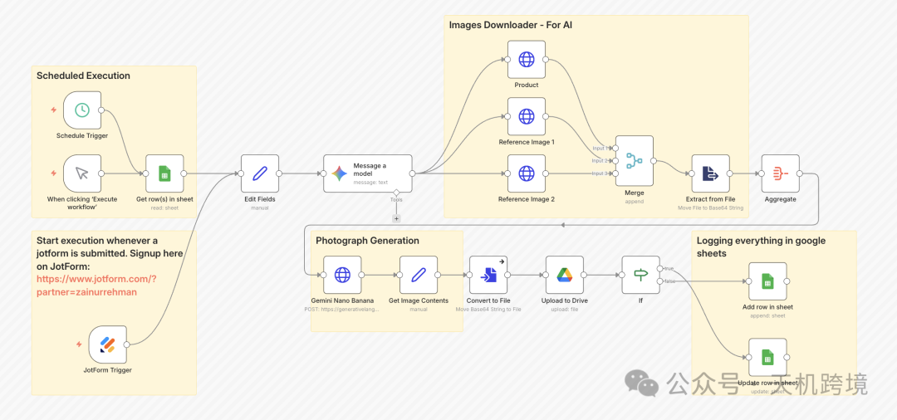

基于对亚马逊AI图片工作流的详细拆解（尤其是n8n平台上的实现路径），亚马逊自动化图片AI工作流通常包含以下 **5个关键步骤**。

这些步骤构成了一个从“业务数据输入”到“最终资产交付”的完整闭环，其核心在于将策略（Strategy）**与**执行（Execution）**分离，并引入**质检（Q&A）机制。

## 1. 触发与数据输入 (Trigger & Data Input)

工作流的起点通常是结构化的业务数据，而非随意的一句话指令。

- **触发方式：**

   常见的是在 Google Sheets 表格中新增一行产品信息。
- **关键输入：**

- **原图（Raw Image）：**

   必须提供一张随手拍的产品基础图或白底图，作为AI生成的参考基准（Reference Image）。
- **元数据：**

   包括产品名称、ASIN编码、核心卖点等，用于辅助AI理解产品特性。

## 2. 策略分析与提示词构建 (Strategy Analysis & Prompt Engineering)

这是工作流的“大脑”环节（通常由 ChatGPT 承担），它的任务不是画图，而是将业务逻辑“翻译”给绘图AI听。不同类型的图片有不同的分析策略：

- **主图 策略（合规性）：**

   AI分析原图，识别产品形态，转化为符合亚马逊严格规范（如“RGB 255纯白底”、“占据85%画幅”）的提示词。
- **副图 策略（结构化）：**

   AI根据产品特性，自动拆解出5张辅图的JSON数据结构（例如：一张全家福、一张微距材质、一张生活场景等）。
- **广告图/A+图 策略（逆向工程）：**

   AI会先分析竞品评论（VOC）或抓取痛点，然后针对性地生成强调“解决痛点”或“品牌氛围”的视觉描述。
- **A/B测试策略（假设生成）：**

   AI自动提出假设（例如“极简风 vs 堆料风”），并生成两组截然不同的提示词用于并发测试。

## 3. 自动化生成执行 (Execution & Generation)

这是工作流的“工厂”环节（由MJ/ Lovart / Nano Banana 等节点承担），根据上一步的指令进行规模化生产。

- **参数控制：**

   为了保证产品不变形，通常会开启 **ControlNet** 约束，确保生成的图片与原图在轮廓和细节上保持一致。
- **逻辑结构：**

- **循环（Loop）：**

   针对辅图，工作流会进入循环模式，逐一生成列表中的5张图片，而非一次性生成。
- **并发（Parallel）：**

   针对A/B测试或A+内容，工作流会同时开启多条线路，并行生成对照组（Variant A）和实验组（Variant B），提高效率。

## 4. 视觉质检与反馈闭环 (Visual Q&A & Feedback Loop)

这是区分“玩具”和“生产力工具”的关键步骤。直接生成的图片往往不能直接商用，需要引入**AI质检员**（通常是 GPT-4o Vision）。

- **自动审核：**

   质检节点会检查图片是否符合硬性标准，例如：背景是否为纯白？是否有伪影？文字是否乱码？。
- **修正闭环：**

   如果质检**未通过（Fail）**，工作流会自动触发“修正反馈”，将错误原因（如“阴影太重”）反向传回生图节点，要求重新生成，直到\*\*通过（Pass）\*\*为止。

## 5. 交付与归档 (Delivery & Archiving)

最后一步是将生成的数字资产标准化归档，以便运营人员直接使用。

- **云端存储：**

   自动将高清大图上传至 Google Drive 对应的产品文件夹。
- **数据回写：**

   将生成的图片链接回填至 Google Sheets 表格中，更新状态为“Done”。
- **通知触达：**

   通过 Slack 或邮件发送通知（如“3组 A/B 测试素材已就绪”），提醒人工进行最终确认。
- **SEO增值：**

   对于A+页面，工作流甚至会自动生成包含关键词的 Alt-Text（替代文本）并一并交付，用于提升SEO。

**正确的路径是：先掌握这些基于数据的业务技巧，内化成策略，再写进提示词让AI执行。**

我来演示一下。

## 第一板块：主图与流量入口（决胜CTR）

*主图决定客户点不点，不合规直接被关小黑屋。*

1. **移动端变焦红线**：图片长边必须≥1600像素。激活移动端缩放功能是转化红线，看不清细节买家会直接划走，数据验证能提20%转化。
2. **RGB 255的绝对值**：白底必须是RGB(255,255,255)。肉眼白没用，数值差1都会被AI判定降权，必须用吸管检查。
3. **视觉占比欺诈**：长条产品用45度对角线构图。在缩略图中撑满格子，视觉上比竞品大一圈，强行拉高点击。
4. **鞋靴类目死规矩**：必须单支、左朝向、45度角。这是算法硬指标，别玩创意，否则会被判主图不符直接限流。
5. **拒绝 假 渲染**：算法正在压制一眼假的3D图。渲染必须模拟真实物理光影和漫反射，否则会被归类为非真实商品。
6. **光效陷阱**：严禁装饰性光斑。已有案例证明，圆形光效会被AI误判为徽标Logo，直接导致Listing变狗。
7. **变体Swatch图**：多色变体必须单独上传色块图。否则系统强行压缩主图到小圆圈，模糊不清极度劝退。

把这些规则植入「亚马逊主图」的提示词，用于Nano Banana Pro：


```
# Role
You are an expert Amazon Product Photographer and AI Visual Director specialized in the "3C & Consumer Electronics" category. Your goal is to analyze the input image of a product and write a highly detailed, conversion-optimized text-to-image prompt.

# Objective
Generate a prompt that will produce a "Best Seller" quality Amazon Main Image (White Background) that maximizes Click-Through Rate (CTR) and adheres to strict platform compliance.

# Analysis Instructions (Do not output this, just perform it)
1. **Identify the Subject:** Recognize the device type (e.g., Drone, Laptop, Power Bank, Adapter) and its key value proposition features (Screens, Ports, Lenses, Propellers, Prongs).
2. **Determine the "Hero Angle":**
   - If the object is flat (e.g., Laptop, Phone): Choose a dynamic perspective that shows the screen contents vividly AND the slim profile.
   - If the object is boxy/dense (e.g., Power Bank, Adapter): Choose a 3/4 isometric view (approx. 30-45 degrees) to reveal two or three faces simultaneously (e.g., the port face and the branding face).
   - If the object is complex (e.g., Drone): Choose a top-down angled view that splays the arms/propellers diagonally to maximize canvas coverage.
3. **Analyze Material & Texture:** Determine if the surface is matte plastic, brushed metal, or glossy glass, and define lighting to accentuate these specific textures.

# Output Format (The Prompt You Must Write)
Write a continuous, comma-separated prompt string covering the following dimensions:

1.  **Subject Definition:** [Product Name], [Core Feature], professional e-commerce product photography.
2.  **Composition & Angle:** [Dynamic Angle based on your analysis]. The product must be positioned diagonally or centrally to occupy exactly 85% of the frame. 
3.  **Lighting & Atmosphere:** Studio lighting, softbox illumination, [Specific lighting to highlight material, e.g., "rim lighting for edges" or "specular highlights for glass"], no harsh shadows, natural contact shadow only.
4.  **Technical Quality:** 8k resolution, ultra-realistic, sharp focus, focus stacking, hyper-detailed.
5.  **Amazon Standards:** Pure white background (RGB 255,255,255), no text, no watermarks, no props, distinct edges.
6.  **Color & Tone:** [Match the product's actual color], high contrast, vibrant yet accurate colors.

# Critical Constraints
- **For Screens:** If the product has a screen, the prompt must specify "vibrant screen display showing abstract colorful wallpaper, glowing screen".
- **For Metal/Connectors:** Specify "metallic luster, chrome finish on connectors".
- **For Matte Surfaces:** Specify "premium matte finish, soft diffuse reflection".
- **Zoom Capability:** Ensure the description emphasizes texture details (grain, metal brushing) to support 1600px+ zoom capability.

# Input
[Attached Image]

# Your Output
(Provide ONLY the prompt string, nothing else.)
```


看看效果。

这是我随手拍的图：

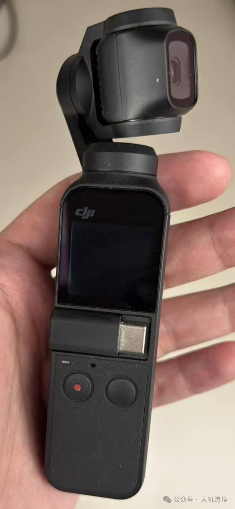

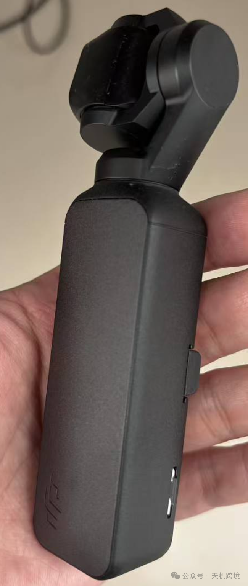

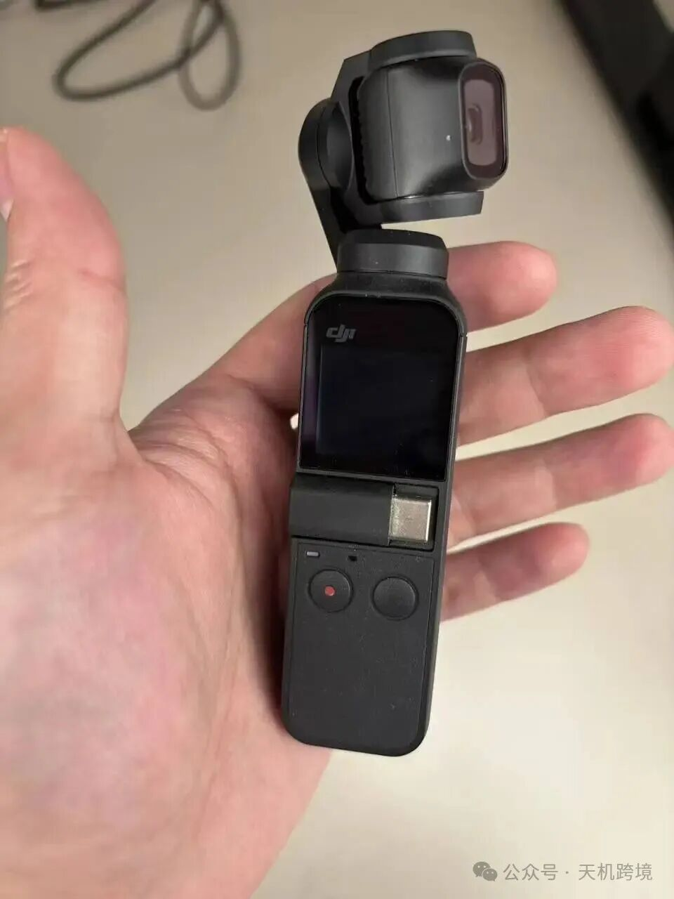

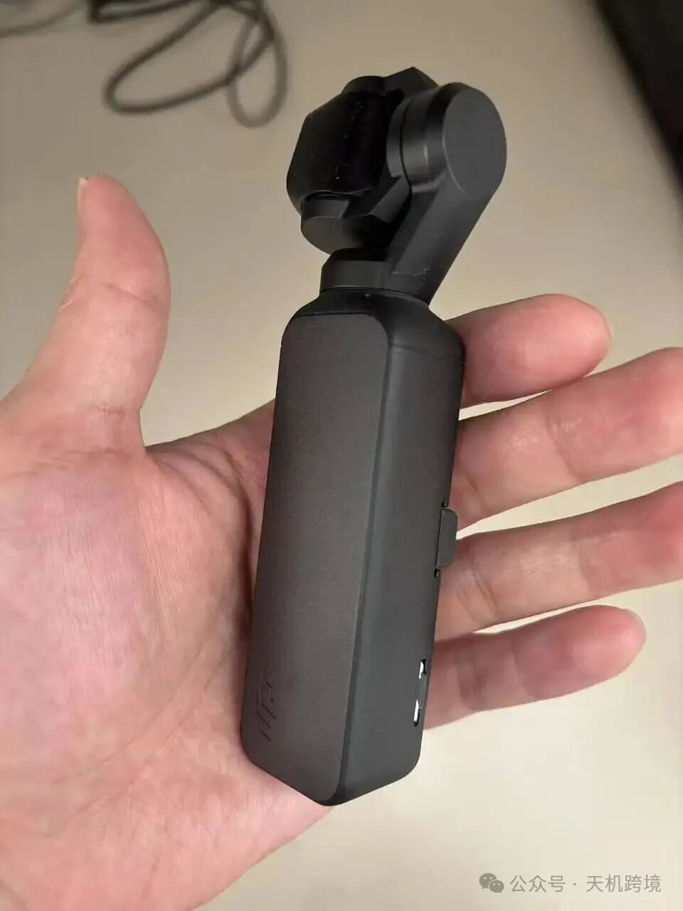

生成亚马逊主图：

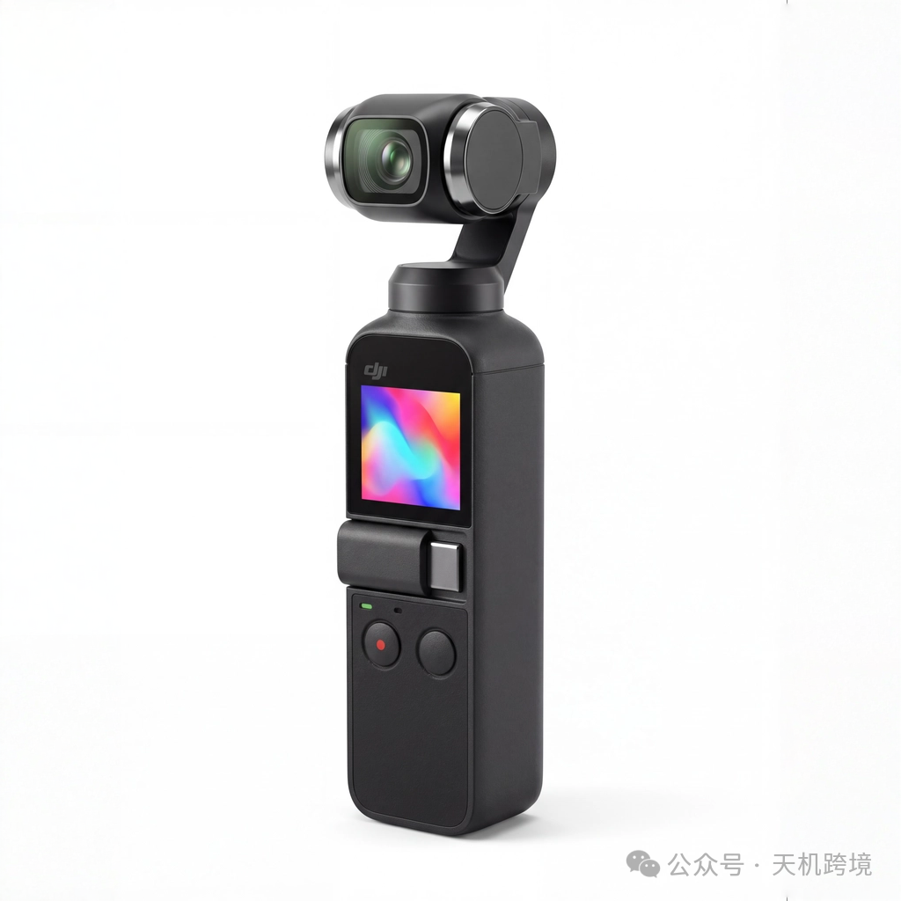

**那工作流怎么玩？**

关键还是在`图片分析`这个AI Agent节点上，分析随手拍的图之后给出生图提示词

最后再有一个AI质检员审核图片是否合规，这是基操。

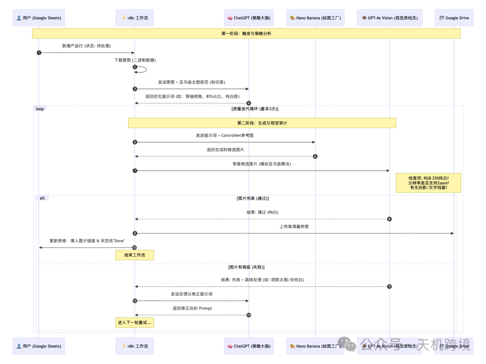

参考网上的工作流，大概会长这样。

## 第二板块：辅图与转化说服（决胜CVR）

*辅图的逻辑是消除疑虑，而非单纯展示。*

8. **卖点图标化**：大脑处理图像比文字快6万倍。把食品级、防水等枯燥参数做成图标+短语，买家扫一眼就懂。
9. **一一对应原则**：5张辅图严格对应5点描述。第一点讲材质，第一张图就放材质微距，形成文图互证闭环。
10. **包装清单防差评**：电子家居类必放一张全家福。明确展示所有配件，能显著降低因 以为有其实没有 导致的退货。
11. **意外场景**：放一张 意料之外 的用法图，如橄榄球头盔护颈。这种超预期价值是转化的临门一脚。
12. **视频卡位战**：上传视频后前台只显示6张图。核心卖点必须在前6张展示完毕，第7张图会被视频入口折叠隐藏。
13. **尺寸参照物**：别只标数字。一定要放入手机、可乐罐或人手做参照，直观感知大小能大幅降低尺寸误判退货。

同样植入生成多张「亚马逊辅图」的提示词：


```
# Role
You are an expert Amazon E-commerce Visual Strategist and Prompt Engineer specialized in Consumer Electronics (3C). Your goal is to analyze an input product image and generate 5 distinct, high-conversion text-to-image prompts for the product's "Gallery Images" (Secondary Images).

# Input Analysis
1.  **Identify Product:** Analyze the uploaded image to determine the device type (e.g., Drone, Laptop, Mic, Charger), material (Metal, Plastic), and key visible features (Ports, Screens, Lenses).
2.  **Determine Value Props:** Infer the likely selling points based on the form factor (e.g., if small -> portability; if many ports -> connectivity; if rugged -> durability).

# Output Requirements
Generate 5 separate prompts corresponding to the following "Amazon High-CVR Structure". 
**Global Constraint for all prompts:** Aspect Ratio 1:1, Photorealistic 8k, Commercial E-commerce Lighting.

## Image 1: The "What's in the Box" (Knolling Shot)
* **Goal:** Eliminate anxiety about missing accessories.
* **Prompt Structure:** Flat lay photography, knolling style, overhead view. The [Product] is placed centrally. Surrounding it neatly are implied essential accessories (cables, adapters, manuals, pouch). Clean light grey or white background. Text overlay placeholder: "What's in the Box". High key lighting.

## Image 2: The "Key Feature" Infographic (Iconography)
* **Goal:** Visualize complex specs quickly.
* **Prompt Structure:** Close-up hero shot of the [Product]'s main feature (e.g., Lens, Port, Screen). Floating 3D minimalist icons next to the feature (e.g., a battery icon, a lightning bolt icon, a wifi icon) indicating specific specs. Depth of field focuses on the product. Professional tech blue or warm tech lighting.

## Image 3: The "Lifestyle & Scale" (Context Shot)
* **Goal:** Show size reference and use case.
* **Prompt Structure:** [Insert a logical Scenario based on product analysis]. 
    * *If Wearable:* Show a model wearing the [Product] comfortably in a city or studio setting.
    * *If Portable (Laptop/Phone):* Show a hand placing the [Product] into a sleek backpack or using it at a coffee shop table.
    * *If Home Device:* Show it placed on a modern wooden desk with organized peripherals.
    * **Critical:** Ensure the product looks realistic in size relative to the human hand/body.

## Image 4: The "Macro Detail" (Quality & Ports)
* **Goal:** Show build quality and connectivity.
* **Prompt Structure:** Extreme Macro shot, side profile or functional angle of [Product]. Highlighting texture details (brushed metal, matte finish) and specific ports/buttons. Soft rim lighting to accentuate edges. Sharp focus.

## Image 5: The "Surprise Use Case" (Ecosystem/Versatility)
* **Goal:** Show versatility or "it connects with everything".
* **Prompt Structure:** [Product] shown connected to or interacting with other common devices (e.g., a phone, a camera, a laptop). Or shown in a challenging environment (e.g., outdoors, active use) if the product looks rugged. Conveying "Seamless Integration".

# Execution
Based on the [Attached Image], output the 5 prompts below. Do not explain them, just write the prompts ready for image generation software.
```


生成的辅图效果是不是还不错：

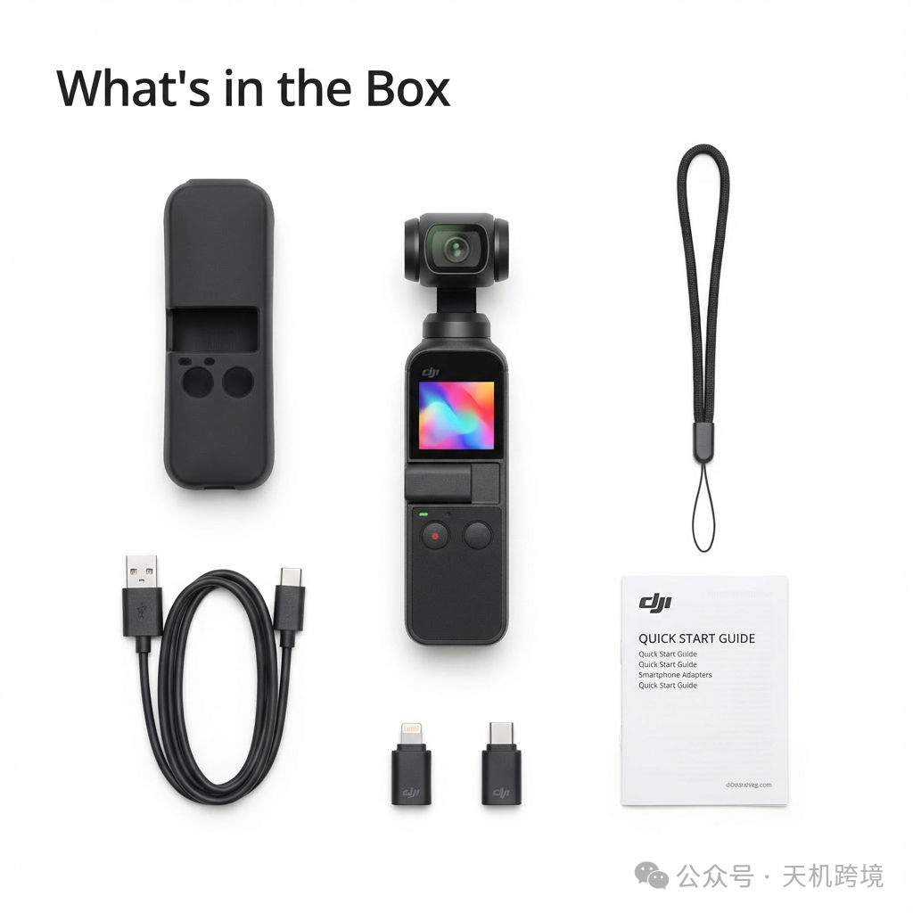

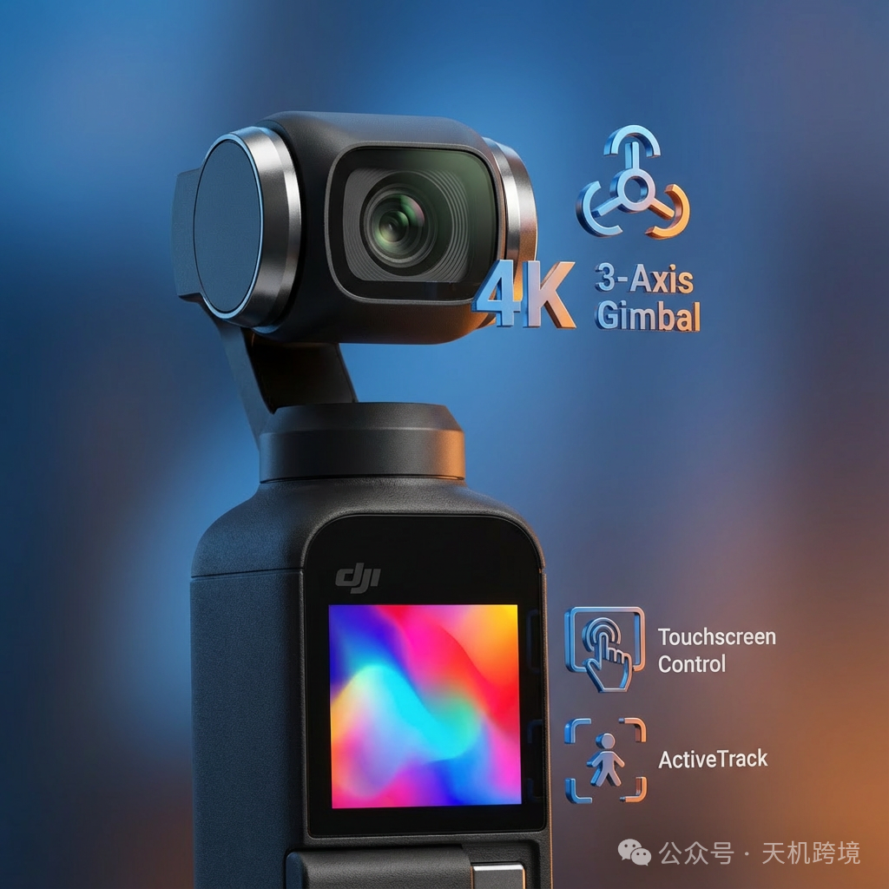

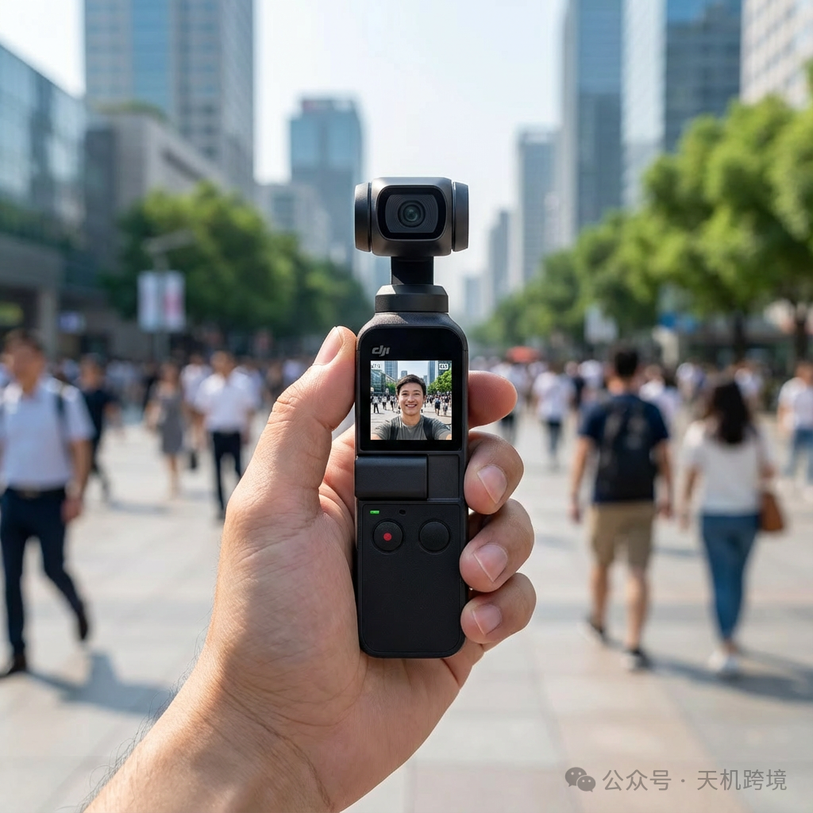

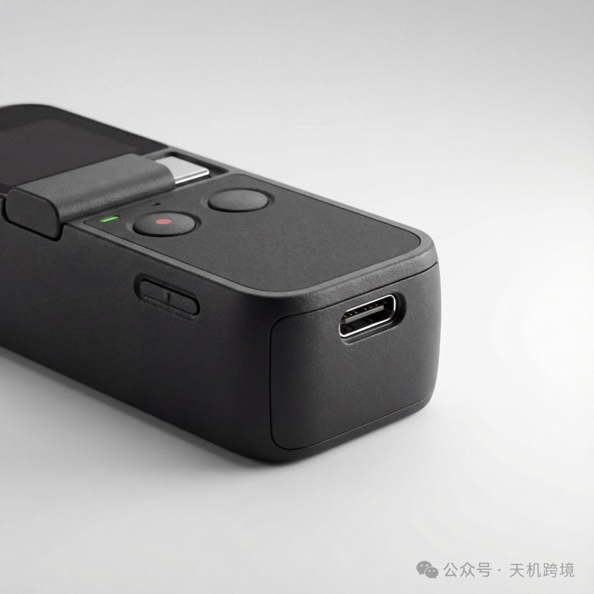

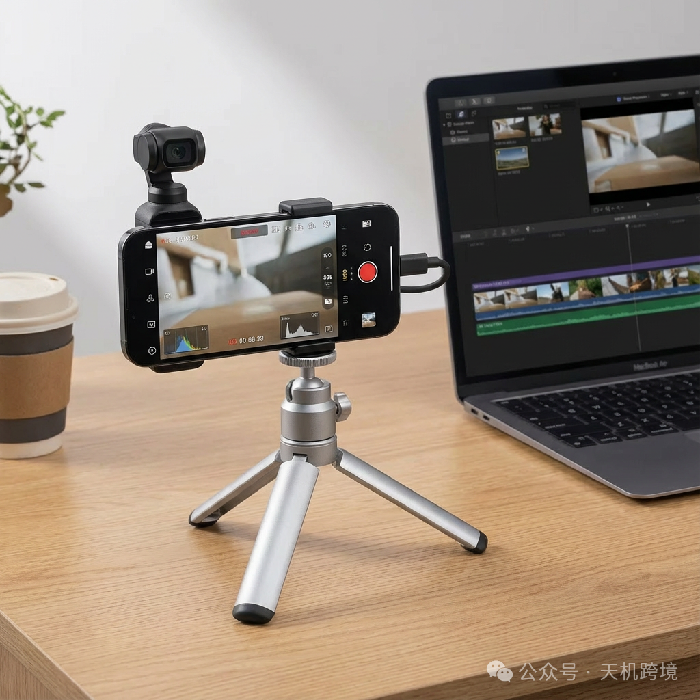

**工作流怎么玩？**

这里跟前面不一样的地方在于「批量循环生图」

总结出自己类目的辅图模板，让AI逐个去生成，参考逻辑：

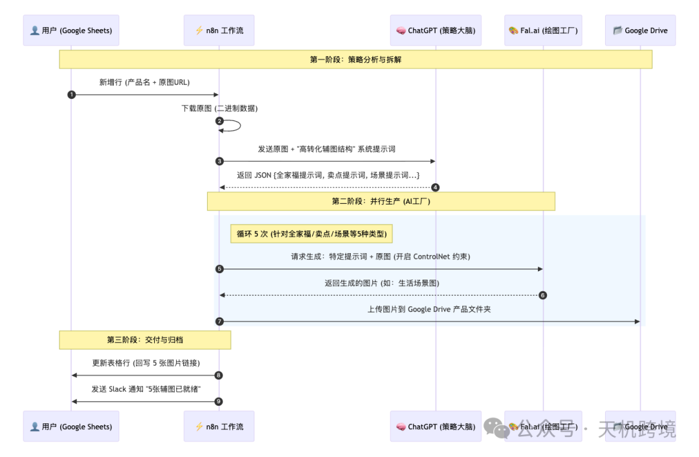

## 第三板块：品牌故事+风格+A+与品牌溢价（长期主义）

如何做好产品图片关键性参数输入-做出高质量提示词，思路来源

全链路 产品--数据源质量  来源（思路如下）

怎样才能做好的产品图片 思路

①卖点拆解，爆款文案 图片，竞品ASIN的图片给AI,提炼，竞品卖点和提示词，“爆款文案”全套逻辑输入

②整体风格，色调， 视觉质感，品牌基调

③人群： 人群特征 用户画像 购买消费水平 学历 婚姻 可支配年收入

④场景： 使用场景

⑤产品体验： 竞品评论收集，评论分析，用户功能，用户使用效果

⑥购买动机：背后的 购买意图识别 Rufus cosmos算法匹配

⑦产品特征 属性，

⑧本地消费者文化差异，消费心理，消费习惯  目标市场分析 用户需求，

品牌核心要点，

品牌方向

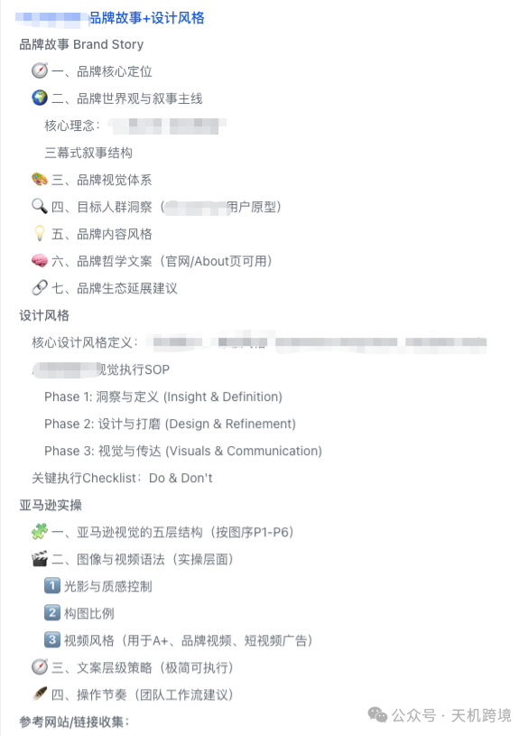

①品牌故事+②设计风格

①品牌故事Brand Story

一、品牌核心定位

二、品牌世界观与叙事主线

核心理念：三幕式叙事结构

三、品牌视觉体系

四、目标人群洞察（用户原型）

五、品牌内容风格

六、品牌哲学文案（官网/About页可用）

七、品牌生态延展建议

②设计风格

核心设计风格定义：

规范

视觉执行SOP

Phase1:洞察与定义（Insight&Definition）

Phase2:设计与打磨（Design&Refinement）

Phase3:视觉与传达（Visuals&Communication）

关键执行Checklist：Do&Don't

③亚马逊实操

亚马逊视觉的五层结构（按图序P1-P6）

图像与视频语法（实操层面）

光影与质感控制

构图比例

视频风格（用于A+、品牌视频、短视频广告）

三、文案层级策略（极简可执行）

四、操作节奏（团队工作流建议）

④参考网站/链接收集：

品牌故事创作

生活场景描述

目标人群智能分析

使用场景智能分析

智能文案生成

目标人群分析

用户痛点挖掘

使用场景扩展

核心卖点提炼

差异化优势

市场定位

视觉风格

Rufus深度洞察

基于您提供的文档《如何做好产品图片思路全链路 产品.docx》，特别是其中关于全链路思维、品牌视觉体系、亚马逊实操以及Prompt结构化的内容，我为您梳理了一套\*\*“自动化生成高质量产品图片工作流”\*\*的构建思路。

要实现自动化且高质量的图片输出，核心在于\*\*“结构化输入的颗粒度”**与**“商业意图的对齐”\*\*。以下是完整的全链路思路：

## 一、 核心逻辑架构

自动化工作流不仅仅是写提示词（Prompt），而是将非结构化的产品信息转化为机器可理解的结构化数据。

**公式：**`高质量输入 = (硬性产品数据 + 软性品牌美学 + 动态市场洞察) × 亚马逊转化逻辑`

---

## 二、 自动化工作流的五个关键输入维度

根据文档内容，这五个维度共同决定了AI生成图片的质量和商业有效性。

1. ### 物理属性与特征提取 (The "What")

这是最基础的输入，确保AI生成的“是这个产品”而非“像这个产品”。

- **外观特征拆解：** 需输入产品的材质、图案类型（如纯色/印花/罗纹）、版型（Fit Type）以及具体的模型名称
- **卖点视觉化：** 将核心卖点（Key Selling Points）转化为视觉语言。例如，不仅输入“强力散热”，而是输入对应的视觉表现（如风道气流图、冰蓝冷色调）
- **产品体验还原：** 基于竞品评论（VOC）和用户功能反馈，提取用户最在意的细节属性 (

2. ### 用户画像与场景定义 (The "Who" & "Where")

图片必须不仅展示产品，还要展示“谁在用”以及“在哪里用”。

- **多维人群画像：** 提示词需包含具体的年龄层、职业特征（如"Professional women 25-40"）、消费水平甚至婚姻状况 。
- **场景分级策略：**


- **高频场景（Occasion Type 1）：** 用户最常使用的环境（如通勤、婚礼）。

- **次高频场景：** 用于拓展用途 ()。

- **生活方式锚定：** 定义Lifestyle（如休闲、商务、波西米亚），确保背景与产品调性一致

3. ### 品牌视觉与美学控制 (The "Vibe")

为了避免生成的图片像“公模”，必须注入品牌基因。

- **三幕式叙事：** 将品牌故事（Brand Story）融入图片背景。例如，如果品牌理念是“环保”，光影和背景需体现自然感
- **视觉质感 SOP：** 明确规定色调、光影（Light & Shadow）和视觉质感。这是区分廉价图与品牌图的关键
- **风格定义：** 明确设计风格（如极简、复古），并执行“Do & Don't”清单，告诉AI什么是被禁止的视觉元素

4. ### 市场文化与本地化 (The "Context")

针对不同站点生成符合当地审美习惯的图片。

- **文化差异适配：**


- **德国站：** 提示词应强调“功能性”、“极简风格”、“严谨” ()。
- **英国/欧洲站：** 关注正式场合适配性以及当地天气特征（如阴雨天场景） (

- **消费心理映射：** 分析目标市场的消费习惯，将这些心理诉求转化为具体的画面元素 ()。

5. ### 亚马逊平台算法适配 (The "Algorithm")

图片的最终目的是转化，需符合亚马逊的算法逻辑。

- **五层视觉结构：** 按照亚马逊视觉P1-P6的逻辑规划图片序列，确保主图、场景图、功能图各有侧重 ()。
- **购买意图匹配：** 利用Rufus和Cosmos算法逻辑，确保图片内容能回应用户的深层购买动机（如解决焦虑、获得认同）
- **构图比例：** 严格遵循亚马逊移动端和桌面端的最佳构图比例 ()。

---

## 三、 自动化工作流执行SOP (参考文档结构)

建议您搭建一个 **"JSON 结构化 Prompt 生成器"**，流程如下：

Phase 1: 洞察与定义 (Insight & Definition) ()

- **动作：** 输入ASIN或产品描述。
- **工具处理：** 抓取竞品评论(Review)和QA，进行VOC分析，提取“未被满足的期待”和“痛点”
- **输出数据：** 确定核心卖点关键词和需规避的负面视觉元素。

Phase 2: 结构化参数配置 (Structured Input) ()

参考文档中的JSON模板，构建标准输入表单：

JSON


```
{
  "product_core": {
    "item_type": "细分品类 [cite: 79]",
    "material_texture": "材质细节 (如: Carbon fiber texture) [cite: 9]",
    "key_feature_visual": "核心卖点视觉化描述 [cite: 48]"
  },
  "visual_style": {
    "lighting": "光影质感 (如: Soft studio lighting) [cite: 34]",
    "composition": "构图 (如: Golden ratio, Close-up) ",
    "tone": "品牌基调 (如: Luxury, Minimalist) [cite: 4]"
  },
  "market_context": {
    "region": "目标市场 (如: DE/UK) [cite: 62]",
    "cultural_nuance": "文化偏好 (如: UK-Formal) ",
    "target_audience": "用户画像 [cite: 86]"
  }
}
```


Phase 3: 生成与打磨 (Design & Refinement) ()

- **AI生成：** 将JSON参数通过脚本转化为Midjourney/Flux等工具的提示词。
- **人工/AI校验：** 检查是否符合“亚马逊视觉五层结构” ()，确认产品并未变形。

Phase 4: 视觉传达与测试 (Visuals & Communication) ()

- **A/B测试：** 针对不同场景（Occasion Type 1 vs Type 2）生成的图片进行点击率测试。
- **Rufus洞察反馈：** 检查生成的图片是否解决了Rufus报告中提到的“认知偏差”或“核心信息缺失” ()。

## 四、 总结：影响高质量输出的要点清单

在构建自动化工作流时，请务必在System Prompt中包含以下Checklist：

1. **数据源准确性：** 竞品ASIN的卖点提炼是否经过AI清洗？
2. **全域视角：** 是否结合了社媒（Pre-purchase）的种草属性和电商（Post-purchase）的体验属性？
3. **颗粒度：** 提示词是否细化到了“纹理”、“光影方向”和“具体的人群特征”？
4. **品牌一致性：** 是否强制约束了色调和设计风格，防止AI过度发挥？ ()
