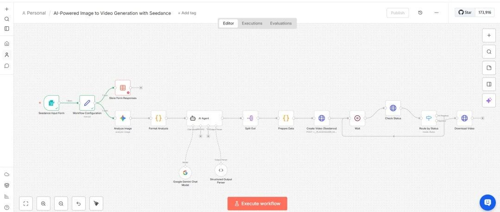
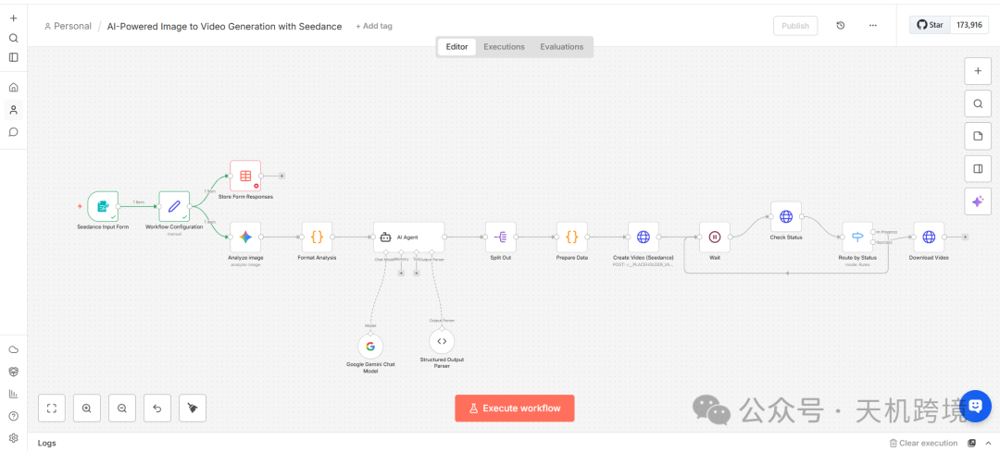
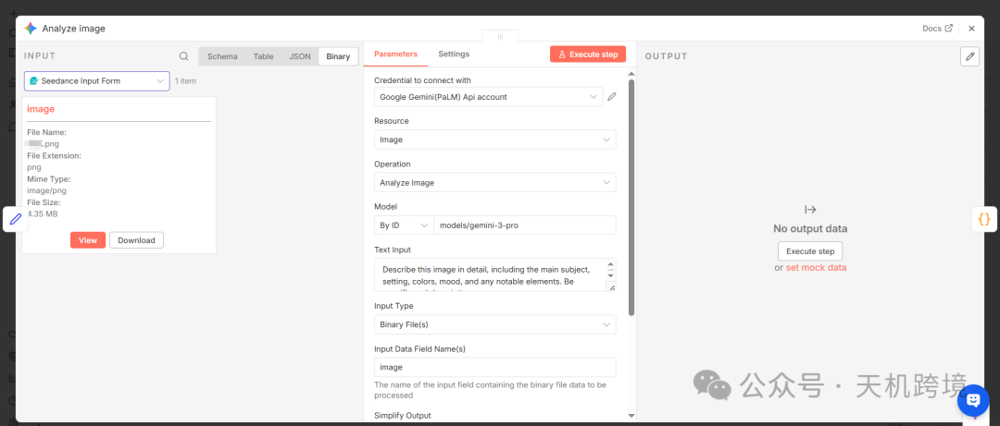
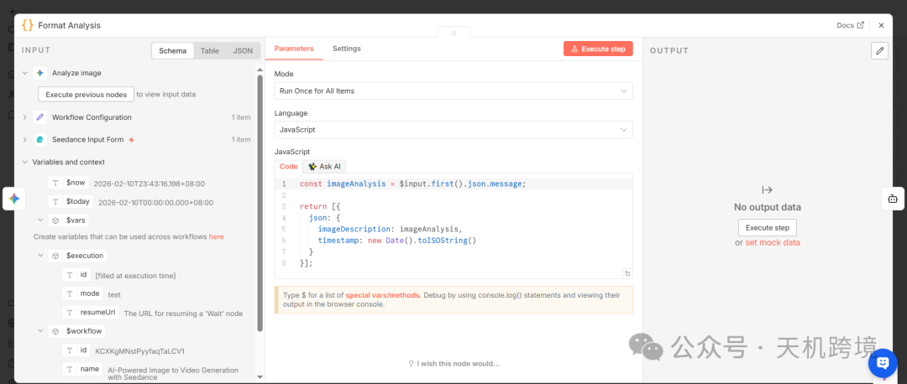
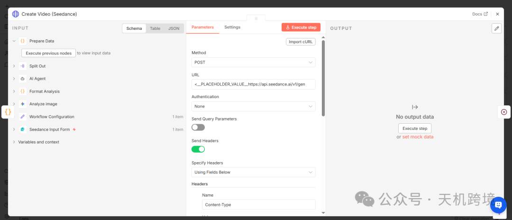
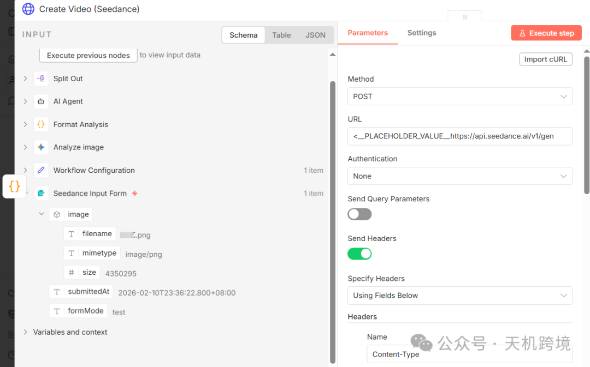
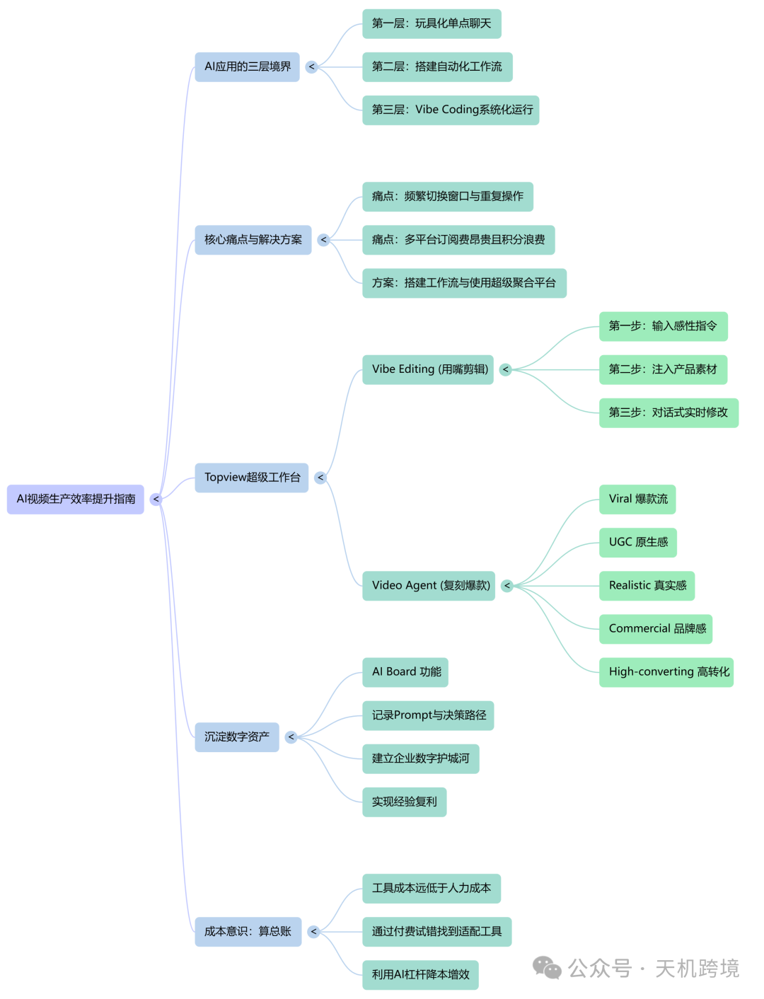

# 亚马逊AI工作流- Seedance自动化生视频

> Source: wechat
> Author: 天机跨境
> Original: https://mp.weixin.qq.com/s/2kAQ9Rcsv3dldj3_qJuu1g

---

---

①AI视频生产效率与系统化工作流指南（n8n和Seedance）

②如何从简单的AI对话跨越到高效的自动化工作流？

③AI Board如何帮助企业沉淀数字资产？（Topview.ai）

③总结

详细拆解AI视频生产工作流指南，以及详细分析，AI-Powered Image to Video Generation with Seedance

这是一份专业且逻辑严密的 “异步 API 轮询” (Async API Polling) 工作流。

这个工作流不仅仅是简单的“发请求 -> 得结果”，它处理了 AI 视频生成中最棘手的“等待时间长”的问题，并利用 LLM (Gemini) 充当了“提示词工程师”的角色。

下面我将为你详细拆解这个`AI-Powered Image to Video Generation with Seedance` 工作流的每一个环节。

---

## 🗺️ 全局概览：四大核心阶段

这个工作流可以被划分为四个清晰的阶段：

1. 输入与视觉分析 (Input & Vision)：接收图片，让 AI “看懂” 图片。输入竞品的图片，进行卖点分析，拆解~
2. 智能体转化 (Agentic Prompting)：将“图片描述”转化为专业的“视频生成提示词”。
3. 发起任务 (Task Initiation)：向 Seedance API 发送生成请求。
4. 循环轮询 (Polling Loop)：不断询问“做好了吗？”，直到完成并下载。

---

## 🔍 详细拆解 (逐个节点分析)

第一阶段：输入与视觉理解 (Input & Analysis)

1. Seedance Input Form (Form Trigger)

- 作用：这是一个 n8n 表单触发器。它生成一个网页链接，允许用户上传一张图片（支持 jpg, png 等）。
- 关键点：它模拟了前端交互，是整个流程的入口。

2. Workflow Configuration & Store Form Responses

- 作用：数据整理。把用户上传的文件名、时间戳等元数据提取出来，方便后续记录或排查问题。

3. Analyze image (Google Gemini Vision) 👁️

- 核心节点：这是工作流的“眼睛”。
- 配置：使用了`gemini-pro-vision` (或类似的多模态模型)。
- Prompt："Describe this image in detail..."（详细描述这张图片，包括主体、环境、颜色、情绪等）。
- 目的：Seedance（或 Sora）是基于文本生成的，所以必须先把“视觉信号”翻译成“文本信号”。

4. Format Analysis (Code Node)

- 作用：简单的 JavaScript 代码，把 Gemini 吐出来的一大段文本整理成干净的 JSON 格式，准备传给下一个 AI。

第二阶段：智能提示词工程 (Agentic Engineering) 🧠

5. AI Agent (LangChain)

- 核心节点：这是工作流的“大脑”。它不是简单的传话筒，而是一个\*\*“专家代理”\*\*。
- 设定 (System Message)："You are a creative video prompt engineer..."（你是一个创意视频提示词工程师）。
- 任务：它接收上一步的“图片描述”，然后根据视频模型的喜好，重写提示词。它会添加“镜头推拉 (dolly zoom)”、“光影风格 (cinematic lighting)”等专业术语。

6. Structured Output Parser

- 关键技术：这是让 AI 听话的神器。
- 作用：它强制 Gemini 不准废话，必须输出严格的 JSON 格式。
- Schema：它定义了输出必须包含`prompt` (提示词),`style` (风格),`duration` (时长)。如果没有这个节点，AI 可能会输出“好的，这是你的提示词...”，导致后续 API 报错。

7. Split Out

- 作用：如果 Agent 一次生成了 3 个方案，这个节点会把它们拆成 3 次独立的执行流程（虽然这里通常只生成 1 个）。

第三阶段：发起生成任务 (Execution) 🚀

8. Prepare Data (Code Node)

- 作用：最后的数据清洗。把 AI 生成的 JSON 字段映射到 Seedance API 要求的字段名（例如把`videoPrompt` 映射到 API 的 payload 中）。

9. Create Video (Seedance) (HTTP Request)

- 动作：`POST` 请求。
- URL：`https://api.seedance.ai/v1/generate` (这是 JSON 里的占位符)。
- 逻辑：它告诉服务器“开始做视频”。注意：服务器不会立刻返回视频，而是返回一个`taskId` (任务ID)。

第四阶段：轮询与下载 (Human in The Loop) 🔄

这是处理耗时任务（如视频生成）的标准架构。

10. Wait (等待节点)

- 作用：暂停工作流（比如 10 秒）。
- 为什么需要：视频生成可能需要 2-5 分钟。如果不停地问服务器“好了没”，服务器会封你的 IP。

11. Check Status (HTTP Request)

- 动作：`GET` 请求。
- URL：利用上一步拿到的`taskId` 去查询状态。
- 逻辑：问服务器“任务 ID 12345 目前是什么状态？”

12. Route by Status (Switch / If) 🚦

- 如果状态是`processing` (处理中) -> 连回 Wait 节点。这意味着流程会倒回去，重新等待，重新检查（形成死循环，直到完成）。
- 如果状态是`completed` (完成) -> 放行，进入下一步。

- 核心逻辑：

13. Download Video (HTTP Request)

- 作用：只有当状态为“完成”时才会触发。根据返回的`videoUrl` 下载最终的 MP4 文件。

---

## 🛠️ 你需要修改/配置的地方

这个 JSON 导入 n8n 后，不能直接运行，你需要填入真实的信息（由 JSON 中的`<__PLACEHOLDER__>` 标识）：

1. Google Gemini Credentials：

- 在`Analyze image` 和`Google Gemini Chat Model` 节点中，你需要绑定你的 Google PaLM/Gemini API Key。

2. Seedance API URL & Key：

- Create Video 节点：检查 URL 是否正确。如果不叫`Seedance` 而是`Runway` 或`Luma`，你需要改成对应的 API 地址。你还需要在 Header 里添加`Authorization: Bearer <你的API_KEY>`。
- Check Status 节点：同样需要检查 URL 规则（通常是`/status/{id}`）并配置 Header 鉴权。

3. Wait 时间：

- 默认可能是 10 秒。如果你用的模型生成很慢（如 Sora），建议改为 30 秒或 1 分钟，以节省 API 调用次数。

## 💡 总结

这是一个非常教科书式的 “AI 代理 + 异步任务处理” 模板。它展示了如何用 n8n 协调 视觉模型 (Gemini Vision)、语言模型 (Gemini Pro) 和 外部执行引擎 (Seedance API)，非常适合用于构建 SaaS 后端或企业级自动化工具。

AI视频生产效率与系统化工作流指南

本文将AI应用分为单点聊天、**自动化工作流**及**系统化集成**三层。作者推崇使用 **Topview** 平台，它通过**超级聚合**解决多软件切换痛点。核心功能包括**一句话出片**的 Vibe Editing、复刻爆款的 Video Agent，以及将经验转化为**数字资产**的 AI Board，实现降本增效。

## 超级聚合平台Topview.ai

根据提供的来源材料，要从简单的AI对话（“玩具化”阶段）跨越到高效的自动化工作流，需要经历认知上的升级和工具选择上的转变。以下是具体的实施步骤和建议：

## 1. 认知升级：识别AI应用的三个层级

首先，你需要明确自己目前处于哪个阶段，并有意识地向更高层级迈进。文中将AI应用分为三层：

- **第一层（AI玩具化）：**

   仅与AI进行单点聊天，一问一答。
- **第二层（工作流搭建）：**

   开始使用 N8N、Dify 或 RPA 等工具搭建工作流，实现自动化。
- **第三层（系统化/Vibe Coding）：**

   能够自己编写代码或构建工具，让AI在团队中“无感知”地运行。

跨越的关键在于**抛弃第一层的“聊天”模式**，因为这种模式效率极低，大部分时间都浪费在无价值的重复动作上。

## 2. 解决核心痛点：消除“切换”成本

简单对话模式最大的弊端是\*\*“切换”\*\*。你需要不断地在网页间跳转、重复上传下载文件、反复粘贴提示词（Prompt）。这种在不同窗口和步骤间的切换会让人晕头转向，占据了工作的大量时间却不产生价值。

**解决方案：搭建工作流**。通过工作流（如 N8N），你可以实现网页间无需切换、文件自动处理、无需重复粘贴 Prompt。工作流是一个“超级组织”，能聚合分散的精力，实现“点击一下就能运行”的一劳永逸的效果。

## 3. 选择“超级聚合”平台（以视频创作为例）

对于视频和图文创作，除了通用的工作流工具，还需要更专业的聚合平台。

- **避免分散采购：**

   为了追求高质量，以往可能需要分别购买 MJ（生图）、Sora/Kling（生视频）、HeyGen（数字人）等多个软件，导致成本高昂且积分浪费。
- **寻找“聚拢一切”的工作台：**

   来源推荐了 **Topview** 这样的超级聚合平台，它集成了视频、图片生成等多种功能，解决了在不同软件间切换和付费的痛点。

## 4. 利用AI的高级功能实现“傻瓜式”高效产出

在高效工作流中，AI不再是简单的问答机器，而是能够理解复杂指令的“代理（Agent）”。

- **“用嘴剪辑”（Vibe Editing）：**

   不需要学习复杂的剪辑软件或写代码。只需三步：

1. **给指令：**

    描述想要的感觉（如“极简科技感”），AI自动生成架构。
2. **注入灵魂：**

    上传素材，Agent自动嵌入。
3. **调整：**

    通过对话修改细节（如“让文字更有节奏感”），AI实时调整。

- **复刻爆款（Video Agent）：**

   针对电商或流量需求，利用“参考视频 + 你的产品 = 爆款视频”的逻辑，AI能全自动完成写脚本、对口型、生成视频的全过程。

## 5. 关键一步：将“过程”沉淀为“资产”

这是区分新手和高手的核心。简单的对话记录很容易丢失（在聊天记录里刷走、网页关掉就没了、员工离职带走），无法复用。

- **建立“库”的概念：**

   企业或个人的数字护城河不是最终生成的MP4文件，而是**经过验证的 Prompt 组合和决策路径**。
- **使用资产管理功能：**

   如 Topview 的 **AI Board** 功能，能自动记录每一次抽卡、对话剪辑和参数调整。这样即使人员流动，新人也能通过查看历史记录，立马复刻出同等水平的作品，实现真正的复利。

## 6. 具备“算总账”的思维

最后，要接受“工具成本”。虽然搭建工作流或订阅聚合平台需要付费，但相比于人工操作的低效、试错成本以及“抽卡”失败的浪费，这些工具费用只是“小钱”。付费是为了找到最适配、能力最强的工具（大模型能力相差巨大），从而利用AI杠杆实现降本增效。

根据来源材料，Topview 的 **AI Board** 功能通过将创作的\*\*“过程”**转化为企业的**“资产”\*\*，从而帮助企业沉淀数字资产。具体方式如下：

1. **自动记录全过程，避免经验流失**在传统的AI创作中，宝贵的提示词（Prompt）和参数调整往往散落在聊天软件（如Discord）的历史记录里，或者随着网页关闭而消失，甚至随员工离职而带走。**AI Board** 解决了这个问题，它能**自动记录、分类和归档**每一次“抽卡”（生成尝试）、每一次对话剪辑以及每一次参数调整。它确保了这些创作过程不会因为人为疏忽或人员变动而丢失。
2. **沉淀核心决策路径，建立“数字护城河**”文中强调，AI时代最重要的资产不是最终生成的视频文件（MP4），而是那些**经过市场验证的、能稳定产出爆款的 Prompt 组合和决策路径**。 AI Board 将这些“配方”保存下来，成为企业独有的数字护城河。
3. **实现无损交接，复刻高水平产出**通过 AI Board 的记录，企业可以实现“铁打的Board，流水的兵”。即使原来的员工离职，新入职的员工只需查看 Board 中的历史记录，就能理解之前的操作逻辑，立马复刻出同等水平的作品。这实现了真正的**复利**，让经验留存在公司内部，而不是烂在个人的聊天记录里。

总结来说，AI Board 通过**记录操作路径**和**标准化经验复用**，帮助企业将一次性的灵感转化为可重复利用的标准化资产。
