# 亚马逊AI工作流-自动化生视频智能体

> Source: wechat
> Author: 天机跨境
> Original: https://mp.weixin.qq.com/s/pOCx9Gp0brzjvx7X8sqviA

---

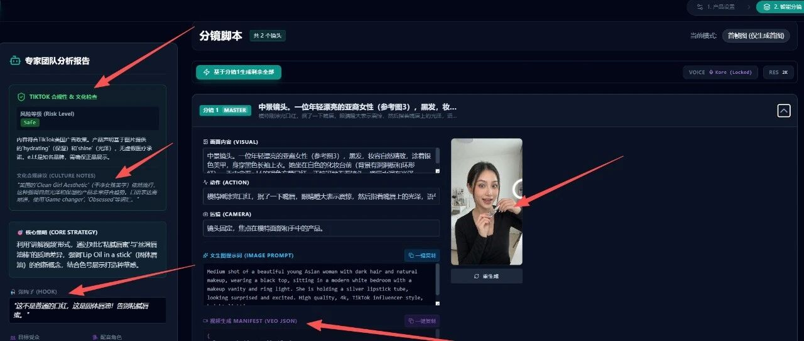

---

亚马逊AI工作流-自动化生视频智能体

AI Creator Studio · 爆款视频创作系统 副本

> 🔗 原文链接： ⁣⁢⁣⁣⁡📱 AI Creator Studio · 爆款视频创作系统

> ⏰ 天机跨境 阳亚运 AI Creator Studio 智能视频创作平台 v2.0
>
>

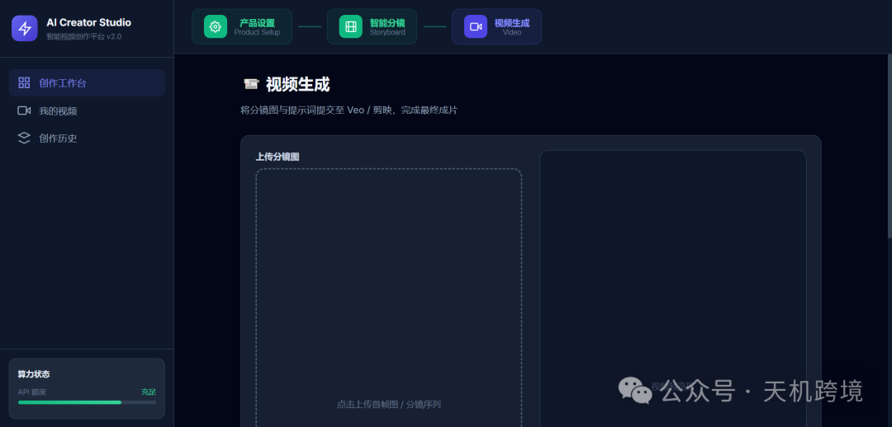
>
>

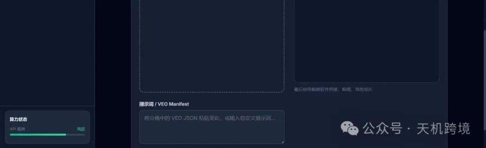

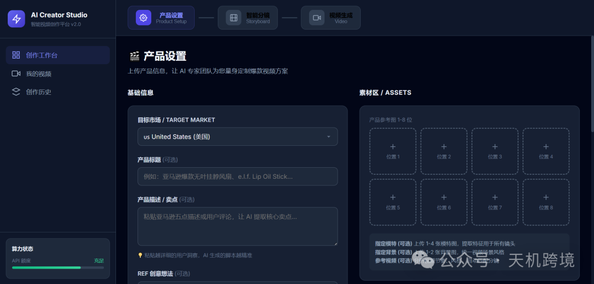

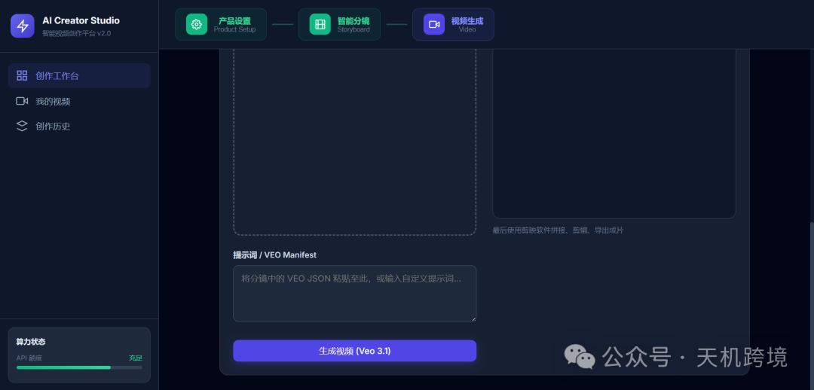

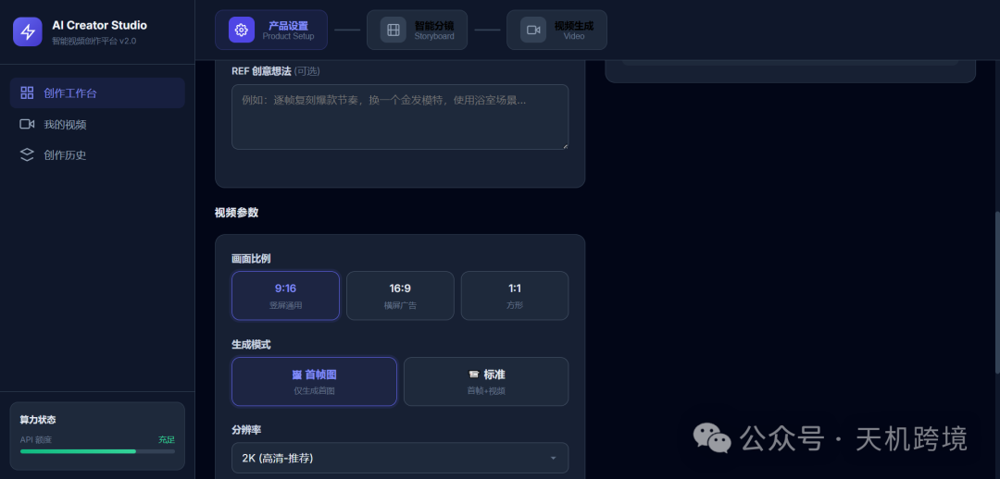

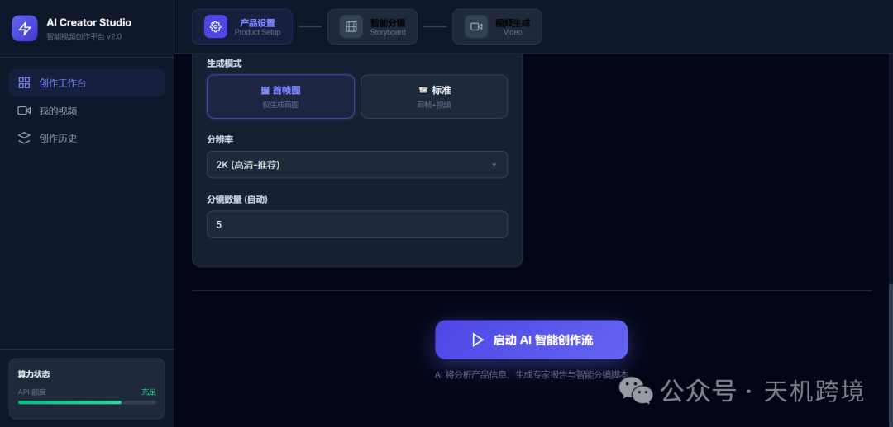

## 智能分镜

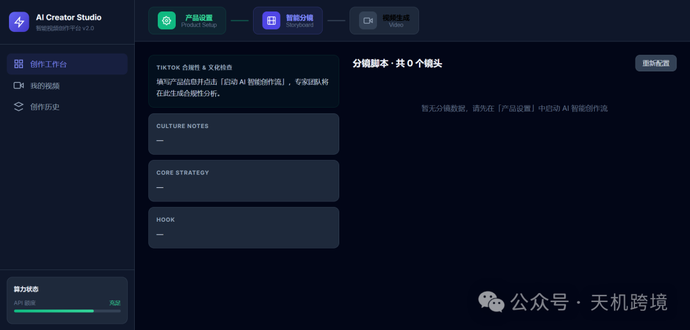

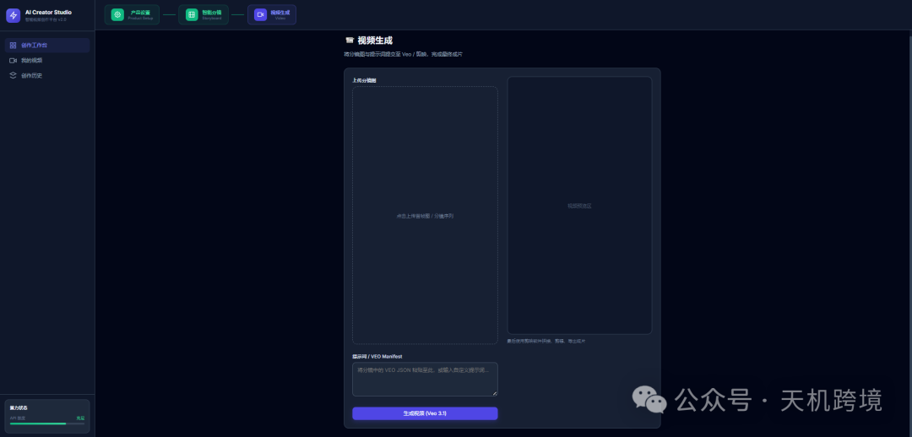

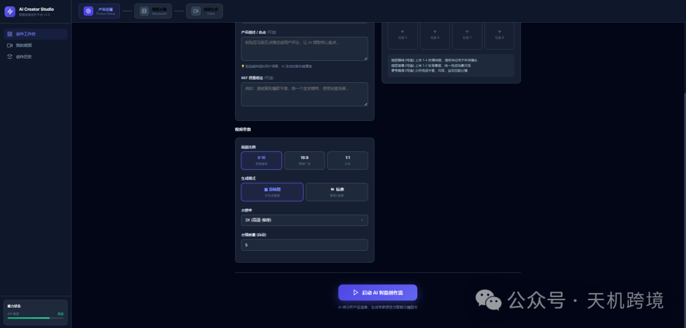

## —— 零基础小白也能做出的 4K 级带货视频

### 这是一个什么软件？

简单来说，它是一个“AI 电商带货视频总导演”。 你不需要请摄影师、不需要写脚本、不需要剪辑。你只需要上传几张随手拍的产品照片，它就会：

1. 自动大脑分析： **识别你的产品卖点、针对 TikTok 用户设计“黄金 3 秒”开头。**
2. 自动画分镜：  **生成每一秒的画面，保证产品和模特长得一样（这是最难的技术！）。**
3. 自动写提示词： **生成顶级视频模型（Veo）能看懂的“导演指令”。**

🌟 适用人群： **各平台卖家（可以根据平台、产品、市场定制）、带货达人、不想露 脸的博主。**

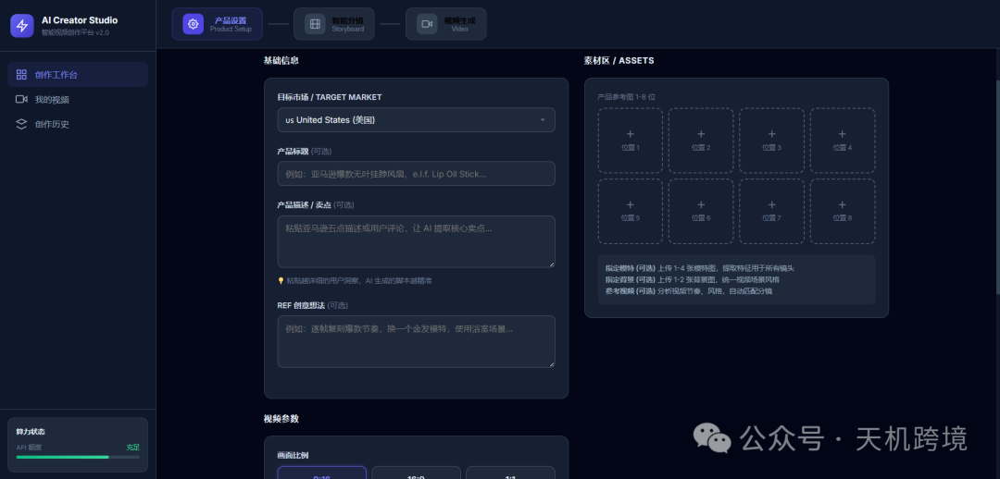

---

### 核心优势（为什么要用它？），简单易用！只要脑子里面有想法就有无限视频。

- ⚡️ 零门槛操作：不用学复杂的 Prompt（提示词），不用懂摄影打光。上传图片 -> 点击“启动”，AI 全自动搞定。
- 🔒 角色一致性（黑科技）：市面上的 AI 视频经常“第一秒模特是长发，第二秒变短发”。我们的系统拥有\*\*“视觉锚定”技术\*\*，确保你的模特、产品在所有镜头里保持一致！
- 🎬 4K 电影级画质：内置摄影参数模拟，支持“香蕉 Pro”高画质模型，生成的图片细节毛孔可见。
- 🧠 策略型脚本：不是瞎生成，而是基于营销逻辑。它会分析出“强钩子（Hook）”、“痛点”和“下单理由”，让视频不只是好看，更能出单。

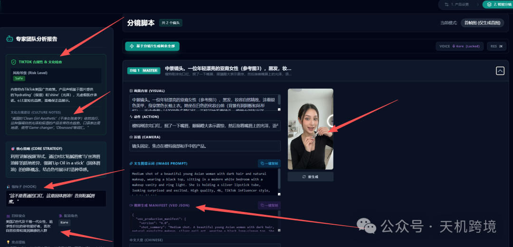

---

### 新手必读：关于“原料”的两个关键问题

在使用前，小白最容易晕的两个概念，这里用大白话解释清楚：

#### ❓ Q 1：什么是“API”？

> *通俗解释：API 就像是\*\*“电费预存卡”\*\*。 这个软件是一个超级聪明的大脑，但它运转需要消耗能量。你需要去谷歌申请一个 API Key（就像一串密码），填进软件里，它才有动力开始工作（分析图片、画分镜）。 不用担心，API 的费用非常低，且申请一次可以用很久。*

#### ❓ Q 2 ：什么是“视频会员”？

> *通俗解释：这是\*\*“冲印胶卷的暗房”\*\*。 我们的软件负责“拍摄”和“导演”（生成完美的分镜图+导演指令），但要把这些变成了动态的视频，需要用到谷歌最顶级的 Veo 视频生成器。*

- *现状：谷歌官方的视频生成会员很贵，而且门槛高，普通人很难买到或无限量使用。*
- *我们的解决方案：我们为您提供“会员通道”！*
- *超级福利：您不需要自己去折腾买昂贵的谷歌会员。仅需 1-200 元左右，我们就能提供生成 2-4000 个视频的算力支持！折合下来一条视频才 1 毛钱补到，比你自己买会员便宜几十倍。*
- 其它主流视频模型也可以。

---

### 保姆级使用教程

### 为了保护卖家数据隐私，系统启用了本地锁屏保护，所有内容都在自己电脑上！！！

#### 第一步：产品设置（给 AI 喂料）

1. 上传产品图：建议 1-4 张。随手拍的白底图、场景图都可以。
2. 可选设置： **指定模特+指定背景+指定脚本**

1. 指定模特：如果你有固定的模特脸部照片，上传上去，AI 会让她“出演”你的视频。
2. 参考视频：如果你在 TikTok 上看到一个爆款视频，把它下载下来喂给软件。AI 会逐帧分析它的节奏，把主角换成你的产品，完美复刻爆款节奏！

3. 参数选择：

1. 模型选择\*\*“Banana Pro”\*\*（画质最好）。
2. 生成模式选\*\*“标准”\*\*即可。
3. 口红

#### 第二步：AI 导演通过（生成策略）

点击\*\*“启动 AI 智能创作流”。 系统会开始疯狂运转，你会看到左侧出现了“专家分析报告”\*\*：

- 它制定了什么策略？
- 这一条视频是卖给谁的？
- Hook钩子（开头一句话）怎么说最抓人？

**👀 请务必关注左侧的【合规性报告】：**

\* 如果是 🟢 **Safe (安全)**：直接开干！

\* 如果是 🟠 **Warning (警告)**：请查看下方的“文化合规建议”，看看是不是哪个卖点在当地有歧视嫌疑。

#### 第三步：智能分镜与生产（关键步骤）

系统会列出 4-6 个分镜（可调节）。

1. 一键生成画面：点击右上角的\*\*“✨ 一键生成全部分镜图片”\*\*。

1. 系统会自动画出每一张分镜图（首帧）。

2. 生成语音：觉得脚本不错？点击每个分镜下的\*\*“生成语音”\*\*，这是 SOTA 级（目前最强）的 AI 配音，听起来完全不像机器人。目前veo支持语音可以省略这一步。
3. 获取“导演指令”：点击分镜卡片里的\*\*“视觉提示词 (Optimized)”。看那个绿色的 JSON 代码框——这就是价值连城的“导演指令”\*\*。

·将我们生成的 **首帧图**下载。

·复制 **JSON 提示词**。

#### 第四步：去“暗房”变成视频（最后一步）

1.把刚才下载的分镜图和对应的提示词放到视频生成工具中立刻生成视频。

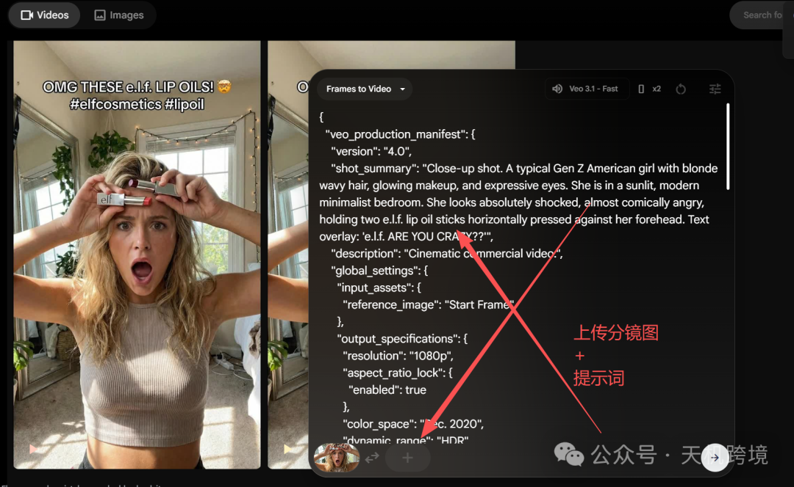

2.生成效果展示

|  |  |
| --- | --- |
| 1-1.mp4 | 4-1.mp4 |

### 成本价格

1. **视频智能体工作流3500元**，可以一直使用。

2.API用户自己注册购买然后我们会帮你内置到智能体，可以提供注册购买指南。

谷歌api计费说明，用多少扣多少，所有智能体都需要！但是我们 **提供0成本使用方法！**

ai.google.dev

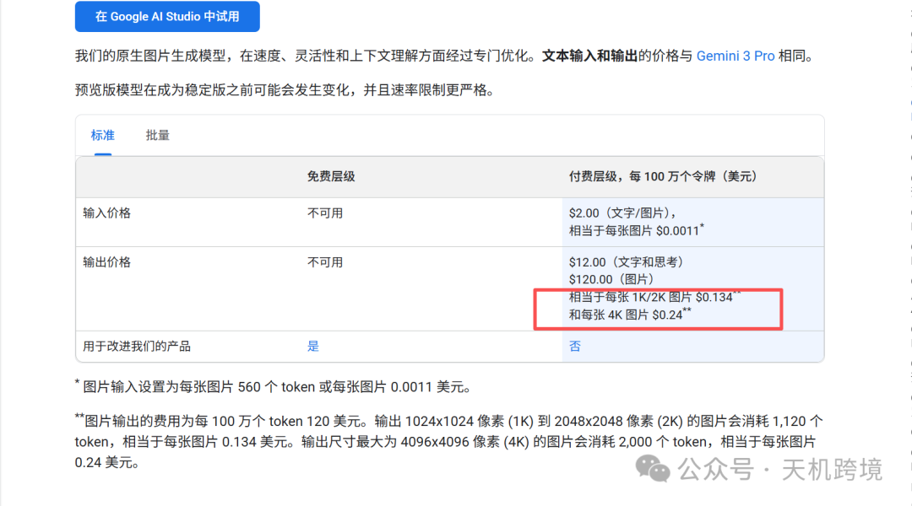

3. **视频会员，提供谷歌veo高级会员，每条视频成本5分钱。（额外付费通常在200元以内每个月或者自己购买）**

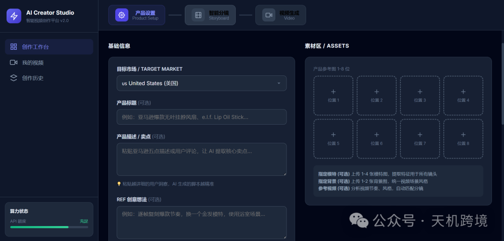

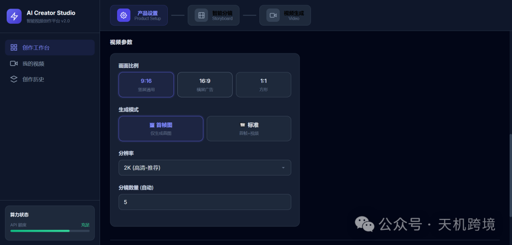

https://my.feishu.cn/wiki/Dl35wCuCyiRCWEkOzf2cIFpbnnd?from=from\_copylink

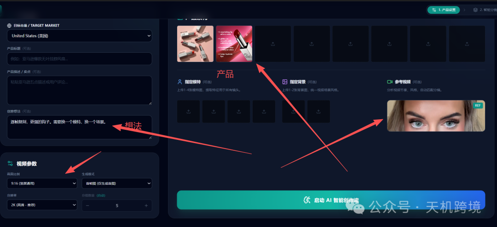

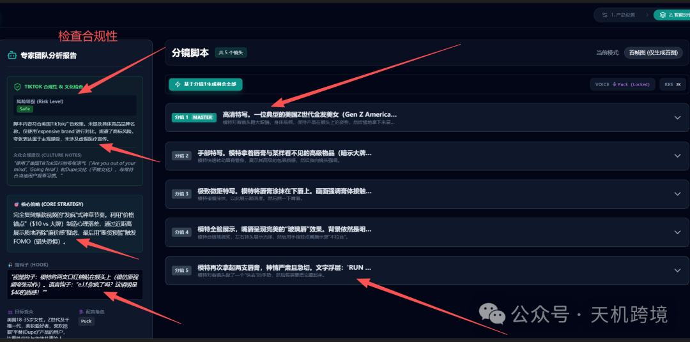

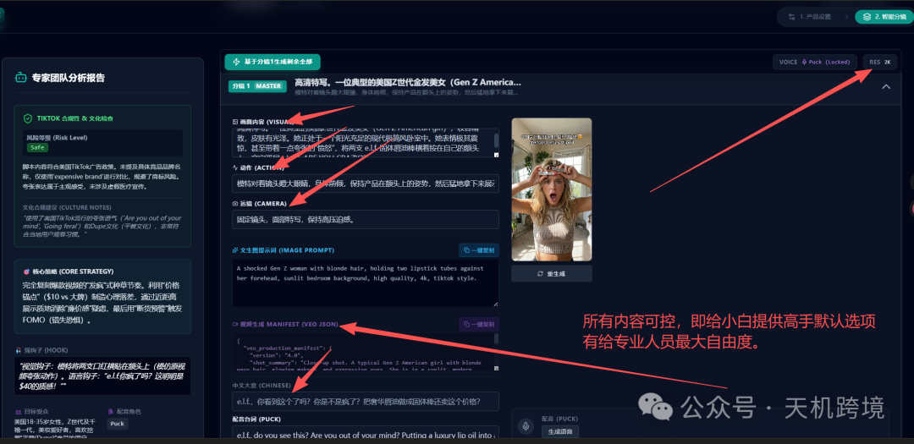

