# 如何用AI打造一套全自动爆款短视频剪辑系统？论文级教程

> Source: wechat
> Author: 天机跨境
> Original: https://mp.weixin.qq.com/s/NX_McOpS7r6SCvYurOeUuw

---

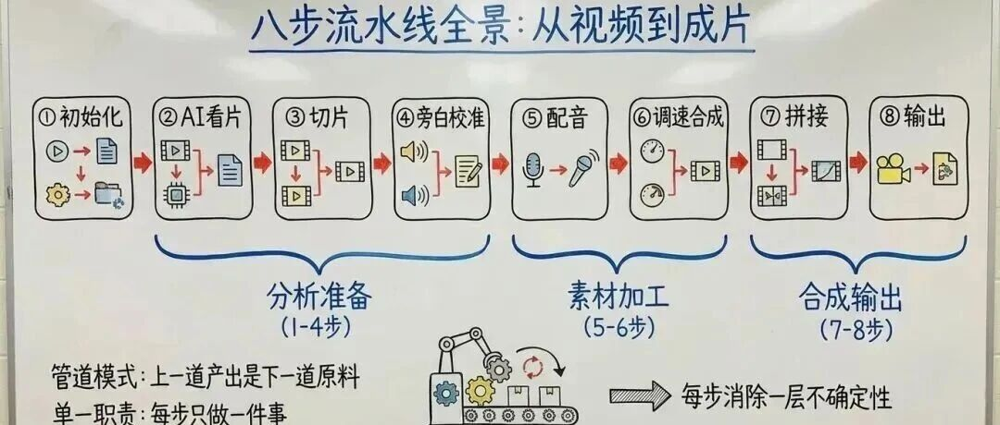

---

我如何用 Cherry Studio 进行爆款短视频剪辑的？论文级教程

**工作流100个原创 Skill 第 10 期 用AI做一套全自动视频剪辑系统 AI快剪**

摘要：本文用 AI 做了一套全自动视频剪辑系统 — — 输入一段原始视频，输出一部带旁白、字幕、背景音乐的成片，全程不动鼠标。完整拆解这套系统的设计逻辑和工程哲学，以及一个可能改变你做事方式的核心洞察：**工具一直在变，不变的是工作流程**。

**关键词：** 剪辑；音画同步；多模态；Claude Code Skill。

一套全自动视频剪辑系统 AI快剪

总结    一套全自动视频剪辑系统 AI快剪

这份论文级别教程，详述了利用 **AI 驱动的自动化工作流**来提升视频创作效率的方法。通过其开发的 **AI快剪 Skill**，展示了如何让 **Gemini** 深度理解视频内容并自主生成剧本，脚本、提示词，分镜头，配音与字幕，实现从原始素材到成片的自动化转化。核心技术逻辑涵盖了**八步流水线管道系统模式**，通过“速度因子”解决音画同步难题，并结合 **Cherry Studio** 降低了智能体操作的门槛。特别强调，虽然 **AI 工具**不断更迭，但稳定的**工作流**才是内容创作者真正的竞争壁垒与杠杆。这种“原生 AI 剪辑”**模式支持二十种风格配置，不仅极大提升了生产力，还保留了用户手动微调的灵活性。最终，该系统证明了 AI 作为**效率放大器，同时，能让创作者从重复劳动中解脱，专注于审美与策略的输出。

如何用 Cherry Studio打造一套爆款短视频剪辑系统？论文级教程

简述AI快剪Skill实现自动视频剪辑的八步流水线

AI快剪 Skill（AICut Skill）实现全自动视频剪辑的八步流水线设计采用了“管道模式”（Pipeline），将复杂的创作过程拆解为八个独立的工程步骤。以下是这八步的简要概述：

1. **初始化 (Initialization)** 系统通过对话确认用户的需求（如视频路径、风格选择、分镜数量等），并使用工具（FFprobe）读取原始视频的时长、分辨率和帧率等元数据，为后续计算建立基础数据。
2. **AI 看片 (AI Analysis)** 这是核心步骤。系统将视频上传给 Google Gemini 模型，并注入包含美学标准的“导演指令”。AI 观看视频后，输出一份包含分镜起止时间戳和旁白内容的结构化分镜剧本。
3. **视频切片与跳切检测 (Video Slicing & Jump Cut Detection)** 根据剧本的时间戳，系统将完整视频切成多个片段。随后，系统会自动扫描每个片段的首尾（约 1.3 秒），检测并修剪掉可能残留的上一镜头画面（跳切），确保画面干净。
4. **旁白校准 (Narration Calibration)** 系统根据设定的语速系数（如每秒 3.63 字）检查旁白字数是否与修剪后的画面时长匹配。如果偏差超过 10%，系统会自动精简或扩展旁白文本，以实现音画同步的“上游预防”。
5. **AI 配音 (AI Dubbing)** 调用语音合成服务（Fish Audio）为旁白生成配音。为了解决时长不确定的问题，系统会并发生成快、中、慢三个版本的配音，并自动选择时长最接近画面时长的一版。同时计算“速度因子”（视频时长 ÷ 音频时长）。
6. **调速合成 (Speed Adjustment Synthesis)** 利用速度因子调整画面播放速度（加速或减速），使其与配音时长完美对齐。同时，系统生成 ASS 格式字幕，并将调整后的画面、配音和字幕合成一个完整的带声画片段。此步骤支持多路并行处理。
7. **拼接 (Splicing)** 将所有处理好的分镜片段首尾相连，并按设定的音量（如 15%）循环混入背景音乐。
8. **输出 (Output)** 生成最终的成片视频，并输出一份 Markdown 格式的制作报告，记录每个分镜的时长、速度因子和选用的旁白版本等信息，方便用户复盘或调试。

这一流水线的核心设计哲学是“单一职责”**和**“消除不确定性”：每一步只做一件事，且每一步都在为最终成品的确定性增加筹码。

Gemini 模型在 AI 看片环节如何理解导演指令？

在AICUT Skill 的“AI 看片”环节中，Gemini 模型是通过接收一份被称为“导演指令”（Director's Instructions）的超长提示词（Prompt）来理解并执行导演意图的。

具体来说，Gemini 通过以下机制理解和执行这些指令：

1. **大规模提示词注入（Prompt Injection）**： 系统在将视频上传给 Gemini 时，会同步注入一份长达数百行的文本指令。这份指令不仅是简单的任务描述，更像是一份详尽的“拍摄与写作指南”。
2. **确立核心美学守则**： 导演指令明确定义了 AI 分析视频时必须遵循的“基本法”。以美食纪录片为例，指令定义了四条核心守则：

1. **绝对音画同步**：要求旁白与画面严格对应。
2. **先解构再书写**：要求先理解画面内容，再进行创作。
3. **用节奏聚焦感官**：强调通过节奏感来调动观众的感官体验。
4. **旁白是有温度的**：规定旁白不能是冷冰冰的说明书，而要有情感温度（例如写出“高温是风味的起点”而非“现在煎牛肉”）。

3. **风格化的差异定义**： 系统利用配置文件（YAML）来管理不同的导演指令，从而让 Gemini 扮演不同风格的导演：

1. **美食纪录片风格**：指令要求慢节奏、沉稳、有呼吸感（语速约 3.63 字/秒）。
2. **TikTok 带货风格**：指令则要求“节奏紧凑、卖点前置、情绪感染”（语速约 3.8 字/秒）。

4. **结构化输出约束**： Gemini 在理解了这些感性的美学指令后，被要求输出**理性的结构化数据**（JSON 格式的分镜剧本）。这意味着它必须将对画面的艺术理解转化为精确的起止时间戳和具体的旁白文本，直接为后续的工程步骤提供原料。

简而言之，Gemini 并不只是“看”到了视频，它是戴着一副由“导演指令”定制的**有色眼镜**去审视视频，从而确保输出的分镜和旁白符合预设的艺术风格。

[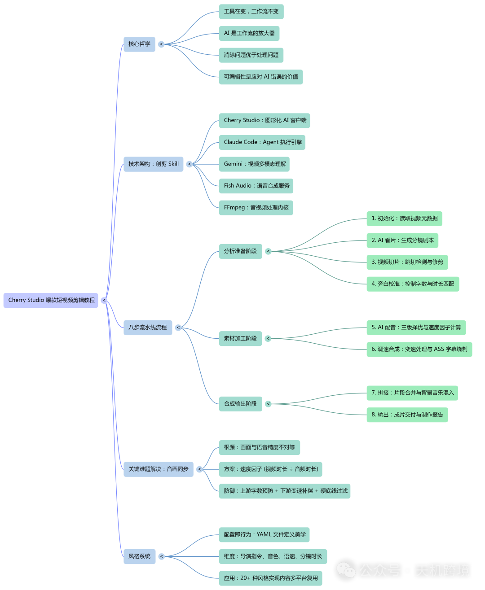](https://mp.weixin.qq.com/s?__biz=MzU2NzQ5MzY2Ng==&mid=2247487170&idx=1&sn=aac9db850661ea2b40baa3dca11d6fed&scene=21#wechat_redirect)

今天我们的 Skill 实现的效果——AI 根据输入的原始素材，自动完成剪辑、配音、配乐，直接输出一段4K的短视频。

这就是「AI快剪 Skill」做的事。这个项目跟了我三代工具。早在Make 和 N8N 工作流时代，我就在尝试用自动化工作流剪辑视频。后来写了一个几万行代码的AI快剪项目来实现这个功能。今天的版本换了个壳，用 Claude Code 的 Skill 来实现，但骨架没变。

这里面有一个我反复验证了三代工具的观点：**工具一直在变，工作流不变。**

Make 与 N8N 是工具，几万行 TypeScript 是工具，Skill 也是工具。但剪辑视频的流程——看片、写旁白、配音、对齐时长、合成输出——这个工作流从来没变过。

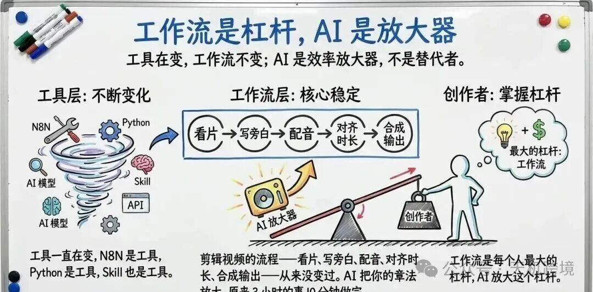

工作流是杠杆，AI 是放大器

今天读完这篇文章，你将理解：

1. **Cherry Studio 的实操路径**，如何在你的电脑上跑起来
2. **八步流水线的全景架构**，每一步在做什么，为什么要做这一步
3. **数据流动的完整轨迹**，追踪一个分镜从诞生到成片的全过程
4. **音画同步的核心难题**，为什么画面和声音总是对不上，以及AI快剪 Skill 如何解决
5. **风格系统的设计哲学**，一个文件如何定义一种美学

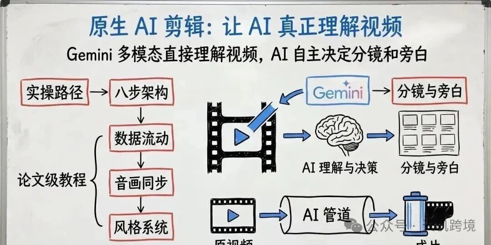

原生 AI 剪辑：让 AI 真正理解视频

---

## 目录

## 一、先跑起来：在 Cherry Studio 中使用AI快剪 Skill

## 二、八步流水线总览

## 三、每个步骤在做什么

## 四、数据在步骤间如何流动

## 五、为什么画面和声音总是对不上

## 六、AI 不是万能的，但可编辑就够了

## 七、风格系统：一个文件定义一种美学

## 八、结语：好的工程设计不是解决难题，而是让难题不出现

---

## 一、先跑起来：在 Cherry Studio 中使用AI快剪 Skill

在讲设计哲学之前，先让你手上有东西跑。

但在动手之前，花 30 秒理解两个概念。搞清楚了，后面每一步你都知道自己在做什么。

**Cherry Studio。** 开源的多模型 AI 桌面客户端，集成 300+ 模型，支持 macOS、Windows、Linux。

它解决了两个痛点。第一个：模型太多太散。OpenAI 一个网页，Claude 一个网页，Gemini 又一个。Cherry Studio 把它们收进同一个窗口，一键切换。第二个，也是更重要的：它把 Claude Code Agent SDK（智能体开发套件）这套复杂的底层能力封装成了图形界面。不用开终端，不用敲命令行，点点鼠标就能让 AI 在你电脑上执行代码、操作文件、运行 Skill。**Cherry Studio 让「用 Skill」变得跟聊天一样简单。**

**Agent + Skill。** Cherry Studio 里的 Agent（智能体）模式让 AI 能「动手干活」。但它还是通才——你说「剪视频」，它可能写一段命令让你自己跑，也可能理解成「帮我写个剪辑教程」。有能力，没章法。

Skill 解决的就是这个问题。Anthropic（Claude 母公司）2025 年推出的能力模块化标准，**把指令、脚本、参考资源打包成一个文件夹，Agent 遇到对应任务时自动加载。** 不是限制 AI，而是给它一条确定的路径——每次说「剪视频」，它都知道该走哪八步。

**Cherry Studio 给了你界面，Agent 给了你执行力，Skill 给了你确定性。** AI快剪就是那个让「剪视频」变得确定的 Skill。

参数确定：选择模式和风格

### 二， 第八步：等待八步流水线执行

参数确认完，Agent 自动执行八步流水线。整个过程约 5-15 分钟，取决于视频时长和网络状况。

你会在对话窗口看到每一步的执行状态——初始化、AI 看片、视频切片、旁白校准、AI 配音、调速合成、拼接、输出。不需要任何操作，喝杯咖啡等着就行。

---

## 二、八步流水线总览

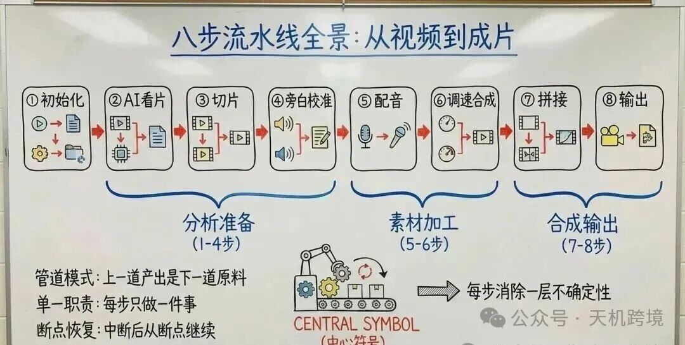

八步流水线全景：从视频到成片

先给你一张全景地图。

八个步骤像工厂的八道工序。每道工序只做一件事，上一道的产出就是下一道的原料。这个设计在工程上叫「管道模式」（Pipeline），你可以把它想象成一条流水线，视频从一端放进去，成片从另一端出来。

**第一步：初始化**。告诉系统「剪什么、怎么剪」。煎烤视频选了高级模式，指定美食纪录片风格、6 个分镜、一首背景音乐。

**第二步：AI 看片**。AI 观看视频，写出分镜剧本和旁白。Gemini 识别出蒜瓣热油、煎牛肉、炒口蘑、炸鸡翅、金沙鸡翅、收尾 6 个场景。

**第三步：视频切片与跳切检测**。按剧本时间戳切片，扫描首尾修剪残留画面。煎烤视频 6 段全部干净，无需修剪。

**第四步：旁白校准**。检查旁白字数是否匹配画面时长，基于语速系数逐段校准。

**第五步：AI 配音**。为旁白生成语音，计算速度因子。5 段 AI 配音 + 1 段保留原声。

**第六步：调速合成**。调整画面速度、烧入字幕，3 路并行处理。

**第七步：拼接**。合并所有分镜，混入背景音乐，BGM 音量 15%，循环混入。

---

## 三、每个步骤在做什么

### 第一步：初始化，导演开机前的准备会

好的初始化不是问更多问题，是把默认值设到最好。

### 第二步：AI 看片，导演的第一遍观影

这是整个系统最关键的一步。

系统把视频上传给 Google Gemini，连同一份「导演指令」，告诉 AI 用什么美学标准来分析。美食纪录片风格的导演指令长达 800 多行，定义了四条守则：绝对音画同步、先解构再书写、用节奏聚焦感官、旁白是温度。

正是这份指令让 AI 写出了「高温是风味的起点」「时间赋予了它独特的韧性」这样有纪录片质感的旁白，而不是「今天教大家做一道煎牛肉」这样的教程口吻。

Gemini 看完后输出一份分镜剧本：第一个镜头从第 6 秒到第 15 秒，拍的是蒜瓣在热油中翻滚；第二个镜头从第 15 秒到第 26 秒，拍的是煎牛肉……每个分镜包含起止时间和一段旁白。

这里有一个巧妙的成本优化。系统和 Gemini 的对话分两轮：第一轮上传视频并注入导演指令，输出分镜剧本；第二轮在同一个对话中生成多版旁白。因为第二轮复用了第一轮的视频上下文缓存，不需要重新上传视频，大约节省了 45000 个 token（令牌，AI 计费单位）。

**你付出的是一次 API 调用的费用，得到的是一个不知疲倦的导演。**

四，初始化与 AI 看片：导演的准备会和第一遍观影

### 第三步：视频切片与跳切检测，剪刀落下，再擦去毛边

按分镜剧本的时间戳，用 FFmpeg 把完整视频切成 6 段素材。

切完后，系统扫描每段首尾各 1.3 秒，检测有没有残留画面——比如蒜瓣的画面闪了一帧才切到煎牛肉，观众就会感知到一次不自然的「跳」。系统用 FFmpeg 的 scdet（场景检测）滤镜扫描并自动裁掉残留帧。

煎烤视频的 6 个切点都干净，全部跳过修剪。但广州美食视频就没这么幸运：8 段中有 5 段需要修剪，烤鸭那段开头 1.03 秒残留着肠粉画面。

**把不干净的剪刀口擦干净。** 这一步不影响内容，但决定品质。

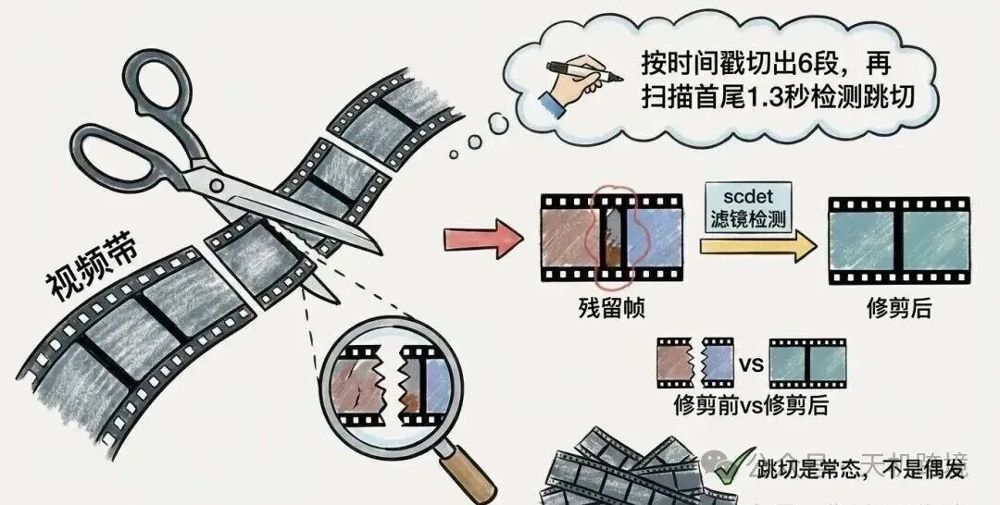

五，视频切片与跳切检测：剪刀落下，再擦毛边

### 第四步：旁白校准，编辑的红笔

美食纪录片的语速大约每秒 3.63 个字。一个 8.7 秒的蒜瓣热油镜头，旁白应该在 32 个字左右。

系统逐段检查旁白字数。如果偏差超过 10%，就自动精简或扩展。比如一段旁白本来有 45 个字，但画面只有 8 秒，按 3.63 字/秒算应该是 29 个字，偏多了 55%，系统会把旁白精简到 29 字左右。

注意这一步排在跳切检测之后。为什么？因为跳切修剪可能会改变画面时长。广州美食视频中，烤鸭分镜原本 8 秒，修剪后变成 6.47 秒，缩短了将近 20%。如果在修剪之前算字数，就会算多。

这是一个典型的「顺序依赖」设计——步骤的排列顺序不是随意的，后面的步骤依赖前面步骤的准确输出。

> ## ★
>
> **设计洞见**：为什么不合并？跳切检测管「画面」，旁白校准管「文字」，职责不同。合并则牵一发动全身，分开则互不影响。

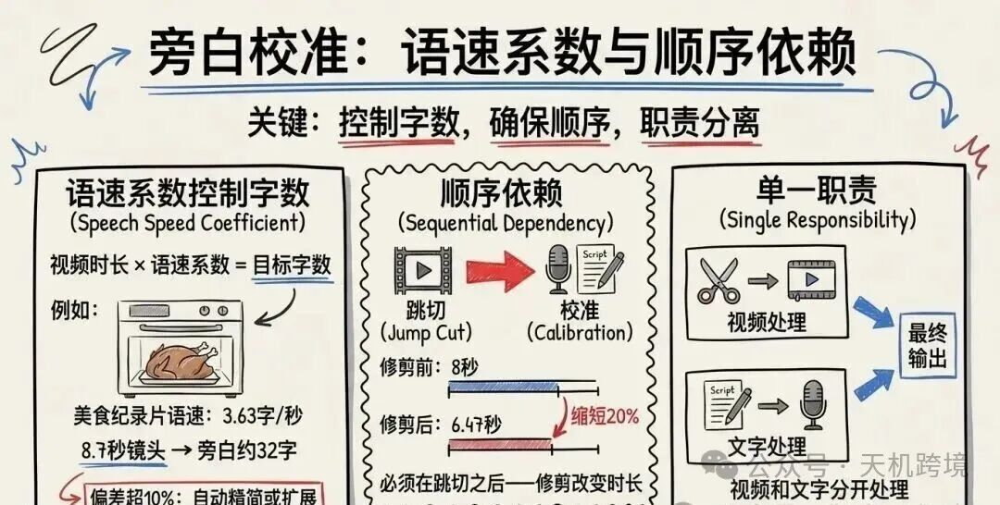

六，旁白校准：语速系数与顺序依赖

### 第五步：AI 配音，声音的诞生

校准后的旁白送给 Fish Audio（一个语音合成服务）生成配音。

这里有一个不常见的设计——系统不是生成一版配音，而是同时生成三版：一版语速快、一版语速中等、一版语速慢。三版并发生成，哪版的时长最接近画面时长，就选哪版。

### 第六步到第八步：从碎片到成品

**第六步：调速合成**。把画面速度、配音、字幕三者融合为一个片段。字幕用 ASS 格式（一种可以控制字体、颜色、位置的高级字幕格式）生成，可以指定字体大小（48 号）、描边颜色（黑色双重描边）、位置（底部居中）、每行字数（20 字自动换行）。三路并行处理，三个分镜同时合成。

**第七步：拼接**。6 段首尾相连，背景音乐压到 15% 音量循环混入。15% 是一个经过实践验证的数值，再高会盖过旁白，再低存在感不够。

**第八步：输出**。成片复制到输出目录，生成一份制作报告，记录每个分镜的时长、速度因子、选用的旁白版本等信息。

八步流水线可以分成三个阶段来记忆：

**分析准备**（第 1-4 步）——从一段视频到一份精确的剧本；

**素材加工**（第 5-6 步）——从剧本到一堆带声音的片段；

**合成输出**（第 7-8 步）——从一堆片段到一部成片。

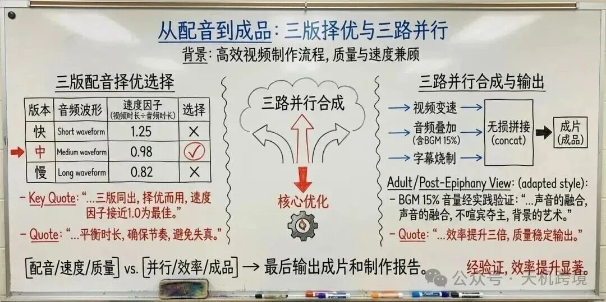

从配音到成品：三版择优与三路并行

---

### 四、数据在步骤间如何流动

第三章是每一步各自在做什么。这一节换个视角——跟着一个具体分镜走完全程，看数据如何变形流动。

以煎烤视频的第四个分镜「炸鸡翅」为线索。

**AI 看片**：Gemini 在第 59-69 秒识别出炸鸡翅画面（9.7 秒），写下旁白初稿，以 JSON（结构化数据格式）格式写入分镜剧本。

**跳切检测**：切出视频片段，扫描首尾画面干净，时长保持 9.7 秒。

**旁白校准**：9.7 秒 × 3.63 字/秒 = 35 字，系统微调定稿。

**AI 配音**：定稿旁白合成出 12.4 秒配音——比画面长了近 3 秒。速度因子 = 9.7 ÷ 12.4 = 0.78，视频需要减速到 0.78 倍。

**调速合成**：视频 0.78 倍速 + 配音正常速度 + 字幕按标点断句，三者合并。观众看到稍慢的炸鸡翅画面配上从容旁白——美食纪录片，慢一点反而更有质感。

**拼接**：炸鸡翅排第四位，和其他五段拼接，背景音乐贯穿始终。

数据在步骤间的形态不断变化：视频文件 → 分镜剧本 → 视频片段 → 音频文件 → 合成片段 → 成片。每一次交接，形态变了，但信息被完整保留。

**好的管道设计，就是让每一步只需要知道上一步给了它什么，不需要知道更远的事。**

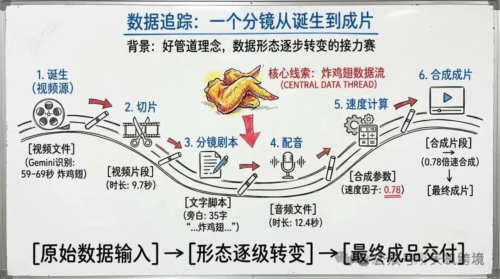

数据追踪：一个分镜从诞生到成片

---

**时长天然不匹配，是常态而非例外。**

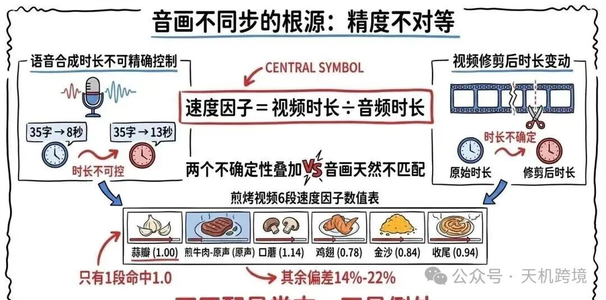

音画不同步的根源：精度不对等

#### 三道防线：预防、补偿、硬底线

**上游预防**：旁白校准阶段用语速系数提前控制字数。蒜瓣热油之所以命中 1.0，正是上游预防的成功案例。

**下游补偿**：用 FFmpeg 变速调整画面播放速度。0.8 到 1.2 范围内人眼几乎感觉不到——你不会注意到炸鸡翅慢了 22%，美食画面本来就适合慢节奏。

**硬底线**：速度因子超出 0.5 到 1.5，分镜直接丢弃。不修复，不降级，直接放弃。少一个好镜头，远好过多一个坏镜头。

这背后是一个重要的设计哲学：**消除问题优于处理问题。**

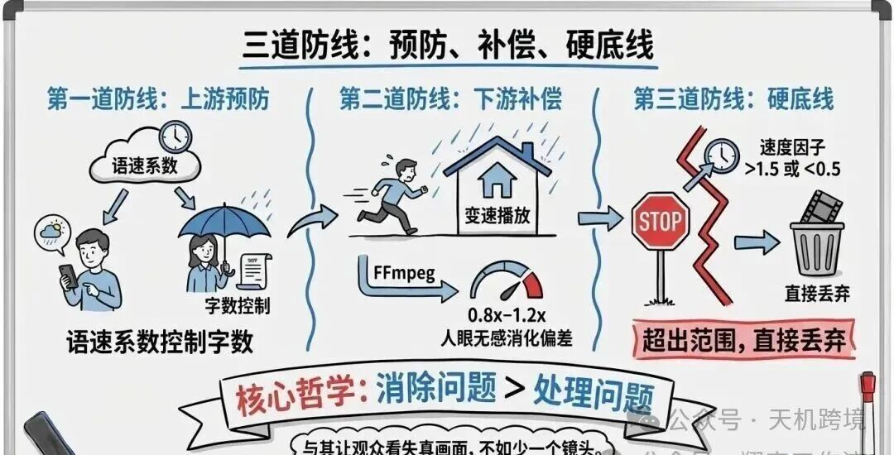

三道防线：预防、补偿、硬底线

---

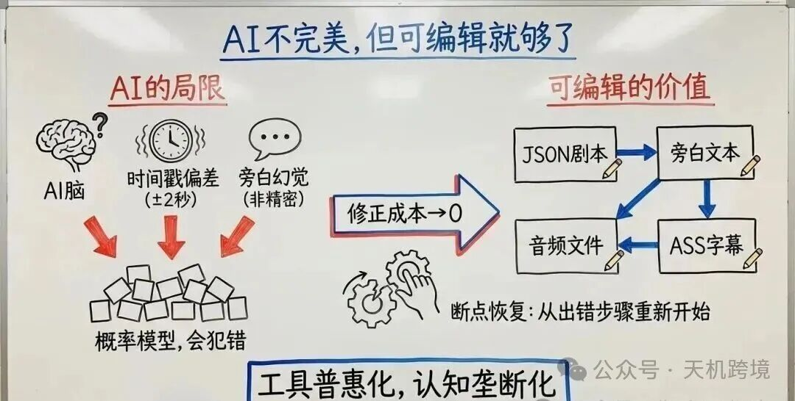

AI 不完美，但可编辑就够了

---

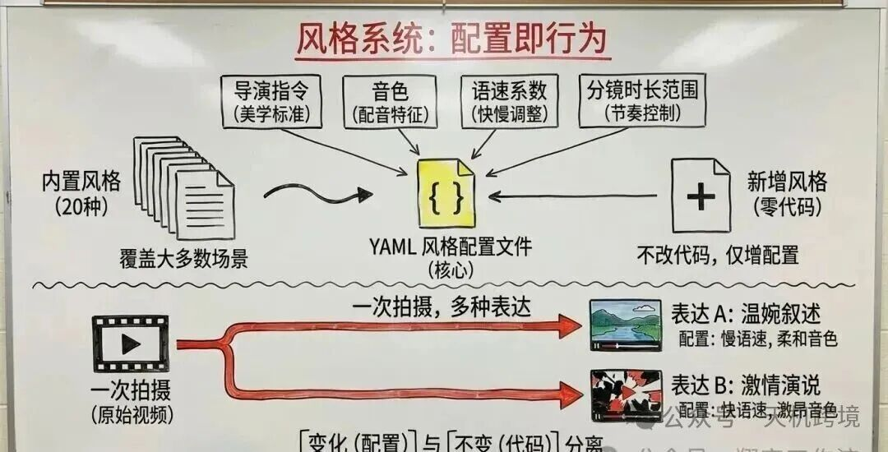

风格系统：配置即行为

---

把下面这段提示词复制给 Claude Code，你就能从零搭建自己的 AI 剪辑系统：

「你是一位高级多媒体系统架构师，精通视频处理管道设计。请帮我从零构建一个 AI 视频剪辑自动化系统，要求如下：

**核心目标**：输入一段原始视频，输出一部带旁白、字幕、背景音乐的成品短片。全程自动化，人不干预。

**技术栈**：Python 3.12+ / Gemini API / Fish Audio API / FFmpeg

**八步管道设计**：

1. **初始化**：收集用户输入（视频路径、风格选择、分镜数量），用 FFprobe 读取视频元信息（时长、分辨率、帧率），创建运行目录和配置文件
2. **AI 视频分析**：将视频上传至 Gemini，注入风格化导演指令，输出 JSON 格式的分镜剧本，包含每个分镜的起止时间戳和旁白文本。利用 Gemini 多轮对话的隐式缓存，第二轮生成多版旁白时复用第一轮的视频上下文
3. **视频切片 + 跳切检测**：按分镜时间戳用 FFmpeg 无损切割视频片段。对每段首尾各扫描 1.3 秒，用 scdet 滤镜检测场景跳切，自动裁剪残留帧。跳切检测阈值 8%，裁剪后最小保留 2 秒
4. **旁白字数校准**：基于语速系数（如美食纪录片 3.63 字/秒）计算每段旁白的目标字数。偏差超过 ±10% 则自动精简或扩展旁白。必须排在跳切检测之后，因为修剪会改变视频时长
5. **TTS（文字转语音）配音**：为每段旁白并发生成三版配音（快/中/慢语速），计算速度因子 = 视频时长 ÷ 音频时长，自动选择速度因子最接近 1.0 的版本。支持标记特定分镜为「保留原声」
6. **调速合成**：用 FFmpeg setpts 滤镜调整视频播放速度，atempo 调整音频速度，生成 ASS 格式字幕（48号字体、黑色双重描边、底部居中、20字换行），三者合并为完整片段。最大并发 3 路
7. **最终拼接**：用 FFmpeg concat demuxer（拼接解复用器）无损拼接所有分镜。若有 BGM，以 15% 音量循环混入
8. **输出报告**：复制成片到输出目录，生成 Markdown 格式的制作报告

**关键机制**：

- **速度因子硬底线**：超出 0.5-1.5 范围的分镜直接丢弃，不做降级处理
- **断点恢复**：每步完成后写入 progress.json，支持中断后从断点继续
- **风格配置化**：每种风格用一个 YAML 文件定义（导演指令、音色ID、语速系数、时长范围），新增风格不改代码
- **双重音画同步保障**：上游字数校准 + 下游变速补偿

请完整实现这个系统，确保八个步骤顺序执行并支持断点恢复。」

---

**继续深入**

这套八步视频剪辑流水线只是「AI 内容自动化」的一个实战项目。在课程中，你还会学到微信公众号批量运营、小红书内容创作、PPT 自动生成、SEO 审计等各类实战项目，每一个都是可以直接落地的工作流。

如果你想获取完整资源、系统学习 AI 编程工作流，欢迎加入课程

---
