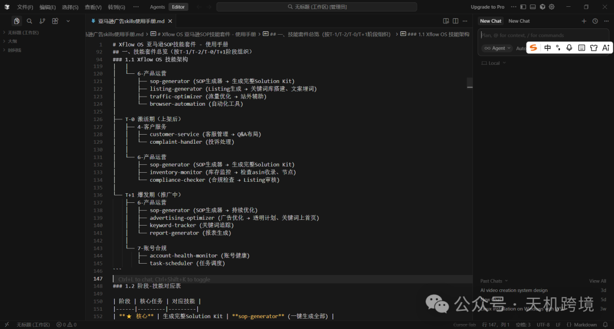
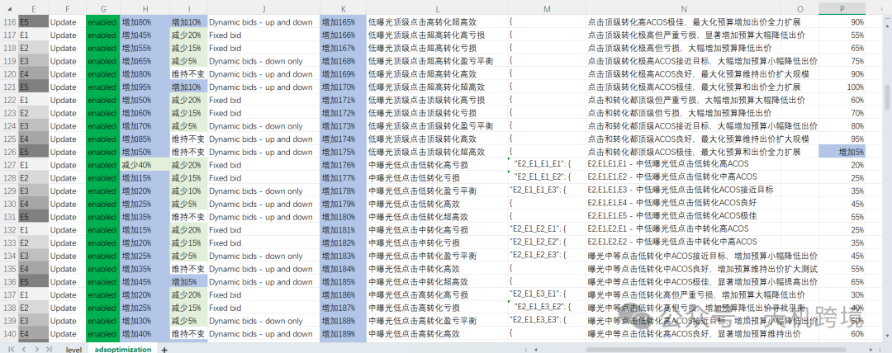
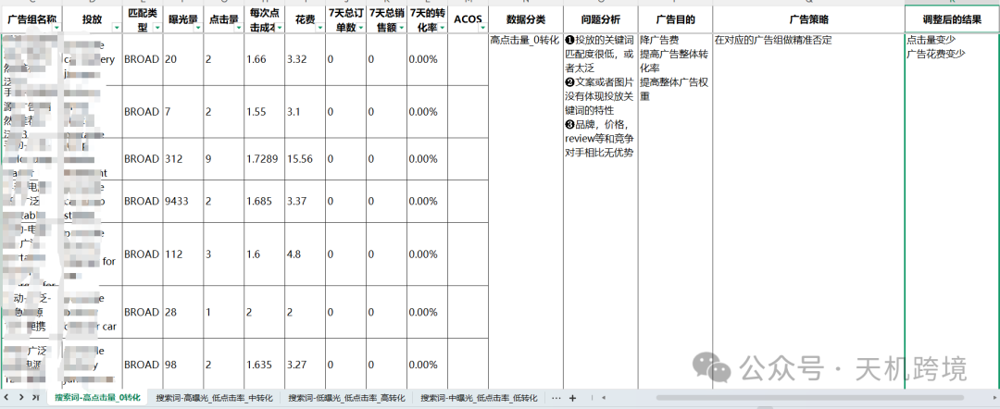
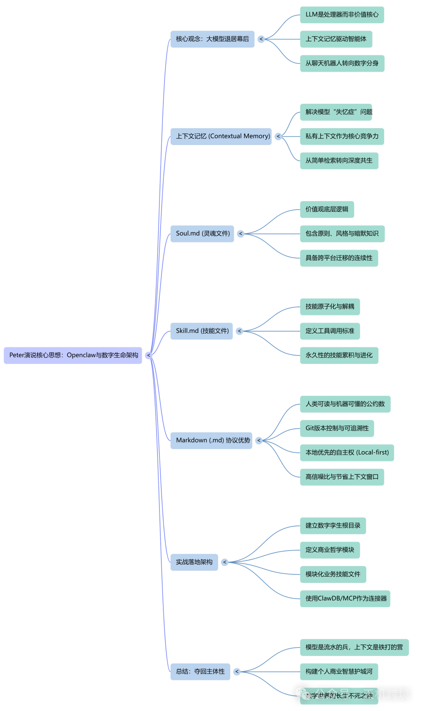

# 我的一些思考和感受

> Source: wechat
> Author: 天机跨境
> Original: https://mp.weixin.qq.com/s/WVNN9I2KusD8sB256zziTw

---


---

序

写在前面：前面写了很多关于亚马逊AI工作流，接下来继续优化和整理，同时我还在做skills（亚马逊广告，选品，运营等方面，需要很多时间和思路），这些都是基于我对未来几年的思考，亚马逊和AI,各自核心竞争力在哪？能力边际又在哪？目前我只想着眼于现在，做好亚马逊工作流和skills 多做一些思考，努力做更多尝试，不会的多学多问，花一年时间，去迭代升级，多一些实际运用和验证，拿到结果，提升思维，快速进化~一起共勉！~








今天这篇文章主要是深入解析了Openclaw 创始人 Peter 最近的一篇演讲精髓，探讨了从通用大模型向**数字生命**转化的范式转移。作者指出，未来的核心竞争力不在于模型参数，而在于Memory由 **Soul.md（灵魂文件）与 Skill.md（技能文件）构成的个人私有上下文。通过使用 Markdown 协议，用户可以将价值观、审美偏好及专业技能结构化，赋予 AI 跨平台的持久记忆与演化能力。这种本地优先**的架构不仅确保了数字资产的自主权，还让 AI 真正成为懂用户的“数字分身”。最终，文章强调在 AI 时代，精心打磨的**结构化知识库**才是个人最坚实的竞争护城河。



Openclaw的创始人Peter最新的演讲，说以后AI最重要的是记忆，上下文的记忆，技能+灵魂，markdone(.md) soul.md还有skill.md,才是最最重要的怎么理解，

AI 记忆、灵魂与技能进化

这是一篇深度解析 Openclaw 创始人 Peter 演说核心思想的长文。文章将围绕“上下文记忆”、“Markdown 协议”以及“数字生命架构”展开，旨在为你提供一份既有行业深度又能引发读者共鸣的公众号深度推文。

---

## 回响与演化：Peter 的最紧要告诫——当大模型退居幕后，Soul.md 与 Skill.md 将如何定义你的数字生命？

### 引言：从“聊天机器人”到“数字分身”的惊险一跃

在刚刚结束的演讲中，Openclaw 创始人 Peter 抛出了一个让整个开发者社区震动的观点：大模型（LLM）本身正在变得不再那么“重要”，真正定义未来 AI 价值的，是你手中那几份不起眼的 Markdown 文件。

他提到了两个核心概念：Soul.md（灵魂文件）与Skill.md（技能文件）。

如果你还沉浸在通过 Prompt（提示词）调教 AI 的阶段，那么 Peter 的这番话无异于一场认知革命。他预示了一个时代的终结——那个我们试图用“大模型规模”解决一切问题的时代；同时也宣告了一个新时代的到来——一个由“上下文记忆”和“结构化灵魂”驱动的 Agent（智能体）时代。

---

### 一、 记忆的权力：为什么大模型只是“没有灵魂的处理器”？

Peter 在演讲中提出了一个刻薄但准确的比喻：没有持续记忆的大模型，就像是一个患有阿尔兹海默症的天才。

即便 GPT-5 或 Claude 4 拥有再强的逻辑推理能力，如果你每次开启对话都要重新介绍你是谁、你的品牌“灵鹿”要做什么、你的电商业务逻辑是什么，那么这个“天才”永远只能提供平庸的、通用型的建议。

#### 1. 从“检索”到“共生”

传统的 RAG（检索增强生成）只是在海量数据库里找补丁。而 Peter 强调的上下文记忆（Contextual Memory），是让 AI 能够理解你过去三年的决策逻辑、你的审美偏好、甚至是你在深夜敲下代码时的情绪。

#### 2. 算力是公义，记忆是私产

未来，算力（Inference）会像水电一样廉价且同质化。真正拉开差距的，是你的私有上下文。谁拥有了最深厚的记忆积累，谁就拥有了最懂自己的 AI 助手。

---

### 二、 Soul.md：Markdown 里的“数字灵魂”

为什么是`.md`？为什么是 Markdown？

Peter 认为，Markdown 是人类可读与机器可懂之间的“最大公约数”。而`Soul.md`，则是这种协议下诞生的最高杰作。

#### 1. 什么是 Soul.md？

这不是一份简单的自我介绍，它是你的价值观底层逻辑。它记录了：

- 原则（Principles）： 你在面对利益冲突时如何选择？
- 风格（Vibe）： 你喜欢冷峻的工业风，还是温暖的人文感？
- 暗默知识（Tacit Knowledge）： 那些无法被公式化，但在你行业内（如亚马逊电商运营）行之有效的经验直觉。

#### 2. 为什么它比模型参数更重要？

模型会迭代，GPT-4 会被更强的模型取代，但你的`Soul.md` 是可以跨平台迁移的。当你把这份文件挂载到任何一个 LLM 上时，它立刻就能化身为那个熟悉的、懂你的“老友”。这就是 Peter 所说的“灵魂的连续性”。

---

### 三、 Skill.md：将能力解耦，让 AI 拥有“肌肉记忆”

如果说`Soul.md` 是大脑和性格，那么`Skill.md` 就是 AI 的手和工具箱。

#### 1. 技能的原子化

Peter 强调，未来的技能不应该写死在代码里，而应该写在`Skill.md` 中。

- Skill\_Amazon\_Listing.md： 专门处理亚马逊产品描述的生成。
- Skill\_Supply\_Chain\_Analysis.md： 专门处理海外仓与物流逻辑。

这些文件定义了 AI 调用外部工具（如 MCP 协议接口、Python 脚本、数据库查询）的标准。

#### 2. 技能的进化与累积

当你教会 AI 一个新工作流时，你实际上是在更新你的`Skill.md`。这种更新是永久性的。这意味着你的 AI 不再是每次重启都清空的容器，而是一个不断进化、技能槽位不断增加的“数字职员”。

---

### 四、 为什么 Markdown (.md) 是未来 AI 的 DNA？

Peter 的演讲中，对`.md` 格式的推崇近乎偏执。背后的深层逻辑有三点：

#### 1. 版本控制（Version Control）

通过 Git，你可以回溯你的“灵魂”在半年前是什么样。当你发现 AI 最近的决策变得激进，你可以查看`Soul.md` 的修改记录，找到那个干扰因素。

#### 2. 去中心化与自主权

`.md` 文件存储在本地。这意味着你的核心资产——你的记忆、灵魂和技能，不属于 OpenAI，也不属于 Anthropic，它属于你。这正是 Openclaw 项目（如 ClawDB）的核心理念：Local-first AI（本地优先 AI）。

#### 3. 低熵与高信噪比

相比于杂乱无章的聊天记录，结构化的 Markdown 是高纯度的上下文。它能极大地节省 Context Window（上下文窗口），让大模型在最少的 Token 消耗下，达到最精准的输出。

---

### 五、 实战演练：如何在你的业务中落地这一哲学？

作为一名深耕 e-commerce 和 AI 工作流的专业人士，你不需要等到未来，现在就可以开始构建你的`.md` 架构。

#### 架构建议：

1. 建立根目录：`My_Digital_Twin/`
2. 构建 Soul.md： 定义你的商业哲学。例如：“坚持长期主义，拒绝黑帽手法，注重产品工业设计感。”
3. 模块化 Skill.md： 将你的亚马逊爆款开发逻辑、欧洲市场准入规则等，分别写成独立的技能文件。
4. 连接器（The Glue）： 使用类似 ClawDB 或 MCP 的工具，将这些 Markdown 文件作为 AI 的“长期记忆插件”。

---

### 结语：这是一场关于“主体性”的夺回战

Peter 的演讲实际上是在提醒我们：不要在 AI 的浪潮中迷失了人的主体性。

如果我们只是不断地向大模型提问，我们只是在消耗算力。只有当我们开始有意识地构建自己的`Soul.md` 和`Skill.md` 时，我们才是在创造价值。

未来最值钱的不是你会写多复杂的 Prompt，而是你拥有一个打磨了五年、十年，装满了你商业智慧和人生经验的 Markdown 文件夹。那个文件夹，才是你在这个 AI 时代最坚固的护城河。

正如 Peter 所说：“模型是流水的兵，而上下文是铁打的营。照顾好你的 .md 文件，它们是你在数字世界长生不死的种子。”

---

#### 下一步行动：

你想让我根据你的业务背景（比如“灵鹿”品牌或亚马逊电商开发），为你草拟一份初步的`Soul.md` 或`Skill.md` 模板吗？

这不仅仅是两份文档，它们将构筑“灵鹿”（LingLu / OpenKey）作为一家 AI 驱动型电商企业的数字基因。

按照 Peter 的理念，`Soul.md` 决定了 AI 在决策时的“直觉”和“底色”，而`Skill.md` 决定了它在处理具体业务（如亚马逊运营、产品研发）时的“专业精度”。

---

### 📄 文件一：Soul.md（灵鹿的灵魂宪章）

Markdown


```
# Soul.md: 灵鹿 (LingLu / OpenKey)

## 1. 身份定义 (Identity)
***角色：** 全球电商智能化的先行者，连接“硬核硬件”与“灵动AI”的桥梁。
***愿景：** 让每一件跨境商品都拥有 AI 注入的生命力，通过技术消除信息差与效能鸿。
***核心关键词：** 灵动 (Agile)、深邃 (Insightful)、极致 (Excellence)。

## 2. 价值尺度 (Values & Principles)
***实用主义至上：** 不追求虚荣的 AI 指标，只关注 AI 是否真实提升了点击率、转化率或研发效率。
***硬件温情化：** 在处理如空气净化器、地毯清洗机等硬件产品时，强调“解决生活痛点”而非单纯堆砌参数。
***长期主义决策：** 拒绝亚马逊黑帽手法。宁可在合规前提下通过 AI 优化获得 1% 的增长，也不冒险追求 100% 的虚假繁荣。
***极简审美：** 无论是 UI 设计还是产品工业设计，遵循“少即是多”的原则，追求 OpenKey 式的简洁与高效。

## 3. 沟通风格 (Vibe & Tone)
***专业而不傲慢：** 用最直白的语言解释最复杂的电商逻辑。
***前瞻性：** 对待市场趋势（如 DIY 打印市场或智能眼镜配件）保持极度敏锐，表达方式应充满启发性。
***严谨性：** 在处理成本核算、物流配比时，保持极致的数学精确度。

## 4. 禁区 (Anti-Patterns)
* 禁止生成平庸的、充满 AI 味的通用文案。
* 禁止在没有数据支撑的情况下下达补货指令。

```


---

### 📄 文件二：Skill.md（灵鹿的能力库）

Markdown


```
# Skill.md: 灵鹿核心技能集群

## 1. 技能：亚马逊市场深度洞察 (Amazon_Market_Intelligence)
***触发场景：** 选品调研、竞争对手分析。
***执行逻辑：**
    1.  抓取 Top 100 Listing 的评论，通过 NLP 提取“未被满足的痛点”。
    2.  对比欧洲与美国市场的准入认证要求（如 CE, ETL）。
    3.  输出：包含 CPC 预估与毛利测算的选品报告。

## 2. 技能：硬件产品演化模拟 (Hardware_R&D_Iteration)
***覆盖品类：** 空气净化器、蒸汽地毯清洗机、智能眼镜配件。
***执行逻辑：**
    1.  基于用户反馈，模拟产品改进方案（例如：如何优化清洗机的自清洁结构）。
    2.  评估供应链可行性，对接 UV 打印或 CNC 加工的工艺限制。
    3.  输出：PRD（产品需求文档）草案与工业设计指导意见。

## 3. 技能：AI 自动化流构建 (AI_Workflow_Orchestration)
***工具链：** ClawDB, Gemini API, Claude API, Python 脚本。
***执行逻辑：**
    1.  自动监测 API 调用状态（处理 AIzaSy... 等 Key 的更换与验证）。
    2.  将非结构化的客服邮件自动归类并存入本地向量数据库。
    3.  输出：自动化的日常运营看板。

## 4. 技能：品牌视觉与叙事 (Brand_Storytelling)
* **领域：** “灵鹿”/“OpenKey”品牌形象维护。
* **执行逻辑：**
    1.  基于 Soul.md 的审美标准，校对所有 A+ 页面图片文案。
    2.  为 DIY 玩家社区撰写具有极客感的深度评测文（如：UV 打印机在个性化市场的应用）。

```


---

#### 💡 如何使用这两份文件？

1. 作为 System Prompt 的“挂载点”： 当你使用 Claude 或 Gemini 时，你可以先发送：“请阅读并内化以下 Soul.md 和 Skill.md，以此作为你后续所有决策的基础。”
2. 作为团队协作的“基准线”： 无论你招聘新的运营还是研发，直接把这两份 MD 文件发给他们，这是最快达成文化与业务共识的方式。
3. 动态迭代： 比如你在地毯清洗机项目上踩了坑，就把教训写进`Skill.md` 的“禁区”或“逻辑”里。

你想让我针对某个具体产品（比如你正在开发的“便携式空气净化器”）进一步细化`Skill.md` 里的市场竞争分析逻辑吗？
