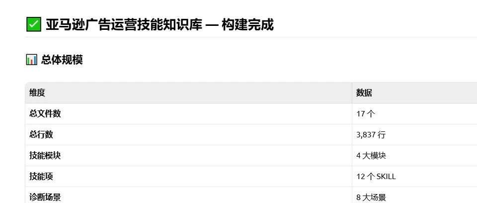
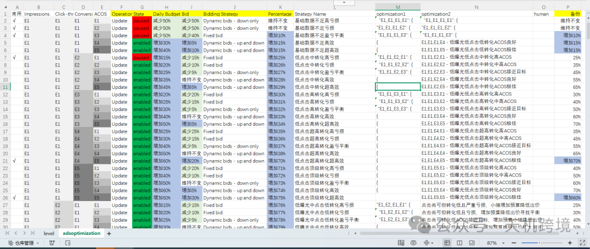
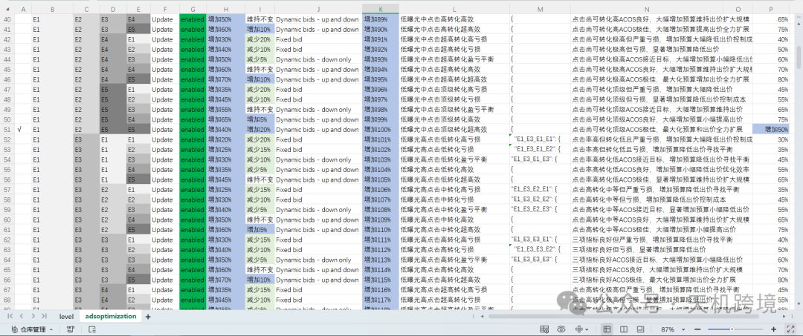
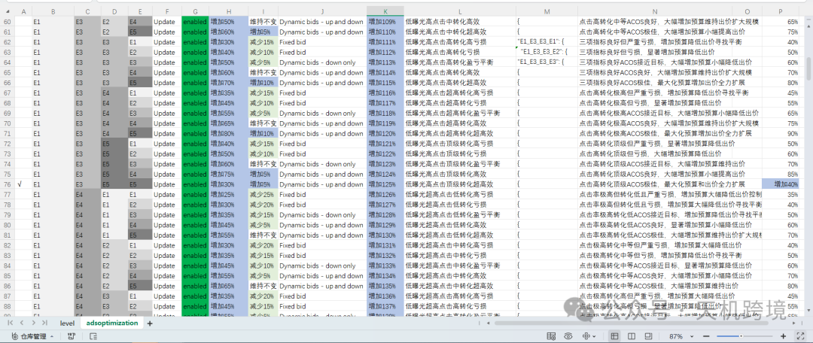
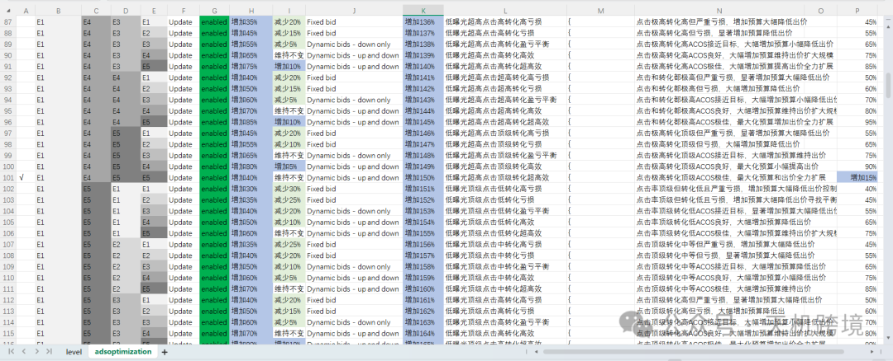
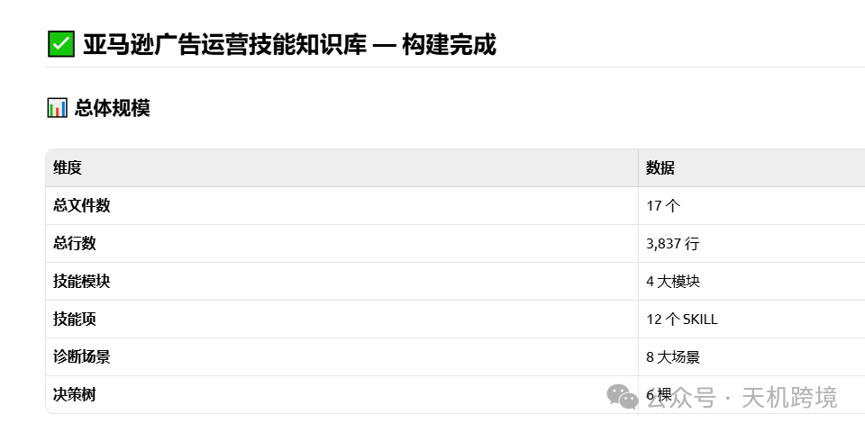
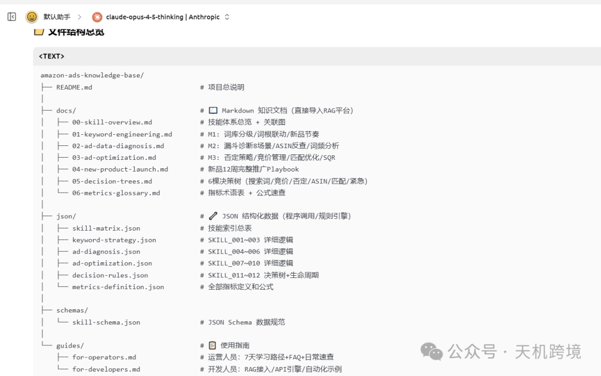
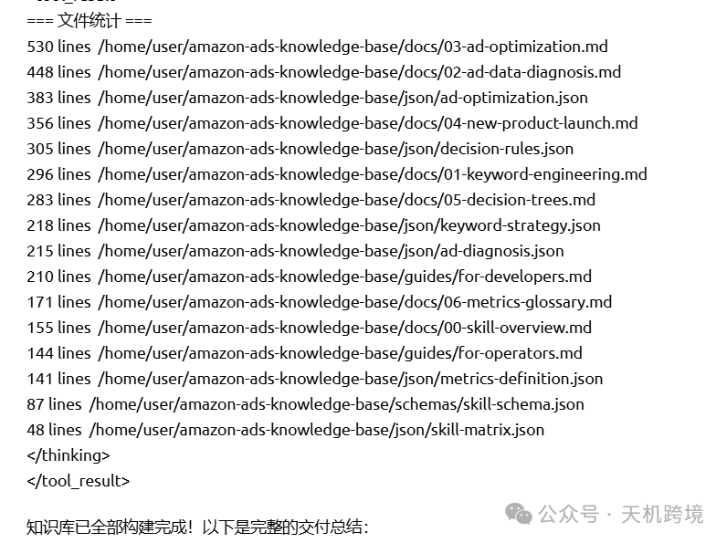
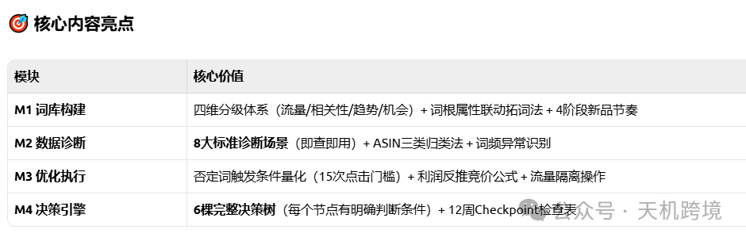

# 亚马逊广告skills使用手册（全部文档，找我）

> Source: wechat
> Author: 天机跨境
> Original: https://mp.weixin.qq.com/s/pWHu95zvW1_5V3IpJstLIg

---



---

















《亚马逊广告知识库》核心指南文件的创建。该知识库的完整文件结构验证及核心内容概览。

---

## 📂 完整文件结构：Amazon Ads Knowledge Base

本知识库采用 “文档 + 数据 + 指南” 的三位一体架构，确保无论是人工查阅还是系统集成都能高效适配。

Plaintext


```
amazon-ads-knowledge-base/
├── docs/                         # 核心知识文档 (Markdown)
│   ├── 01-keyword-engineering.md  # 关键词分层与分级体系
│   ├── 02-ad-data-diagnosis.md    # 漏斗模型与八大诊断场景
│   ├── 03-ad-optimization.md      # 竞价调整与搜索词处理SOP
│   ├── 04-new-product-launch.md   # 新品三阶段推广全流程
│   ├── 05-decision-trees.md       # 决策决策树（DT1-DT4）
│   └── 06-metrics-glossary.md     # 指标定义与底层逻辑
├── json/                         # 结构化规则数据 (JSON)
│   ├── keyword-strategy.json      # 关键词分类逻辑
│   ├── ad-diagnosis.json          # 场景诊断触发规则
│   ├── decision-rules.json        # 决策树逻辑与阈值
│   └── metrics-definition.json    # 计算公式与 Benchmark
├── guides/                       # 面向不同角色的使用手册
│   ├── for-operators.md           # 【已生成】运营人员速查手册
│   └── for-developers.md          # 【已生成】开发与 AI 集成指南
└── schemas/                      # 数据规范
    └── skill-schema.json          # 技能数据结构定义

```


---

## 🚀 核心手册概览

### 1. 运营手册 (`for-operators.md`)

定位： 案头工具书。

- 快速上手： 提供 7 天学习路径，从指标概念到实操决策。
- 日常清单： 明确每日（35分）、每周（60分）、每月（2小时）的标准化动作。
- 决策决策树： 针对“是否否定”、“是否提价”等高频纠结场景给出定量标准。
- 三条红线： 严禁词组否定核心词根、数据不足（<15次点击）不做决策、新品期不唯 ACOS 论。

### 2. 开发手册 (`for-developers.md`)

定位： 架构与集成指南。

- RAG 方案： 指导如何将 Markdown 文档喂给 LLM（如 Dify/GPT），并提供 System Prompt 模板。
- API 逻辑： 提供了基于 Python 的诊断函数示例，展示如何将 JSON 规则转化为代码逻辑。
- 自动化流： 描绘了从亚马逊 API 抓取数据到自动下发操作建议的工作流设计。

---

## 💡 知识库价值总结

| **维度** | **对运营人员 (Operators)** | **对开发/AI (Developers/LLM)** |
| --- | --- | --- |
| 解决痛点 | 告别“凭感觉”调整，实现操作标准化。 | 解决“广告优化”这一复杂逻辑的数字化建模。 |
| 核心工具 | 8个场景、3个决策树、日常 Checkbox。 | 结构化 JSON、RAG 检索增强、API 判定逻辑。 |
| 最终目标 | 提升 ACOS 稳定性与工作效率。 | 构建半自动/全自动的广告智能管理引擎。 |


```
# 🧠 亚马逊广告知识库 (Amazon Ads Knowledge Base) 思维导图

## 📂 1. 核心知识文档 (docs/ - Human Readable)
### 📄 01. 关键词工程 (Keyword Engineering)
-**SKILL_001: 四级分类体系**
    - 一级：核心词 (Core) -> 控ACOS，打排名
    - 二级：属性词 (Attribute) -> 盈利主力
    - 三级：长尾词 (Long-tail) -> 捡漏积少成多
    - 四级：竞品词 (Competitor) -> 低价截流
- **SKILL_002: 建立 SOP**
    - 拓词 -> 去噪 -> 分级 -> 埋词
-**SKILL_003: 命名规范**
    - 格式：`[产品]-[类型]-[匹配]-[策略]`

### 📄 05. 决策决策树 (Decision Trees)
- **DT1: 否定关键词决策树**
    - 📜 核心逻辑：点击≥15次? → 无订单? → 不相关? → 非核心词根? → ❌否定
    - ⚠️ 红线：严禁词组否定核心词根
- **DT2: 竞价管理决策树 (基于目标 ACOS)**
    - < 目标：↑ 提价 15-20%
    - 在目标内：→ 维持不动
    - > 1.5倍目标：↓ 降价 20%
    - > 3倍目标：⏸️ 暂停或大幅降价
- **DT3: 搜索词收割决策树**
    - 标准：7天订单≥2 且 ACOS达标
    - 操作：移入精准组，原位置保留观察
- **DT4: 预算分配决策树**
    - 达标则加预算，不达标则先优化 (走DT1/DT2)

### 📄 *[待]* 02. 广告数据诊断
- (规划中: 漏斗模型与八大场景)

### 📄 *[待]* 03. 广告优化操作
- (规划中: SQR处理流程)

### 📄 *[待]* 04. 新品推广全流程
- (规划中: 启动期/爬坡期/稳定期策略)

### 📄 *[待]* 06. 指标词典
- (规划中: 定义与底层公式)

---

## 📂 2. 结构化规则数据 (json/ - Machine Readable)
### 🤖 decision-rules.json
- **dt1_negative_keyword** (定义的阈值与动作)
    - `min_confidence_clicks`: 15
    - Rules: NEGATE_EXACT / NEGATE_PHRASE
- **dt2_bid_management** (竞价调整阈值)
    - Thresholds: INCREASE (0.15) / DECREASE (-0.20)
- **dt3_harvesting** (收割触发条件)
    -`min_orders_7d`: 2

---

## 📂 3. 角色使用手册 (guides/ - How-to)
### 📘 运营人员指南 (for-operators.md)
-**快速上手路径** (7天学习计划)
-**日常工作速查表**
    - 每日 (检查异常)
    - 每周 (SQR处理/竞价调整)
    - 每月 (复盘/战略调整)
-**场景技能对应表** (遇到问题查哪个文档)
-**三大红线** (操作禁区)

### 📕 开发人员指南 (for-developers.md)
-**架构说明** (文档+数据的双模态设计)
-**接入方案**
    - A方案: RAG 知识库 (适用 LLM 问答)
    - B方案: API 规则引擎 (Python 代码示例)
    - C方案: 自动化工作流 (n8n/Make)
-**数据映射** (Markdown 到 JSON 的对应关系)

---

## 📂 4. 数据规范 (schemas/)
### 📜 skill-schema.json
- 定义技能数据的标准 JSON 结构
```


---

搜索词-中曝光\_高点击率\_高转化率 分析

数据分类是中曝光\_高点击率\_高转化率

问题分析是 提取优质词，放大广告绩效，持续保持，

广告目的是 保持单量，优质词，提升单量，

广告策略是

❶ 记录该类数据的自然位和广告位，如果转化率变低，通过调整投放对象出价和广告位，尽量让自然位和广告位靠近之前的位置

❷ 尝试提高投放对象的竞价

❸  单独开一个广告组，出单词的广告组，继续投放，放大订单，保持广告表现好的绩效，没有单独开广告的词，会归入‘有效出单词-未投放’表格，请务必投放广告，可以尝试投放精准，词组，广泛类型同时投放（在词组和广泛组里面否定精准，降权重区分开来）

调整后的结果是 持续保持，可能点击量增加，转化率可能会有下降，单量增加明显，ACOS升高，都是正常现象

去重后的词库 需要进行统计，分析，做词库分析

搜索词-低曝光\_高点击率\_中转化 分析

数据分类是 低曝光\_高点击率\_中转化率

问题分析，

❶ 有可能关键词竞价过低

❷ 高度匹配，竞争不大的词

③预算太低，不够花，曝光时长不够，

④可以分2个大的方面进行原因排除：产品因素，可能listing没有埋此词，后台search terms没有进行优化维护，需要把出单好的关键词放进去，

⑤广告因素，曝光少，因为广告竞价不稳 不够高 竞价策略不好（基础竞价，广告位竞价，竞价策略），关键词排名，关键词搜索量，广告预算，否词，自动广告中是否有此词的相关搜索词

⑥流量精准性

搜索词-低点击量\_0转化率

数据分类 搜索词-低点击量\_0转化

问题分析 ❶ 点击数据不够

❷ 其它原因

广告目的，测试，稳定广告体系

广告策略，目前数据量不足，不具参考性，可以不理会，有些词可能是不匹配的，但是否定过多的话，会对广告体系破坏较大，需要等点击次数数据有一定量以后再做分析，

调整后结果，不做调整，观察

搜索词-低曝光\_高点击率\_高转化

数据分类 搜索词-低曝光\_高点击率\_高转化率

问题分析 ❶ 有可能关键词广告竞价过低

❷ 高度匹配，竞争不大的词

广告目的 提升单量

广告策略 ❶ 反查该部分词的自然位和广告位，通过广告竞价来确保至少有一个位置在首页前半部分 SIF坑位快照，每一小时更新

❷ 没有单独开广告的词，会归入‘有效出单词-未投放’表格，请务必投放广告，可以尝试投放精准，词组，广泛类型同时投放（在词组和广泛组里面否定精准，降权重区分开来）

出单关键词需要再进行广告投放

调整后结果，点击量增加，转化率可能会有下降，单量增加明显，ACOS升高

搜索词-高曝光\_低点击率\_低转化

数据分类，搜索词-高曝光\_低点击率\_低转化率

问题分析 ❶ 投放的关键词匹配度不高，或者太泛

❷ 文案或者图片没有体现投放关键词的特性

❸ 品牌，价格，review等和竞争对手相比无优势

广告目的：稳单量

降ACOS

提高转化率

开广泛广告提升单量

广告策略 ：❶ 建议在对应广告组做精准否定

❷ 建议单独开广告组，做低价广泛，同时做精准否定

❸ 搜索词匹配度不高的话，建议做精准否定

❹ 从售价，review，品牌竞争力，listing页面竞争力等维度检查是否适合投放该词，不合适的话，建议做精准否定

❺ 如果是策略性追求销量和排名则可以保留并观察

调整后结果：点击量减少

转化率上升

单量基本持平或上升

ACOS降低

搜索词-中点击量\_0转化

数据分类搜索词-中点击量\_0转化

问题分析❶ 投放的关键词匹配度不高，或者太泛

❷ 文案或者图片没有体现投放关键词的特性

❸ 品牌，价格，review等和竞争对手相比无优势

广告目的：降广告费

提高广告整体转化率

提高整体广告权重

广告策略：❶ 反查该词的匹配度，不匹配的话，建议做精准否定

❷ 从售价，review，品牌竞争力，listing页面竞争力等维度检查是否适合投放该词，不合适的话，建议做精准否定

❸ 如果词是匹配的，而且策略性追求销量则可以保留并观察，但是需要修改listing页面，做促销活动等做配合

调整后结果：点击量变少

广告花费变少

可能增加订单量

数据记录，对比分析，复盘，一个月一次

搜索词-高点击量\_0转化

数据分类搜索词-高点击量\_0转化

问题分析❶ 投放的关键词匹配度很低，或者太泛

❷ 文案或者图片没有体现投放关键词的特性

❸ 品牌，价格，review等和竞争对手相比无优势

广告目的降广告费

提高广告整体转化率

提高整体广告权重

广告策略在对应的广告组做精准否定

调整后结果点击量变少

广告花费变少

数据记录，对比分析，复盘，一个月一次

搜索词-高曝光\_低点击率\_中转化率

数据分类搜索词-高曝光\_低点击率\_中转化

问题分析❶ 词的流量大或者比较泛

❷ 价格，review，品牌无优势

❸ 主图吸引力不够

广告目的提高点击率

广告策略 ❶ 如果可以的话，在标题或者主图里面体现该词的属性

❷ 将该词开视频广告

调整后的结果 点击量增加

单量增加

数据记录，对比分析，复盘，一个月一次

搜索词-低曝光\_低点击率\_高转化率

数据分类 搜索词-低曝光\_低点击率\_高转化

问题分析❶ 部分是含竞品品牌词，产品竞争力较强

❷ 偶然性出单词

广告目的 提高曝光量

提高点击率

广告策略 ❶ 没有单独开广告的词，会归入‘有效出单词-未投放’表格，请务必投放广告，可以尝试投放精准，词组，广泛类型同时投放（在词组和广泛组里面否定精准，降权重区分开来）

❷ 如果该词开了广告，可以适当提高竞价或者调整广告位

调整后的结果点击量增加

单量增加

  低曝光低点击低转化ACOS接近预期

专业诊断：发现了高效小众市场，产品定价策略合理，存在明显扩展潜力。

大师级优化方案：

预算调整：果断增加40-45%，分三次阶梯式提升

出价策略：增加8-12%，使用双向动态出价

广告组扩展：同时启动3个测试广告组，各偏离原目标人群15-20%

库存预警：设置库存预警线为平均30天销量，防止突破增长导致断货

竞争防御：预留10%预算专门用于竞品防御出价，保护核心关键词排名

30年经验要点：低流量高效率组合是亚马逊平台上最容易被忽视的增长金矿，需要快速行动抢占先机


为您生成基于当前已创建内容的《亚马逊广告知识库》思维导图结构。

此导图展示了知识库的“双模态”架构（人读文档 + 机读数据）及其核心内容。

Markdown


```
# 🧠 亚马逊广告知识库 (Amazon Ads Knowledge Base) 思维导图

## 📂 1. 核心知识文档 (docs/ - Human Readable)
### 📄 01. 关键词工程 (Keyword Engineering)
-**SKILL_001: 四级分类体系**
    - 一级：核心词 (Core) -> 控ACOS，打排名
    - 二级：属性词 (Attribute) -> 盈利主力
    - 三级：长尾词 (Long-tail) -> 捡漏积少成多
    - 四级：竞品词 (Competitor) -> 低价截流
- **SKILL_002: 建立 SOP**
    - 拓词 -> 去噪 -> 分级 -> 埋词
-**SKILL_003: 命名规范**
    - 格式：`[产品]-[类型]-[匹配]-[策略]`

### 📄 05. 决策决策树 (Decision Trees)
- **DT1: 否定关键词决策树**
    - 📜 核心逻辑：点击≥15次? → 无订单? → 不相关? → 非核心词根? → ❌否定
    - ⚠️ 红线：严禁词组否定核心词根
- **DT2: 竞价管理决策树 (基于目标 ACOS)**
    - < 目标：↑ 提价 15-20%
    - 在目标内：→ 维持不动
    - > 1.5倍目标：↓ 降价 20%
    - > 3倍目标：⏸️ 暂停或大幅降价
- **DT3: 搜索词收割决策树**
    - 标准：7天订单≥2 且 ACOS达标
    - 操作：移入精准组，原位置保留观察
- **DT4: 预算分配决策树**
    - 达标则加预算，不达标则先优化 (走DT1/DT2)

### 📄 *[待]* 02. 广告数据诊断
- (规划中: 漏斗模型与八大场景)

### 📄 *[待]* 03. 广告优化操作
- (规划中: SQR处理流程)

### 📄 *[待]* 04. 新品推广全流程
- (规划中: 启动期/爬坡期/稳定期策略)

### 📄 *[待]* 06. 指标词典
- (规划中: 定义与底层公式)

---

## 📂 2. 结构化规则数据 (json/ - Machine Readable)
### 🤖 decision-rules.json
- **dt1_negative_keyword** (定义的阈值与动作)
    - `min_confidence_clicks`: 15
    - Rules: NEGATE_EXACT / NEGATE_PHRASE
- **dt2_bid_management** (竞价调整阈值)
    - Thresholds: INCREASE (0.15) / DECREASE (-0.20)
- **dt3_harvesting** (收割触发条件)
    -`min_orders_7d`: 2

---

## 📂 3. 角色使用手册 (guides/ - How-to)
### 📘 运营人员指南 (for-operators.md)
-**快速上手路径** (7天学习计划)
-**日常工作速查表**
    - 每日 (检查异常)
    - 每周 (SQR处理/竞价调整)
    - 每月 (复盘/战略调整)
-**场景技能对应表** (遇到问题查哪个文档)
-**三大红线** (操作禁区)

### 📕 开发人员指南 (for-developers.md)
-**架构说明** (文档+数据的双模态设计)
-**接入方案**
    - A方案: RAG 知识库 (适用 LLM 问答)
    - B方案: API 规则引擎 (Python 代码示例)
    - C方案: 自动化工作流 (n8n/Make)
-**数据映射** (Markdown 到 JSON 的对应关系)

---

## 📂 4. 数据规范 (schemas/)
### 📜 skill-schema.json
- 定义技能数据的标准 JSON 结构

```
