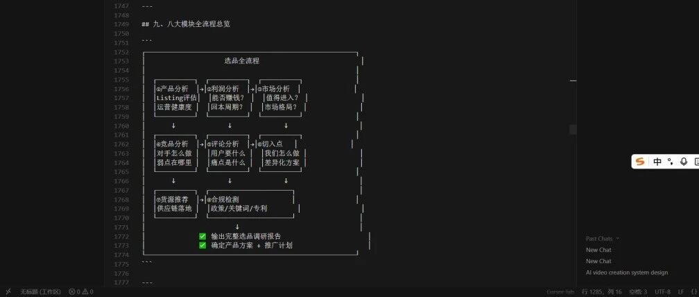
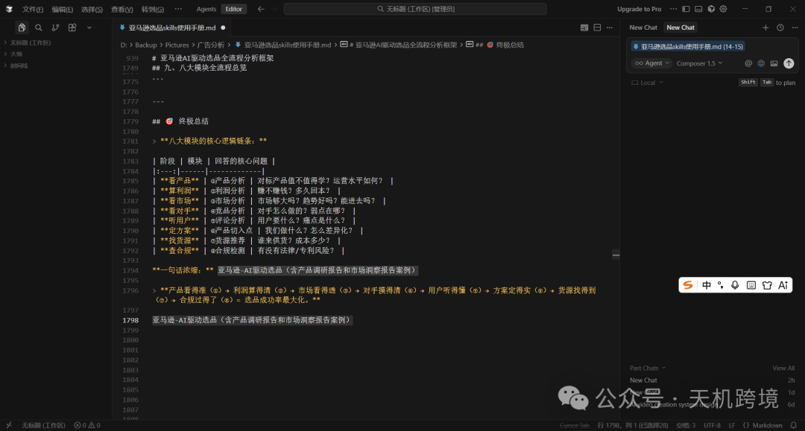
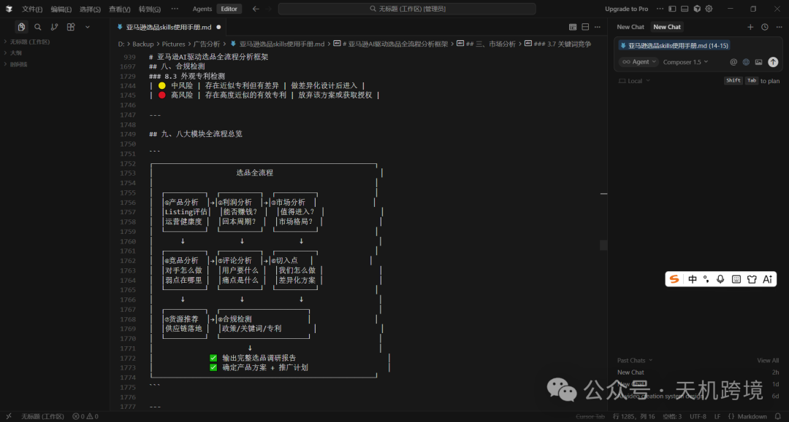
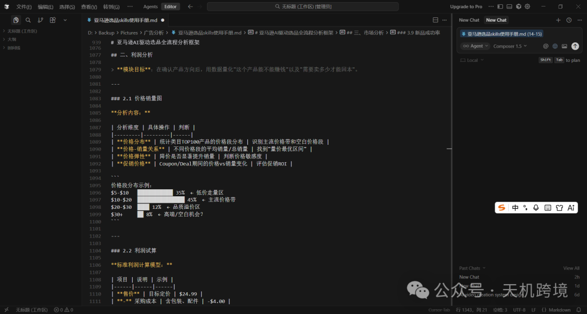
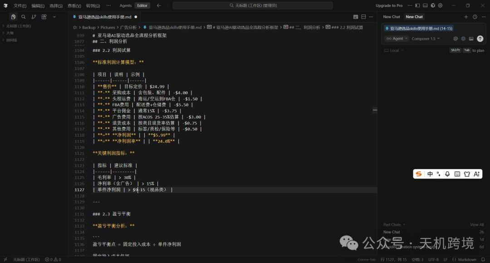
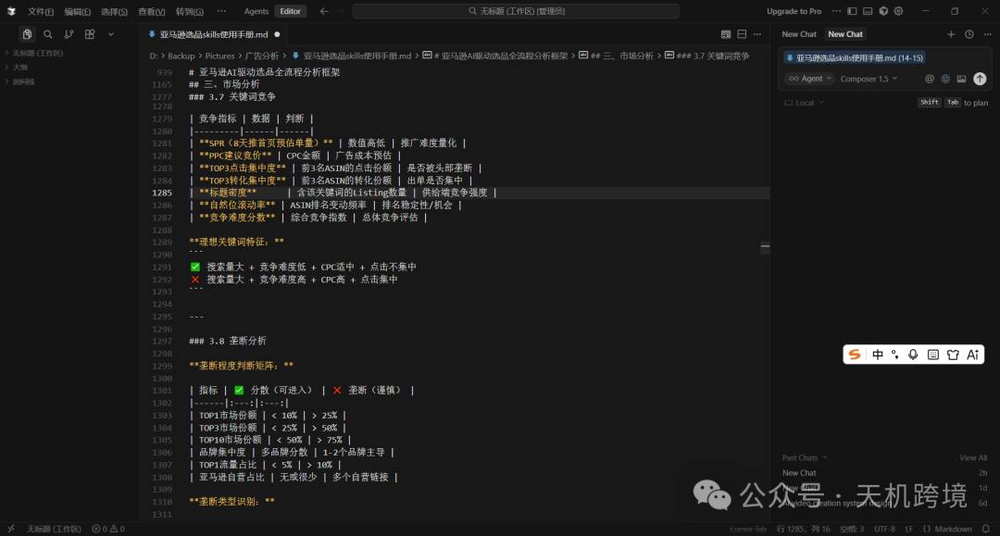
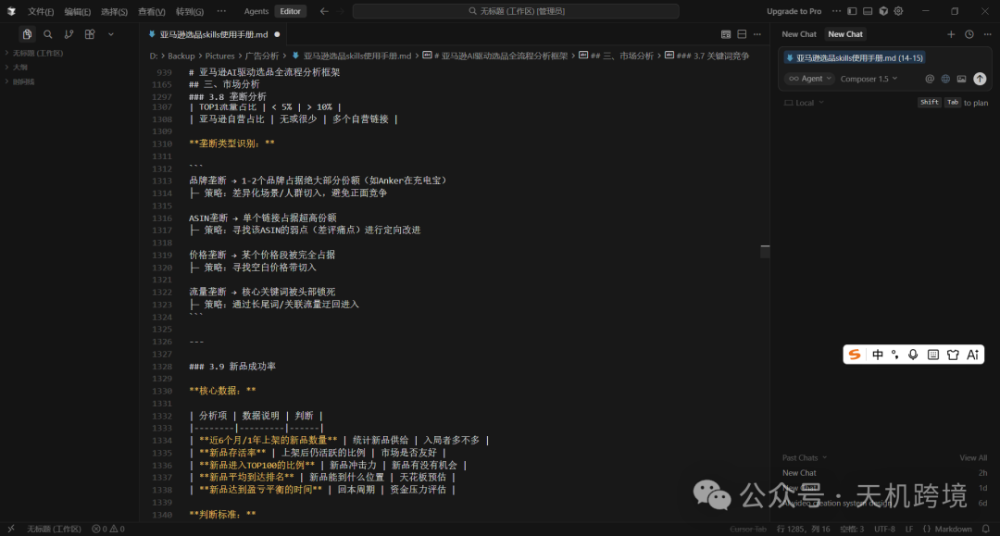
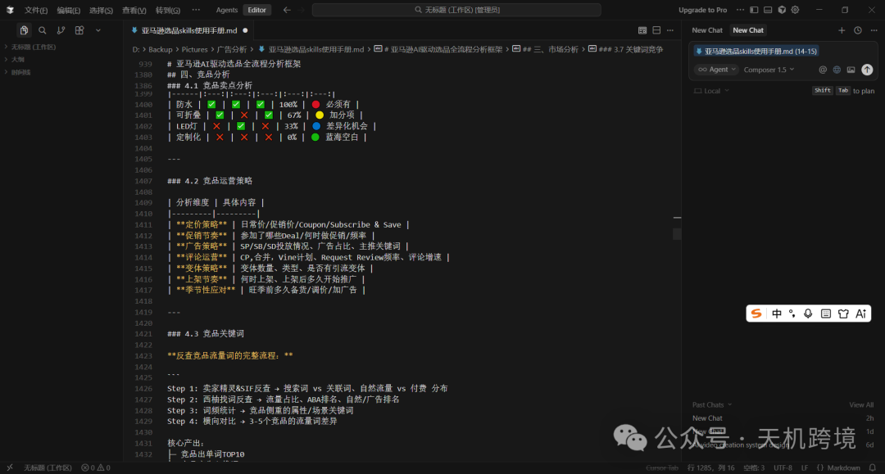
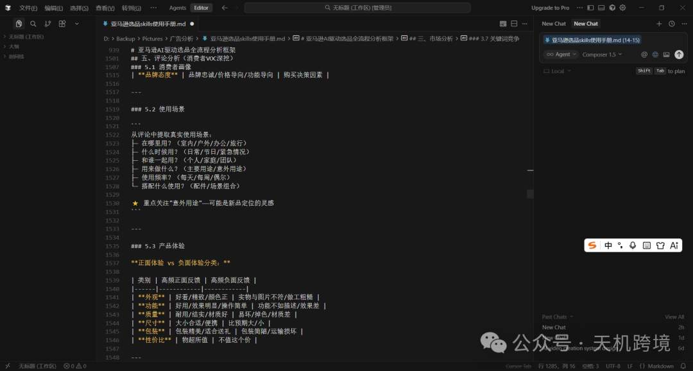

# 亚马逊选品skills使用手册（文件找我）

> Source: wechat
> Author: 天机跨境
> Original: https://mp.weixin.qq.com/s/896hyF7hwiAVT-tt71ZPFg

---

---

你好 ！需要源文件的朋友请后台加我好友，谢谢~我给你发~

亚马逊-AI驱动选品（含产品调研报告和市场洞察报告案例）

