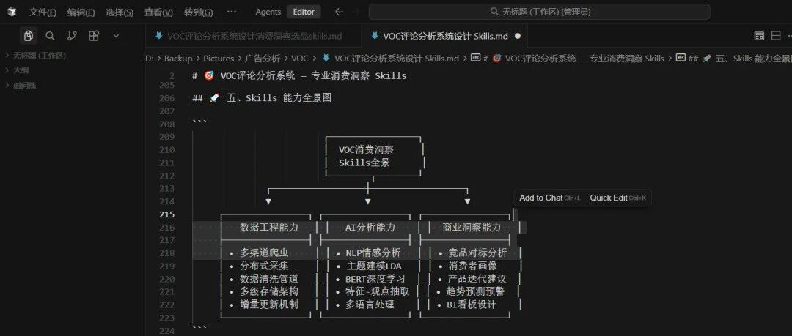
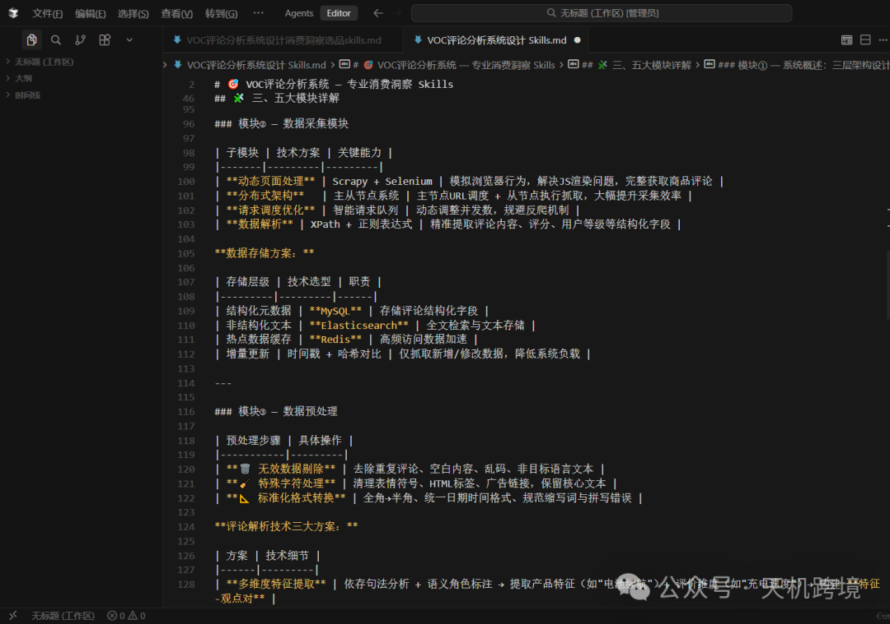
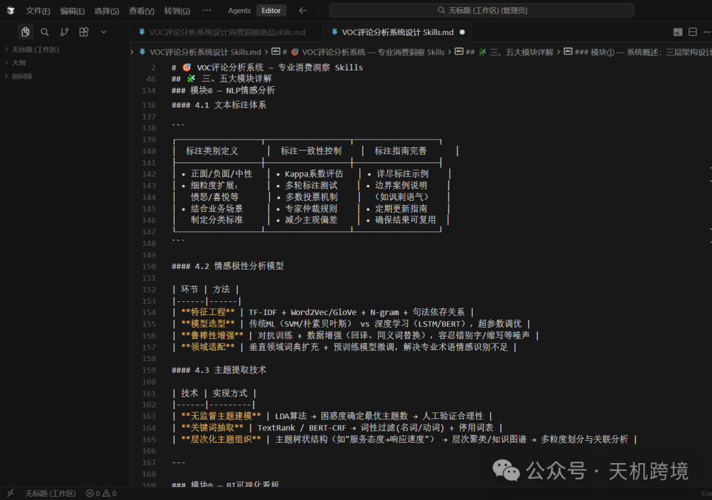
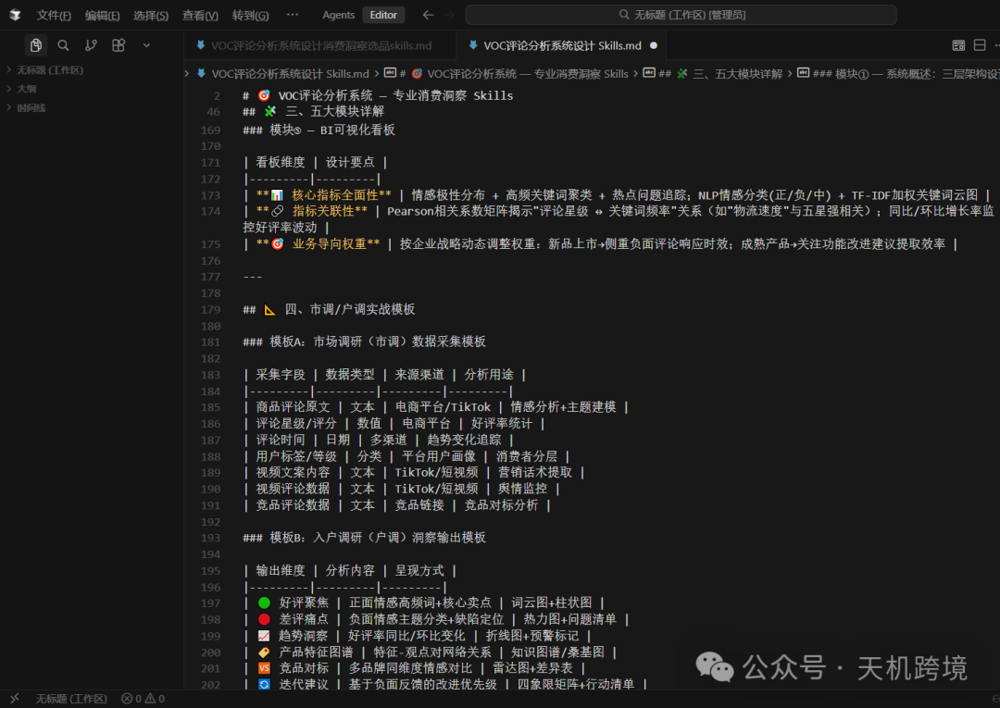
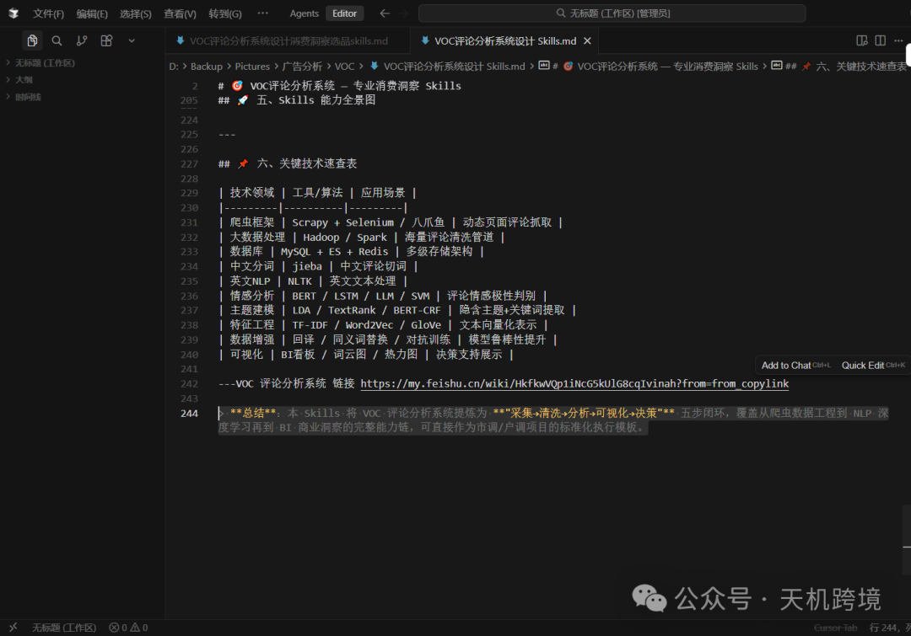

# 亚马逊工作VOC评论分析系统 — 专业消费洞察 Skills

> Source: wechat
> Author: 天机跨境
> Original: https://mp.weixin.qq.com/s/dZblL8Lzzi-7ccc7WYOR0g

---

---

本 Skills 为 "采集→清洗→分析→可视化→决策"五步闭环，覆盖从爬虫数据工程到 NLP 深度学习再到 BI 商业洞察的完整能力链，可直接作为市调/户调项目的标准化执行模板。--VOC 评论分析系统

