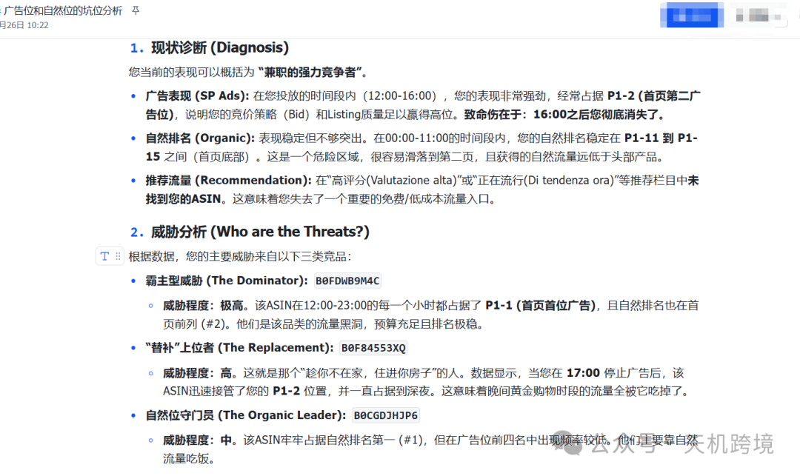
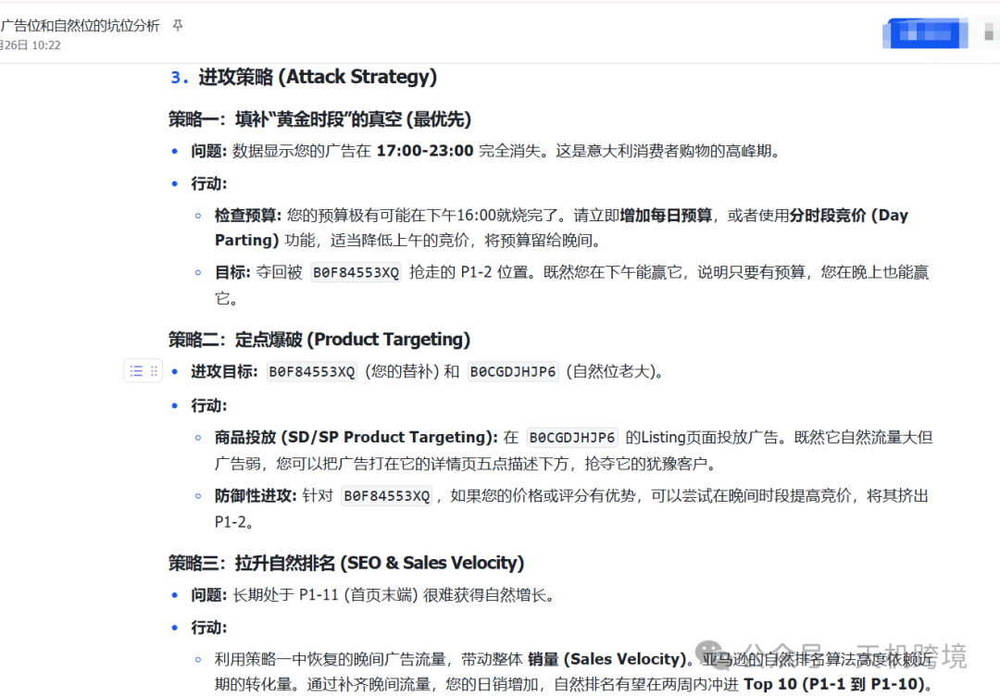
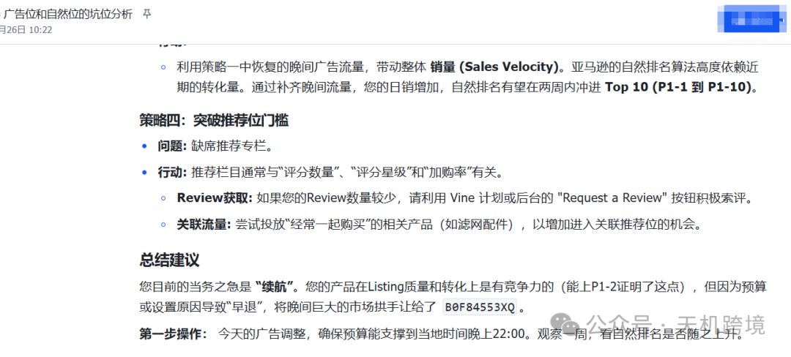
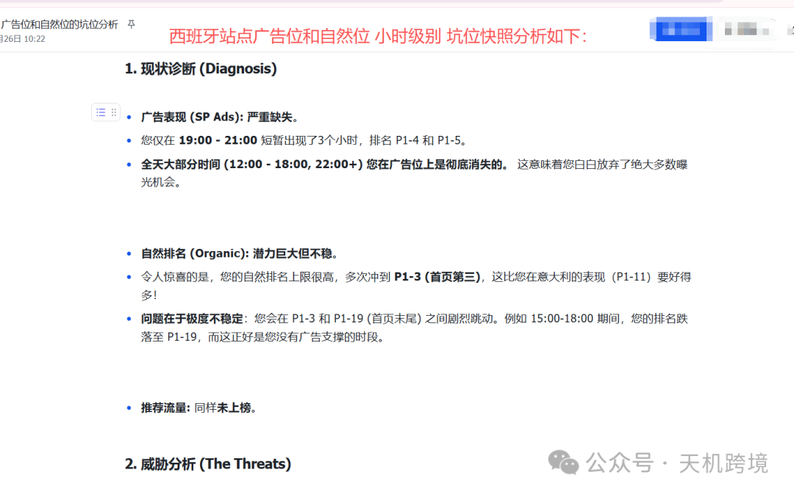
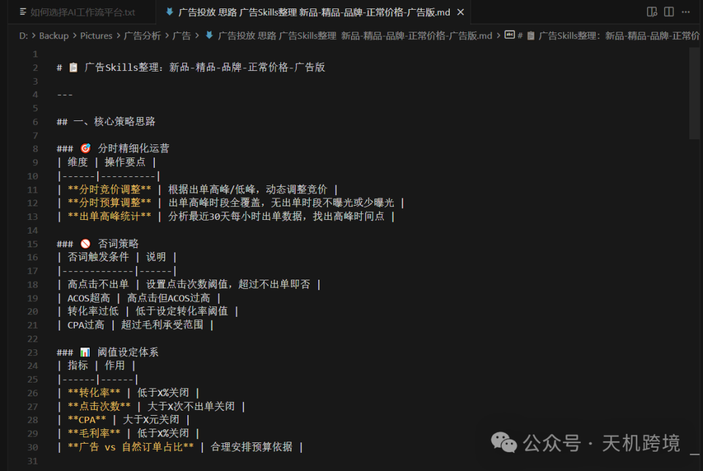

# 亚马逊广告skills高级玩法

> Source: wechat
> Author: 天机跨境
> Original: https://mp.weixin.qq.com/s/QQemJfOs1i0r2DfQQ-urPQ

---

---

写在前面：

今天要写的一个广告skills是针对精品模式（新品-打曝光打收录为主，老品-打转化，打位置 降ACOS,打进攻）

其中，用核心竞品ASIN 9个+自己ASIN,多产品进行流量比较（找词，定方向），再用小时坑位快照，找出核心词，长尾词等，小时级广告位，自然位，推荐位，曝光时长，曝光的位置，具体微调，具体思路看文章后半段

分析效果

