# 用八爪鱼RPA+AI采集分析Reddit信息做亚马逊广告投放素材建议分析

> Source: wechat
> Author: 天机跨境
> Original: https://mp.weixin.qq.com/s/BBmK_hpwPFK0Tiy1AUJT1A

---

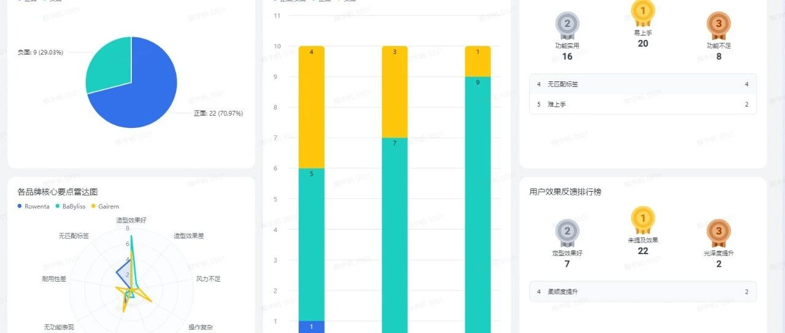

---

## 核心主题：RPA+AI驱动消费者洞察

核心是展示如何利用AI技术，结合海量社交媒体数据，深入、快速、精准地分析消费者行为、需求和决策逻辑，从而为品牌的产品创新、营销策略和品牌定位提供可落地的洞察支持。

**“AI+数据”**——基于社交媒体上的千万级真实讨论，正在重新定义消费者洞察的方式与效率，穿透表象，挖掘用户未言说的深层需求与决策逻辑。消费者洞察：用户是谁，人群特征，生活方式，消费理念，消费心理，消费路径，（身份职业爱好代际行业，类目） 用户要什么“消费场景，共性需求，深层次，核心痛点，期待价值，”（功能，质量，价格，外观，服务，心理价位）

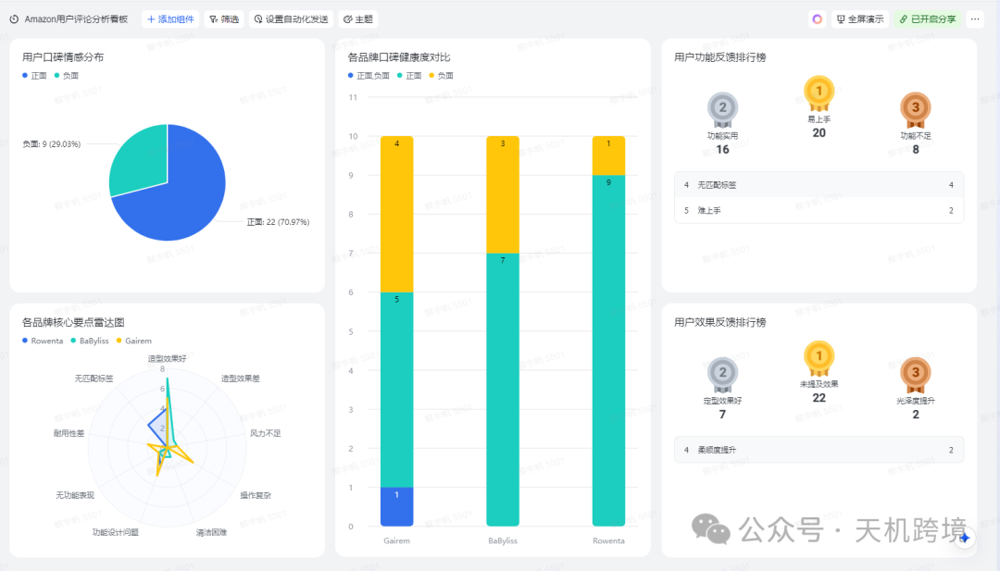

核心卖点-驱动因子，阻尼因子，正向反馈 负向反馈，种草阶段-购买阶段-使用反馈阶段

消费者洞察报告:五个核心one voice一个声音 转变成【产品创新】，人群，场景，共性需求，核心痛点

亚马逊VOC洞察落地三个方向：①产品创新方向，one voice ②影响策略 ③品牌定位方向 定性


---

## 一、 平台核心功能模块（五大核心能力）

文档首先展示了声量通平台提供的五大核心功能，这些功能构成了进行深度洞察的数据基础和分析工具：

1. **测声量 & 听声音（消费者声量监测与分析 找准核心广告投放词）**

1. **功能**：实时监测并回溯品牌、竞品、话题或关键词在全网社媒平台（如reddit、youtube等）的声量、声量份额（SOV）和搜索指数。
2. 亚马逊平台 消费者图片视频，买家评论，QA
3. **能力**：覆盖上亿条数据，AI智能分析情感（准度95%+），自动生成趋势图、平台分布、热词分析等。

2. **AI生成营销级报告（智能报告生成快速找准消费场景需求，人群定位）**

1. **功能**：配置营销专家级AI，一键智能生成图文并茂的专业分析报告（如社媒分析、活动复盘等）。
2. 可以结合Rufus和站外，小编辑 测评 发帖

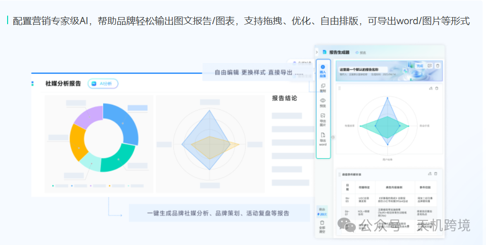

- **能力**：支持报告内容的拖拽优化、自由排版，并可导出为Word或图片格式，极大提升报告撰写效率。

3. **对比竞品社媒表现（竞品/品牌对比分析 定投/类目广告，站外展示广告）**

- **功能**：一屏对比本品牌与竞品在声量指数、趋势、内容方向、发布者分析等多维度数据。

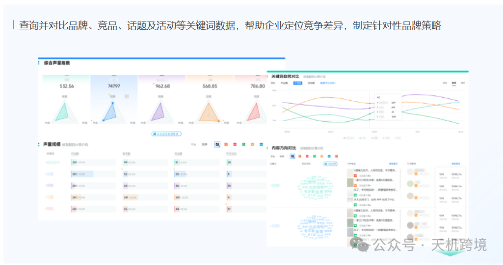

- **能力**：帮助卖家快速定位竞争差异，发现自身优劣势，并一键生成竞品对比分析报告。

4. **查询品牌/亚马逊品类SOV（市场份额分析 品牌人群定位）**

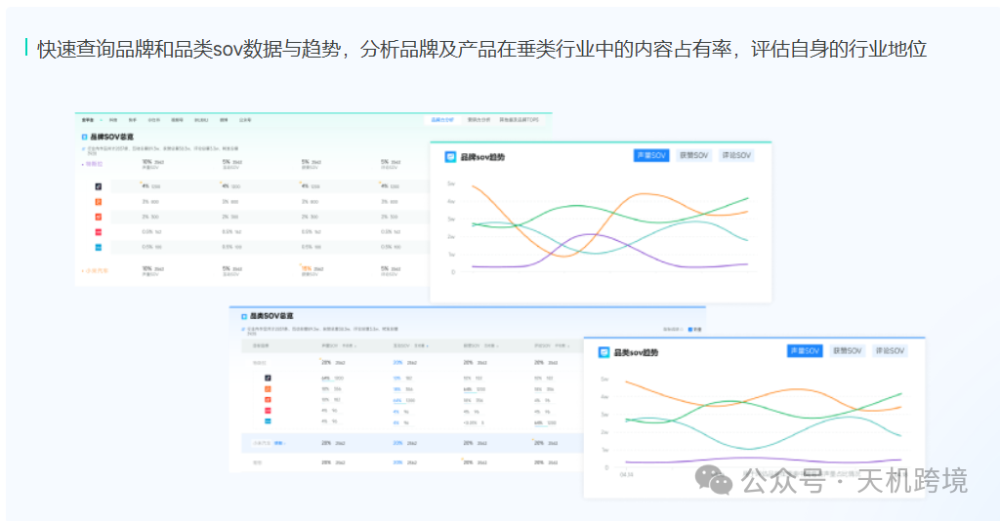

1. **功能**：衡量品牌在特定垂类行业中的内容占有率，包括总声量SOV、互动SOV等。

- **能力**：通过数据趋势，评估品牌在行业内的相对影响力与地位。

2. **全面评估品牌影响力 & 监测负面信息（声誉管理与舆情预警）**

1. **功能**：综合评估品牌影响力指标（声量、互动量、传播效能等）；监测负面舆情并实现分钟级预警；挖掘正向优质内容进行放大。
2. **能力**：AI智能聚合关键作品与关键账号（按商业价值、舆情危机等维度），统一管理社媒账号资源，生成舆情处置报告，实现高效的声誉管理。

---

## 二、 消费者 VOC 洞察方法论与报告框架

文档的核心部分深入阐述了如何进行真正的消费者洞察，并介绍了声量通“消费者洞察报告”的完整框架。

**one voice一个声音 转成【产品创新】**

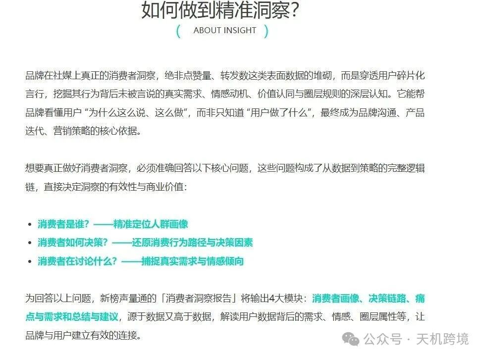

### （一） 对“真正洞察”的定义

- 真正的洞察**不是**表面数据（点赞、转发）的堆砌。
- 真正的洞察**是**穿透用户碎片化言行，挖掘其背后**未被言说的真实需求、情感动机、价值认同与圈层规则**。它回答“用户为什么这么说/这么做”，而不仅仅是“用户做了什么”。

### （二） 洞察必须回答的三个核心问题

1. **消费者是谁？** —— 精准定位人群画像（身份、职业、爱好、代际等）。
2. **消费者如何决策？** —— 还原消费行为路径与决策因素（从种草到购买到反馈）。
3. **消费者在讨论什么？** —— 捕捉真实需求与情感倾向（核心痛点、期待价值）。

### （三） 消费者洞察报告的四大模块（以大疆无人机为例）2025年10月社媒舆情监控分析

基于以上问题，报告输出四个模块，将数据转化为策略：

1. **Part 01: 消费者画像**

1. **目的**：精准定位目标用户，发现高潜人群。
2. **内容**：分析核心人群特征、生活方式、消费理念。例如，大疆的核心人群包括“航拍摄影爱好者”（重体验）、“农业从业者”（重效率）和“科技潮玩玩家”（重创新）。

2. **Part 02: 决策链路**

- **目的**：理解消费者从种草到购买再到反馈的全过程，识别关键驱动因子和阻塞因子。

- **内容**：分阶段（种草、购买决策、使用反馈）分析用户的关注点和行为。例如，大疆用户在种草阶段关注价格和画质，购买时权衡优惠与服务，使用后反馈集中于产品稳定性和售后服务。

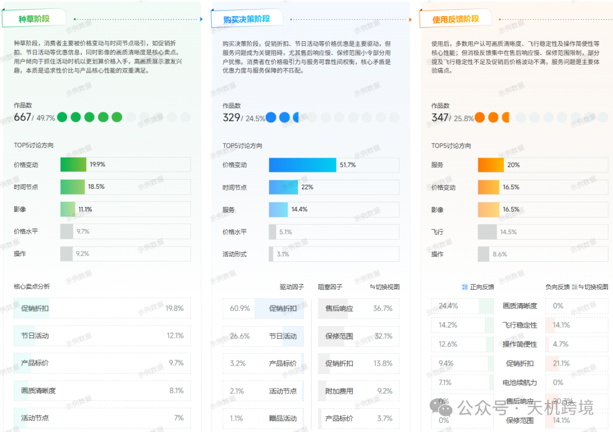

3. **Part 03: 痛点与需求**

- **目的**：找到用户的高频使用场景、核心需求与痛点，指导产品优化。

- **内容**：通过矩阵分析场景与需求、场景与痛点的关系。例如，大疆的“航拍记录”场景对应高“画质需求”，但痛点在于“操控困难”；“物资运输”场景则对“载重需求”高，但“载重能力弱”是主要痛点。

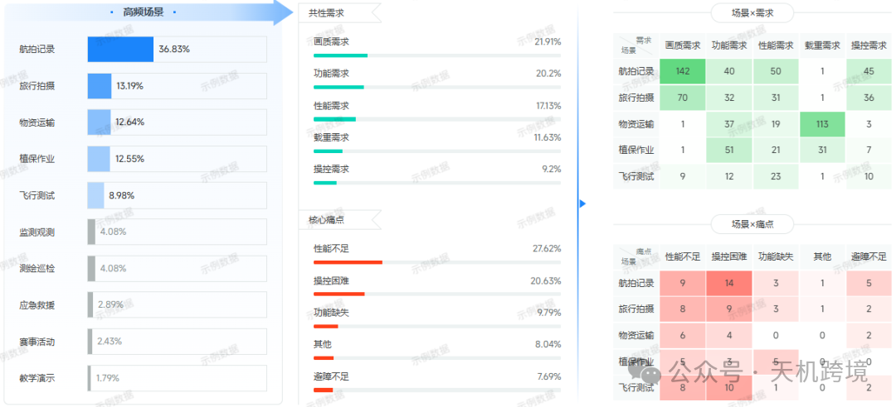

4. **Part 04: VOC总结与建议**

- **目的**：整合前三部分的发现，提出具体、可落地的产品与营销建议。
- **内容**：针对不同人群和问题，给出分层级的建议（如紧急攻坚、重点突破、持续优化、长期规划）。例如，为大疆提出“优化旅行航拍体验（开发轻量化机身）”、“升级农业飞防功能”、“开放潮玩改装接口”等具体措施。

---

## 三、 平台核心优势与差异化

文档最后强调了声量通相较于传统咨询报告或通用AI工具的核心优势：

- **数据基石**：基于新榜10年+的社媒数据能力，自动抓取千万级真实声量数据，智能清洗噪音。
- 1one voice一个声音 成【产品创新】

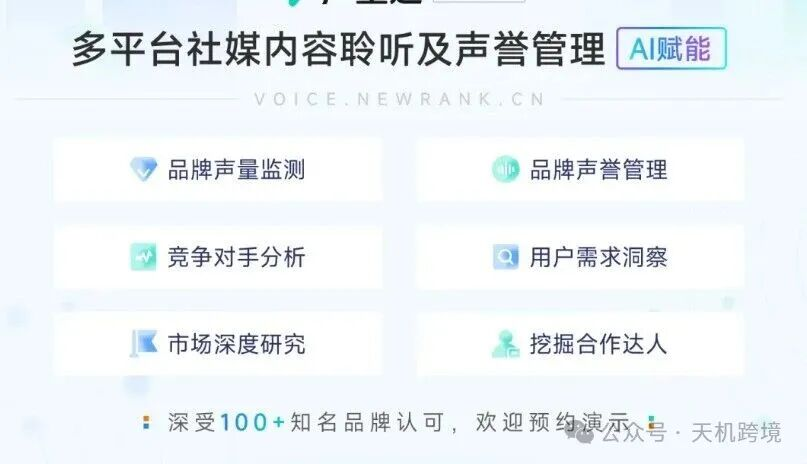

- **分析深度**：AI具备深度语义解析能力，不仅能分析情感，更能挖掘潜在需求、用户画像和决策路径。
- AI总结分析， 探测消费者的深度语义 购买意图 背后动机

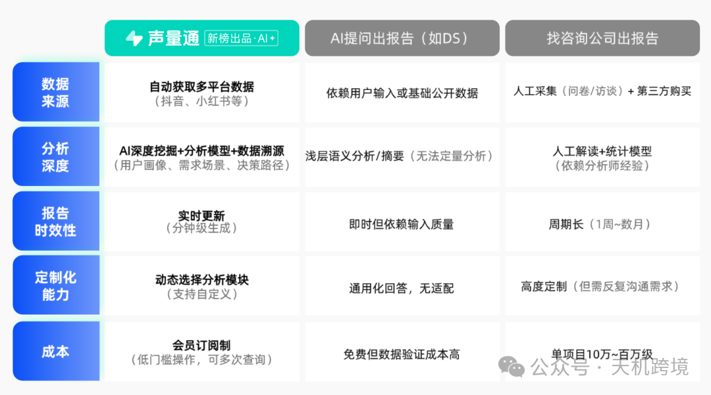

- **可追溯与透明**：每个分析结论都关联原始数据链路，避免“黑箱”决策。

- **即时高效**：分钟级生成实时更新的报告，远快于传统咨询周期（数周至数月），且成本更低。
- **定制化与可落地**：支持动态选择分析模块，报告结论直接导向可执行的产品和营销建议。

## 总结

这份文档系统性地展示了一个由AI和数据驱动的现代消费者洞察解决方案。它不仅仅是一个数据分析工具，更是一个融合了**数据获取、AI智能分析、专业洞察模型和策略落地建议**的一体化平台，旨在帮助品牌真正读懂用户，实现精准营销和产品创新

by the way最近在出海圈子里，Reddit逐渐火了起来。

这个集小红书➕微博➕知乎于一身的海外论坛，是全球用户体量最大的平台。尤其是在AI时代，由于Reddit有海量优质的用户讨论内容，被各大巨头相中，市值暴涨3.8倍。

**正值20周岁的老牌论坛，正在重新焕发生机。**

而对我们国人来说， **Reddit就是产品出海的「演练场」**

**不论是新品冷启动，还是用户调研，都能在上面拿到一手的、最真实的用户反馈。这才是价值所在。**

|  |  |
| --- | --- |
| Image  Image | Image |

这也是为什么我前面专门做Reddit工作流的原因，它也会是我未来重点的研究方向：

【飞书文档】出海赚美金：用n8n搭建「Reddit商机搜索与洞察」 AI Agent自动化寻找蓝海市场，发现真实痛点

但，我上次做的工作流，在实际落地中有两个问题：

1是Reddit太多子版块了，不知道去哪搜

2是相关内容很多关键词，如果要一个一个去搜，很麻烦，也会很耗时，效果也未必好

突然有种面对海量优质信息，但不知从何下手的无力感。

直到我发现，Reddit有一个`Answers` 功能，简单来说就是基于Reddit内容的AI问答。

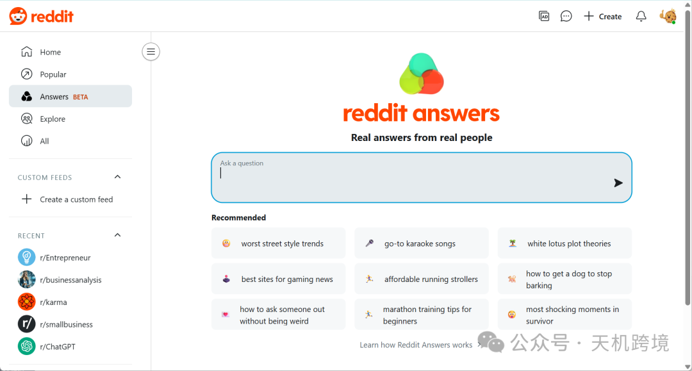

那有了它，是不是意味着我之前做的工作流白费了，毕竟我们能直接从Answers里获得想要的答案，于是我试了一下。

## 需求场景与分析思路

我最近在帮一个做出海智能猫砂盆的创业团队做市场调研。他们的产品准备登陆美国市场，计划把TikTok作为核心的营销引爆点。

但问题来了：团队对于什么样的广告素材能真正打动美国的猫主人，心里完全没底。

是该展示产品的高科技、未来感？还是该突出它如何解放双手，让铲屎官彻底告别痛苦？或者是强调产品的安全性，让用户放心？每一个方向似乎都对，但每一个方向都可能因为不了解用户的真实想法而白白烧掉大量广告费。

因此，我们的核心任务变得非常明确： **必须潜入到真实的美国用户社群中，去“偷听”他们到底在聊什么、抱怨什么、渴望什么。**

也就是说，想通过分析Reddit上关于猫砂盆（无论是传统的还是智能的）的海量讨论，挖掘出那些最能引发共鸣的 **用户痛点、使用场景、甚至是他们津津乐道的“爽点”和吐槽的“雷点”**。最终，将这些一手的情报，转化为一份可以直接指导拍摄的、高转化率的TikTok广告素材创意报告。

OK，整理一下就形成了提示词。但由于`Reddit Answers` 只支持中文，所以我要先翻译一下：

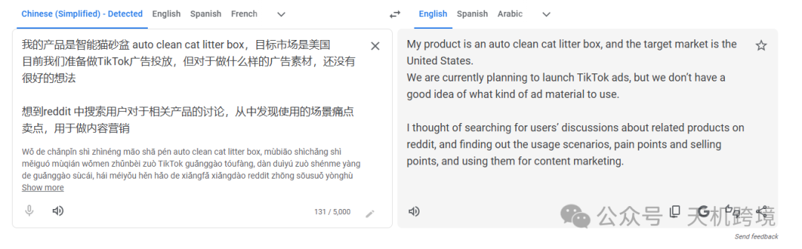

下面就是回复，我们看到Reddit AI确实帮我们整理了一些要点，以及每个要点下又要多个小点，所有内容都有明确的帖子来源。

**但说实话这结果不太能用，**

**1是识别的不太好，很多结果变成了扫地机器人相关，而非智能猫砂盆。**

**2是对我们的业务诉求（亚马逊广告投放）并没有涉及到**

|  |  |
| --- | --- |
| Image | Image |

这也是Reddit Answers的问题 ， **更多是一个根据用户需求智能搜索相关帖子的能力 。**

等等？

还记得我们前面说的痛点吗——不知道搜什么，也不知道去哪里搜

而Answers不正是解决了这个问题吗？

于是我们就有了一个升级的解决方案： **借助Reddit Answers来做相关帖子的检索，然后再接回原先的逻辑，重新抓取每个帖子和评论的原始内容，做AI分析。**

整体的思路逻辑如下：

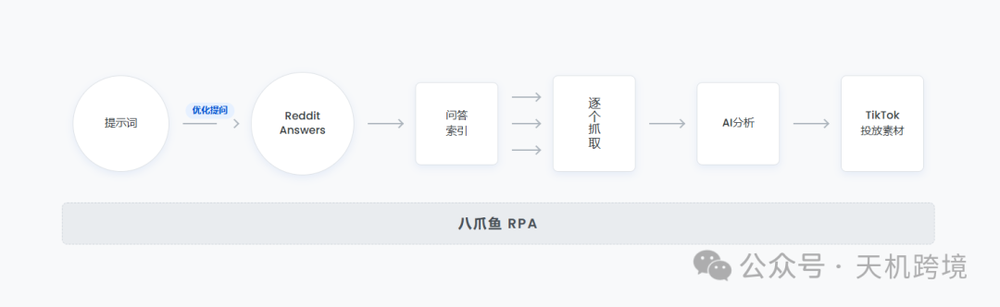

其中，我发现，Answers的回答质量跟用户的提问有效性成正比，所以在最开始需要先做一个AI优化用户提问。

而整个流程，我们就无法用n8n等工作流来完成了，毕竟是要在Reddit页面里操作Answers的提问、爬取页面。

我选择了用`八爪鱼RPA` 来作为我们的底座。链接https://affiliate.bazhuayu.com/RtwJLK

八爪鱼是我很早就开始在用的数据爬虫软件，而这个 **八爪鱼RPA可以算是升级版，既能轻松完成复杂页面的数据抓取，也能做工作流编排，实现自动化；同时，内置的AI能力，足以帮助我们实现AI分析，提炼出有价值的结论。**


https://affiliate.bazhuayu.com/RtwJLK

按照这个思路，我用八爪鱼实践后，得到了这样一份 **基于Reddit用户洞察而来的TikTok投放广告素材报告**，是不是还不错？后面我还会拿Gemini Deepresearch的来对比

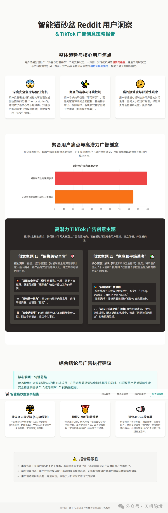

接下来，我们逐个部分来看八爪鱼RPA怎么做。

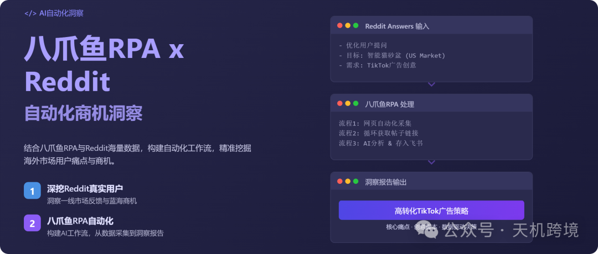

## 八爪鱼RPA开发实战

想跟着实操还原RPA流程的，可以先下载八爪鱼RPA： https://partner.rpa.bazhuayu.com/62uO6X

也可以直接点击阅读原文跳转

### 优化用户提问

参考提示词：


```
我的产品是智能猫砂盆 auto clean cat litter box，目标市场是美国
目前我们准备做TikTok广告投放，但对于做什么样的广告素材，还没有很好的想法

想到reddit 中搜索用户对于相关产品的讨论，从中发现使用的场景痛点卖点，用于做内容营销
请你帮我翻译成英文需求，可以让我直接向reddit ai提问，也就是生成ai提示词
直接给我ai提示词即可，其他什么都不要说
生成的ai提示词控制在500英文字符数以内，一定要简单有力，重点突出。
```


**（Reddit Answers搜索中，提问的英文字符数要求是500以内。）**

用AI优化后的搜索提示词：


```
Analyze Reddit discussions from US cat owners about cat litter boxes. Identify the most common complaints, frustrations, and pain points with both traditional and automatic models. Pinpoint the features they love or wish for in an ideal auto-clean cat litter box. Summarize these findings into key selling points and content ideas suitable for TikTok ads targeting American cat owners.
```


重新跑一下，可以发现优化后， **讨论的更精准了，同时也有具体的关于TikTok Ads 建议**

|  |  |
| --- | --- |
| Image | Image |

在八爪鱼RPA中，这部分的流程是这样的：

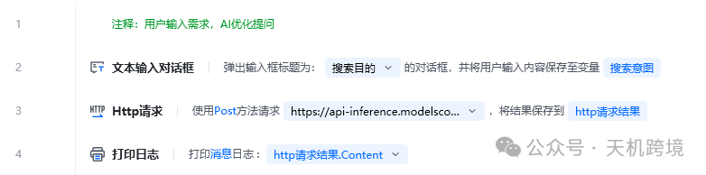

其中，对于八爪鱼PRA的AI能力，有两种方式可以用

1种是用内置的AI大语言模型，会按实际使用消耗成本（每个账号都能白嫖5元）

|  |  |
| --- | --- |
| Image | Image |

1种是用原始的Http请求来解决

前者比较简单，后者麻烦点，所以这里教大家怎么用后者。

新建一个http请求

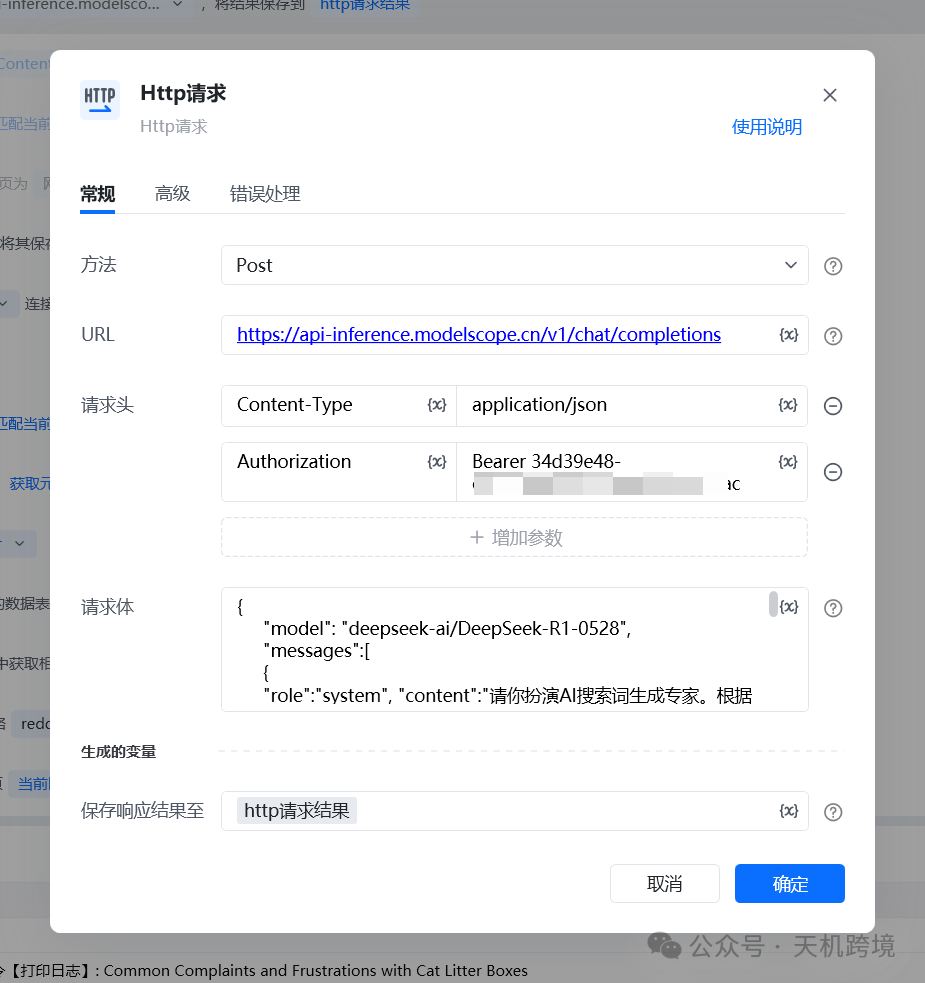

- 方法：选择Post
- URL：输入大模型地址，这里我用的是魔塔的每天2000次免费额度

地址填`https://api-inference.modelscope.cn/v1/chat/completions`

- 请求头：固定的两个

- Content-Type：application/json
- Authorization：Bearer 密钥

- 请求体按以下结构来写：


```
{
      "model": "deepseek-ai/DeepSeek-R1-0528",
      "messages":[
      {
      "role":"system", "content":"请你扮演AI搜索词生成专家。根据用户的需求（通常是想到reddit 中搜索相关产品的讨论，从中发现使用的场景痛点卖点，用于做内容营销。）翻译可以直接向reddit ai提问的提示词。直接给我ai提示词即可，其他什么都不要说。生成的ai提示词控制在500英文字符数以内，一定要简单有力，重点突出。",
      "role":"user","content":"<oct:ref>搜索意图.InputText</oct:ref>"
      }
      ],
      "temperature": 0.9,
      "max_tokens": 2048,
      "top_p": 1,
      "frequency_penalty": 0.0,
      "presence_penalty": 0.6
  }
```


其中，对于变量`搜索意图` ，是从`文本输入对话框` 获取的，里面的`InputText` 属性才是文本内容，才能直接加入到请求体里。

运行的时候会弹出一个对话框，用于输入用户的搜索目的。

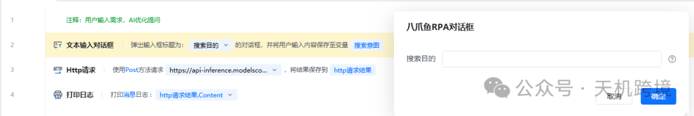

我们输入：


```
我的产品是智能猫砂盆 auto clean cat litter box，目标市场是美国。目前我们准备做TikTok广告投放，但对于做什么样的广告素材，还没有很好的想法。
```


最终Http请求给出的，就是AI优化过的搜索提示词。

### RPA使用Reddit Answers

有了提示词后，我们就要让RPA自动打开`Reddit Answers` 页面，输入提示词并提问。

这部分流程很简单：

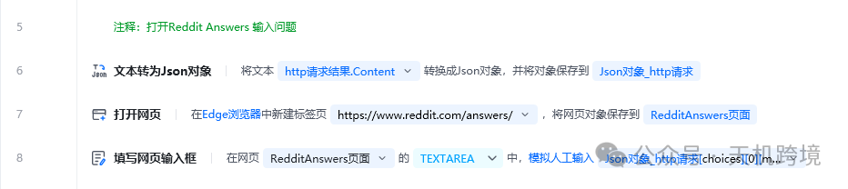

需要注意的是，因为Reddit是海外的，要科学上网，网速比较慢，所以可以增加超时时间，避免在过短时间内未能打开导致报错

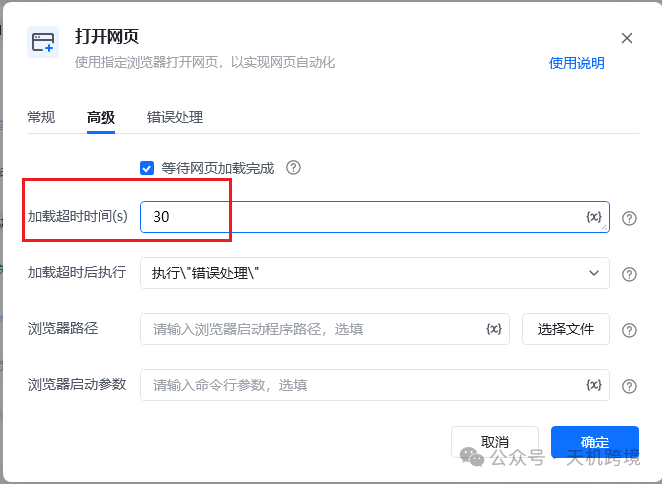

打开页面后就是输入提示词。

找到`填写页面输入框` 的指令

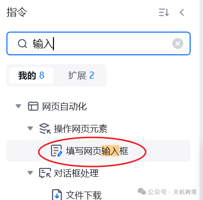

要先告诉RPA我们要在页面的什么位置输入内容，点`捕获新元素`

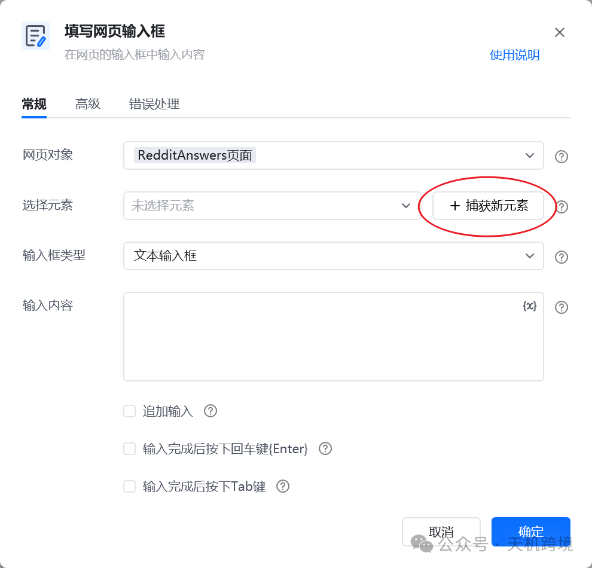

找到如图的提问框位置，同时按`Ctrl+鼠标左键`

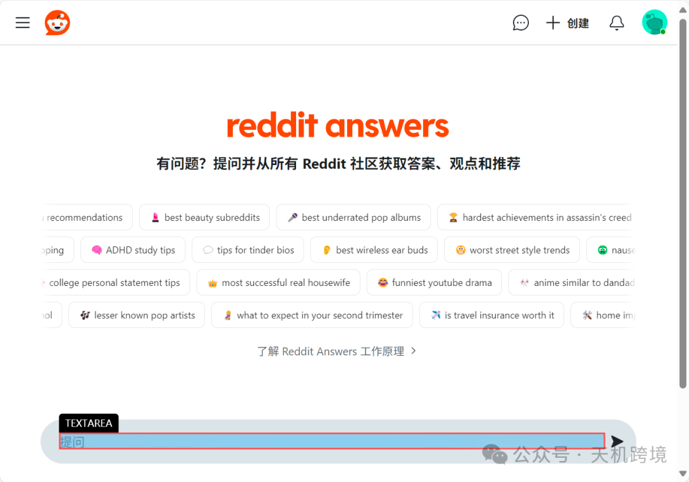

接着RPA就会自动识别这个位置的元素了，然后我们把前面http请求的文本内容（也就是优化后的提示词）填进去，并且让RPA填完就按回车确认，这样Reddit Answers就能开工了。

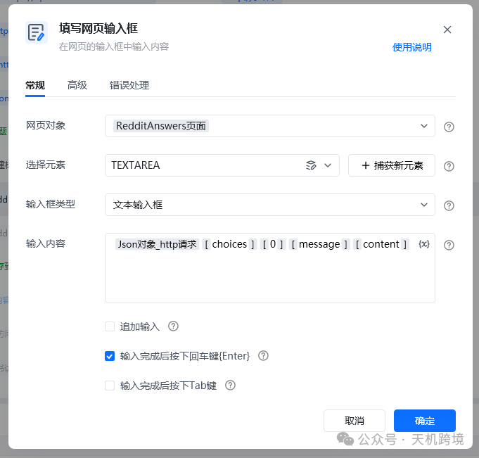

其中，对于http请求返回的结果，是一个很复杂的结构，不能直接拿来搜索，而是要取里面的有效部分

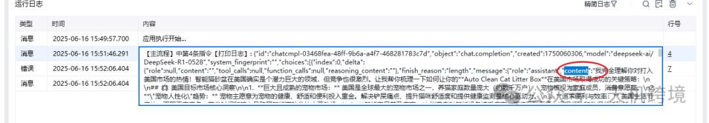

首先把返回结果转成json对象，再提取其中的文本

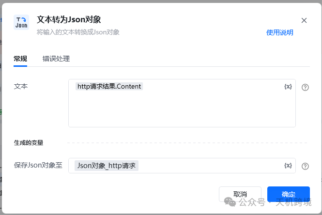

最后就得到了上面`填写网页输入框` 中的`输入内容` 。

页面就是文章开头展示的那样，这里不重复展示。

### 采集Answers的回答内容并保存到飞书

接着就是处理回答页面的内容。

这里，我们延续用了我上次的飞书表格来作为数据库存储每次搜索记录。

表格模型是这样：

**1个是搜索记录**，记录每次用户的搜索，包括搜索意图和Reddit Answers回答的内容。

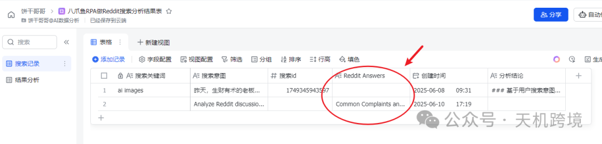

**1个是结果分析表**，是把每个帖子单独分析的记录存到这里

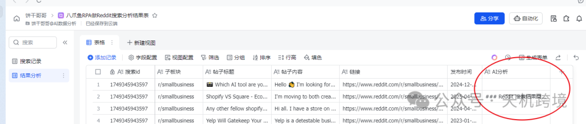

OK，回到八爪鱼RPA，这里，我们要把Reddit Answers的结果，采集下来后，存到飞书里。

流程是这样：

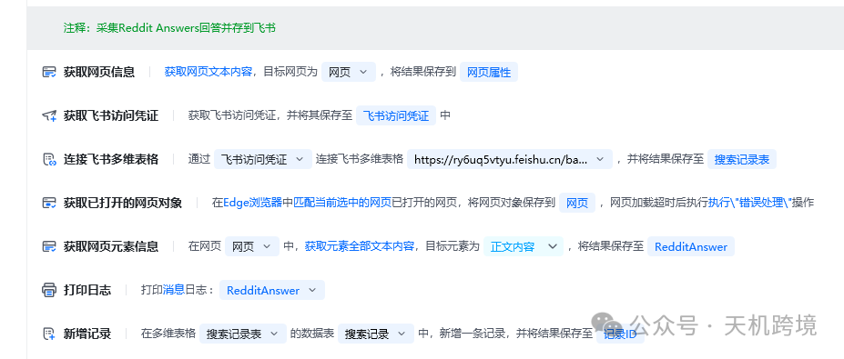

首先，把内容扒下来，可以用`网页自动化` 里的`获取页面信息` ，把整个页面的内容都存下来，简单粗暴。

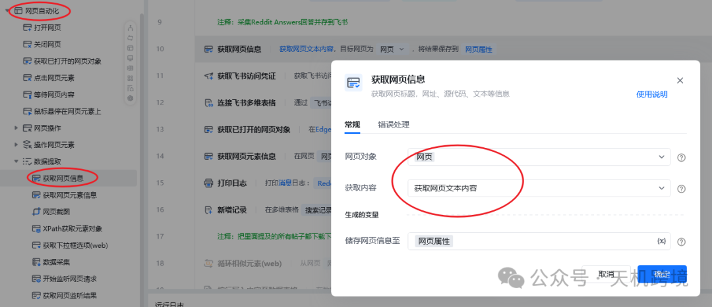

对于飞书，需要先`获取飞书访问凭证`

输入在飞书后台获取的App id、App secret

不了解的，我在这篇文章有详细说明，可以参考

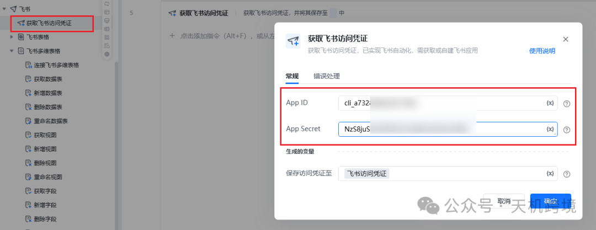

有了凭证后，才能`连接飞书多维表格` ，这里输入你的表格地址即可。

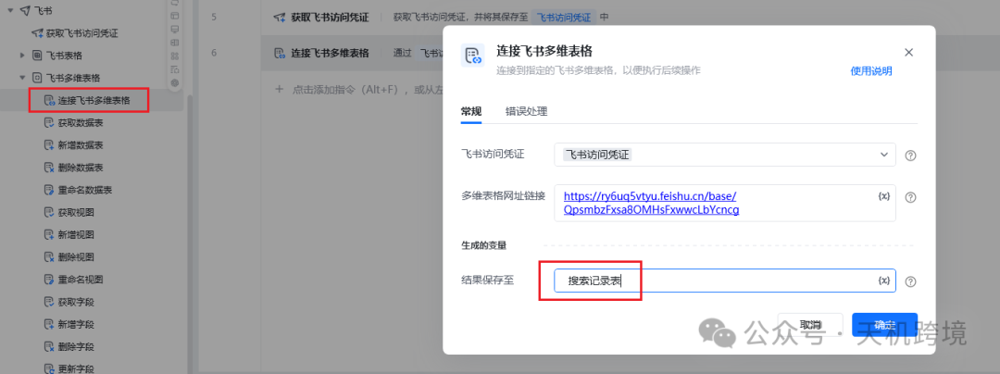

接着，就可以`新增记录` ，把需要的信息存到对应表格里

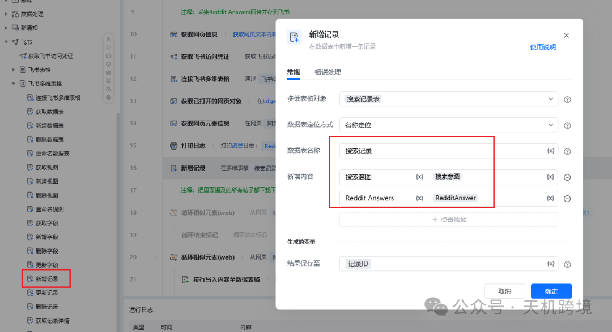

测试运行一下，就能看到八爪鱼RPA顺利把内容同步进去了。

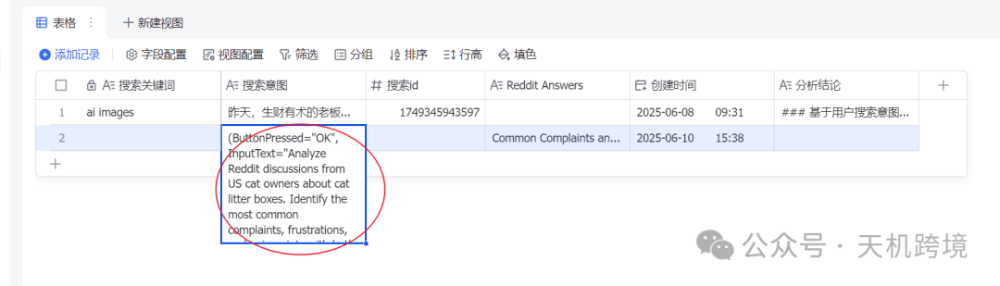

### 逐个打开回答里提及的所有帖子，保存到飞书

前面的分析思路说过，Reddit Answers的回答不是目的，它只是个索引，我们要的是里面提及的帖子。

**所以问题就转变成了，如果获取回答里的帖子链接。**

首先，我们观察Reddit的回答，每次都是同样的结构，于是问题就简单了， **可以直接抓链接的相似元素，让八爪鱼RPA去遍历打开即可。**
