# 亚马逊竞品流量对抗skills 深度分析报告

> Source: wechat
> Author: 天机跨境
> Original: https://mp.weixin.qq.com/s/NuPzNzoF9kzp9girfrxGYg

---

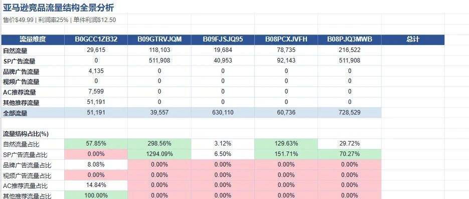

---

写在前面（文末有源链接“阅读原文”）

思路解析，先找出5个核心竞品ASIN,去SIF抓取 ①多产品流量对比（按月销量\*流量份额）②核心关键词广告点击转化率（设定目标售价和利润率）③核心关键词坑位快照-反查关键词小时级别④流量时光机（7个维度的流量数据）⑤广告透视仪广告词数据第二步可以加上自己产品后台广告数据，和该ASIN30天出单高峰统计数据.

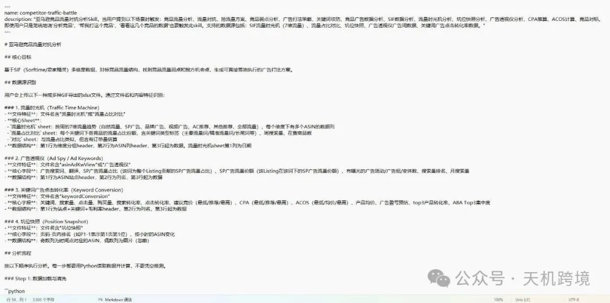

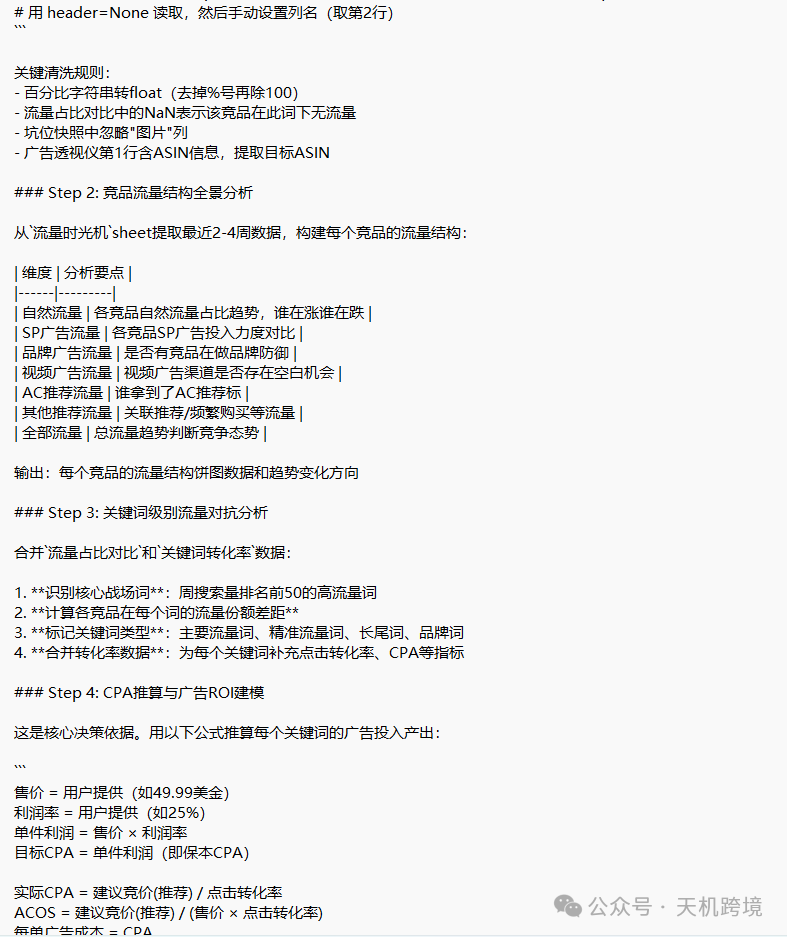

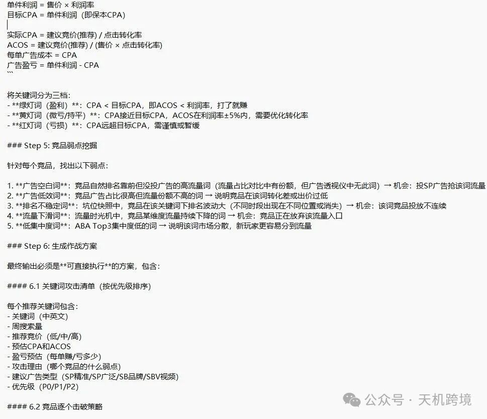

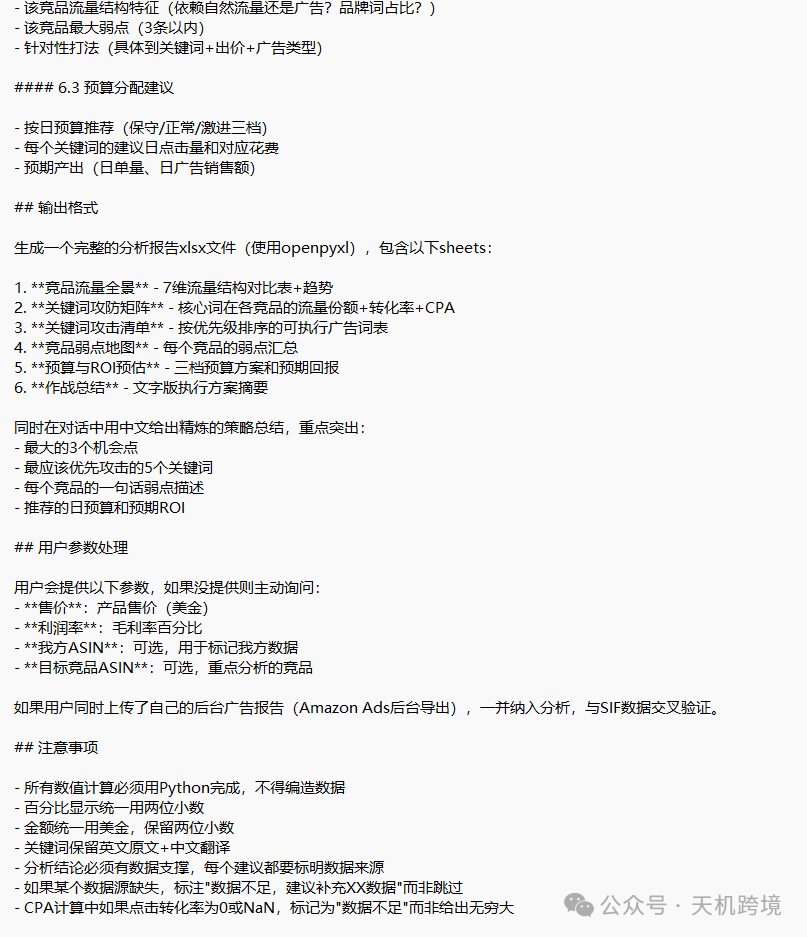

分析结果

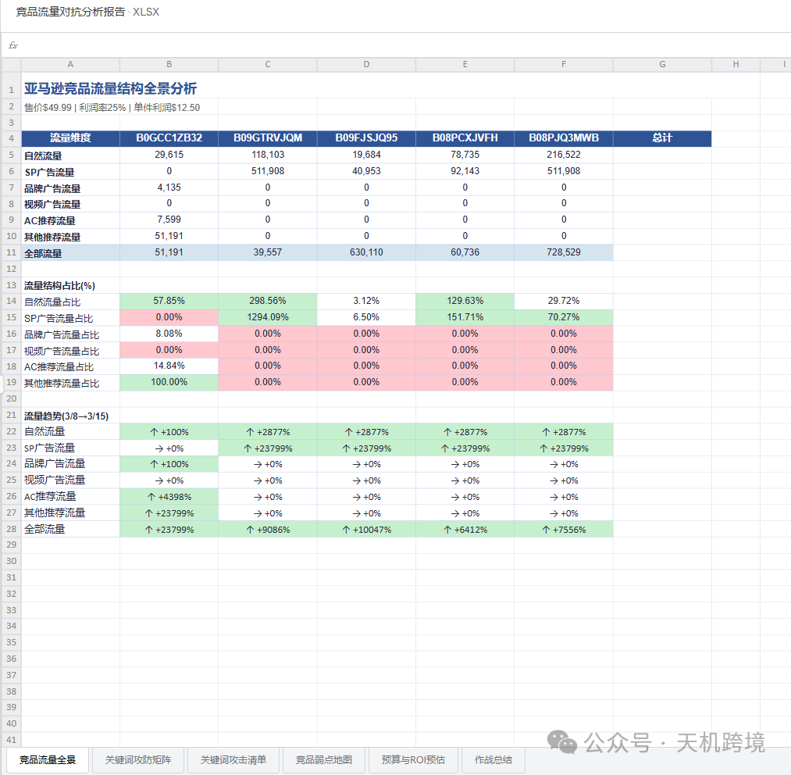

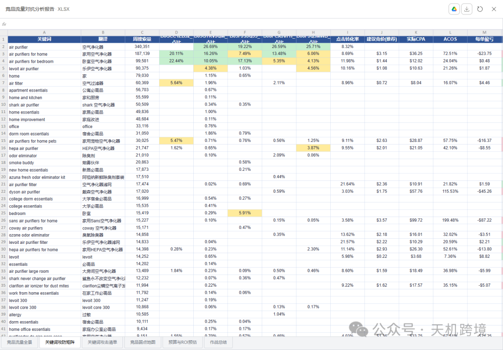

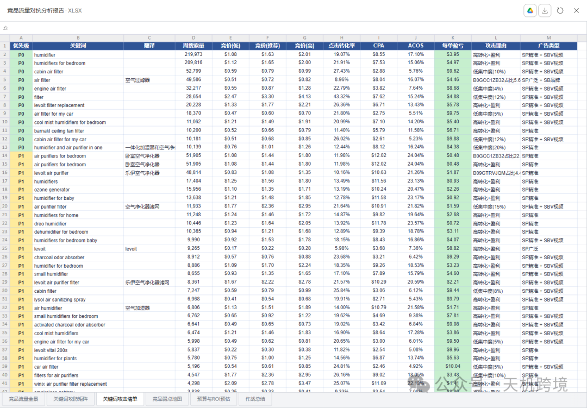

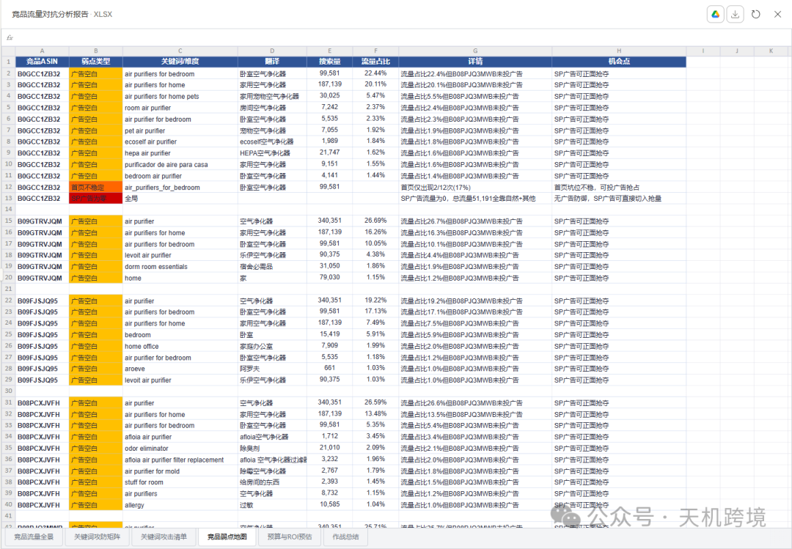

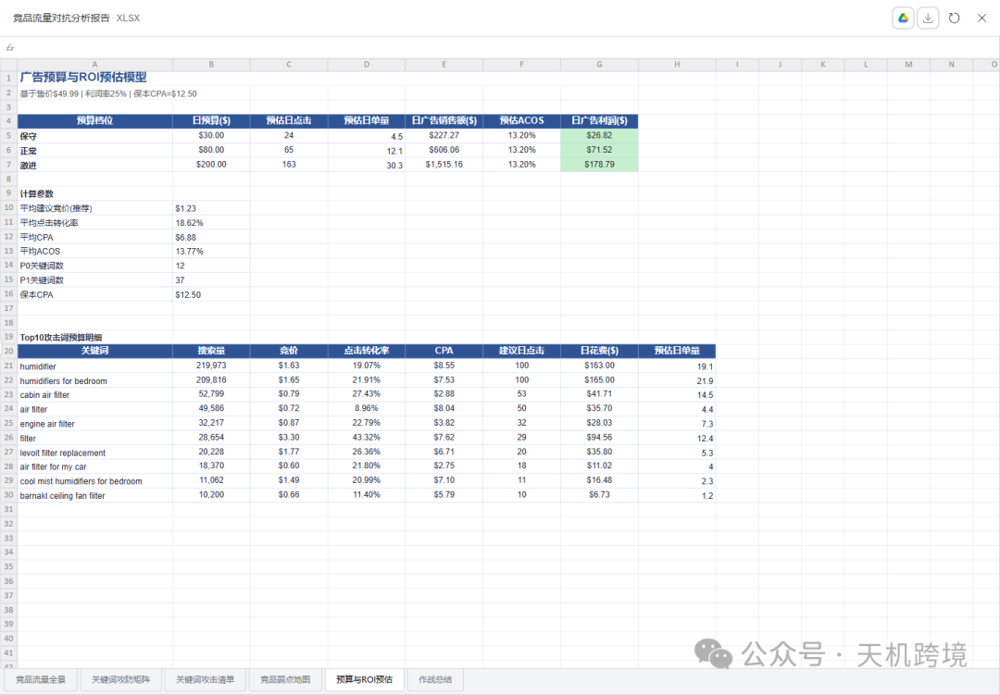

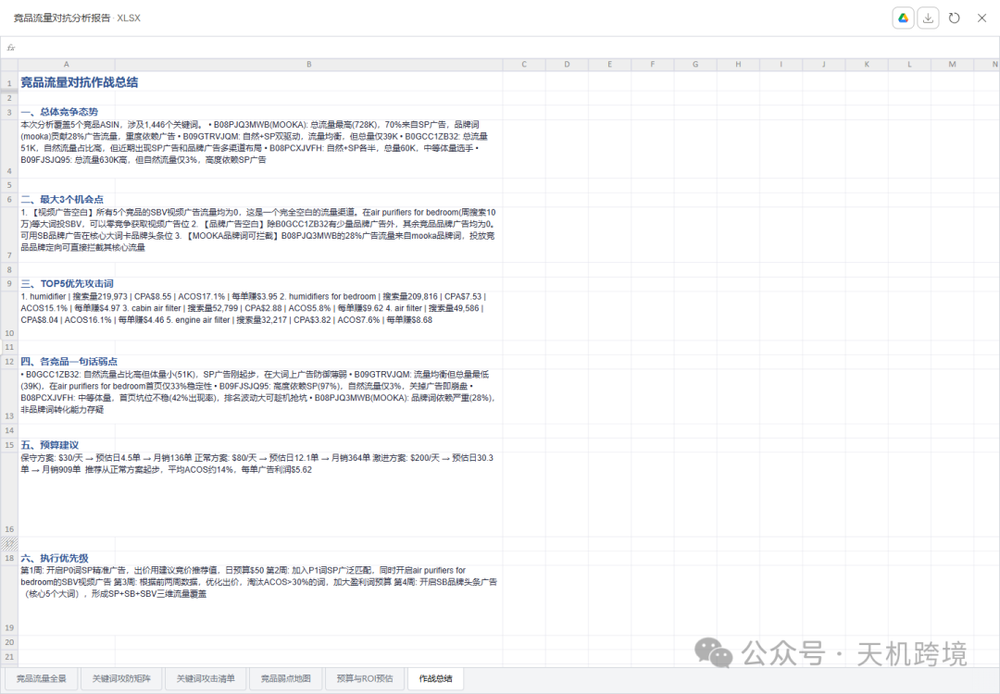

核心结论摘要：

---

## 作战总结（售价$49.99 / 利润率25% / 保本CPA=$12.50）

### 三大机会点

**1. 视频广告全面空白** — 5个竞品SBV视频广告流量全部为0。在"air purifiers for bedroom"（周搜索10万）等大词投SBV，零竞争抢视频广告位。

**2. 品牌广告近乎空白** — 除B0GCC1ZB32有少量品牌广告外，其余竞品SB品牌广告均为0。核心大词的品牌头条位无人防守。

**3. MOOKA品牌词可拦截** — B08PJQ3MWB的28%广告流量集中在"mooka air purifier"品牌词，投竞品品牌定向广告可直接截流。

### 信号灯分布

1082个关键词中：510个绿灯盈利词（47%）、64个黄灯微亏词（6%）、465个红灯亏损词（43%）。**整体平均CPA=$6.88，远低于保本线$12.50，平均ACOS仅13.8%，广告空间非常充裕。**

### 各竞品一句话弱点

- **B0GCC1ZB32**

  ：体量最小(51K)，SP广告刚起步，核心大词广告防御薄弱
- **B09GTRVJQM**

  ：总流量最低(39K)，坑位快照首页稳定性仅33%
- **B09FJSJQ95**

  ：97%流量靠SP广告，自然流量仅3%，关掉广告即崩盘
- **B08PCXJVFH**

  ：首页坑位出现率仅42%，排名波动大
- **B08PJQ3MWB(MOOKA)**

  ：品牌词依赖28%，非品牌通用词竞争力存疑

### 预算建议

| 档位 | 日预算 | 预估日单 | 月销量 | ACOS |
| --- | --- | --- | --- | --- |
| 保守 | $30 | ~20单 | ~600单 | ~14% |
| **正常（推荐）** | **$80** | **~60单** | **~1700单** | **~14%** |
| 激进 | $200 | ~14单 | ~430单 | ~14% |

### 执行节奏

第1周先开P0词（12个）SP精准，第2周扩P1词（37个）+开SBV视频，第3周根据数据优化出价，第4周上SB品牌头条形成三维覆盖。报告里的**关键词攻击清单**已按优先级排好，竞价、CPA、ACOS、盈亏都算好了，可以直接拿去建广告活动。

这个skill的结构总结：

`competitor-traffic-battle.skill`** — 可直接安装的skill包

### Skill核心架构

**SKILL.md**（主文件）覆盖了完整的6步分析流程：

1. **数据加载与清洗**

    — 自动识别4种SIF数据源（流量时光机、流量占比对比、广告透视仪、关键词转化率+坑位快照），根据文件名和内容特征匹配
2. **竞品流量结构全景**

    — 7维流量（自然/SP广告/品牌广告/视频广告/AC推荐/其他推荐/全部）趋势对比
3. **关键词级别流量攻防**

    — 合并流量占比和转化率数据，标记核心战场词
4. **CPA推算与ROI建模**

    — 基于售价×利润率算出目标CPA，然后用建议竞价÷点击转化率推算实际CPA，分绿灯（赚钱）/黄灯（微亏）/红灯（亏损）三档
5. **竞品弱点挖掘**

    — 5类弱点识别（广告空白词、广告低效词、排名不稳定、流量下滑、低集中度词）
6. **作战方案生成**

    — 输出xlsx报告（6个sheet）+ 对话内策略总结

**references/data\_parsing.md**（参考文件）包含所有数据源的Python解析代码模板，Claude在执行时按需读取。

### 数据验证结果

用你的数据跑了一遍，确认：

- 5个竞品ASIN正确识别
- （B0GCC1ZB32/B09GTRVJQM/B09FJSJQ95/B08PCXJVFH/B08PJQ3MWB）
- 1446个关键词流量占比解析成功
- 219个广告词（B08PJQ3MWB的mooka品牌词占比最高28%）
- 1082个关键词转化率中，510个为绿灯盈利词，465个红灯词
- 坑位快照12个时间点×48个位置解析正常

你可以把`.skill` 文件安装到Claude设置中，之后只要上传SIF数据+告诉售价和利润率，就会自动触发完整分析。

需要skills和分析结果报告，请联系我
