# 亚马逊运营场景UI设想-如何结合SIF的MCP

> Source: wechat
> Author: 天机跨境
> Original: https://mp.weixin.qq.com/s/jou7O_MhwyhKUjK4YiP3Jw

---

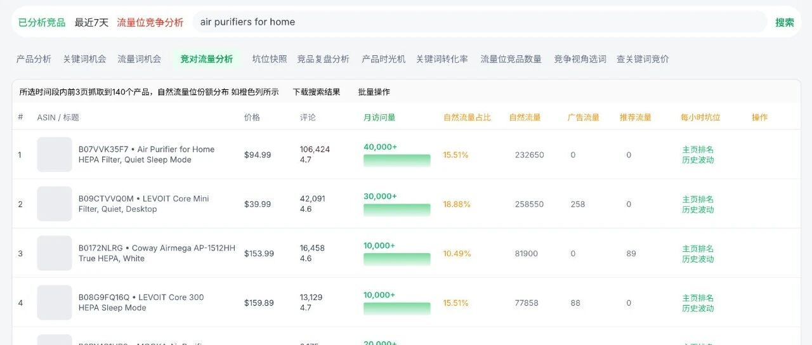

---

写在前面：

最近在做UI设计，后面SIF的MCP跑通，做好运营的最后一公里！设想的几个场景，日常跟踪表，项目经营&盈亏分析，运用里程碑，指定竞品ASIN的全部流量对比（6个维度）流量词详细对比，广告关键词盈亏推荐，广告词透视仪，竞争流量对抗分析，自然流量份额分析（预估值）广告流量，类目平均转化率以及广告和自然占比等等

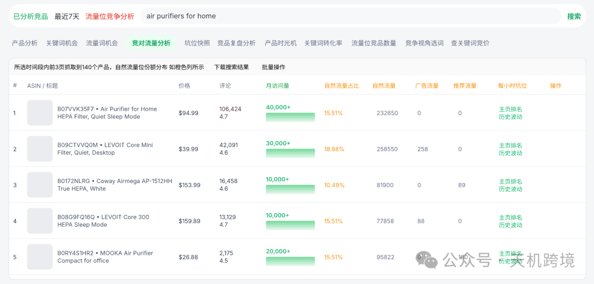

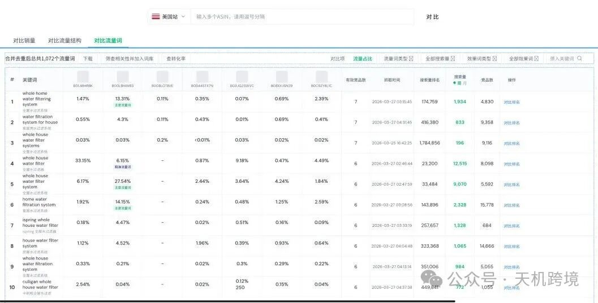

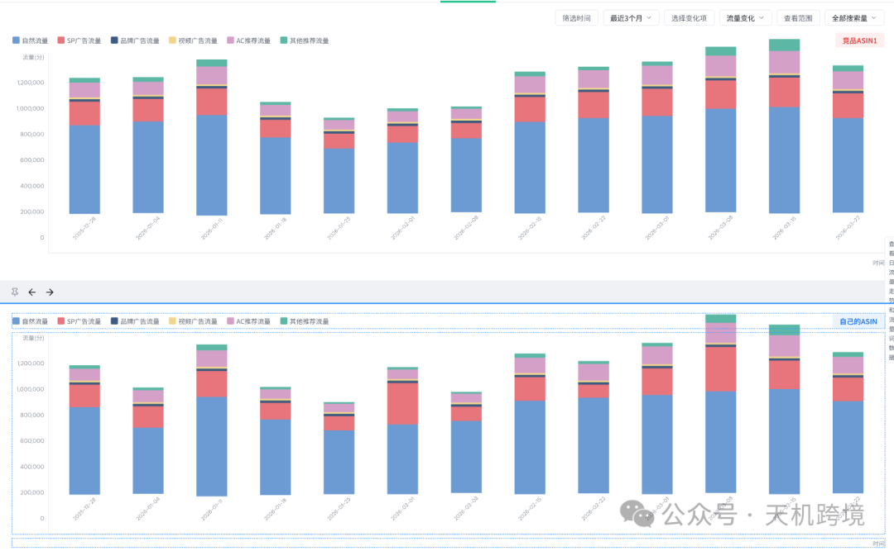

后面会使用折线图，对比6个流量维度数据（可以按照周维度或月维度）

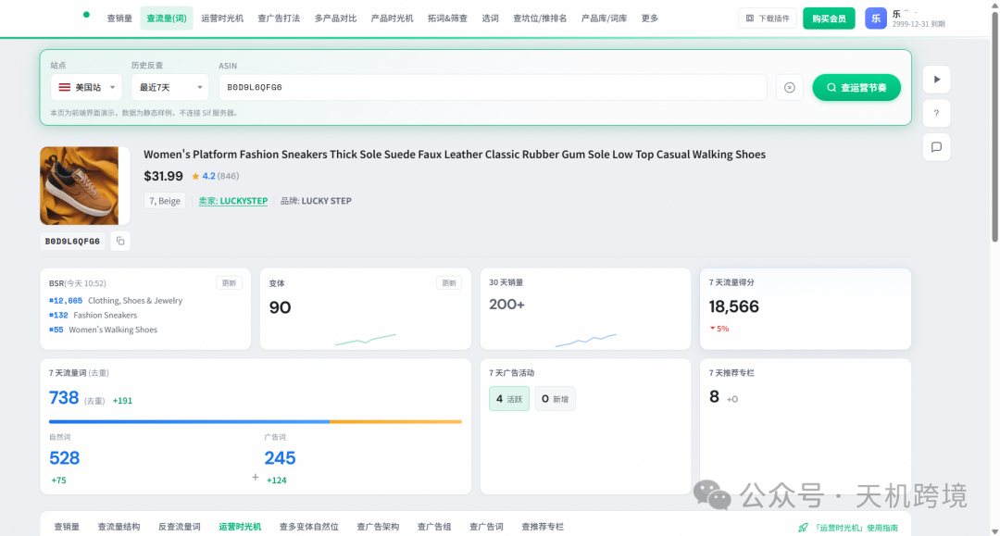

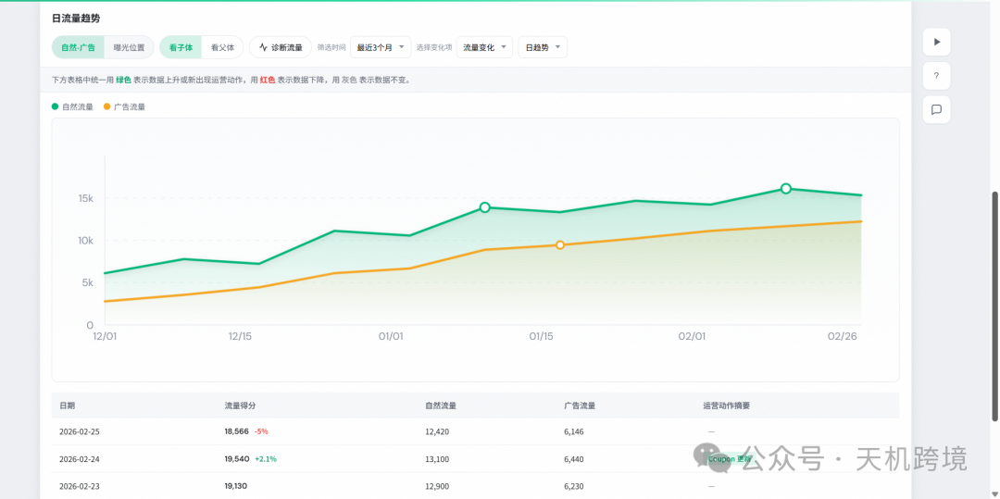

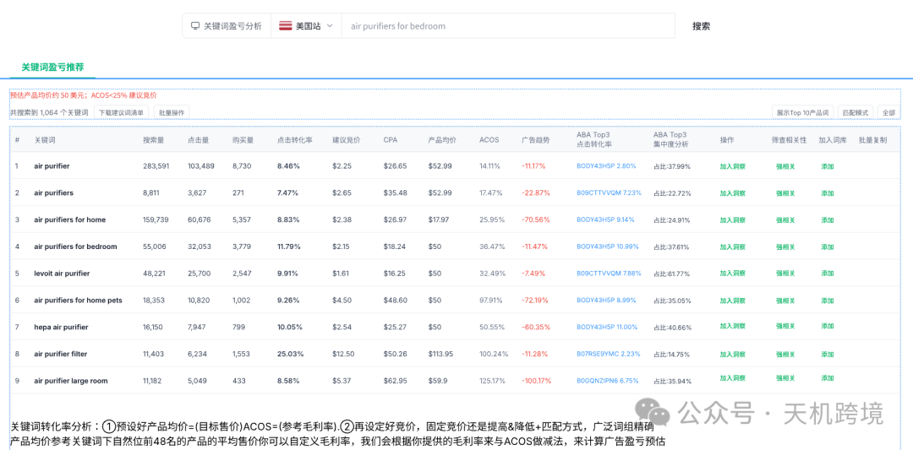

盈亏平衡，是加上平均售价，毛利率以后算出CPA,广告点击转化率去推演

每一个关键词的盈亏

亚马逊竞品流量结构全景

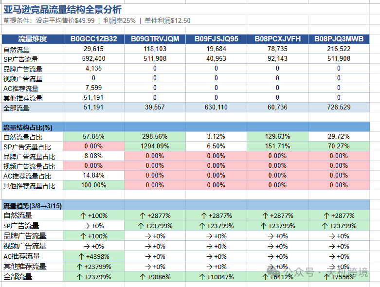

关键词攻防矩阵

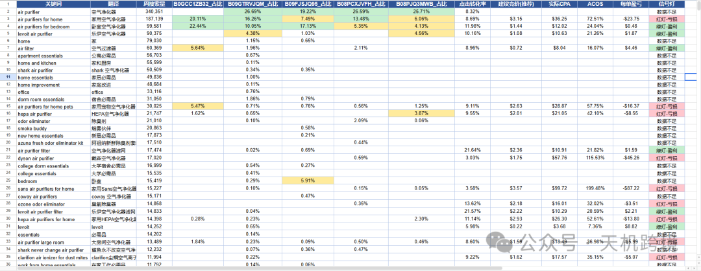

关键词攻击清单

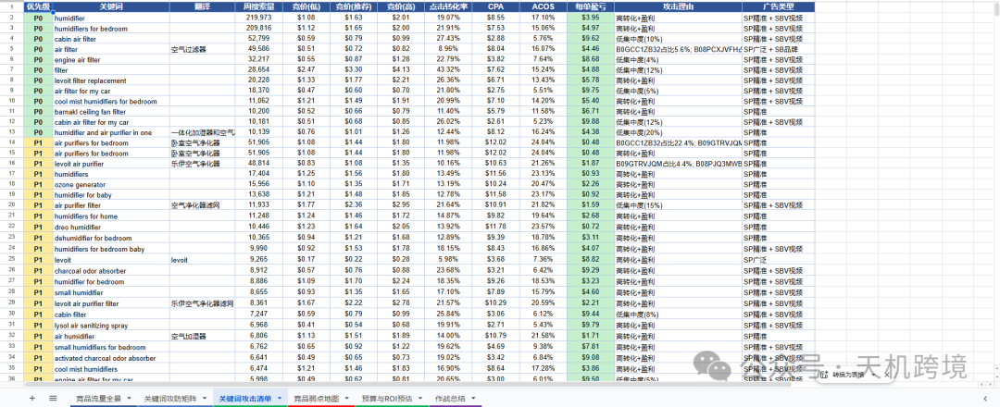

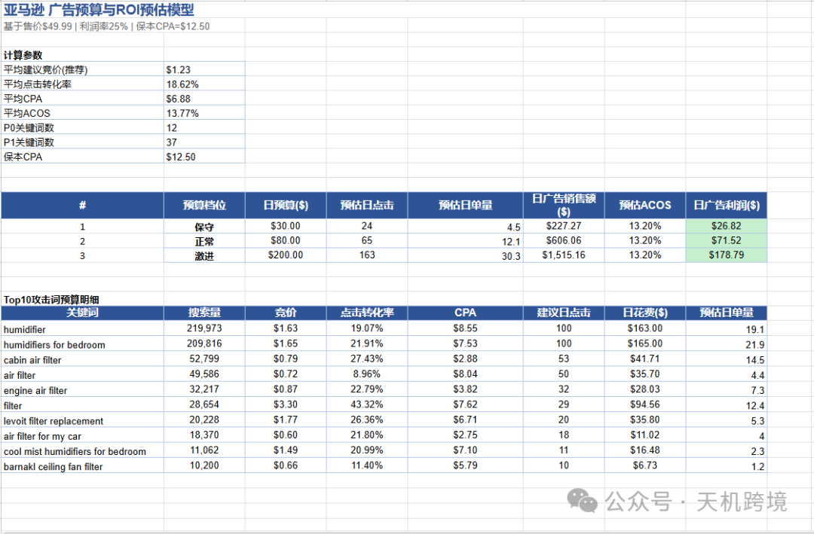

广告预设的 预算和ROI

竞品流量弱点地图

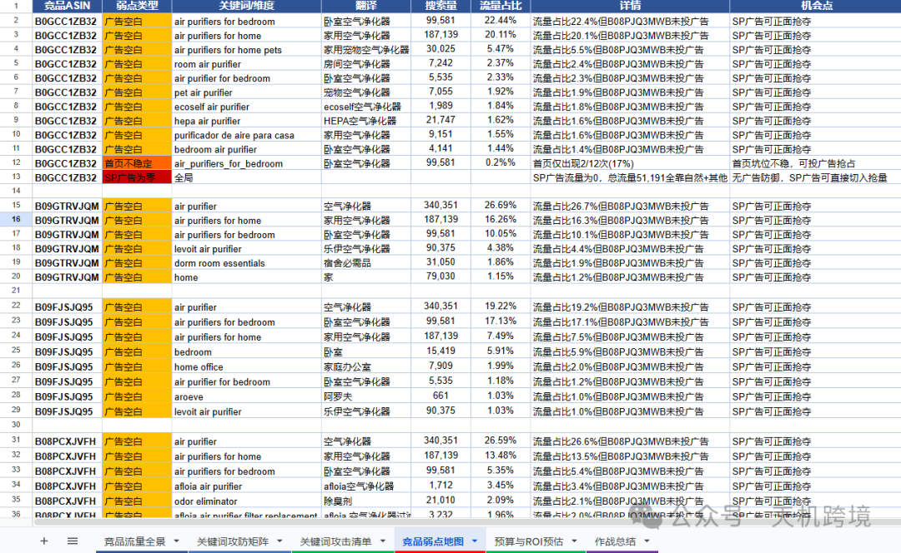

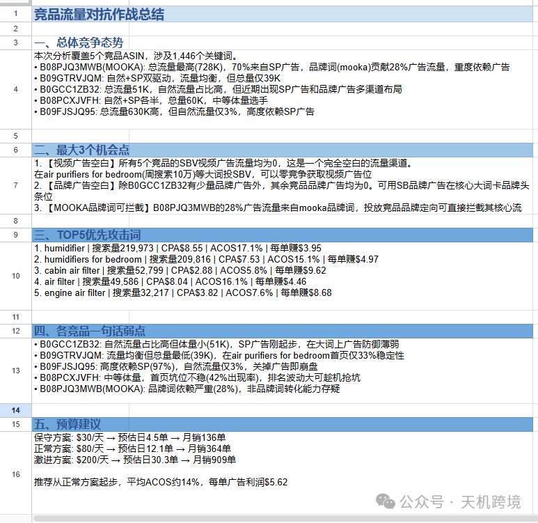

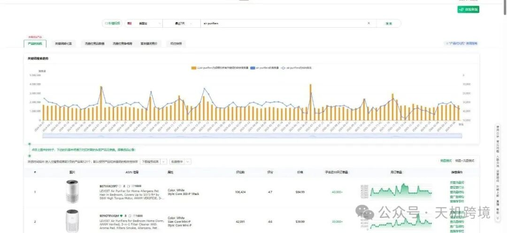

写在最后

目前是数据接口打通，单点 一个一个场景做，后面串起来，解决具体需求

做数据分析，做工作流，后面会结合领星ERP(App ID),和之前用的好的飞书多维表格，工作流，AI,智能体结合起来运用，未来2周会专心致志做，然后迭代，内测，做更多测试
