# 亚马逊listing打分系统-灵犀AI系统亚马逊智能决策平台-LinSee

> Source: wechat
> Author: 天机跨境
> Original: https://mp.weixin.qq.com/s/nsT87nTrIsiTa_RQV1T6rQ

---

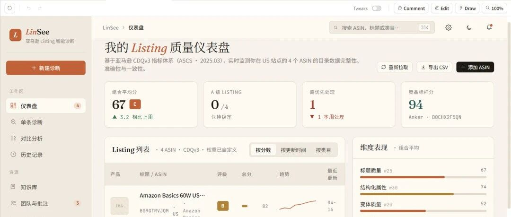

---

亚马逊listing打分系统-LinSee

灵犀AI系统亚马逊智能决策平台-LinSee

我们设计的这套亚马逊Listing打分系统，【亚马逊产品质量分（LQS）】标志着数据质量衡量方式从传统的IDQ（商品数据质量）转向更综合的CDQ（目录数据质量）。LinSee系统新增了【变体质量】【结构化属性】等指标，并引入\*\*正确性、完整性，一致性、规范化\*\*等定性维度，借助\*\*AI与大型语言模型\*\*评估目录属性。各维度权重为：标题质量25%、结构化属性30%、变体质量20%、图片与A+ 15%、五点与描述5%、A+内容5%，从而提供更全面的目录健康度视角。

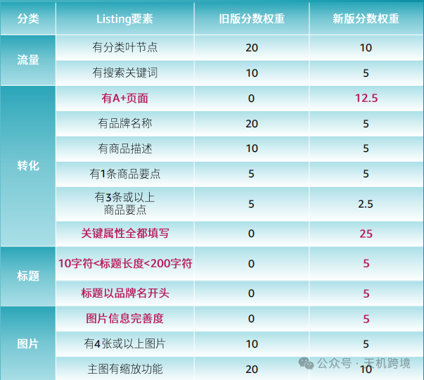

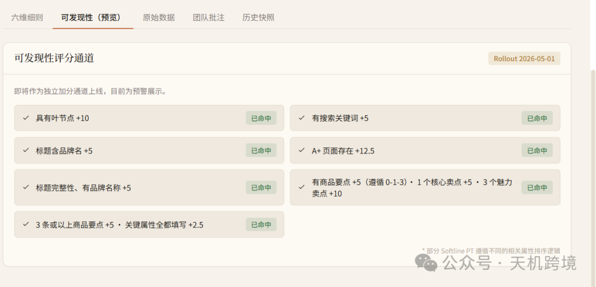

预留：直接增加一个可发现性质量评分-指标：后期版本会增加的指标

即Discoverability:Product Type Classification(产品类型分类)

支持团队修改记录+历史快照，记录运营/设计优化后的效果，监控

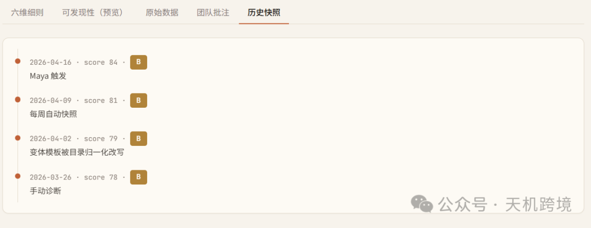

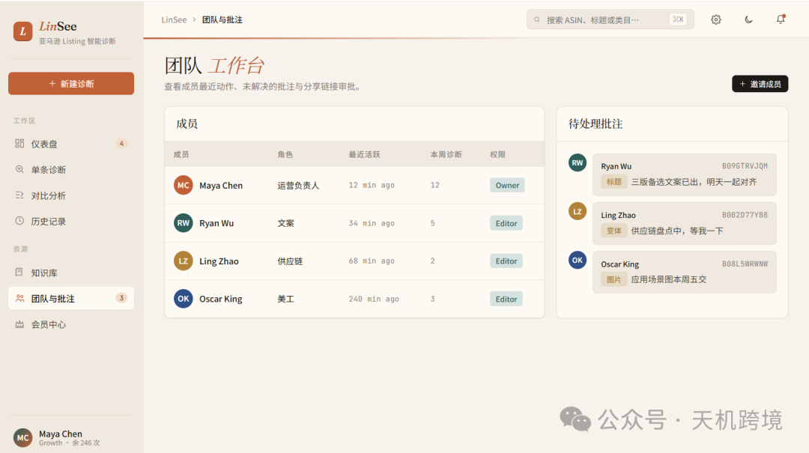

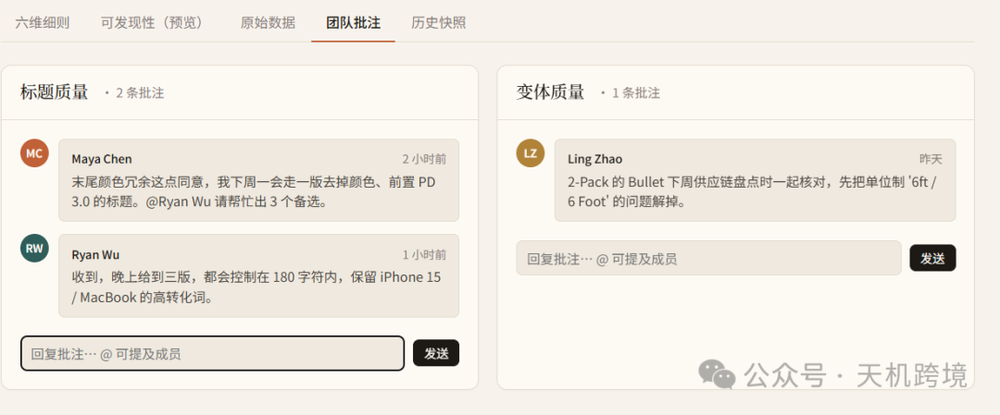

仪表盘展示综合评级+分数，单条诊断，对比分析，知识库

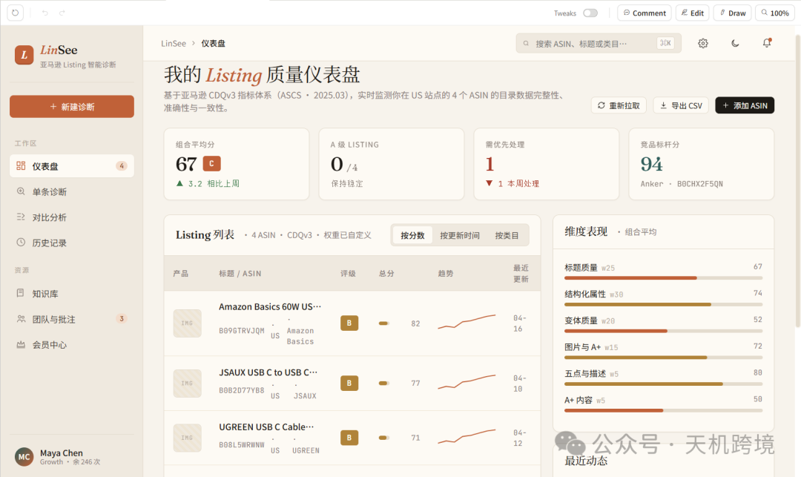

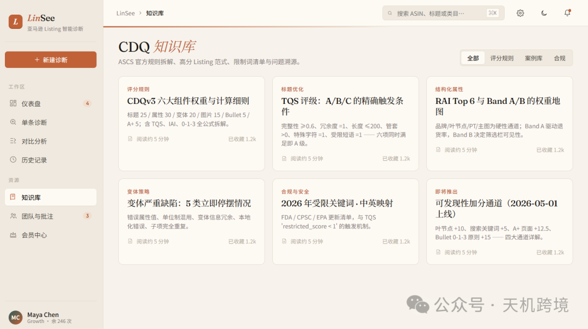

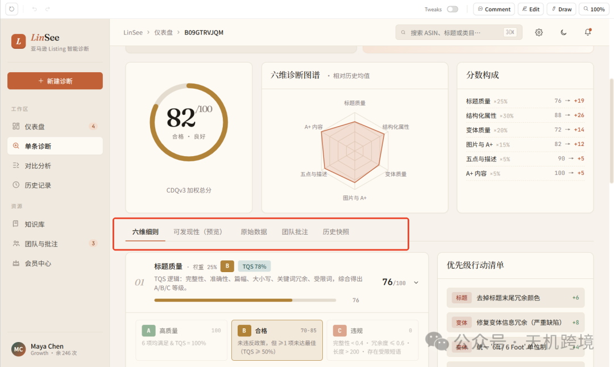

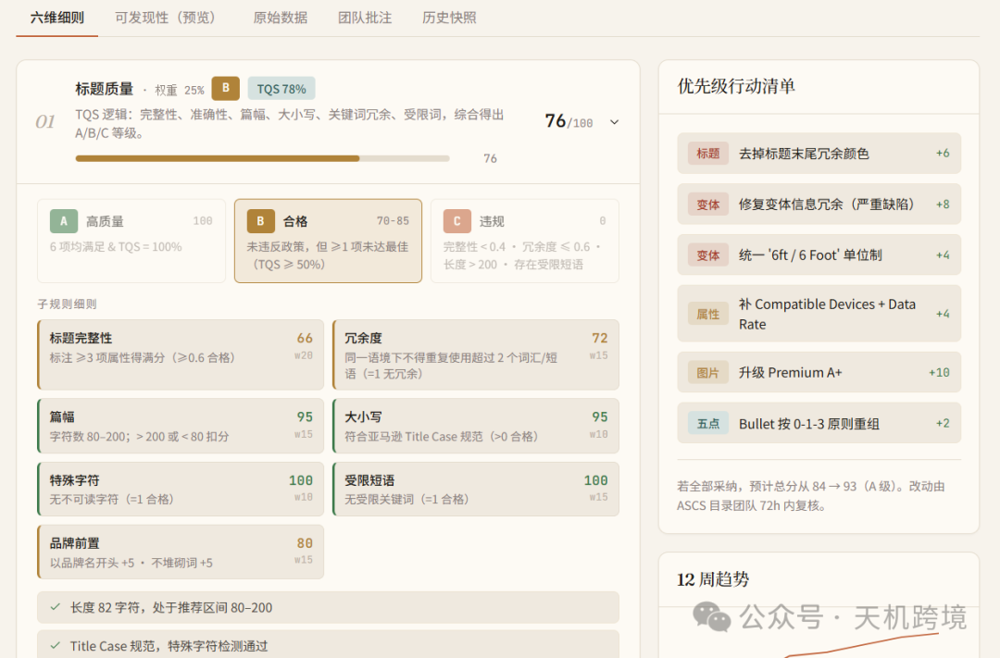

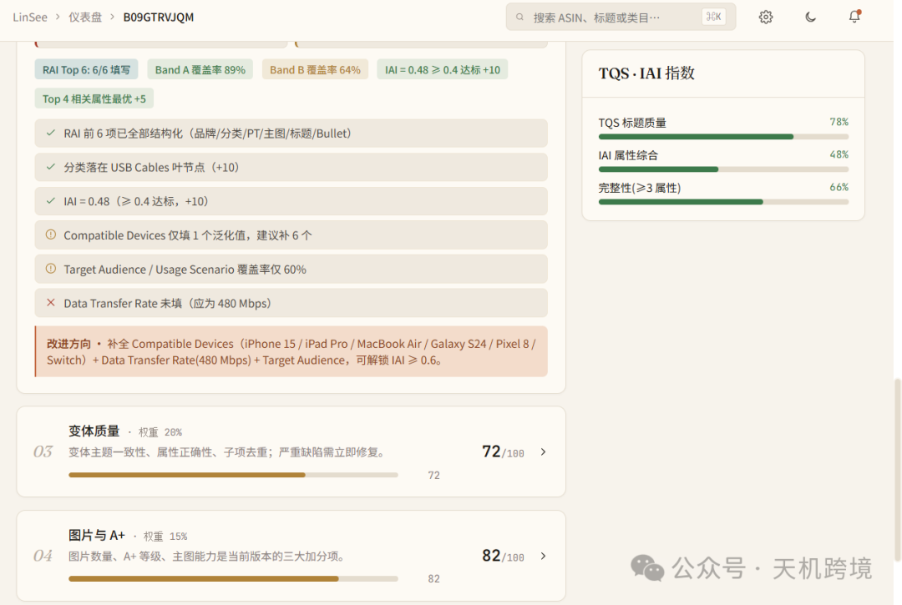

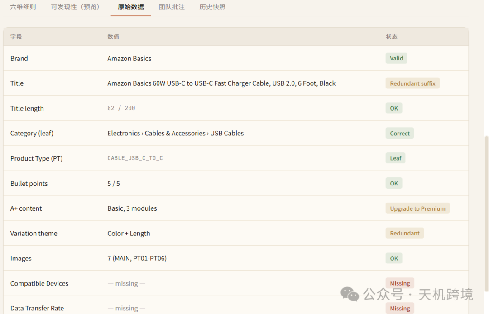

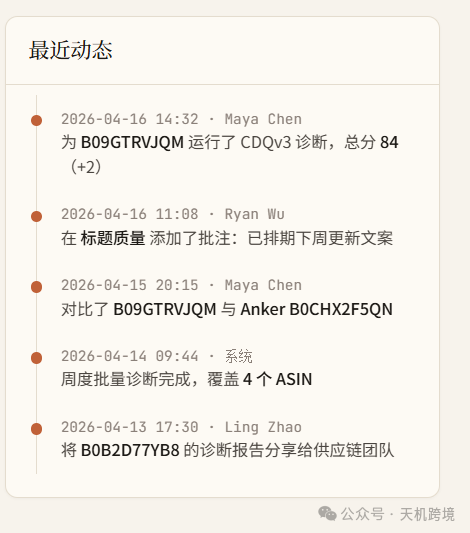

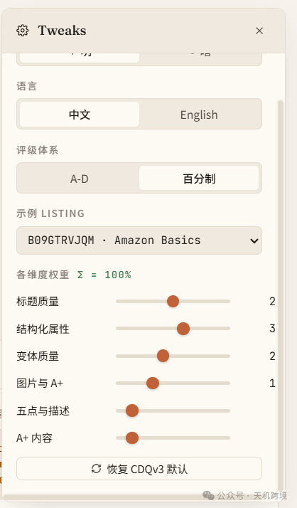

对比分析：我vs竞品一比一分析，找到差距，快速补齐

从6+1维度：（可发现性分析）

标题质量25%、结构化属性30%、变体质量20%、图片与A+ 15%、五点与描述5%、A+内容5%，+（可发现性分析）加分项

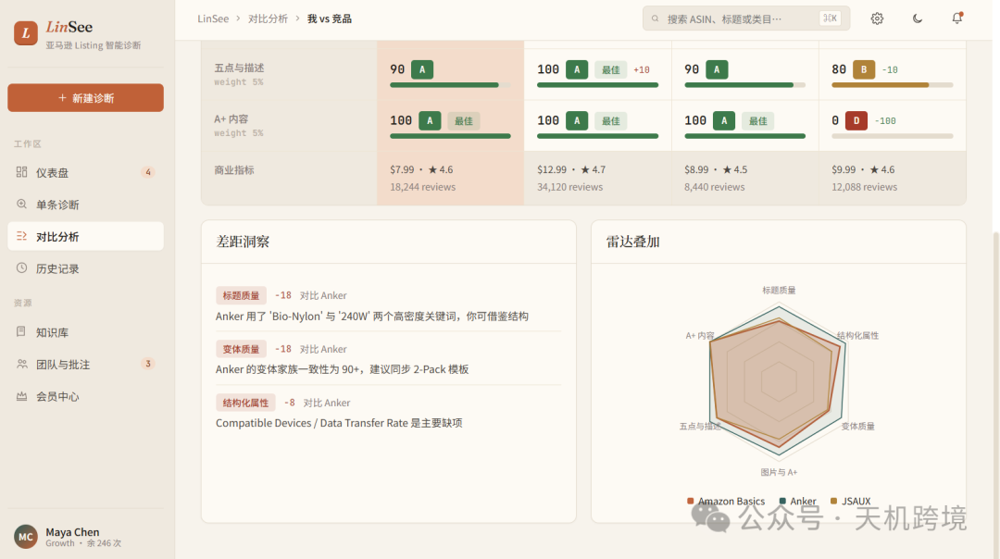

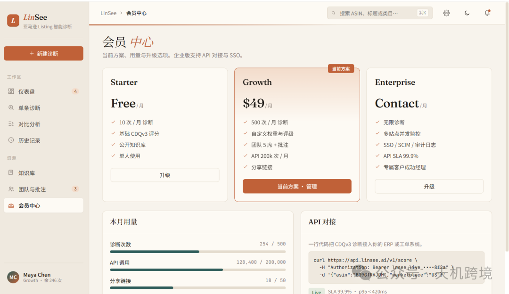

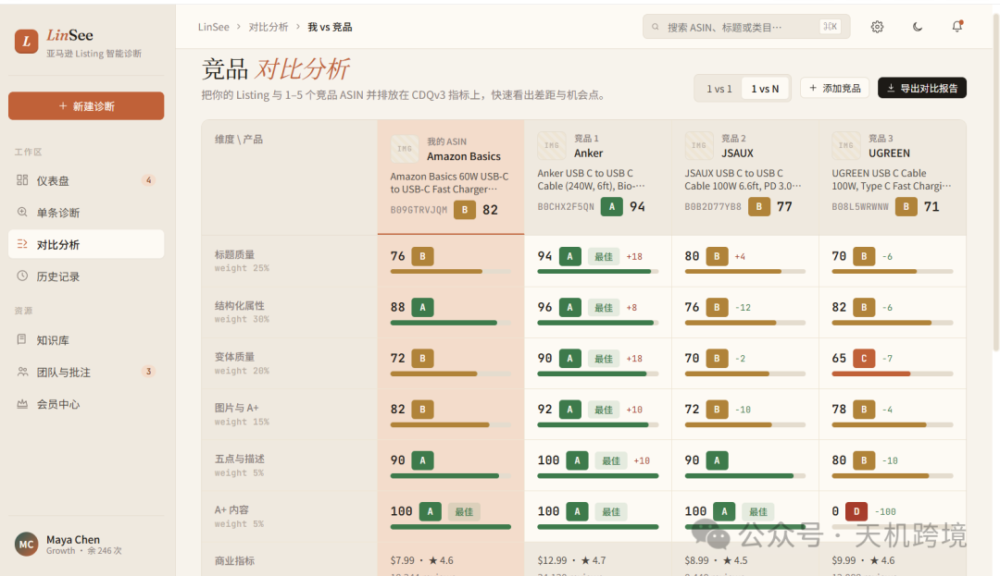

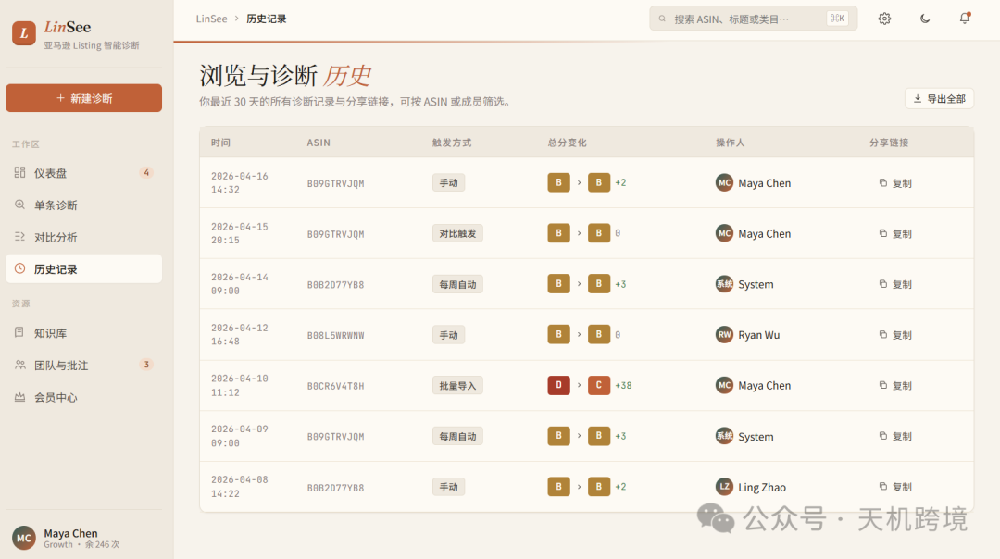
