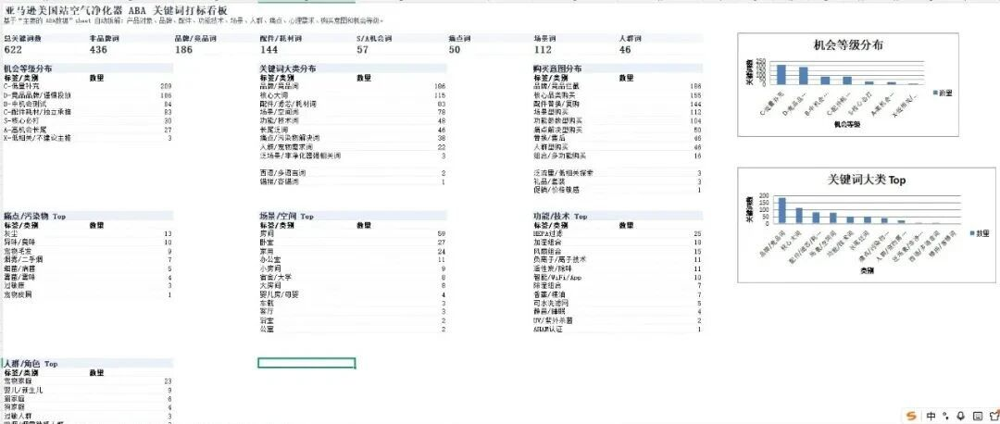
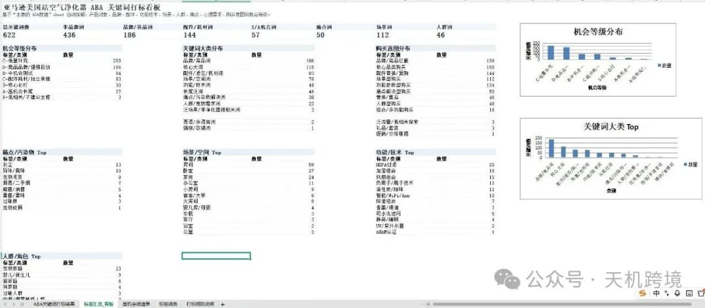
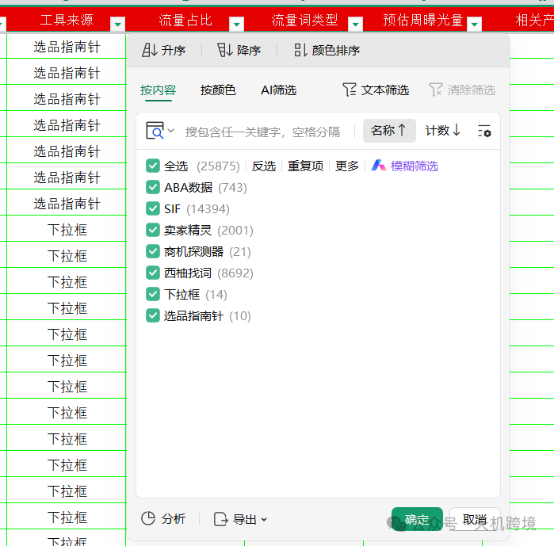
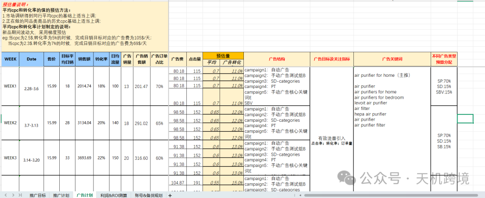
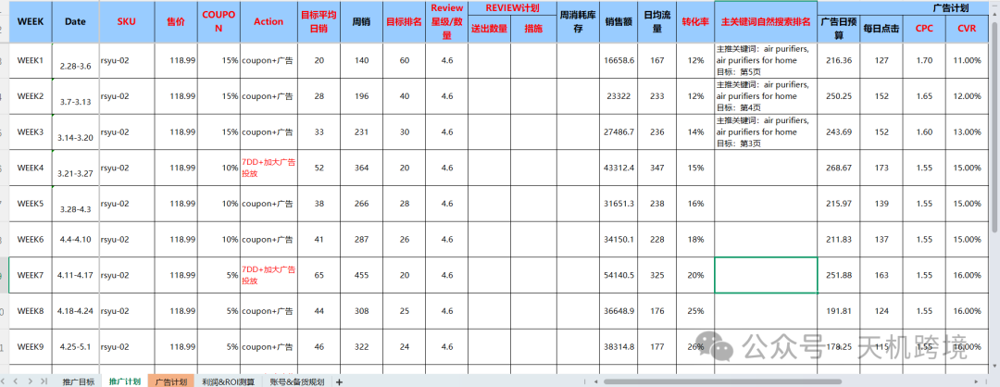
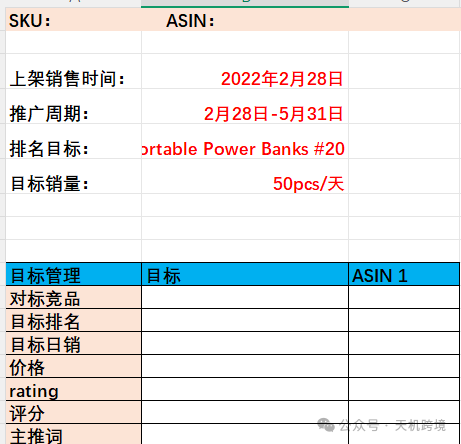
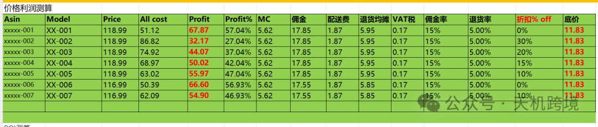
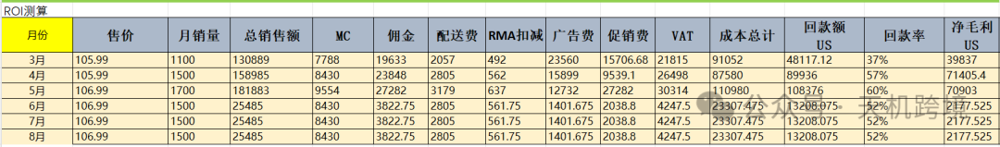
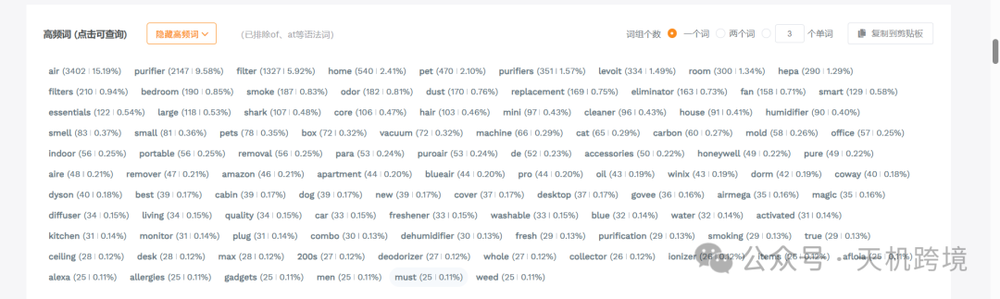
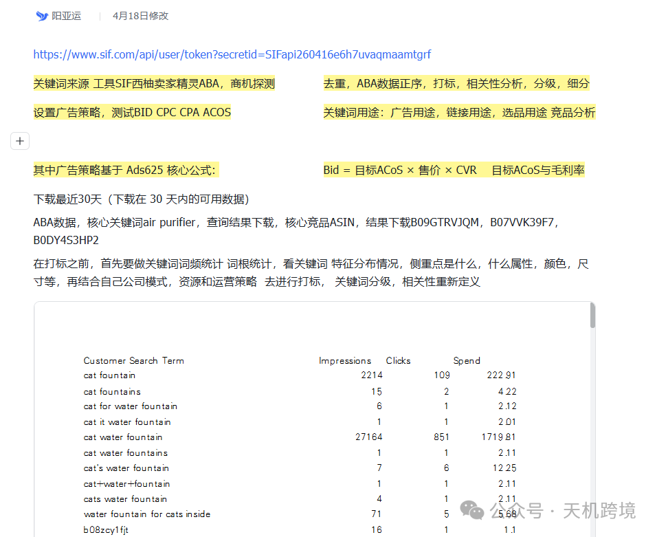

# 亚马逊关键词打标&搭建和用途

> Source: wechat
> Author: 天机跨境
> Original: https://mp.weixin.qq.com/s/ayPNgIVzbhhWEeqwoVJ4kQ

---

---

序言：需要模版和skill文件后台私信我或者直接加V:13265758038

关键词打标

关键词来源

关键词来源：不限于

工具：SIF西柚卖家精灵ABA数据，商机探测，亚马逊前台搜索框下拉词

根据广告目标，设置广告策略，预演测试BID，CPA，CVR，ACOS这块

其中广告策略基于Ads625核心公式: 目标CPC=ACOS\*客单价\*转化率   ACOS与毛利率的差额（新品假设全部毛利都用来打广告）

数据去重，ABA排名数据按正序，完成打标，相关性分析，分级，细分

关键词用途:广告用途，链接用途，选品用途，竞品分析。

在打标之前，首先要做关键词词频统计/词根统计，一定要看关键词特征分布情况，主要侧重点是什么，是在场景，颜色，人群，参数，属性，痛点，尺寸等等，再结合自己公司模式，资源和运营策略 去进行打标，关键词分级，相关性，重新定义

关键词用途：

①广告策略流量布局，广告打法，和运营策略

②链接锚点，埋词，双系统：用户+亚马逊（结构化属性）

③原子级拆解，打标，重构，做选品，数据层，洞察分析

④监测，流量，关键词收录情况，做流量的晴雨表

⑤广告关键词盈亏推荐，广告点击率，衡量每一个关键词的盈亏

具体讲第一个用途，广告策略+广告计划

根据关键词属性特征，打标，结合运营策略，制定广告计划

将新品30-60天的流量布局和收录关键词，广告打法进行拆分，规划SOP

广告计划：每一个星期的数据

价格利润测算

测算ROI

# 十二维度、最终你要得到的不是“标签”，而是“决策”

一个成熟的关键词打标系统，最终应该回答这 8 个问题：

1. 这个关键词属于什么产品、属性、功能、人群、场景？

2. 它是流量词、转化词、痛点词、礼品词，还是品牌价值词？

3. 它对应用户的哪种心理需求？

4. 它在购买路径的哪个阶段？

5. 它适合放标题、五点、A+、图片，还是广告？

6. 它是现有竞品都在打的红海词，还是有缺口的机会词？

7. 它能不能迁移成产品创新、视觉卖点或广告抓手？

8. 它和你自己的供应链、品牌定位、价格带是否匹配？

共打标：\*\*关键词\*\*

\* 新增标签维度：

  \* 产品对象

  \* 品牌/竞品词

  \* 配件/滤芯/耗材

  \* 功能/技术

  \* 场景/空间

  \* 人群/角色

  \* 痛点/污染物

  \* 属性/参数

  \* 情绪/心理需求

  \* 购买意图

  \* 组合标签

  \* 广告打法建议

  \* Listing/链接用途

  \* 视觉/内容建议

  \* 选品/产品建议

  \* 机会等级

  \* 优先级分

建议主标签分成 12 个一级维度。
