# 亚马逊竞品分析skill（推广节奏+季节性分析）

> Source: wechat
> Author: 天机跨境
> Original: https://mp.weixin.qq.com/s/aKQ3mgPJsuWLCV1ztmTcjA

---

---

## 亚马逊竞品分析skill - 推广节奏大师

> 亚马逊竞品分析 skill，一款专为亚马逊竞品分析，**推广节奏分析与季节性分析**设计的skill！/amazon-asin-analyzer

### 核心功能

#### 1. 竞品分析

- **关键时间节点**

  首次上架时间，

  最早出单时间，

  首条评论时间，

  首次改价时间，

  首次DEAL时间，

  首次COUPON，

  首次PRIME，

  +首次出单Buybox价格是XXX,货币X

  +首次DEAL价格是XXX,货币X

  +大类最佳BSR,小类最佳BSR,近30天销量，评分，评论数
- **核心趋势图表：**

  BSR排名，成交价，评论数，综合趋势分析，月度流量结构（自然和广告），月度新增评论分析， 大类BSR趋势分析，月销量趋势分析，自然流量与广告流量
- **推广节奏分析：**

  每个月销量与排名，listing策略 流量策略 评论策略 流量异常，

  风险判断
- **季节性分析：**

  季节性销量波动分析，全周期月度销量与BSR走势，  季节性指数 & 年度同期对比 ，月度季节性指数统计表，各年各月销量热力图，同比增长率（YoY）明细表 ，选品 & 运营节奏建议，选品/备货节奏 ，定价策略，广告投放节奏，年度增长趋势

#### 2. 数据来源

SIF插件：获取目标竞品ASIN所有历史数据

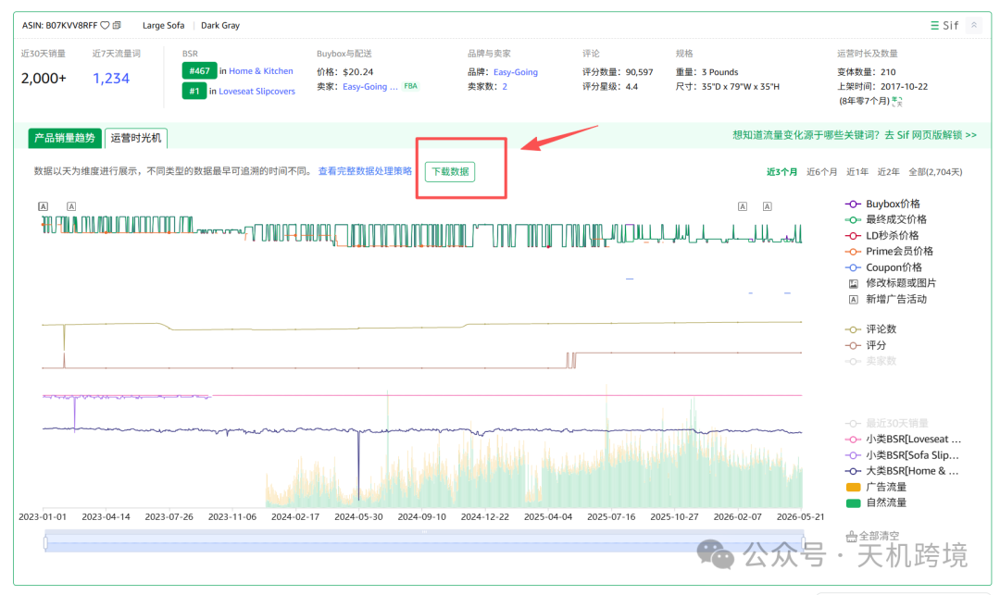

分析：

|  |  |
| --- | --- |
| Image | Image |

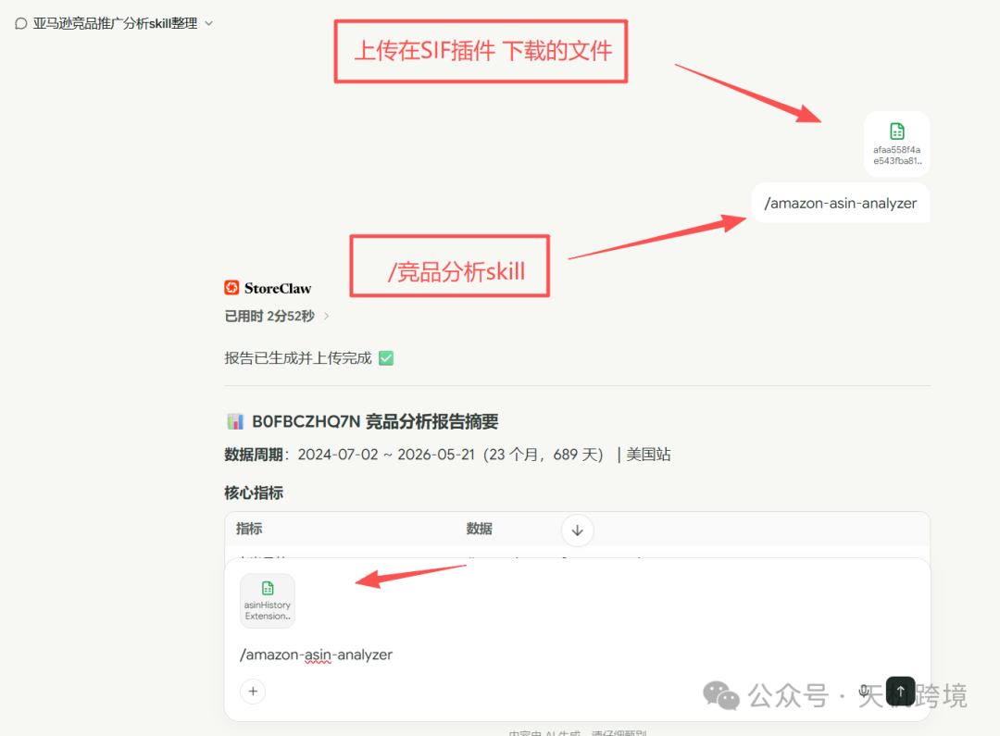

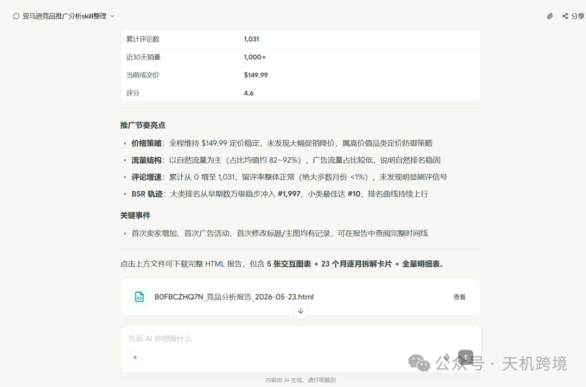

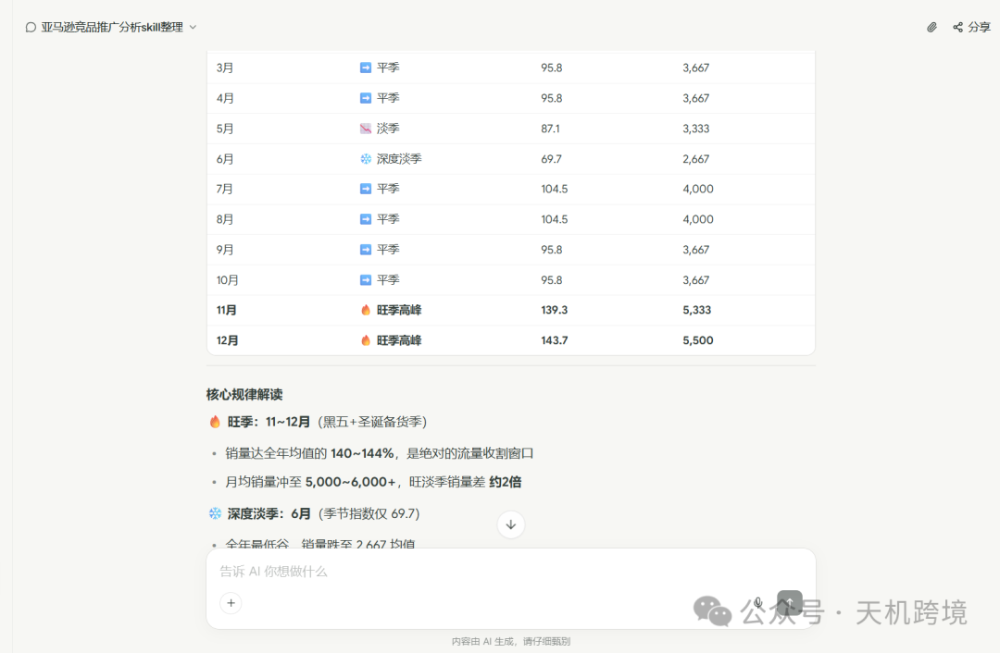

输出格式，部分展示，需要skill 后台私信 13265758038

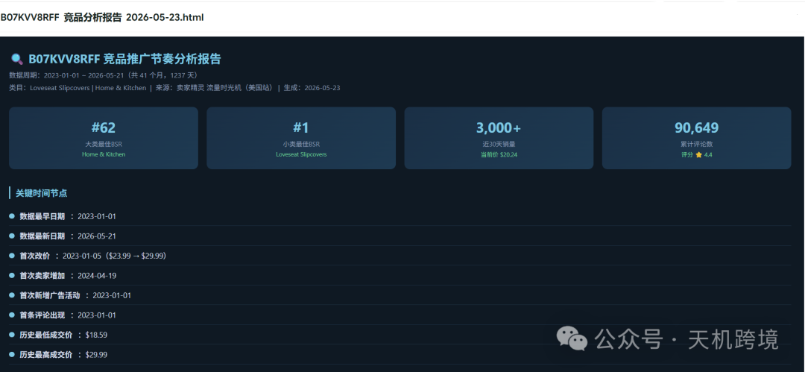

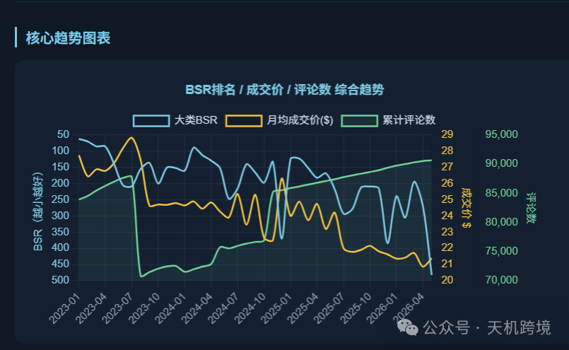

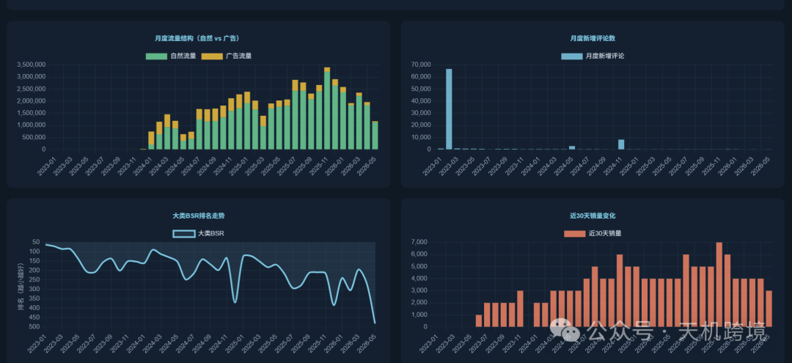

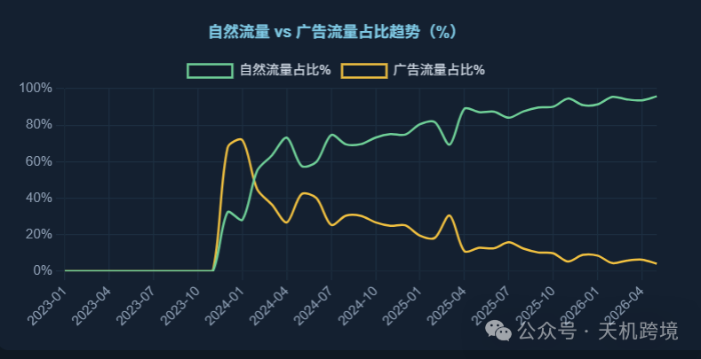

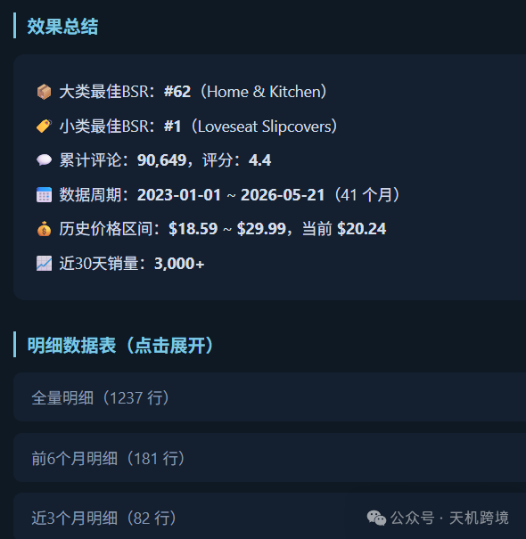

季节性分析

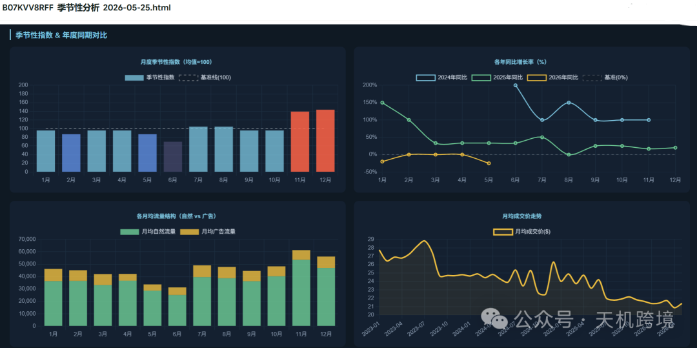

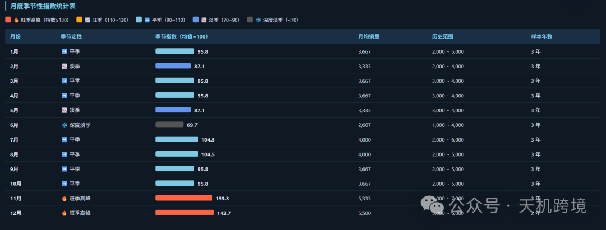

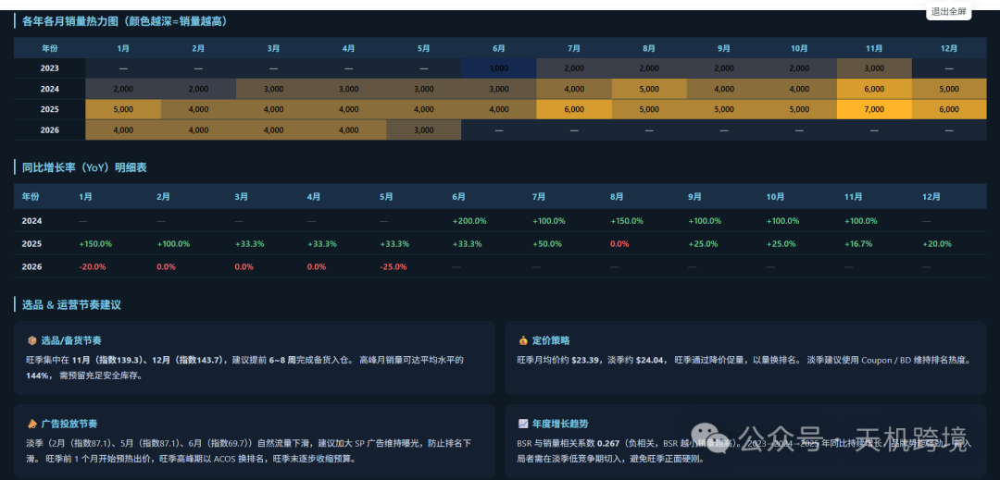
