# 《基于eCPM算法：如何精准测算亚马逊链接的自然与广告流量真实比例？》原创

> Source: wechat
> Author: 天机跨境
> Original: https://mp.weixin.qq.com/s/2LIWR6aGC6rLpwtWQsxiCA

---

---

《基于eCPM算法：如何精准测算亚马逊链接的自然与广告流量真比例？》

如何验证亚马逊链接的自然流量与广告流量的比值：用真实的数据验证，

主要验证自己竞品的各流量占比， 与自己的实际销量订单，自然单与广告单的比值，可以为我们做选品，竞品分析，流量异常做参考，

用自己竞品几个老品和刚刚做了1-2个月的新品ASIN进行验证，需要整理出来竞品真实的流量，转化率，销量（广告单+自然单）和SIF的流量数据

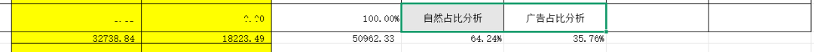

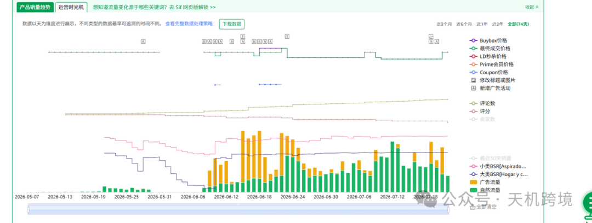

把德国法国意大利西班牙英国每一个站点的数据整理出来

通过SIF插件去查询目标竞品ASIN的流量情况， 自然流量与广告流量占比， 比值是64.2%：35.76%.

结合自己竞品的实际销量情况，数据是很准的，西班牙是非常接近，意大利差2-3%。

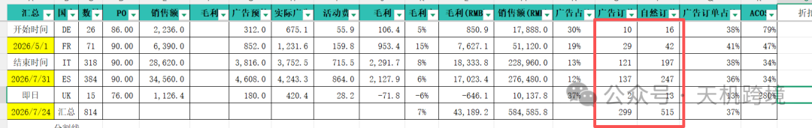

意大利的数据41.09%，我们实际数据，是38%，差3%

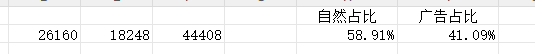

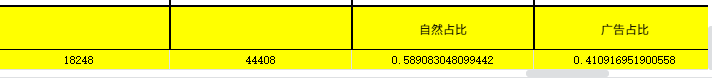

这里一个思路

一个思考

这个是一个结果，要寻找他深层次的原因，就要 去反查关键词，关键词的排名，看坑位， 关键词的广告位来带动自然位 eCPM这个思考

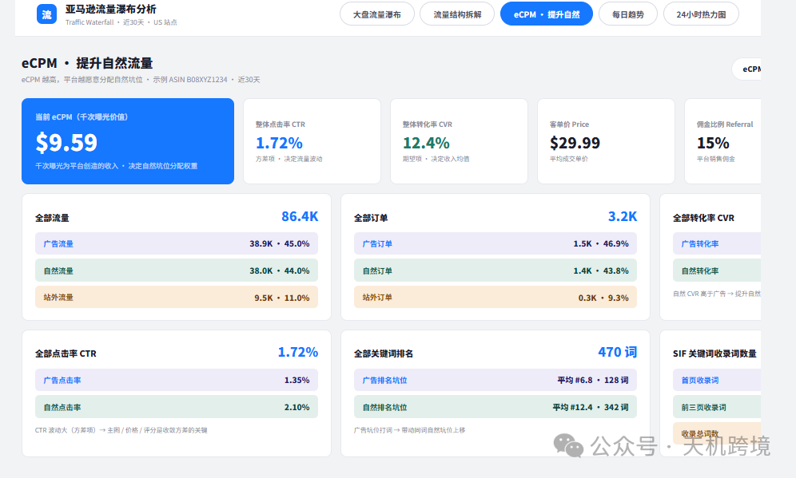

找6-8个核心关键词 查 坑位快照

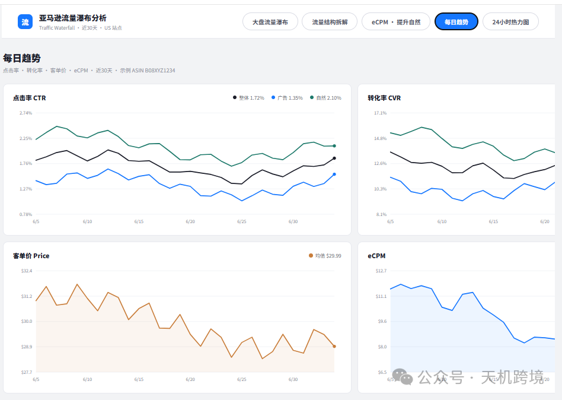

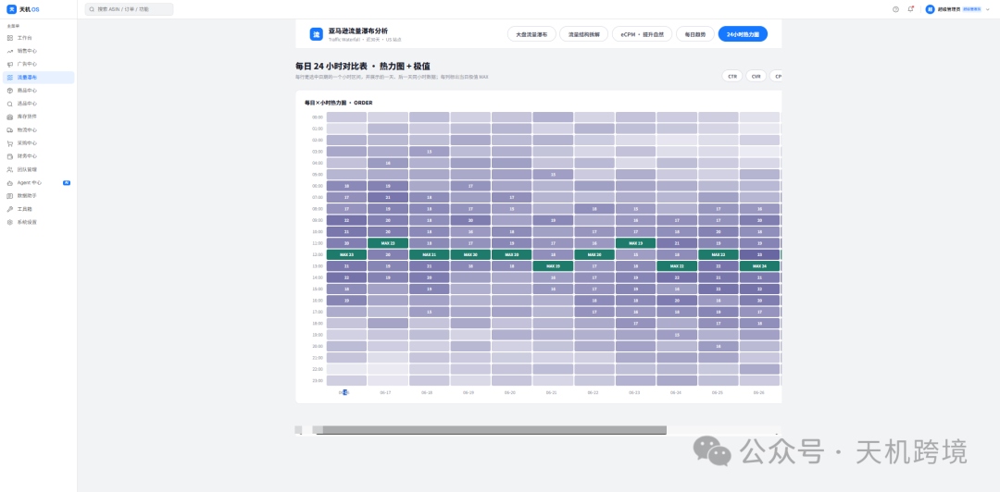

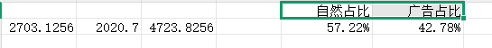

德国验证 自然流量2703.1256，广告流量2020.7（57.22%：42.78%），广告单占比38%，差4-5%

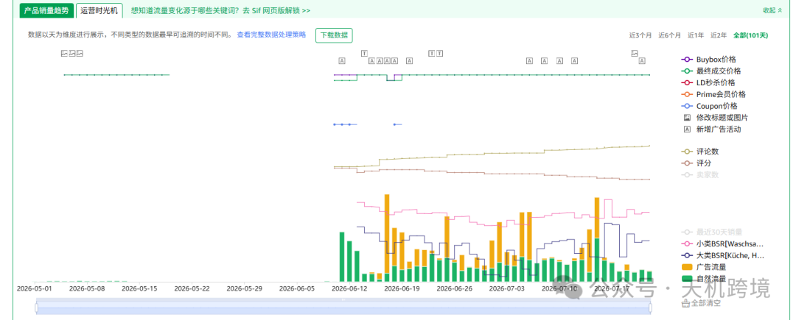

英国 验证，自然流量2713.06，广告流量12462（17.88%：82.12%），广告单占比13%，差69%

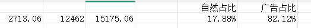

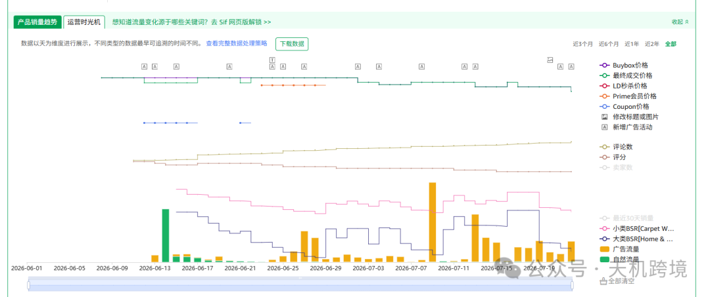

问题点，分析，是广告有问题，广告不怎么出单，转化率1-2%。ACOS很高，自然订单，是测评，全部是测评订单，也就是自然转化率99%， 广告的转化率是1%，导致这种局面，差异巨大

法国验证  自然流量11225.75，广告流量10553（比例是51.54%：48.46%），与实际广告单占比41%，差6-7%

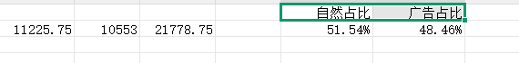

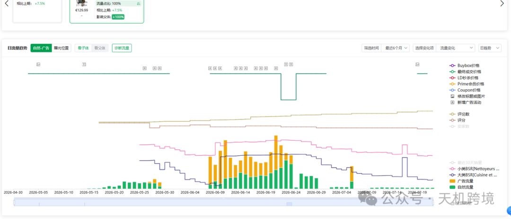

深度思考下，

SIF计算流量的思路是 按有效曝光来计一个流量， 到订单（转化维度）还有2个中间环节，一个是点击率 ，另外一个是转化率， 如果是老品，和已经做的很稳定的产品，到达类目平均转化率，还有点击率较稳定 成熟品，点击率转化率恒定，按SIF流量逻辑（按曝光）计算，可以有效评估 自然与广告的比值情况，亚马逊底层逻辑eCPM,也是与这2个值相关，这个是一个结果， 深究其原因，是关键词的排名，关键词广告排名，和自然排名，80-90%，还有亚马逊推荐，类目流量，站外流量，秒杀，等促销活动：

选品指导

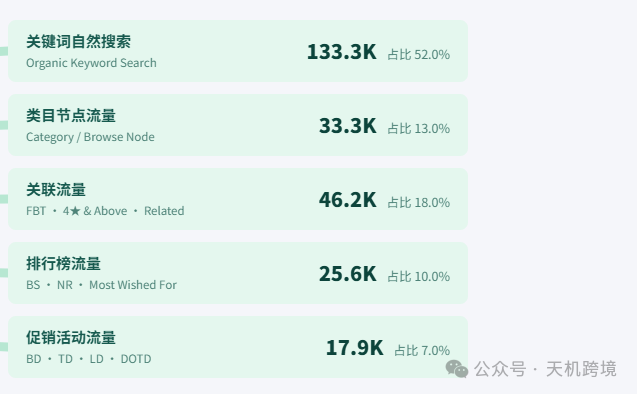

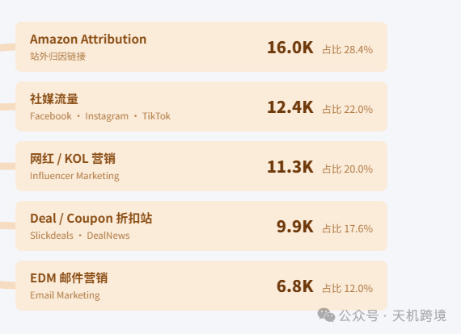

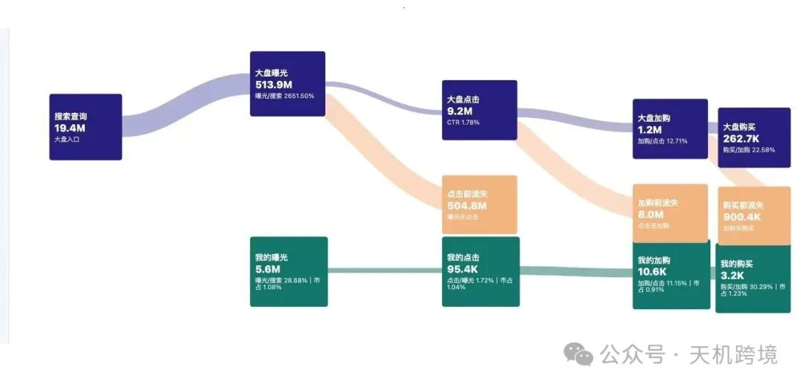

https://os-pit9zmms9-yangyayun.vercel.app/

http://42.193.186.87/os/traffic-waterfall

测试账号admin 、密码admin123456

By the way

另外一个如何查转化率，目前有几个概念需要达成共识

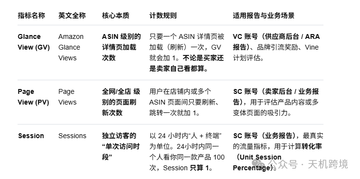

亚马逊付费账号经理可以查类目转化率和指定ASIN的转化率，退款，流量和广告数据 glance view

曝光，搜索量，点击量，浏览量，购买量

亚马逊不同的衡量指标曝光,搜索量,点击量,浏览量,购买量

**亚马逊运营漏斗指标核心包含曝光量、搜索量、点击量、浏览量与购买量**。它们环环相扣，反映了从“产品被看到”到“用户最终下单”的全过程。理解这些指标的定义与转化逻辑，能帮您精准诊断店铺问题

## 核心指标定义

- **搜索量 (SearchVolume)**：

- 指某一特定关键词在亚马逊上被买家搜索的总次数。
- 反映市场需求大小，通常通过后台品牌分析（ABA）或第三方工具查看。

- **曝光量 / 展示量 (Impressions)**：

- 指你的商品链接或广告在买家屏幕上出现的总次数。
- 搜索量大不等于曝光高，还取决于关键词排名和广告竞价。

- **点击量(Clicks)**：

- 指买家看到你的产品后，点击进入详情页面的次数。
- 反映主图、价格、标题和评分对买家的吸引力。

- **页面浏览量 (Page Views /访问量  Sessions)**：

- 页面浏览量（Page Views）指详情页被打开的总次数；会话量（Sessions）指独立访客数。
- 点击进入后即产生浏览，反映店铺整体流量规模。

- **购买量 (Units Ordered / Orders)**：

- 指买家最终下单购买商品的数量或订单数。
- 反映产品本身的转化能力、评论（Review）好坏以及库存情况。

## 转化漏斗与核心比率

- **点击率 (CTR=点击量/ 曝光量)**：

- 衡量主图、价格和首图文的吸引力。
- 如果曝光高但点击率低，说明主图或价格缺乏竞争力。

- **转化率 (CVR= 购买量 /点击量或 购买量 / 会话量)**：

- 衡量详情页面的带货能力与文案、评价的信任度。
- 如果点击高但购买量低，说明详情页描述、五点、QA或A+页面存在短板。

在亚马逊的运营逻辑中，**Glance View（页面快览量）**、**Page View（页面浏览量）** 和 **Session（会话量/访问次数）** 是衡量详情页流量最核心、也最容易混淆的三个“浏览”指标。

亚马逊经理给我们的数据就是抓的glance view流量，得到真实转化率

在亚马逊的运营逻辑中，**Glance View（页面快览量）**、**Page View（页面浏览量）** 和 **Session（会话量/访问次数）** 是衡量详情页流量最核心、也最容易混淆的三个“浏览”指标。

它们虽然都和“看产品”有关，但统计的**维度、规则和应用场景**有本质区别。

---

### 一、 核心定义与本质区别

|  |  |  |  |  |
| --- | --- | --- | --- | --- |
| 指标名称 | 英文全称 | 核心本质 | 计数规则 | 适用报告与业务场景 |
| Glance View (GV) | Amazon Glance Views | ASIN 级别的详情页加载次数 | 只要一个 ASIN 详情页被加载（刷新）一次，GV 就会加 1。不论是买家还是卖家自己看都算。 | VC 账号（供应商后台 / ARA 报告）、品牌引流奖励、Vine 计划评估。 |
| Page View (PV) | Page Views | 全网/全店 级别的页面刷新次数 | 用户在店铺内或多个 ASIN 页面间只要刷新、跳转一次就加 1。 | SC 账号（卖家后台 / 业务报告），用于评估产品内容或多变体页面的吸引力。 |
| Session | Sessions | 独立访客的“单次访问时段” | 以 24 小时内“人 + 终端”为单位。24小时内同一个人看你同一款产品 100 次，Session 只算 1。 | SC 账号（业务报告），最真实的流量指标，用于计算转化率（Unit Session Percentage）。 |

---

### 二、 深度对比与逻辑关联（用案例拆解）

为了让你彻底搞懂，我们设定一个**买家张三**的真实购物场景：

> **场景**：张三在手机上搜到你的产品 A（有多变体），点击进入了详情页（看了一眼），然后刷新了页面（为了看最新评论），接着点击了尺寸切换到产品 B。半小时后，张三关掉手机；晚上，张三再次打开这个页面。

在这个场景中，各项指标会如何变化？

1. **Session 的去重逻辑**：

1. 张三在 24 小时内不管进出多少次、刷新多少次，对于这一个 Listing 来说，**Session 永远只增加 1 个**。
2. **价值**：它剔除了重复刷新的“水分”，反映的是**真正对你产品感兴趣的客户基数（UV/独立访客数）**。

2. **Page View的广度统计**：

1. 张三进页面（PV+1），刷新页面（PV+1），切换到变体 B 页面（PV+1）。此时 PV 总共增加了 3。
2. **价值**：如果一个 Listing 的 **PV远大于 Session**（比如 PV 是 Session 的 3-4 倍），说明买家进入后在你的多变体之间反复对比，或者在详情页停留时间长、反复刷新看评论。**这说明你的页面深度和吸引力很好。**

3. **Glance View 的官方考核（VC特有）**：

1. 与 PV 类似，张三每加载一次页面就产生一个 GV。但它的核心区别在于**它是亚马逊官方考核产品热度、权重、乃至判断卖家是否作弊的底层数据**。
2. 亚马逊的很多算法（如：预测销量、补货建议、Vine计划的领取概率）都是基于 **Glance View** 来跑的。

---

### 三、 深度应用：指标异常的诊断与优化

在实际运营中，将这些指标进行横向对比，可以诊断出精准的店铺问题：

1. ### Page View / Session 比值低（比值接近 1:1）

- **现象**：有多少个访客，就产生多少个页面浏览，买家进来看一眼就走了，没有任何多余的动作。
- **诊断**：

- **主图或价格货不对板**：买家被主图骗进来，发现不是想要的，秒退（跳出率极高）。
- **详情页没有深度**：没有做 A+ 页面，没有关联变体，没有做关联销售，导致买家无处可点。

- **优化**：优化五点描述、增加 A+ 页面的对比表格（Cross-selling）、丰富变体。

2. ### 只有 Session，没有 Glance View

- **现象**：这通常发生在 SC（第三方卖家）和 VC（供应商）概念混淆时。
- **诊断**：如果你是普通第三方卖家（SC后台），你在业务报告里**找不到 Glance View** 这个词，你只需要紧盯 **Sessions**。如果你是 VC 卖家，GV 才是你的“会话晴雨表”。

3. ### 转化率计算的底层逻辑（避坑指南）

- 亚马逊后台的 **买家商品页面浏览比率（Unit Session Percentage）** ＝ 订单商品数量（Units Ordered） ÷ **Sessions**。
- **注意**：是用**购买量除以 Sessions**，而不是除以 Page Views。因为 Sessions 才能代表有多少“个”买家进来了。如果用 PV 计算，转化率会被严重稀释，无法反映真实的购买意向。

---

您提出了一个非常深刻且高度专业（极其贴近亚马逊底层推荐算法与财务测算）的运营模型。

核心观点是：**在点击率（CTR）和转化率（CVR）已经进入“恒定/稳定期”的成熟产品上，直接用SIF的“有效曝光（Impression）”作为流量计量的一级指标，来推导、穿透自然与广告的结构比值，并以此解构类目排名和推荐位。**

这个逻辑是完全成立且极具实操价值的。让我们站在亚马逊 A9/A10 算法的底层逻辑（以 **eCPM/eCPC** 为核心）上，将您的思路做进一步的深度推演和拆解：

---

### 一、 恒定状态下：为什么“曝光（SIF逻辑）”能完美等同于“销量”与“流量结构”？

在传统漏斗中，我们看重 Session（会话）。但正如您所说，当一个老品处于稳定期时：

$$\text{点击率 (CTR)} = K\_1 (\text{常数}), \quad \text{转化率 (CVR)} = K\_2 (\text{常数})$$

此时，整个漏斗的公式简化为：

$$\text{订单量 (Orders)} = \text{有效曝光 (Impression)} \times K\_1 \times K\_2$$

4. ### 流量结构的等权替代

因为 K₁ 和 K₂ 恒定，**曝光量的比值就 100% 等于 订单量的比值**：

$$\frac{\text{广告订单}}{\text{自然订单}} = \frac{\text{广告有效曝光}}{\text{自然有效曝光}}$$

通过 SIF 或相关工具抓取的**关键词自然排名曝光**与**广告排名曝光**，我们可以不经过亚马逊后台滞后的 SP 广告报告，就能**秒级、动态地评估出当前产品的 TACOS 和自然流量健康度**。

2. ### 破除 Session 的局限性

Session 是“总包”数据（无法拆解到具体每一个词、每一个位置）。而 SIF 的有效曝光逻辑是**原子级**的（具体到某个词的第几行第几位）。用曝光去切片，才能看清流量的真正毛细血管。

---

### 二、 深究原因：曝光背后的“底层推动力”结构分解

正如您所说，CTR 和 CVR 是稳定的“桥梁”，而决定桥梁上有多少车流（曝光）的，是后台复杂的流量结构。我们将其按 **80-90% 的核心关键词流量** 和 **10-20% 的辅助/渠道流量** 进行深度拆解：

1. ### 核心骨架（80-90%）：关键词双轨排名（广告 vs 自然）与 eCPM 机制

这是成熟品命脉。亚马逊对每一个坑位（Slot）的分配，本质上是追求 **eCPM（每千次展示期望收入）最大化**。

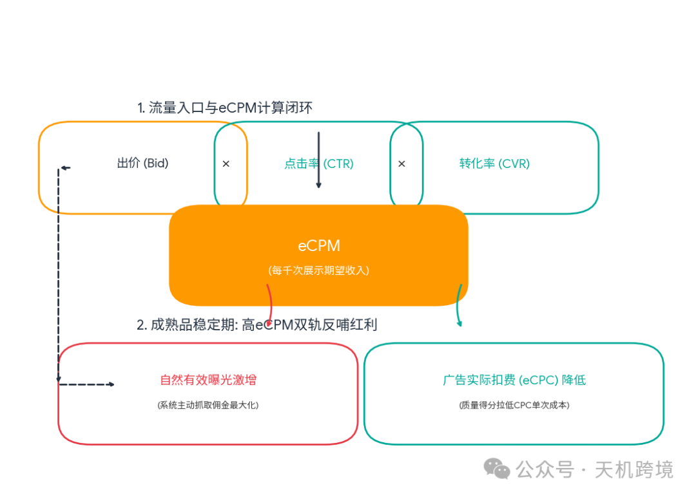

- **eCPM公式**：$$\text{eCPM} = \text{竞价 (Bid)} \times \text{点击率 (CTR)} \times \text{转化率 (CVR)} \times 1000$$
- **算法的博弈**：

- 因为您的成熟品 CTR 和 CVR 极度稳定且处于类目高位，亚马逊的算法对你的产品有**极高的胜率确定性**。
- **广告端**：由于 CTR × CVR 很高，你只需要付出比新品**更低的 eCPC（实际扣费）**，就能稳在广告前排。
- **自然端**：高 eCPM 倒逼系统不断将你推向自然位前排（系统为了赚取佣金最大化）。

- **SIF监控的本质**：SIF 算出的“有效曝光”在这一层，反映的是**你的eCPM竞争力是否在被竞品蚕食**。如果自然有效曝光下降，说明有竞品做出了更高的 CTR/CVR 或出了更高的价格，抢走了你的排名坑位。

2. ### 触角扩展（10-20%）：非主动搜索与促销型流量

当核心关键词的有效曝光见顶时，成熟品的进一步增长或防御，依赖于以下四类非关键词搜索流量：

- **A. 亚马逊推荐流量（Recommended & Associative）**

- **4 颗星以上推荐（4 stars and above）**、**相关商品推荐（Products related to this item）**。
- 这里的底层逻辑不是搜索词，而是**用户画像与行为图谱（Graph embedding）**。稳定的 CVR 让算法敢于在买家浏览同类目其他产品时，将你作为“最安全”的推荐展示出来，形成**推荐曝光**。

- **B. 类目节点流量（BrowseTree/ Taxonomy）**

- 类似 Best Seller 榜单、New Releases 榜单和类目左侧导航栏筛选。
- 这里的曝光由**近期BSR销量的绝对值**决定。销量稳定，类目节点的公域曝光就稳定。

- **C. 秒杀与促销活动（LD/BD/Coupon）**

- 促销不单单是降价，从 SIF 的流量逻辑来看，**促销是瞬间放大“有效曝光”的增压泵**。
- 亚马逊会给予 Deal 页面独立的巨量专属曝光，同时在搜索结果页给产品打上打折标签。这个标签会**瞬间拔高原本恒定的CTR和CVR**，从而在短时间内让 eCPM 飙升，洗刷并推高自然排名。

- **D. 站外流量（Off-Amazon Traffic）**

- 通过 Amazon Attribution（品牌引流奖励计划）引入的站外流量（如 Google Ads、红人营销）。
- 亚马逊目前极其欢迎站外流入的净增流量，这会给 Listing 注入额外的“权重红利”，间接反哺站内的自然曝光。

---

### 三、 沉淀到具体运营：如何利用这一深度逻辑进行操盘？

基于您提出的这个高度闭环的模型，成熟品的运营标准动作可以从“天天调广告”升维到“**监控曝光结构变动**”：

1. **设定曝光警戒线**： 通过 SIF 导出核心前 20 个大词的“有效曝光量”基准值。如果发现总销量下滑，先不要盲目改动详情页（因为 CVR 恒定），而是通过 SIF 对比**是广告曝光缩水了（可能竞品卷 bids），还是自然位曝光掉到了第二页（自然排名下滑）**。
2. **精细化控制广告挤出效应（Cannibalization）**： 如果 SIF 显示某个词的自然位已经稳居第一（自然曝光极高），而广告位也在同一屏（广告曝光也高），在 CTR/CVR 恒定的情况下，这意味着**你的广告在洗劫你原本不需要花钱的自然流量**。此时可以果断、小步幅地降低该词的广告竞价，观察总有效曝光是否发生断崖式下跌。如果没有，则成功降低了 ACOGS。
3. **用活动打破平衡**： 当关键词的“自然+广告”有效曝光在类目中已经摸到天花板（如拿到了 30% 市场份额），想要进一步打破平衡，必须靠**秒杀（LD/BD）或者拓展站外类目推荐流量**，去激活非搜索维度的曝光，以此完成老品的二次爆发。
