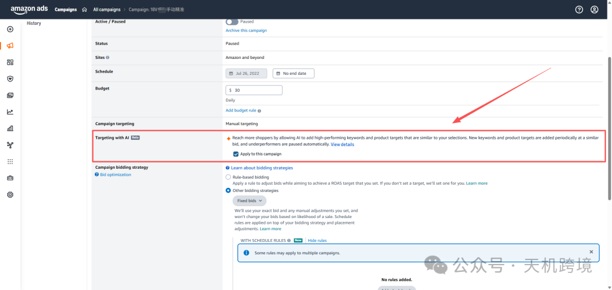
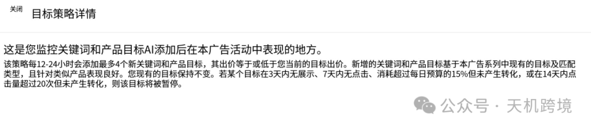
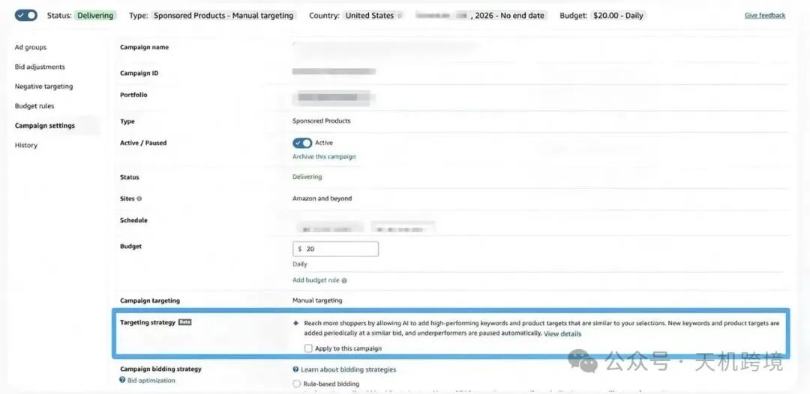
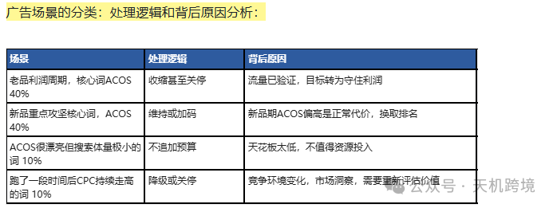
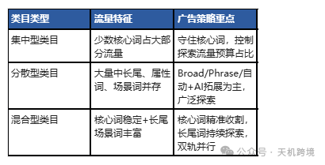
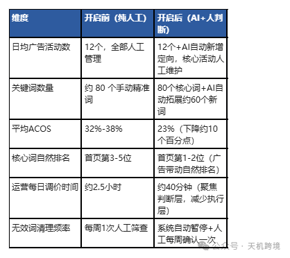

# 亚马逊广告新功能 - Targeting Strategy 深度解析

> Source: wechat
> Author: 天机跨境
> Original: https://mp.weixin.qq.com/s/vUwmTgnLMcrqrFzYRauDdA

---

---

亚马逊广告进入AI决策时代

## 亚马逊广告 Targeting Strategy（Beta）深度拆解

## 广告新功能Targeting with AI（Targeting Strategy Beat）

## 亚马逊广告进入AI决策时代：Targeting Strategy Beta来了

## 定向策略详情即(自动拓词)和(自动砍词)

现在，你可以开启该功能来监控 AI 添加的关键词和商品投放目标在应用于此广告活动后的表现。

1. 该策略每 12–24 小时添加最多 4 个新的关键词和商品ASIN投放目标，竞价等于或低于你当前的目标竞价。**(自动拓词)**
2. 新的关键词和商品投放目标基于此广告活动中现有的投放目标和匹配类型，并且在类似商品上表现良好。你现有的投放目标保持不变。**(好的保持)**
3. 如果某个目标在 3 天内没有获得曝光、在 7 天内没有点击、花费超过每日预算的 15% 但未产生转化，或在 14 天内获得 20 次以上点击但无转化，则该目标将被暂停。**(自动砍词)**

运营应该把精力放在目标设定，预算分配，流量价值判断，以及广告策略等，这些顶层决策上（以后广告不再是拼手速了，拼的是决策判断力）

从天天调Bid到做顶层判断——AI接管执行后，运营价值重新定义：通过允许 AI 添加与您所选目标相似的高表现关键词和商品投放目标，触达更多消费者。系统会定期以相近的竞价添加新的关键词和商品投放目标，并自动暂停表现不佳的目标。投词 + 否词 AI自己会进行判断

Reach more shoppers by allowing AI to add high-performing keywords and product targets that are similar to your selections. New keywords and product targets are added periodically at a similar bid, and underperformers are paused automatically.

自动清理低效投放(自动砍词)

除了自动加词，Al还会自动暂停表现不佳的投放目标。亚马逊公开了四条触发暂停的明确门槛，只要满足任意一条，系统便会即刻关停该投放：

连续3天没有产生曝光；

连续7天没有产生点击；

消耗达到活动日预算的15%依旧无订单转化；

14天内累计获得20次以上点击，但未能转化成交。

运营应该把精力放在目标设定，预算分配，流量价值判断，广告策略，顶层决策上

以往我们做广告，都是运营先定好投放策略：选哪些关键词、打哪些ASIN、设置什么匹配方式、给到多少出价。广告跑起来之后，再对照搜索词报告、广告报表，人工去加词、否词、反复调价。

而Targeting Strategy，不只是严格按照你设置好的定向去获取流量，还会根据广告运行的真实反馈，自主挖掘新的关键词、商品定向机会，同时对部分效果不佳的定向做自动处理。

目前是在广告后台，系列Campaign设置 里面，Targeting Strategy （Beta） 如图：框选

正文：

【摘要】亚马逊广告后台：Sponsored Products那悄然上线了 Targeting Strategy（Beta），AI 每隔 12-24 小时自动新增最多 4 个关键词或 ASIN 定向，同时按四条硬规则自动关停低效投放。这不是一次普通的功能更新——它意味着亚马逊开始把广告执行层面的高频决策，交给系统来完成。本文深度拆解 Targeting Strategy 的四条自动暂停阈值背后的逻辑、AI 与运营的分工边界、三个必须由人做的核心判断（目标/流量结构/产品阶段），以及预算分层管理的方法论，并给出一套「AI 接管执行层 → 运营聚焦判断层」的实战工作流，帮你提前适应这场运营角色的底层变革。

## 一、亚马逊正在把广告执行层交给 AI，这次广告正式进入AI决策时代

亚马逊 Sponsored Products 广告后台最近出现了 Targeting Strategy（Beta）功能。表面看只是一个开关按钮，背后却是亚马逊首次将广告定向的执行权，系统性地移交给 AI——不是帮你出建议，而是直接替你执行。一边帮你在找词，另一边帮你还在砍词

这个功能能做两件事：①每 12-24 小时自动为你新增最多 4 个关键词或 ASIN 定向投放（竞价不超出你预设的最高出价上限）；②同时按四条硬规则自动关停表现不佳的投放目标。这意味着：AI 不仅在「找词」，还在「砍词」，执行层的核心动作已经被系统化了。

|  |  |
| --- | --- |
| 亚马逊 Sponsored Products 后台悄然上线 Targeting Strategy（Beta），AI 每隔 12-24 小时自动新增最多 4 个关键词或 ASIN 定向，同时按四条硬规则自动关停低效投放。 | 四条自动暂停阈值（满足任意一条即刻关停）：连续3天无曝光、连续7天无点击、消耗15%日预算仍无订单转化、14天内20+点击零成交。这四条阈值，构成了 AI 理解「低效」的量化边界。 |

## 二、AI 接管执行后，运营每天调 Bid 还有意义吗？

如果 AI 已经能找词、筛词、暂停低效投放，运营每天花大量时间盯着关键词调 Bid，是否还有必要？答案是：调 Bid 本身仍有意义，但它不再等同于完整的广告优化。更重要的是理清楚广告目标，梳理广告节点场景和广告阶段，合理分配广告预算，竞品打法，以及流量价值的判断，趋势判断，核心价值，更高的广告策略层级，

出价 Bid 解决的只是一个单点问题：这一次流量，你愿意付出多少成本参与竞争。但广告最终效果，从来不是只看出价。同样 ACOS 40% 的关键词，放在不同场景下处理逻辑完全不同：

广告场景的分类：处理逻辑和背后原因分析：

所以 AI 普及之后，运营需要升级的，不是调价的手速，而是做判断的能力——这个关键词的「存在意义」是什么，该加还是该减，由谁来判断。答案是：只有运营自己能判断。

## 三、 三个核心判断，AI 无法替代运营

Targeting Strategy 可以帮我们挖掘、筛选流量，执行，但有三个核心判断，AI 无法替代运营——因为它们不是数据问题，而是经营决策问题。

判断一：你的投放目标是什么（利润 / 增长 / 排名） 广告目的是什么，它要实现什么目标

同样是 ACOS 40%，放在不同目标下，处理逻辑完全不一样。追求利润，就要看重稳定性与投产效率；做增长，可以接受部分新流量短期投产偏高；冲排名，则要判断哪些核心词值得持续投入、换自然排名。AI 不知道你的产品此刻最需要什么——这需要人来定方向。这个是根据你的广告目的来做的，是为了什么，利润，增长，还是抢排名

|  |  |
| --- | --- |
| 广告目标： | 原则：不能单纯盯着 ACOS 数字，先想清楚这笔预算，是为了利润、增长，还是抢占排名。目标没定清楚，调价就是盲目的。 |

判断二：你的类目流量结构是怎样的，是集中还是分散，还是混合，需要因地制宜，具体问题具体分析

①有些类目流量高度集中，少数核心词就占据绝大部分流量——这类类目重点是守住核心词，避免预算被低价值流量分散；大词决定大部分的流量入口，需要牢牢守住，实时监测，另外有预算的 余地下看看长尾词出单词，还有蓝海词小众词，去做维稳， 低价捡漏

②有些类目流量很分散，大量中长尾、属性词、场景词并存——这类类目 Broad、Phrase、自动广告以及 AI 拓展新 Target 的价值会更大。

核心问题是：这个类目，更适合探索新流量，还是优先管控流量质量。判断流量的价值和趋势

③混合型，需要核心词稳定，牢牢把握+长尾场景词替补，精准收割，维稳，还有小词 蓝海词巩固，双管齐下

|  |  |  |
| --- | --- | --- |
| 类目类型 | 流量特征 | 广告策略重点 |
| 集中型类目 | 少数核心词占大部分流量 | 守住核心词，控制探索流量预算占比 |
| 分散型类目 | 大量中长尾、属性词、场景词并存 | Broad/Phrase/自动+AI拓展为主，广泛探索 |
| 混合型类目 | 核心词稳定+长尾场景词丰富 | 核心词精准收割，长尾词持续探索，双轨并行 |

判断三：你的产品现在处于哪个阶段

产品阶段变了，广告结构和预算分配就要跟着调整— —不能一直靠反复调 Bid 去修补旧的广告结构。三阶段的流量目标截然不同：

1.新品期（验证流量）：核心目标是让系统识别这是一个值得推荐的商品。重点不是 ACOS，而是让系统积累足够的点击和转化数据。AI 找词、运营验证，互相配合跑出基础搜索词库

2.成长期（放大有效流量）：核心流量已经跑通，重点是把有效流量持续放大。将已经验证的词逐步升级单独管理，配合 Targeting Strategy 自动拓展更多关联词

3.成熟期（稳定利润）：核心目标是维持订单稳定和利润效率。AI 自动清理低效流量，减少人工维护成本；运营聚焦高价值词的竞价管理

## 四、AI 越会挖流量，越要做好预算管理和流量迁移

系统可以发掘出大量新关键词、新定向，但你的总预算不会随之增加。如果不去区分核心流量和探索流量，很容易出现：新流量不断消耗预算，而原本稳定出单的核心流量，反而拿不到足够资源。预算必须划清边界——三类任务，三份预算，互不侵占。

①核心流量，垄断型，守住基本盘 维稳

②增长流量，巩固/攻击型，持续放大，把流量疆土扩大

③探测型， 捡漏型，有试错，有亏损

|  |  |  |
| --- | --- | --- |
| 预算类型 | 任务 | 可接受的ACOS容忍度 |
| 核心流量预算 | 守住基本盘，稳定出单词的持续投放 | 可接受高于目标ACOS 10-20%，换取排名稳定 |
| 增长流量预算 | 放大已验证有效、仍有增长空间的词 | 接近目标ACOS，监控转化趋势及时调整 |
| 探索流量预算 | Broad/Phrase/自动广告及AI新定向试错 | 可接受较大亏损，目标是发现下一个核心词 |

运营要关注的不只是单个词的出价，更要看流量的迁移变化——这是 AI 无法替你做的判断。新搜索词经过测试能稳定转化，就逐步加大预算，单独做定向管理；曾经表现不错的核心词如果 CPC 持续走高、转化持续下滑，就要及时降级或关停。拓词、否词、调价，本质都是围绕这套逻辑：发现流量 → 验证流量 → 放大有效流量 → 淘汰低效流量。系统越「勤快」，人的判断力越要更清醒。

|  |  |
| --- | --- |
| 拓词、否词、调价，本质都是围绕这套逻辑：发现流量 → 验证流量 → 放大有效流量 → 淘汰低效流量。系统越「勤快」，人的判断力越要更清醒。 | AI 可以提升执行效率，但预算怎么分配、哪些流量值得继续放大，终究需要运营做判断。系统越「勤快」，人的判断力越要更清醒。 |

|  |  |
| --- | --- |
|  | Targeting Strategy 真正的意义，是亚马逊把越来越多广告执行工作交给系统。AI 越深入执行层面，运营就越要把精力聚焦在目标设定、预算分配、流量价值判断这些顶层决策上。调 Bid 依旧有它的价值，但它不再等同于完整的广告管理。AI 时代，运营拼的早已不是手速，而是顶层的经营判断力。提前建立这套「AI 执行 + 运营判断」的工作模式，才能在亚马逊广告进入 AI 决策时代的浪潮中，真正站稳脚跟。 |

运营应该把精力放在目标设定，预算分配，流量价值判断，广告策略，顶层决策上

亚马逊广告策略AI新功能 -Targeting with AI  亚马逊广告策略AI新功能 -Targeting with AI

Amazon 正在尝试让系统参与 Targeting 的动态管理。

这个功能能帮助我们做什么呢？

https://tianjikuajing.feishu.cn/wiki/LZxqw6lTiiZ6YTkwUSScYeCBnid?from=from\_copylink

智能拓展投放目标(自动拓词)
