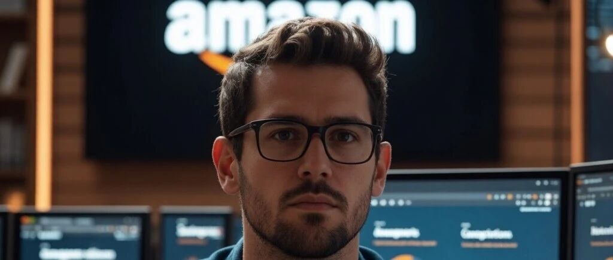
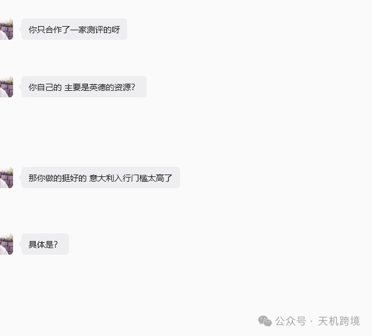
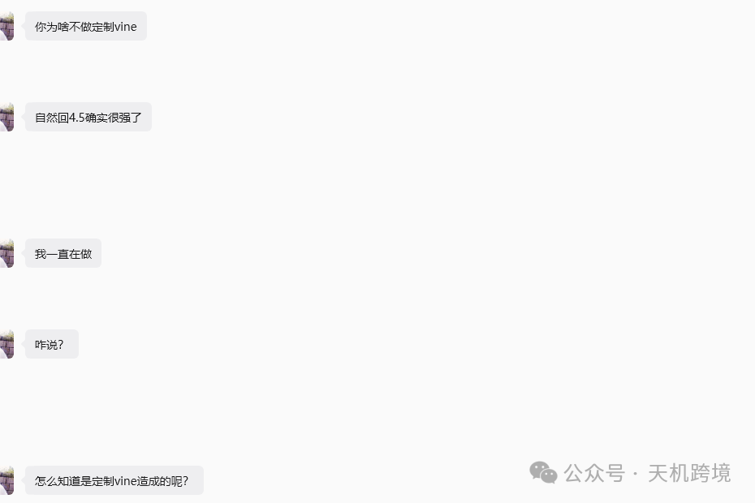
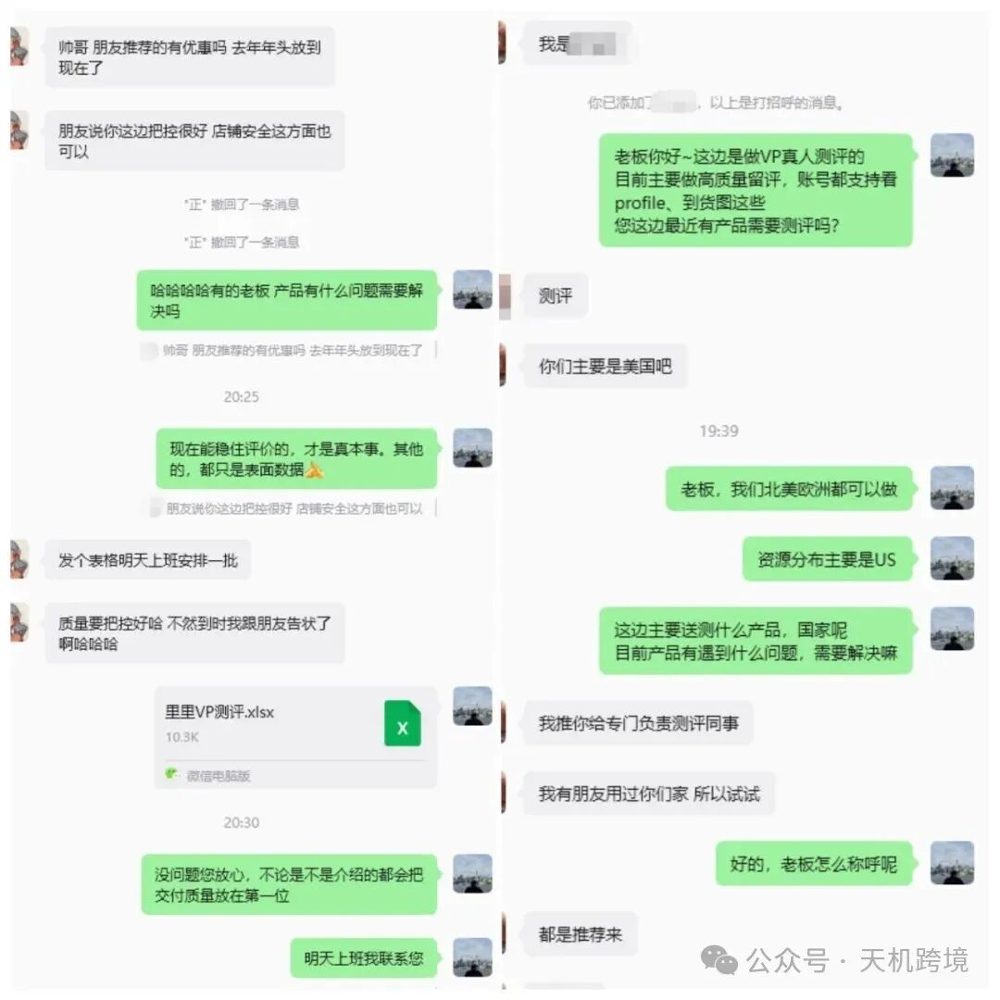
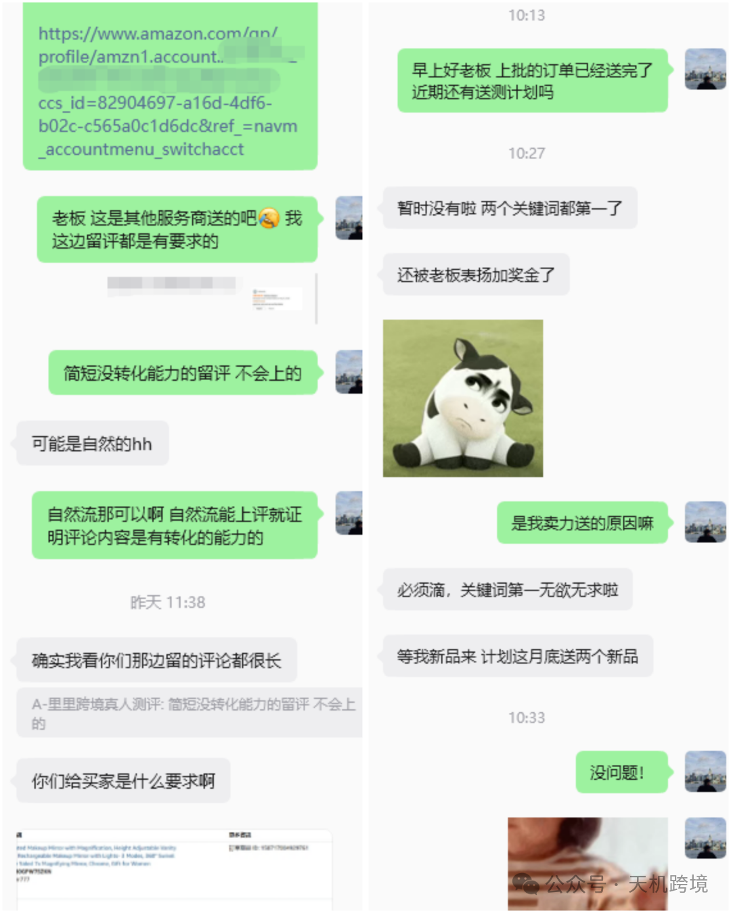
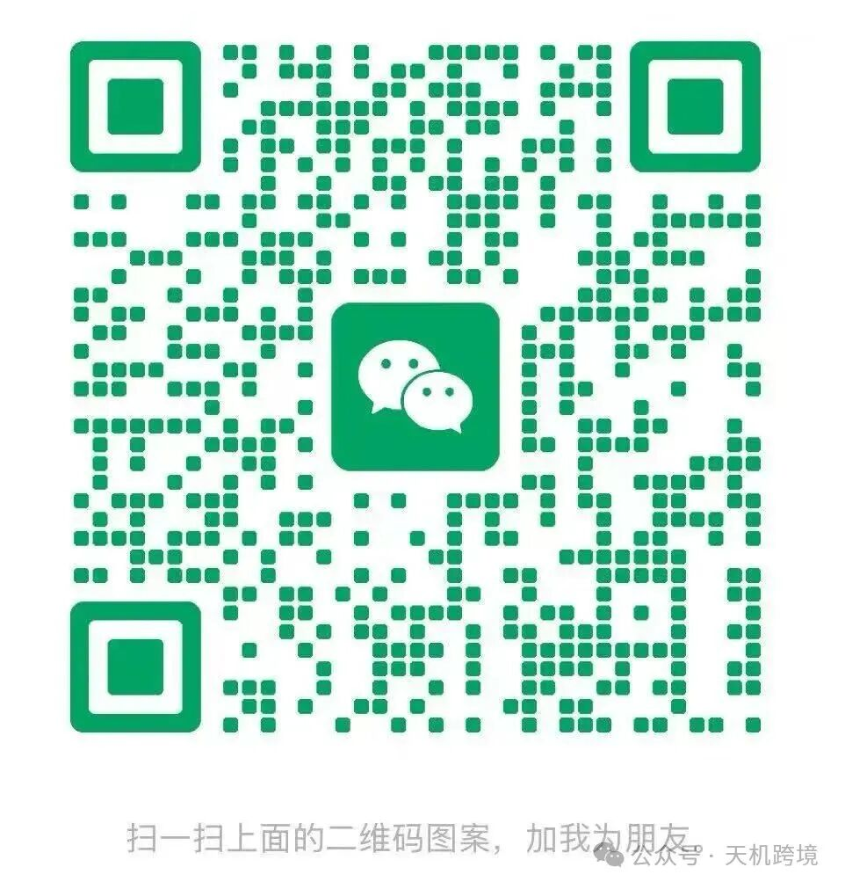
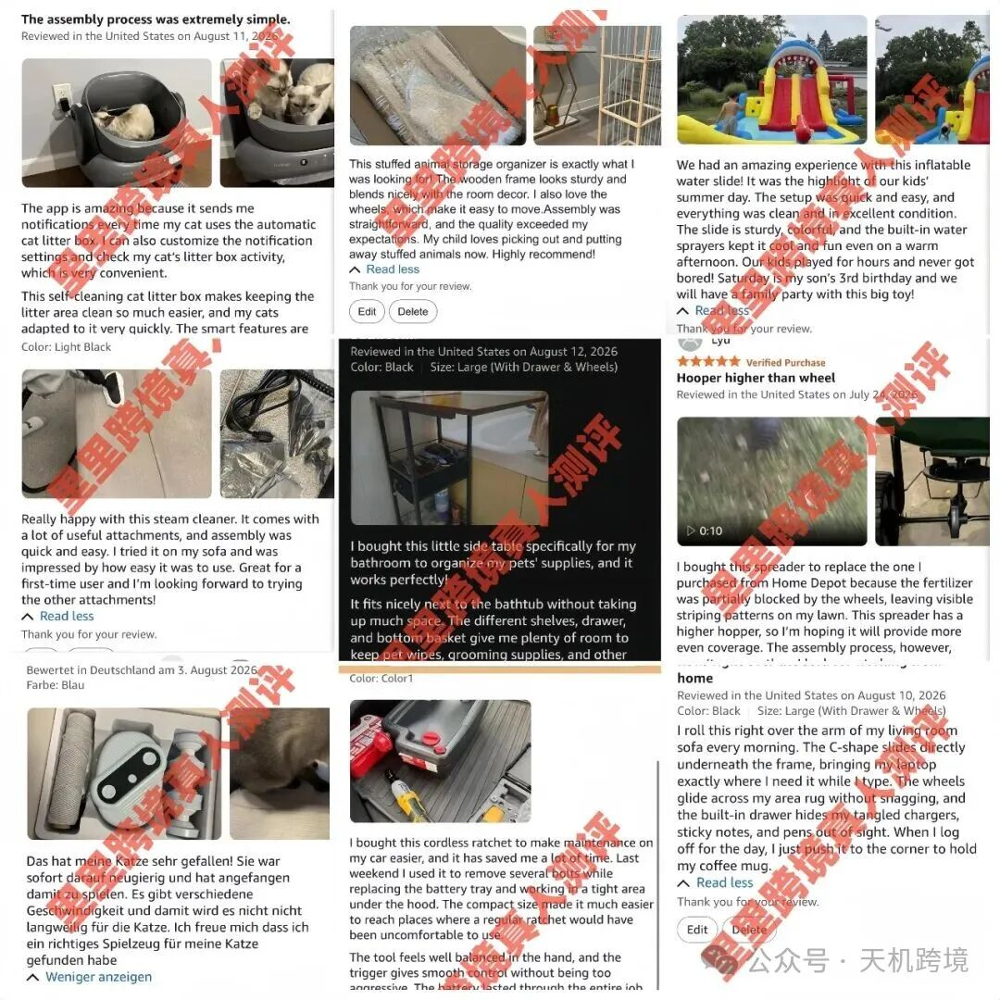
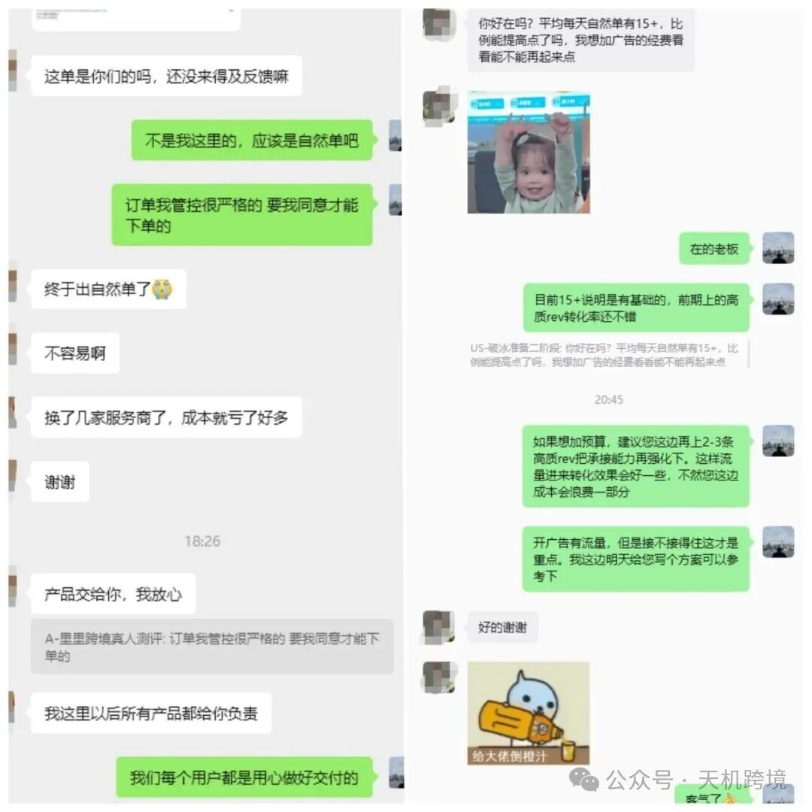

# 如何做亚马逊新品评论，关于新品推广资源分享

> Source: wechat
> Author: 天机跨境
> Original: https://mp.weixin.qq.com/s/u7AFhwBEDJao5sa_zmk9fA

---

---

关于新品推广的一些思路，想法和资源分享！

在跨境电商越来越卷的今天，测评这件事已经变了。以前是“谁做谁起量”，现在是——**做错方式，反而容易出问题。**

**所以你会看到两种结果：**

有的人越做越稳

有的人一试就被打回原形

差别，其实就在资源本身。

**PART1你用的服务商，真的懂现在的测评吗？**

如果你现在还敢随便做测评，那你其实是在赌。不是吓你，是现在这个环境真的变了。

前段时间有个做家具类的新品链接商家跟我聊说为什么转化一直不高？明明产品好，价值高但就是没办法转化。广告费用也花了不少后面我给他推荐了这个服务商。前几天又来找我说：这波效果确实可以，转化明显提升了，广告也没那么烧了。

据我了解就调整了两点。

1.补了一批更高质量、更自然的评价——不是堆数量，而是做真实感

2.放缓节奏，避免集中操作，让数据看起来更“像正常增长

如果你现在也正好在这个阶段——评论有但不稳定、想放量但不敢、有资源但心里没底，可以聊聊，我可以帮你看一下你现在的问题是出在资源还是方式，不一定要合作，但至少别再走弯路。（**结尾为各位大麦准备了小惊喜**）

**在这里推荐一个我以前用的过测评服务商，我只能说，当时做过很多次测评，他们的服务和专业度都很好。**

🔍备注：类目+客单价+当前问题，优先回复

**测评服务扫码找他 ↑ ↑ ↑**

**PART2牢记！！靠谱测评的四个特征**

多年观察下来，现在真正能稳定的测评，基本都符合这4点：

**其一，看账号，而不是听承诺**现在还在说“真人账号”，但连profile都不给看的，基本不用考虑。靠谱的资源一定是：账号可验证、有真实行为记录。而不是靠一句“我们是真人”来证明。

**其二，看行为路径，而不是只看结果**。正规服务商通常会要求了解产品细节、产品价值，毕竟他们用的是真人客户，很多人只看“有没有留评” 但现在更重要的是：这个评是怎么来的 。正常用户会有：搜索 → 浏览 → 对比 → 下单 → 使用 → 留评。而不是“直接下单+快速评论”。

**其三，看内容质量，而不是数量**。真现在最容易出问题的，就是模板评论。统一结构、统一表达，一眼就能被识别。

真正稳定的测评：内容有细节、有差异、有个人表达。一条真实的评论，胜过十条模板评论。

**其四，看节奏控制，而不是拼速度**。一上来就铺量、集中下单，风险是最大的。

现在更稳的方式是：小量测试 → 看效果 → 再放量。节奏可控，才是长期稳定的核心。

⚡**总结一句话**

👉**靠谱的服务商，不是说得多，而是每一步都经得起验证。**

说实话，想找到靠谱的测评渠道并不容易，但也不是没有办法：

**首先建议通过实体跨境商会寻找**。很多城市都有正规的跨境电商协会，在这些平台上找到的服务商相对更靠谱。

**其次是通过老卖家介绍**。跨境圈子就这么大，如果一个服务商能被多个老卖家认可，那基本上不会有大问题。我自己就是通过深圳一个做了8年的老卖家，认识了现在合作的测评团队。

**再次是可以从小单量开始测试**。别一上来就投很多钱，先投3-5单看看效果。记得我同事小陈就是这样，先试了2单，确认靠谱后才加大投入。

**测评服务扫码找他 ↑ ↑ ↑**

正因为现在市场越不确定，测评越要做对。说白了，不是找人做就行，而是你用的资源，能不能扛得住现在的风控。深知每个卖家都渴望自己的商品能在亚马逊这个全球最大的电商平台上脱颖而出，赢得买家的信任和喜爱。

在亚马逊美国US、德国DE、加拿大CA和英国GB等主要市场中，真人测评依然是转化关键的力量。他们的真人测评服务，正是为了助您一臂之力，推动您的销售业绩不断攀升。

**他们的真人测评服务包括但不限于**

真实的评价：他们提供真人测评，确保每个评价都是真实且具有说服力的。每一单都能提供到货图和视频验证，为您的产品赢得买家的信赖。

完整的审核支持：从profile审核到其他验证服务，全面支持，让卖家可以按需检查，完全无需担忧。

**（真实服务案例展示）**

严格按要求执行：他们严格按照客户的要求下单，真人下单货比三家，关键词搜索，按时下单，确保每一步都符合您的期望。

资源丰富：无论是留评单还是免评单，他们都能大量接单，资源丰富，满足您不同的需求。

不讲虚的，只做结果。无论新店冷启动还是老店冲排名，都能提供稳定有效的支持。支持试单，看效果再谈长期合作。**想要了解更多详情，欢迎联系，扫描下方二维码添加！**

我一直觉得，合作不只是安排单子。能多帮商家解决一点问题，就多做一点

这样可以让卖家**少走点弯路**。

添加二维码即可领取。

🔍备注：类目+客单价+当前问题，优先回复

